# 0149 audio core: system architecture (M1)

The architect's design for ADR 0149 (Accepted, revision 2). It was revised after round 2 under the coordinator's rulings, and the owner approved it in round 3 with these choices:
- Babylon's AudioEngineV2 is the fallback backend, replacing Howler. It's chosen automatically when the core can't load, and kept after M1.
- M1 includes a port of Chromium's HRTF panner, gated on its data licence.
- Web Audio's DSP is ported from Chromium, and microfft is the FFT. Its companion, `api-and-models.md` (the senior engineer's, cited as **[API §n]**), owns the public API, settings, data models, byte layouts, the Rust ABI, the file layout, the tests and the tasks. This file owns components, lifecycles, interactions, timing, memory, performance, failure handling, observability and platforms. It covers M1 in detail, and later milestones only where they plug in.

Numbers cite `spikes/audio-worklet/` (one Ryzen AI Max+ 395 core, 2026-11-09, mostly single runs): `README` is the top-level README, and `messaging/`, `decode/`, `spatial/` and `bookkeeping/` are the sub-READMEs. **(est.)** marks a number that wasn't measured. A quantum is 128 frames (2.667 ms at 48 kHz), and a frame is one sample frame at the context rate.

## 1. Overview

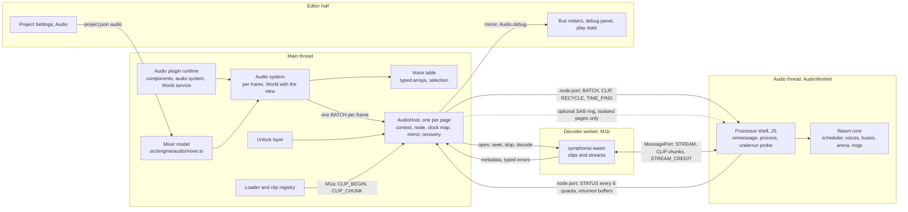

| Component | Thread | Owns | Does |
|---|---|---|---|
| Audio plugin runtime | main | registration | Registers the components, the audio system and a `myco.audio` World service. The service's `load` dynamic-imports the host at scene load, before the first presented frame; its `runs` is false on servers and in headless Worlds, which therefore never fetch the core |
| Audio system (built-in, `lateUpdate`) | main | per-frame intent | Listener pose, attenuation, direction, audibility, selection, `mixer.update(dt)`, mirror apply, batch write and flush |
| Voice table [API §3] | main | **intent**: clip, parameters, priority, owner World, `startFrame`; virtual-voice selection | The source for replay after a rebuild |
| Mixer model | main | bus volumes, solo, snapshots, ducking (0097, unchanged) | `CoreBackend` calls `voiceStarted`/`voiceEnded` on play, free and `setBus`. Every live voice counts toward ducking, including virtual and paused ones, as today |
| AudioHost | main, page singleton | context, node, ports, clock map, mirror, buffer pools, recovery, background policy | Shared by the editor's Engine and play mode's, and lives for the page |
| Unlock layer | main | gesture listeners, the pre-unlock queue | Arms when locked, resumes the context inside the gesture, disarms; re-arms when a resume needs a gesture |
| Loader and clip registry [API §3] | main | clip state, refcounts, ceiling accounting, **encoded bytes for rebuilds** | M1a: fetch, `decodeAudioData`, int16 conversion, paced chunks. M1b: asks the worker |
| Processor shell | audio | message intake, copy budget, underrun probe, trap catch | Copies into wasm memory, calls `process`, posts STATUS |
| Wasm core | audio | **playheads, voice lifetime, buses, effects, the clock, the clip arena, the HRIR set, stream rings** | Renders one quantum per call; applies records; reports ends. Never allocates or grows memory in `process()`. Per voice: resample → distance/cone gain → filter → gain ramp → **panner (equal-power or HRTF)** → bus |
| Decoder worker (M1b) | worker | decoders, stream cursors | Decodes clips (whole) and streams (4096-frame chunks), pulled by credits |
| Editor half | main | settings UI | Settings section, meters, debug panel, underrun play stat; reads the mirror |
| Fallback backend (`audio.backend: "babylon"`, and automatic when the core can't load) | main | Babylon AudioEngineV2 objects behind 0098 | Plays through Babylon's static and streaming sounds, `AudioBus` tree and `PannerNode`, on the **host's** `AudioContext`. It has no effect nodes, so 0097's effects aren't applied (documented). Internal; never public (0010). Howler is deleted when it lands |

| Channel | Direction | Carries | Rate | Mode |
|---|---|---|---|---|
| `node.port` | main → worklet | BATCH, CLIP_* (M1a), TIME_PING, RECYCLE | 1 batch per frame; clips credit-paced | transferred buffers from pools |
| `node.port` | worklet → main | STATUS plus returned BATCH and CLIP buffers | every 6 quanta; every 48 after 250 ms without a batch | transferred |
| Worker `postMessage` | main ↔ worker | open, seek, stop, decode; metadata; typed errors | events | clone (small) |
| `MessageChannel` port | worker ↔ worklet | STREAM_*, worker-sourced CLIP_*; STREAM_CREDIT and returned buffers back | ~11 chunks/s per stream | transferred, `epoch`-tagged |
| SAB ring (optional) | main → worklet | the same BATCH bytes | 1 per frame | SPSC with `Atomics`, drained at each `process()` start |

Main is never on a stream's PCM path. Relaying through main lost 23–83 quanta under jank, and the direct port lost none (`messaging/` §5). The Babylon fallback uses none of these channels: it is plain Web Audio on the main thread.

**DSP sources.** These are ports, so their notices are kept in the file headers and in `THIRD_PARTY_NOTICES.md`.

| Part | Source | Why |
|---|---|---|
| Biquad (lowpass, highpass), dynamics compressor | ported from Chromium's Web Audio (BSD) | exact parity with today's 0097 effects, including Q in dB and the compressor's makeup gain and 6 ms pre-delay |
| Reverb convolver | Chromium's staged non-uniform `ReverbConvolver` design (BSD) | Chromium runs its tail stages on a background thread; the core runs them inline instead, spread over quanta (§6.1) |
| Equal-power panner, distance and cone effects | Chromium (BSD) | today's 0074 sound |
| HRTF panner and database logic | Chromium's `HRTFPanner`/`HRTFDatabase` (BSD), Composite HRIR data **behind a licence gate** (§11) | today's Web Audio HRTF sound |
| FFT | microfft (MIT): 256- and 4,096-point real FFTs and the 4,096-point complex inverse, 14 KB of wasm (built and measured by the coordinator) | the convolver and HRTF |
| Designs borrowed, no code | Kira (clocks, tweens), Firewheel (main-side context and audio-side processor split), SoLoud (virtual voices) | |

## 2. Lifecycles

### 2.1 Context and core

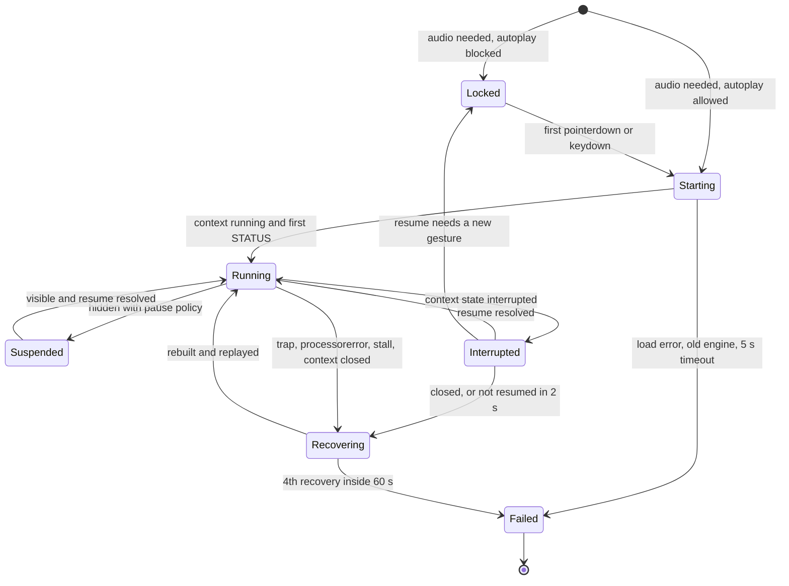

The core loads **while Locked**, into a suspended context, so the gesture only calls `resume()`. A0.6 must confirm that WebKit and Firefox accept `addModule` and node creation on a suspended context; the coded fallback is to create the context inside the gesture. `Audio.status` maps Locked and Starting to `"locked"`, Failed to `"failed"`, and the rest to `"running"`. If the core can't load, the host switches to the Babylon backend automatically, with one warning. A core that loaded but exhausts its recoveries stays silent with `"failed"`. `audio.backend` is a setting, `"babylon"` or `"core"`; Fallback rule (coordinator): an engine that can't load the core (no AudioWorklet or `simd128`, fetch or compile failure, ABI mismatch, no first STATUS in 5 s) switches to the Babylon backend **automatically at load**, with one warning. A core that loaded and then traps more than 3 times in 60 s goes **silent** (`"failed"`), with no switch mid-session. The Babylon backend stays after M1 as this permanent fallback, so older engines still get basic sound. With `"babylon"`, the host still creates the context and runs the unlock layer, and Babylon's engine is handed that context (§9). This lifecycle is then context-only, with no core states.

### 2.2 Voice

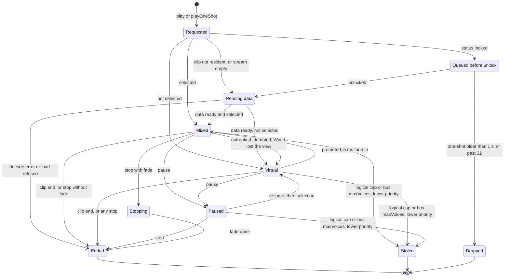

| State | Decided by | Lives in |
|---|---|---|
| Requested, Queued, Dropped, Stolen | main | voice table. Queued applies the 32 and 1 s rule to one-shots only; `AudioSource`-owned and looping voices wait without a timeout ([API §10] issue 4) |
| Pending, clip | main (registry) | voice table; nothing is sent until the clip is resident |
| Pending, stream (M1b) | core | core slot; the first chunk starts it |
| Mixed, Virtual | main selects; the core may demote (§6.3) | both; the core owns the playhead in both |
| Paused | main | both; the playhead holds |
| Stopping, Ended | the core ends the voice; main learns through STATUS | core, then mirror |

Virtual voices keep time in the core: +0.03 ms for 4,096 logical with 256 mixed (`README`). Promotion and demotion use a 5 ms fade, and promotion resets filter state.

**Behaviour change (0074):** when a World loses the view, its voices go virtual (in time, silent). Today they keep sounding, because only the start is gated (`AudioSource.ts:72`). A World that's torn down stops its voices.

### 2.3 Stream (M1b)

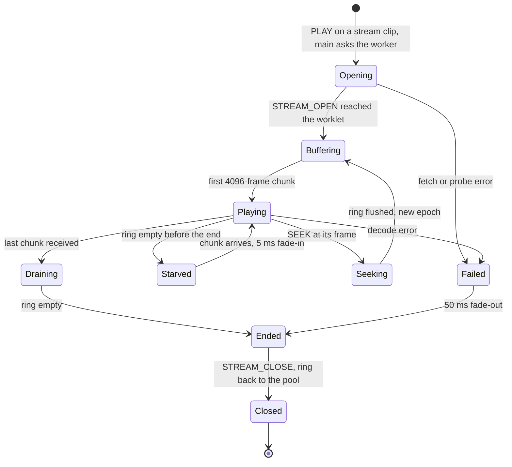

Loops never leave Playing: the worker wraps to `loopStart` (gapless trimming on), so the ring sees one continuous signal. A starved stream holds its position.

### 2.4 Panner kind and HRTF (M1)

| Aspect | Design |
|---|---|
| Pipeline place | the last per-voice stage before the bus: a per-slot **panner kind**, 0 equal-power or 1 HRTF (2–3 reserved for M3's ambisonic bed). Both use the voice's listener-space direction (C5) |
| Who gets HRTF | with `audio.spatial: "hrtf"`, selection ranks the mixed spatial voices by audibility and gives HRTF to the top *N* (`audio.voices.hrtf`: 16 by default and high, 4 low, 0 = none), with the same 1.2× hysteresis as mixing. All other spatial voices use equal-power; non-spatial voices use none |
| Kind change | the core runs both panners and crossfades over 45 ms, as long as Chromium's kernel crossfade, then drops the old one |
| Algorithm | Chromium's: azimuth and elevation interpolation over the database, per-ear frame delays (interaural time difference) through small delay lines, and two kernel sets crossfaded over ~45 ms when the direction changes enough to switch kernel. Chromium convolves a 256-sample IR with FFT size 512 in 256-frame blocks. The core uses **uniform 128-frame partitions with microfft's 256-point FFT** instead (two partitions per IR), so the work is flat per quantum, matching the spike's measured case. The output is the same convolution to float rounding, not bit-identical to Chromium |
| Kernels | computed on demand per voice: one FFT per partition and ear on a kernel switch, into the slot's two kernel sets. At most 4 kernel computations per quantum; further switches wait a quantum, masked by the crossfade |
| HRIR data | ~1.5 MB as f32 PCM at 44.1 kHz. Resampled to the context rate and converted to **int16 (~0.75 MB)** on the loader (M1a) or the worker (M1b), then uploaded as a data blob through the clip path into the arena, outside the clip ceiling. int16 is ample for kernels: −96 dB quantisation, under the IRs' own noise floor |
| When it loads | lazily: the first time a spatial voice is selected for HRTF. Until the blob is resident, those voices use equal-power, then crossfade to HRTF. `"equalPower"` never fetches it. A rebuild re-uploads it with the clips |
| Licence gate | the Composite set (derived from IRCAM Listen) ships only once its licence is cleared. Otherwise, use SADIE II (Apache-2.0) resampled onto the same grid with the same code, or set `"equalPower"` as the default |

## 3. Interactions

### 3.1 Start-up and unlock

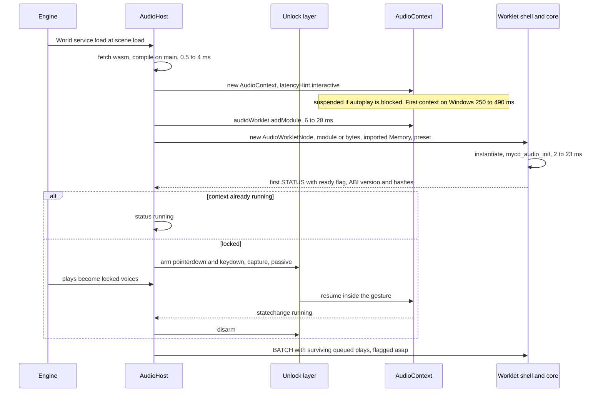

Desktop webviews relax the autoplay policy (§9), so Tauri builds normally start in Running.

### 3.2 playOneShot to voice end and the mirror

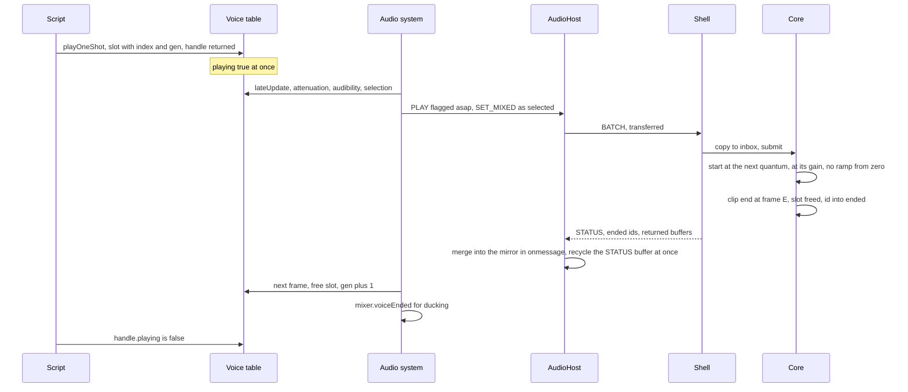

### 3.3 A frame's batch: asap and stamped records

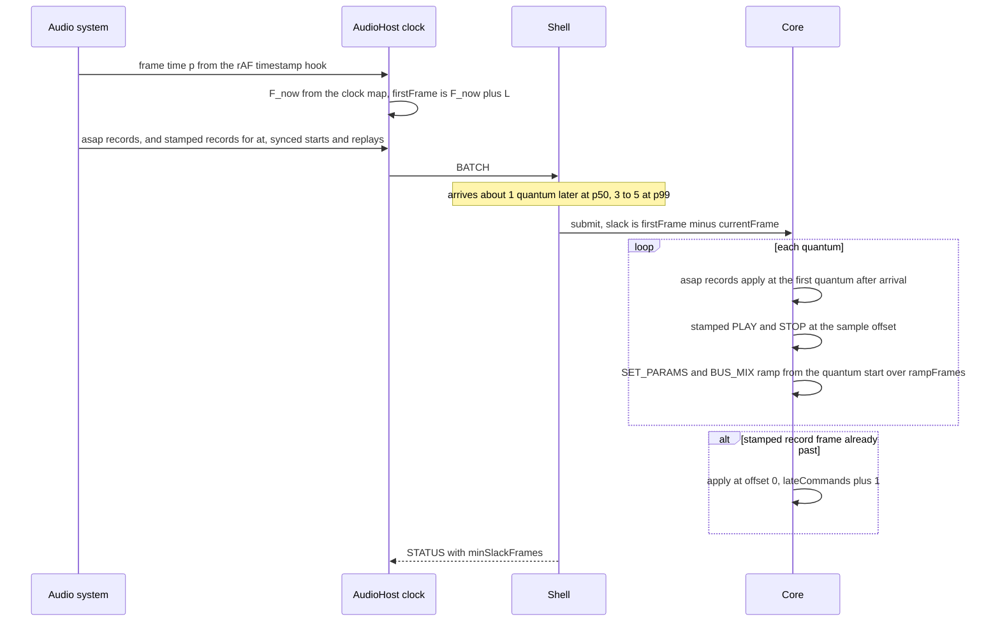

### 3.4 Streaming (M1b)

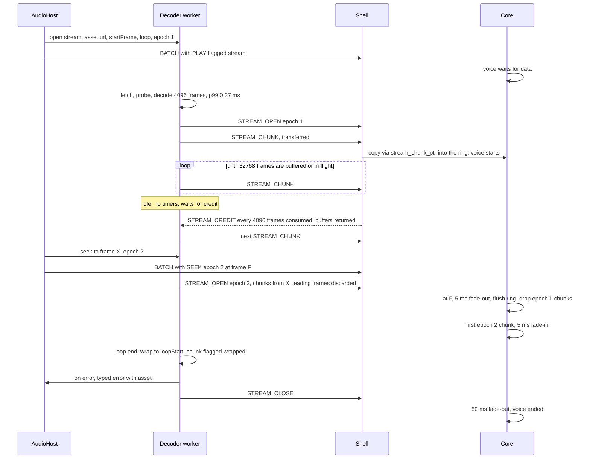

The worker keeps `buffered + inFlight ≤ 32,768` frames (0.68 s), which survived a 300 ms decoder stall (`messaging/` §5). Chunk buffers circulate, so neither side allocates per chunk.

### 3.5 Clip load into the arena

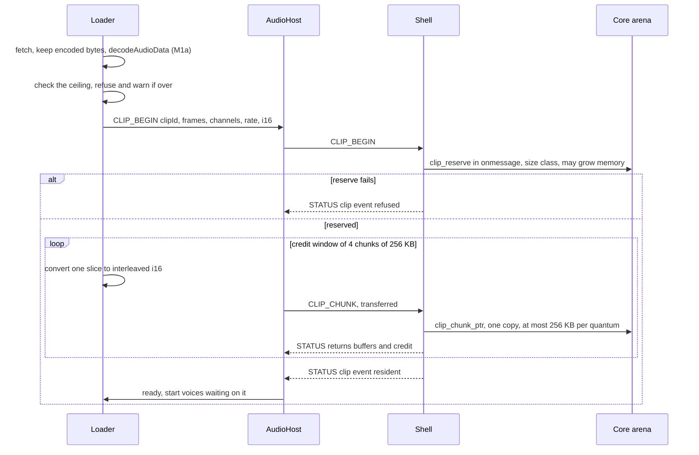

About 64 MB/s, so the 64 MB benchmark set uploads in about 1 s. In M1b the worker decodes and sends the chunks to the shell itself; main sees only metadata. An MP3 without a Xing header has no known length, so the worker decodes it fully before CLIP_BEGIN [API §4].

### 3.6 Trap recovery: the hard rebuild

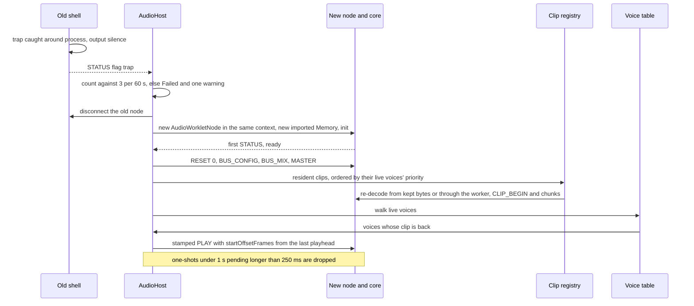

A `processorerror` (a failure outside the trap catch) takes the same path.

### 3.7 Device change, sample-rate change, interruption

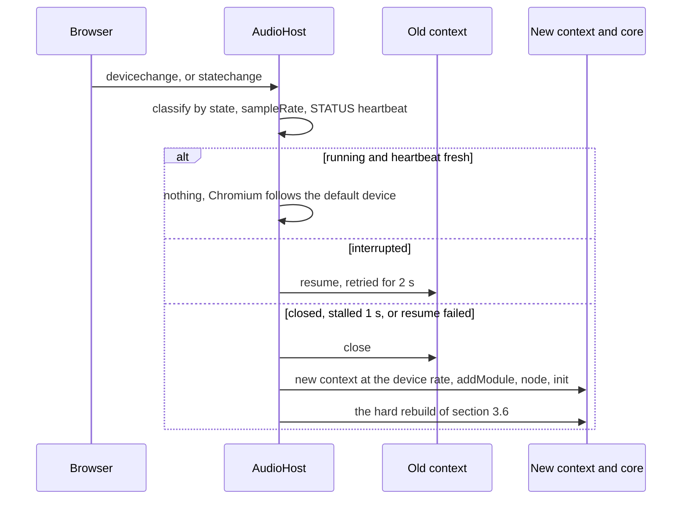

Each clip keeps its own rate, and the voice resampler absorbs a new context rate, so a rate change alone forces no re-decode beyond the rebuild's.

### 3.8 Tab hidden and visible

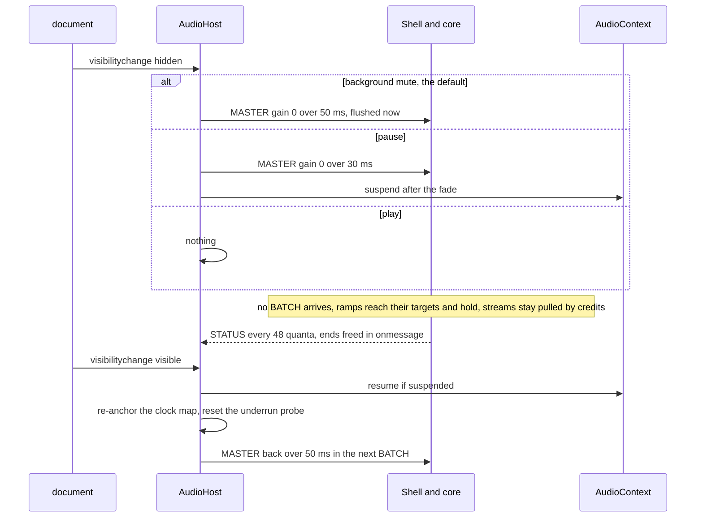

### 3.9 Editor play and stop; several Worlds on one context

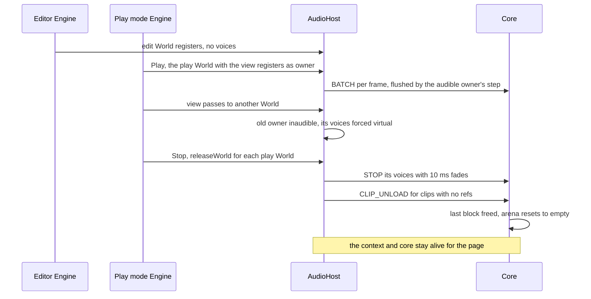

Worlds exist only on main (the voice table's `owner`); the core has no namespaces. Other owners' records ride the next flush. When no Engine steps, the host flushes on a 50 ms `setTimeout`. `Engine.ts:176` reconfigures the one mixer for both Engines. BUS_CONFIG with live voices remaps each voice's bus by name, and unknown names go to the root [API §3]. That's a listed improvement over today, where playing sounds keep their old routing.

## 4. Threading and timing

### 4.1 State ownership

| State | Owner (writes) | Copy elsewhere |
|---|---|---|
| Voice intent | main (voice table) | PLAY, SET_PARAMS |
| Mixed or virtual choice | main; the core only demotes | demotions mirrored |
| Playhead, lifetime, ramps, filter state | core | playheads mirrored when requested |
| Bus tree and parameters | main (mixer) | BUS_CONFIG, BUS_MIX |
| Bus DSP state, meters | core | peaks in STATUS |
| Audio clock | core (`currentFrame`) | `Audio.time` through the clock map |
| Clip PCM | core arena | encoded bytes on main (M1a), the worker's cache (M1b) |
| Stream cursor | worker | positions in chunk headers |
| Context state, recovery count | host | `Audio.status` |

One owner per row. The one shared case, mixed versus virtual, is resolved by direction: the core can only demote, and main honours `mixedCap` so it never re-promotes against the core.

### 4.2 Staleness bounds

| Value | Normal bound | Under a main-thread stall of *s* |
|---|---|---|
| `playing` and `reason` after a natural end | ≤ 1 frame + 16 ms + ~1 ms transfer | *s* |
| `playing` after `play()` or `stop()` | 0 (main writes it) | 0 |
| Playheads, peaks, counters | ≤ 16 ms + 1 frame | *s* |
| Heard vs rendered | the mirror describes the render clock; the speaker lags it by Λ (~50 ms, `README`) | — |
| An asap command's effect | next quantum after arrival: 1 quantum p50, 3–5 p99 | *s* |
| A stamped command's effect | its frame, if it arrives within L | late by *s* − L |

### 4.3 Clock map, lookahead and ramps

Inputs come through a `HostClock` (§4.6). Per frame, *p* is the frame's rAF time.

| Symbol | Definition |
|---|---|
| *H*(*p*) | heard frame = *sr*·(*T* + (*p* − *P*)/1000), with (*T*, *P*) from `getOutputTimestamp()` |
| *o* | offset filter: *o* ← *o* + 0.1·(*o*_obs − *o*), where *o*_obs = *H*(*p*) − *p*·*sr*/1000. Reject a sample more than 5 ms off; after 10 rejections in a row, re-anchor |
| Λ | render lead, an upper envelope of λ_obs = `currentTime`·*sr* − *H*(*p*): attack at once, release 1% per frame |
| *F*_now | *p*·*sr*/1000 + *o* + Λ |
| `Audio.time` | (*p*·*sr*/1000 + *o*)/*sr*, the heard clock [API §1]. Frame *f* is heard when `Audio.time` = *f*/*sr* |
| L | clamp(2·Δ̄, 1,024 frames (8 quanta), 100 ms); Δ̄ is an EMA (0.1) of frame intervals |
| `firstFrame` | max(round(*F*_now + L), the previous batch's `firstFrame`) |
| `rampFrames` | round(clamp(Δ̄, 5 ms, 50 ms)·*sr*), for SET_PARAMS and BUS_MIX. PLAY starts at its gain |

Fallback before Running, or where `getOutputTimestamp` is missing: *F*_now = the newest STATUS `currentFrame` + (`Date.now()` − `dateMs`)·*sr*/1000 + 512.

**Which records are stamped.** Un-timestamped sounds carry the `asap` flag [API §4.2]. They apply at the first quantum after arrival and are never counted late. Expected latency is Λ + 1–5 quanta ≈ 53–63 ms. Only `at` records, starts that must line up (loop restarts kept in sync, M4 music) and replays are stamped at `firstFrame` + offset. L's floor exists because Chromium renders 3–4 quanta per ~10 ms callback and postMessage's tail is 3–5 quanta (`messaging/` §2–4); without it, two frames at 144 Hz (13.9 ms) would make stamped records late.

### 4.4 Late commands

A stamped record whose frame is before the current quantum applies at offset 0, and `lateCommands` and max lateness are counted. PLAY starts from its start (or `startOffsetFrames`), not skipped ahead, since a clipped transient sounds worse than a late one. M4 can add a "sync" flag that skips ahead.

### 4.5 When frames stop

Batches stop. Ramps finish within ≤ 50 ms and hold. Voices play on (`mute`, `play`) or freeze (`pause`). Streams stay credit-pulled. STATUS slows to every 48 quanta and is merged in the host's `onmessage`, and its buffer is recycled at once (otherwise the worklet's pool runs dry). On return, 0011 clamps the first `dt`, the clock map re-anchors, and `firstFrame` jumps forward, still monotonic.

### 4.6 Testability: `HostClock` and the loopback

| Seam | Contract |
|---|---|
| `HostClock` (main) | `rafTime()`, `outputTimestamp()` (contextTime and performanceTime, or null), `currentTime()`, `dateNow()`, injected into the host. Production wraps the browser; tests use a fake that advances explicitly |
| Shell logic | `coreDriver` [API §6] takes `currentFrame` and `dateNow` as arguments on every call. No globals, so Node drives it |
| Loopback | `renderQuanta(n)` renders *n* quanta and delivers the STATUS blocks synchronously at their 6-quantum points |
| Traces | the clock map and underrun probe have replay tests over recorded `(p, T, P, C)` and `(currentFrame, dateNow)` traces, including a suspend, a 300 ms main stall and a `Date.now` jump |

### 4.7 Constants

| Area | Constant |
|---|---|
| STATUS | every 6 quanta; every 48 after 250 ms without a batch; pool of 8 × 16 KB buffers; each list capped at 1,024 entries per block, overflow carried |
| BATCH | pool of 4 × 64 KB; a RESET (replay) batch may use up to the 1 MiB inbox |
| Clock | offset EMA 0.1; reject 5 ms; re-anchor after 10; Λ release 1% per frame; fallback lead 512 frames |
| Lookahead and ramps | L = clamp(2·Δ̄, 1,024 frames, 100 ms); ramps clamp(Δ̄, 5, 50 ms) |
| Underrun probe | below |
| Adaptive cap | §6.3 |
| Lifecycle | unlock queue 32 one-shots / 1 s; Starting timeout 5 s; stall 1 s; interrupted retry 2 s; recovery 3 per 60 s; idle flush 50 ms |
| Fades | promote and demote 5 ms; `releaseWorld` 10 ms; stream error 50 ms; mute 50 ms; pause 30 ms; seek 5 ms out and in |
| Copies | 256 KB per quantum; credit window 4 × 256 KB |
| Streams | 4,096-frame chunks; ring 32,768 frames; credit every 4,096 consumed; start on the first chunk |

**Underrun probe** (in the shell, per `process()` call; *sr* is the context rate):

```
on (re)anchor:  t0 = dateNow; f0 = currentFrame; warmUntil = dateNow + 1000; buckets = 8 × +inf
each call:
  if dateNow < lastDate or dateNow - lastDate > 500: anchor(); return   // clock jump or suspension
  d = (dateNow - t0) * sr / 1000 - (currentFrame + 128 - f0)           // frames behind wall clock
  bucket[floor(dateNow / 125) % 8] = min(that bucket, d)               // a stale bucket resets first
  if dateNow < warmUntil: return
  dMin = min(buckets)
  if d - dMin > 0.024 * sr:                                            // 24 ms
    underruns += 1; underrunFrames += round(d - dMin); anchor()
```

24 ms covers twice Chromium's 10 ms device period, plus the 1 ms clock and margin. Shorter glitches go unseen, and the doc says so. Clock drift (≤ 100 ppm, 0.1 ms/s) stays well under the threshold within the 1 s window. Re-anchor on resume, on becoming visible, and on rebuild. Chromium's `renderCapacity` underrun ratio is reported beside it where it exists (confirm).

## 5. Memory

### 5.1 The worklet's wasm heap

The shell creates the `Memory` and imports it, with `maximum` = fixed size + the clip ceiling. `myco_audio_init` allocates deterministically, and everything but the arena is sized there and never grows. (Imported memory with deterministic init is in M1, so the future soft-recovery path in §7 needs no ABI break.)

| Region | Formula | Default preset |
|---|---|---|
| Code and data | — | ≤ 150 KB (ADR gate), including microfft (14 KB) and the ported Chromium DSP and HRTF code (≈ 25 KB, est.) |
| HRTF slots | *N* × 2 kernel sets × 2 ears × 2 partitions × 129 bins × 8 B + delay lines | 16 → ≈ 140 KB |
| HRIR blob (lazy) | int16 at the context rate | ≈ 0.75 MB, outside the clip ceiling |
| Shadow stack | fixed | 256 KB; a test asserts the stack high-water mark under the stress scene |
| Core state, scheduler | 64 KB + 8,192 pending × 48 B | ≈ 450 KB |
| Inbox | fixed | 1 MiB (BATCH and control only; chunks go direct) |
| Voice slots | *L* × 192 B (est.) | 4,096 → 768 KB |
| Bus graph | *B* × 3 KB + shared convolver reverb (1.8 s stereo IR: non-uniform partition spectra plus frequency-domain delay lines ≈ 2.7 MB) | 96 KB + 2.7 MB at 48 kHz |
| STATUS staging | 16 KB | 16 KB |
| Clip directory and class lists | 4,096 × 32 B + 32 list heads | ≈ 130 KB |
| Stream rings | *S* × 32,768 × channels × 4 B (f32) | 8 × 256 KB = 2 MB |
| **Fixed total** | | **≈ 7.7 MB**, plus 0.75 MB once HRTF loads (low ≈ 5.5 MB, high ≈ 9.6 MB) |
| Clip arena | initial reserve, growing to the ceiling | 16 → 128 MB |

### 5.2 Clip arena (M1)

| Aspect | Policy |
|---|---|
| Format | interleaved int16 by default (11.25 MB per stereo minute at 48 kHz, half of f32); `audio.clipFormat: "f32"` opts out [API §2]. Each clip keeps its own rate |
| Classes | four size classes per power of two from 4 KB up to the ceiling's class ([API §5]); a request rounds up to its class |
| Allocate | pop the class's free list; else take a free block from up to two classes larger; else carve from the arena's bump pointer; else grow memory |
| Growth | only in `onmessage` (`clip_reserve`): by max(block, 4 MB, 25% of the arena), within the memory `maximum`. The shell refreshes views after any call that may grow |
| Free | the block goes back to its class list; no splitting, merging or compaction |
| Reset | when the last block is freed (every clip unloaded, as after `releaseWorld` on play stop), the bump pointer returns to the base and the lists clear. Memory isn't returned to the browser |
| Ceiling | counted in class bytes (what's actually taken). Rounding wastes at most 25% per clip and ~12% on mixed content (est.), so a 128 MB ceiling holds roughly 110 MB of PCM |
| Refusal | ceiling passed, or `memory.grow` fails: refuse, keep playing, one warning, a STATUS clip event |
| Later | compaction, only if `refusedWithFreeBytes` (a refusal while enough free bytes exist in total) shows up in the stress sample |

### 5.3 Presets

In M1, presets are named bundles the editor offers. The file stores numbers [API §2]: `voices` and `clipMemoryMB`. A project value is the ceiling. The effective mixed count is min(project, adaptive cap). M1 doesn't pick presets from a runtime device measurement. "Low" is set in the lab from the low-end soak machine.

| | Low | Default | High |
|---|---|---|---|
| Mixed / logical voices | 64 / 1,024 | 128 / 4,096 | 256 / 4,096 |
| Streams | 4 | 8 | 16 |
| Arena initial / ceiling | 8 / 64 MB | 16 / 128 MB | 32 / 256 MB |
| Initial memory | ≈ 13.5 MB | ≈ 23.6 MB | ≈ 41.5 MB |
| Defined by | the low-end soak device: an Android phone on the lowest Android version Google Play accepts for publishing, running the web build in Chrome/WebView. Its numbers here are a starting point to lower after measuring | — | the reference class |

## 6. Performance

### 6.1 Cost per quantum

*T*_q = *M*·*c*_v(mode, pitch) + (*L*_live − *M*)·*c*_virt + Σ_bus (*c*_bus + Σ *c*_fx) + *c*_rev + *c*_lim + *R*·*c*_rec + *b*·*c*_copy

| Term | Value | Source |
|---|---|---|
| *c*_v, linear resampler | 1.15 µs per mixed voice | `README`: 0.31 ms for 256 |
| *c*_v, 4-point or sinc | 1.6–2.3 µs (est.); grows with pitch, since each voice reads pitch × 128 source frames | re-measured in A3.3 |
| *c*_virt | ≈ 0.008 µs | `README` |
| *c*_bus + meters; *c*_fx | ≈ 1–2 µs; Chromium biquad ≈ 0.5 µs, Chromium compressor 3–6 µs (est., per-sample envelope) | |
| *c*_hrtf per HRTF voice | 6.6 µs static, 10.4 µs while crossfading kernels or panner kind; *N* = 16 all crossfading = 0.17 ms | `spatial/` (Chromium wasm, FFT 256, 256 taps; moving source) |
| *c*_ep, equal-power pan | < 0.1 µs, inside *c*_v | |
| *c*_lim | ≈ 5 µs (est.) | |
| *c*_rev, the 1.8 s non-uniform convolver (stereo) | ≈ 0.07 ms average, ≈ 0.3 ms p99.9 | `spatial/` (2 s stereo: 0.054–0.07 ms average, p99.9 0.23–0.30 ms in Node wasm, idle machine) |
| *c*_copy | ≈ 0.1 µs per KB (est.), ≤ 30 µs per quantum at the cap | |

The formula gains + *N*·*c*_hrtf. The reverb's stages use microfft's 4,096-point transforms for the tail and 256-point for the head.

| High preset at p99.9 (4-point resampler) | ms |
|---|---|
| 256 mixed voices | 0.59 |
| 3,840 virtual voices | 0.03 |
| Buses and effects | 0.10 |
| Reverb convolver (its p99.9 is the quantum that runs the tail's inverse FFT; M1 has one convolver, so nothing aligns with it) | 0.30 |
| HRTF, 16 voices all crossfading (moved from the M3 reserve into M1) | 0.17 |
| **M1 total** | **1.19** |
| Remaining reserve for M2–M4 | 0.11 |
| **Total** | **1.30, exactly the ADR budget** |

It fits, but the ADR's 0.5 ms reserve is now mostly spent. M3's ambisonic bed (0.18–0.35 ms, `spatial/`) will need its own budget from A3.3's measured numbers, or fewer HRTF voices. The default preset (128 mixed voices) totals ≈ 0.9 ms.

### 6.2 Worst case

Chromium on Windows renders 3–4 quanta back to back per ~10 ms device period (`messaging/` §2). Rule: **a 4-quantum burst finishes within 75% of the period (7.5 ms).** M1 on the reference machine: 4 × 1.3 + 0.86 (a worklet GC scavenge, ~once per 10 s at 1,024 voices, `messaging/` §6) + ~0.1 (copy, submit, STATUS) ≈ **6.2 ms**. M3's convolver tail maximum (1.67 ms, `spatial/`) would push that to 7.8 ms, hence phase-staggered tails. A CPU 2.5× slower misses the deadline at the high preset, which is why "low" exists and the cap adapts.

### 6.3 Adaptive voice cap (M1)

| Element | Design |
|---|---|
| Signals | underrun increments (§4.7); `lateCommands` increments with negative `minSlackFrames`, counted only when batches are arriving on time (gap between `firstFrame`s ≤ 2 × Δ̄; otherwise main is the cause); modelled WU p99 as a ceiling against a fixed budget, 1.3 ms ÷ *k*, with *k* (µs per WU) a lab constant per build |
| Window | 250 ms, in the core |
| Decrease | any underrun, or a qualifying late command, or WU p99 > 70% of budget: cap ← max(16, ⌊0.85·cap⌋); hold 1 s |
| Increase | nothing qualifying and WU p99 < 55% for 5 s: cap ← min(configured, cap + max(2, configured/32)), once per second |
| Effect | the core demotes the lowest-`score` mixed voices and reports `demoted` and `mixedCap`; selection uses min(configured, `mixedCap`) |
| Future (not M1) | start-up calibration of *k*, a time-based load estimate from `Date.now()` probes (`loadPermille`, reserved as 0), an emergency per-quantum demote, and device-class preset selection |

### 6.4 Main thread and GC

| Item per frame | Budget | Evidence |
|---|---|---|
| Bookkeeping and selection | ≤ 0.25 ms | 0.08 p50 / 0.22 p99 ms at 4,096 (`bookkeeping/`) |
| Batch pack and post | ≤ 0.1 ms | ~0.1 ms at 1,024 voices (`messaging/` §3) |
| STATUS merge, clock map | ≤ 0.04 ms (est.) | |

Main allocates nothing per frame. The voice table and scratch are preallocated typed arrays; batch and STATUS buffers circulate in pools (allocation happens only when a pool is empty, and is counted); chunk buffers circulate. The one per-call object is an `AudioHandle` per `playOneShot`. On the worklet, postMessage's envelope still allocates (one 0.55–0.86 ms scavenge per ~10 s at 1,024 voices); the transfer-list array is preallocated, and the SAB ring removes the envelope.

### 6.5 Benchmarks

| Track | When | What | Gate |
|---|---|---|---|
| Lab | from M1a.3 | per-quantum wall time: native, Node wasm, and a browser main thread on a COOP/COEP page for 5 µs timers; ≥ 5 runs × 60 s after a 5 s warm-up; p50, p99, **p99.9**, max; reference and low-end machines | freezes the budget table and *k* (A3.3) |
| Content | | 4-point (or sinc) resampler, ≥ 64 MB of distinct clips in shuffled order (cache-cold), 32 buses with effects, 4,096 logical voices with 200 starts per second | |
| CI | **M1c** | a metered wasm (an instruction counter injected after linking, test-only) over fixed scenes in Node; Rust isn't needed in CI | +10% fails |
| Before M1c | | modelled WU totals and lab numbers are informational only | none |
| Live | soak | 30 min of the stress sample with the underrun probe | 0 underruns |

## 7. Failure modes and recovery

| Failure | Detection | Handling | User-visible | Counters |
|---|---|---|---|---|
| Before the first gesture | context suspended after creation | core preloaded; unlock layer armed; one-shots queued 32 / 1 s; `AudioSource` and looping voices wait | `"locked"`, `reason` `"locked"` | `queuedPlays`, `droppedPlays` |
| Trap in `process()` | the shell's `try` around `myco_audio_process`; `processorerror` for anything else | silence, then the **hard rebuild** (§3.6): a new node and new Memory in the same context, RESET 0, clips re-sent by priority (re-decoded from kept bytes in M1a, or by the worker in M1b), stamped replay. 3 per 60 s, then Failed | a gap ≈ re-decode + upload: ~1–3 s for 64 MB (est.) | `traps`, `recoveries` |
| Core fails to load | fetch or compile error, hash or ABI mismatch, missing AudioWorklet or `simd128`, no first STATUS in 5 s one warning naming the cause and the minimum versions, then an **automatic switch to the Babylon backend** (basic playback, no effects, no priority) | `"running"` on the fallback, with `Audio.debug().core.backend = "babylon"` | `loadFailure` |
| HRIR blob fails to load | fetch error or a refused upload | one warning; spatial voices stay equal-power | flatter 3D | `hrtfLoadFailure` |
| Device or rate change, `interrupted` | `statechange`, `devicechange`, heartbeat older than 1 s while running and visible | classify (§3.7): leave, resume, or rebuild at the device rate | 0 to ~3 s gap on rebuild | `rebuilds`, `interruptions` |
| Tab hidden, window minimised | `visibilitychange`; the desktop host forwards Tauri minimise | the policy (§3.8); ramps complete; streams pulled; STATUS slows | per policy | `backgroundEnters` |
| Underruns, late commands | the probe (§4.7); stamped records past their frame | counted; they feed the cap | `Audio.debug()`, editor play stat | `underruns`, `underrunFrames`, `lateCommands`, `minSlackFrames` |
| Decode error, truncated stream | worker typed error | 50 ms fade-out, one warning naming the asset | that sound stops | `decodeErrors` |
| Clip ceiling, failed `memory.grow` | loader accounting; `clip_reserve` error | refuse, keep playing, warn once; waiting voices end with `"failed"` | that clip silent | `refusedLoads`, `refusedWithFreeBytes` |
| Unknown codec | worker probe | one warning naming the clip and `audio.codecs.aac` | that clip silent | `decodeErrors` |
| Stream starvation | ring empty before end of stream | hold, silence, 5 ms fade-in on refill | dropout | `starved` |
| Worklet stall | no STATUS for 1 s while running and visible | hard rebuild | gap | `rebuilds` |
| Version mismatch | envelope major differs | refused, a flag, one warning (stale wasm) | silent | `versionMismatch` |

**Replay order:** RESET → BUS_CONFIG → BUS_MIX → MASTER → live voices by priority. Each PLAY is stamped, with `startOffsetFrames` = the last mirrored playhead + elapsed frames × pitch (wrapped for loops). One-shots that would have ended are dropped. Future `at` times are re-stamped. Paused voices replay paused. Streams reopen with a new epoch.

**Future extension, soft recovery (not M1):** keep the arena across a trap by re-instantiating over the same imported memory and adopting a checksummed clip directory (`myco_audio_adopt_arena`). M1's imported memory and deterministic init keep that option open without an ABI break. Build it only if the soak shows traps.

## 8. Observability

**Work units:** modelled costs the core adds per operation. 1 WU ≈ 1 ns on the reference machine (a u32 per quantum), in five categories (mixed voices, virtual voices, buses and effects, records, copied bytes). STATUS carries each period's last and max totals. Categories are computed only while the debug panel asks. WU drive the cap's ceiling and the informational benchmarks; the metered build (M1c) is what gates CI.

| Group | Counters |
|---|---|
| Timing | `underruns`, `underrunFrames`, `lateCommands`, max lateness, `minSlackFrames`, L, Λ |
| Load | `workUnits`, `workUnitsMax`, p99 over 250 ms (computed on main), budget, `mixedCap` |
| Voices | live, mixed, virtual, paused, waiting, HRTF-panned, `demoted`, `stolen`, `queuedPlays`, `droppedPlays` |
| Memory | arena used, reserved and ceiling; class-rounding waste; clips resident; `refusedLoads`, `refusedWithFreeBytes`; streams; `starved` |
| Health | `traps`, `recoveries`, `rebuilds`, `interruptions`, `decodeErrors`, `versionMismatch`, pool allocations, skipped STATUS posts |

`Audio.debug()` [API §1] adds a `core` block: context state, rate, `baseLatency` and `outputLatency`, L and Λ, transport (`postMessage` or ring), preset numbers, the groups above, and per voice the owner World and audibility in dB. **Bus meters:** per-bus, per-channel peaks over each STATUS period, decayed on main at −20 dB/s. **Editor (M1):** a meter strip in Project Settings > Audio during play (30 Hz), the debug panel (4 Hz, a copy), and an underrun play stat that turns red on any increment.

## 9. Cross-platform matrix

Versions are recalled; **A0.6 confirms them**. The loader probes features, not versions.

**Platforms by product (owner, 2026-11-09).** The editor targets desktop and the web browser only. Published games also target Android through Tauri, whose export is a future record extending 0041; the core runs there in the Android System WebView, on the same AudioWorklet path.

**Android (owner, 2026-11-09).** The low end is a starting point, not an absolute: significant gaps raise the low end to a more capable device class. The low-end soak device is an Android phone on the lowest Android version Google Play accepts for publishing apps, playing the web build in Chrome and the Android System WebView. A0.6 checks whether that version's browser and WebView get AudioWorklet and `simd128` (Chromium 91+). If not, the device runs the Babylon fallback and the soak measures that. Expect a phone CPU several times slower than the reference machine, and higher output latency than desktop. The "low" preset is sized from it.

| | Chrome / Edge | Firefox | Safari | WebView2 | WKWebView | WebKitGTK |
|---|---|---|---|---|---|---|
| AudioWorklet | 66 | 76 | 14.1 | evergreen | system Safari | confirm |
| wasm `simd128` (binding) | 91 | 89 | 16.4 | evergreen | Safari ≥ 16.4 | confirm (likely 2.40+) |
| `getOutputTimestamp`, `outputLatency` | 57, 102 | 70, 70 | confirm | yes | confirm | confirm |
| Load into a suspended context | yes | confirm | confirm | yes | confirm | confirm |
| Autoplay without a gesture | no | no | no | `--autoplay-policy=no-user-gesture-required` (confirm) | `mediaTypesRequiringUserActionForPlayback` none (confirm) | `media-playback-requires-user-gesture` off (confirm) |
| `interrupted` state | no | no | yes | no | yes | confirm |
| SAB ring (isolation) | COOP/COEP | COOP/COEP | COOP/COEP | Tauri headers (confirm) | confirm | confirm |
| Spike evidence | real-time on Windows hardware | Linux container (157) | not run | worklet not yet run | not run | Playwright WebKit, Linux container, no device |

| Quirk | Source | Handling |
|---|---|---|
| First `AudioContext` takes 250–490 ms on Windows | `README` round 2 | create it at scene load, before the first presented frame |
| 3–4 quanta per ~10 ms callback | `messaging/` §2 | the burst rule, L's floor, Λ |
| The worklet has no `performance`, `TextDecoder`, `setTimeout` or `fetch`; it has `Date.now` (1 ms) | `messaging/` §1 | plain C ABI; the 24 ms probe; host-side timers |
| Playwright's Windows WebKit has no Web Audio | `README` | WebKit and Firefox tests run in Docker |
| Linux containers had no audio device | `README` | WebKitGTK real time is unverified until A0.7 and the soak |
| Output latency ~50 ms | `README` | Λ; documented |
| `isomp4` seek after EOF fails (symphonia 0.6.1) | `decode/` §5 | reopen for AAC loops |
| Seeks land up to 103 ms early | `decode/` §8 | the worker discards leading frames |
| Tauri minimise may not fire `visibilitychange` | confirm | the desktop host forwards window events |

**Babylon fallback (kept after M1 as the automatic fallback for engines that can't load the core).** The host builds AudioEngineV2 (`@babylonjs/core` 9.32.0) with `audioContext` set to the host's shared context, `resumeOnInteraction: false` and `resumeOnPause: false`, and with the unmute UI off. Unlock, `interrupted` handling and background policy therefore stay with the host, as with the core. Babylon modules are imported one by one, never from the barrel (CLAUDE.md). Spatial sound uses each browser's own `PannerNode`, so 3D sound differs by engine, which the core path avoids. `maxInstances` maps to bus `maxVoices` only approximately.

## 10. Extension points

| Milestone | M1 provides |
|---|---|
| M2 events and parameters | Containers run on main and play voices. Stamped records and `rampFrames` give automation; the id scheme can cover groups (a `group` field is added when M2's record needs it). `AudioHandle` has the right shape |
| M3 ambisonic bed | HRTF is already in M1 (§2.4). The bed becomes panner kind 2: the voice encodes into a shared 3rd-order bed, decoded once through the same HRIR set and microfft. Panner-kind crossfades and selection ranking already exist. The reserve is nearly spent (§6.1), so M3 re-budgets |
| M3 occlusion | The audio system's order is attenuation → occlusion slot → audibility → selection; per-voice `lpHz` exists; physics is reached through a World service key (0135) |
| M3 convolution (reverb zones) | M1's ported staged convolver; the scheduler knows the quantum index, so extra convolvers take tail phase offsets and never share a tail quantum |
| M4 music | stamped records, `at`, the heard clock |
| M5 profiler | STATUS sections are versioned and counted; WU categories |

## 11. Resolutions and open decisions

| Round-2 item (senior's review) | Resolution |
|---|---|
| C1 imported memory, `adopt_arena` | **Taken with change** (ruling 1): imported memory with `maximum` and deterministic init in M1; soft path documented as future (§7) |
| C2 `clip_chunk_ptr`, `stream_chunk_ptr` | Taken (§3.4, §3.5) |
| C3 STATUS, lists capped at 1,024 | Taken (§4.7); `loadPermille` reserved as 0 in M1 |
| C4 underrun constants | Taken: pseudocode and constants in §4.7, trace tests in §4.6 |
| C5 direction, `spatial` bit | Taken |
| C6 `owner`, main-only | Taken |
| C7 epoch, STREAM_CREDIT, MP3 without Xing | Taken (§3.4, §3.5) |
| C8 ready flag | Taken (§3.1) |
| C9 project ceiling not lowered by device class | Taken; M1 has no device-class selection anyway (§5.3) |
| C10 `audioFrameTime` hook | Taken (`HostClock.rafTime`) |
| C11 `maxVoices` steals | Taken (§2.2) |
| 1 soft trap recovery | Taken (ruling 1) |
| 2 lookahead on every sound | **Taken** (ruling 5): `asap` by default; L only for stamped records; no `audio.latency` setting in M1 |
| 3 metered wasm | **Taken with change** (ruling 3): kept, scheduled in M1c; informational benchmarks before then |
| 4 compacting arena | **Taken with change** (ruling 2): power-of-two slabs, reset on empty, no compaction (§5.2) |
| 5 adaptive cap and calibration | **Taken with change** (ruling 4): underruns, qualifying lates and `minSlackFrames`, with a WU ceiling; calibration and the load estimate are future |
| 6 `HostClock`, loopback | Taken (§4.6) |
| 7 STATUS buffer size | Taken: 16 KB × 8, and recycled in `onmessage` (my round-2 issue 1) |
| 8 view loss goes virtual; BUS_CONFIG while live | Taken: listed as a behaviour change (§2.2); remap by name (§3.9); owner decision 3 |
| 9 1 ms clock pseudocode | Taken (§4.7) |
| 10 suspended-context load | Taken: A0.6 verifies, with create-on-gesture as the fallback; load at scene load (§2.1, §9) |
| 11 shadow stack | Taken: 256 KB plus a high-water test |
| 12 no `group` field | **Changed by the coordinator:** a reserved `u16 group` stays in PLAY and the voice table with no meaning until M2, so M2 needs no wire version bump ([API §4.2]) |
| 13 PLAY doesn't ramp from zero | Taken (§4.3) |
| 0097 ducking counts every live voice | Taken (§1) |
| 0097 `CoreBackend` calls `voiceStarted/Ended` | Taken (§1) |
| 0098 failed backend, no automatic fallback | **Changed by the coordinator (round 3):** an automatic switch to Babylon at load when the core can't load; still silent after exhausted recoveries mid-session (§2.1, §7) |
| 0097 reverb: Freeverb vs the 1.8 s convolver | **Changed by the coordinator:** M1 keeps 0097's generated-IR convolver, using the spike's **non-uniform** convolver (0.07 ms average, ~0.3 ms p99.9 for 2 s stereo, `spatial/`), so there's no behaviour change. The uniform figure (~0.5 ms) doesn't apply. Round 3: Chromium's staged design, ported, on microfft (256 and 4,096 points, 14 KB), since rustfft's planners (300–400 KB) would break the 150 KB gate |
| 0097 filter Q in dB, compressor makeup | Taken: parity is a null test against an `OfflineAudioContext`, within the ADR's dB tolerance |
| 0097 bus remap while playing | Taken as a listed improvement |
| 0074 HRTF loss | **Decided (round 3):** M1 ports Chromium's HRTF panner (§2.4), gated on the data licence |
| 0098 fallback backend | **Decided (round 3):** Babylon AudioEngineV2 replaces Howler as the M1 fallback (§1, §9) |

**Decided by the owner (round 3)**

1. **HRTF in M1:** a port of Chromium's HRTF panner with its Composite HRIR data, for the nearest 16 spatial voices, on the condition that the data licence clears first. The fallbacks are SADIE II with the same code, or equal-power. Budget in §6.1, memory in §5.1.
2. **Estimate accepted:** the senior's revised plan ([API §9]), about 27 person-weeks, against the ADR's 16–18.
3. **Fallback backend:** Babylon AudioEngineV2 behind 0098, internal; `audio.backend` is `"babylon" | "core"`; Howler is deleted when it lands. Fallback rule (coordinator): an engine that can't load the core (no AudioWorklet or `simd128`, fetch or compile failure, ABI mismatch, no first STATUS in 5 s) switches to the Babylon backend **automatically at load**, with one warning. A core that loaded and then traps more than 3 times in 60 s goes **silent** (`"failed"`), with no switch mid-session. The Babylon backend stays after M1 as this permanent fallback, so older engines still get basic sound.
4. **Sound quality:** a manual listening pass backed by automated checks. Parity for the biquad, compressor, panner, distance, cone and HRTF is a null test against an `OfflineAudioContext` (Chromium), within the ADR's dB tolerance.
5. **Reuse:** port Chromium's Web Audio DSP (BSD, notices kept); microfft for FFTs; Kira, Firewheel and SoLoud for designs only.
6. **Also settled:** the reverb stays today's convolver design; Worlds that lose the view go virtual (a listed behaviour change); macOS stays a release gate only.

**ADR follow-up for the coordinator:** ADR 0149 names Howler as the M1 fallback and puts HRTF in M3. Both round-3 choices change accepted text, so per CLAUDE.md they need an amending record (or a revision note on 0149) before M1a.0.

**Still open**

Both owner items are now settled (2026-11-09):
1. **Listening pass:** the owner runs it, per effect, preset, resampler mode and HRTF, before each milestone ships.
2. **Low-end soak device:** an Android phone on the lowest Android version Google Play accepts for publishing apps (see §9). It defines the low preset's numbers (§5.3) and is part of the soak gate.
