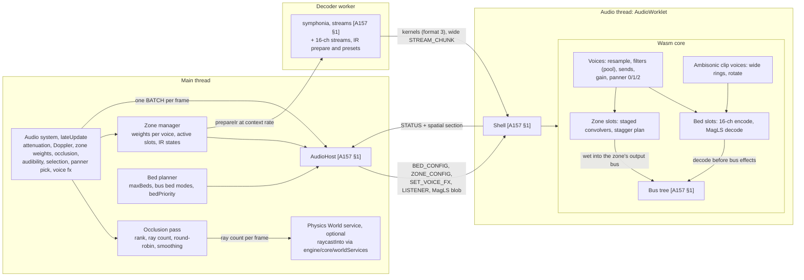
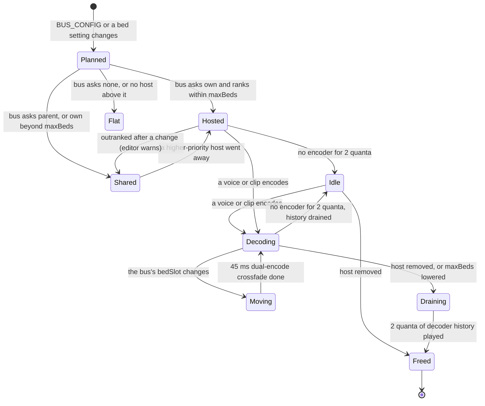
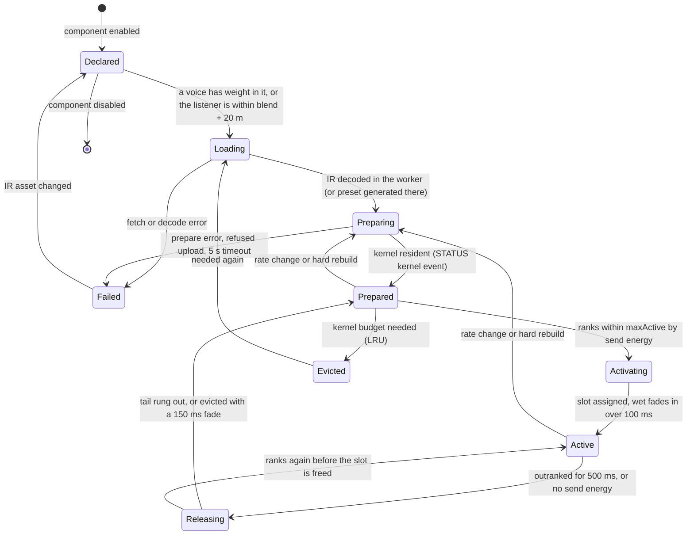
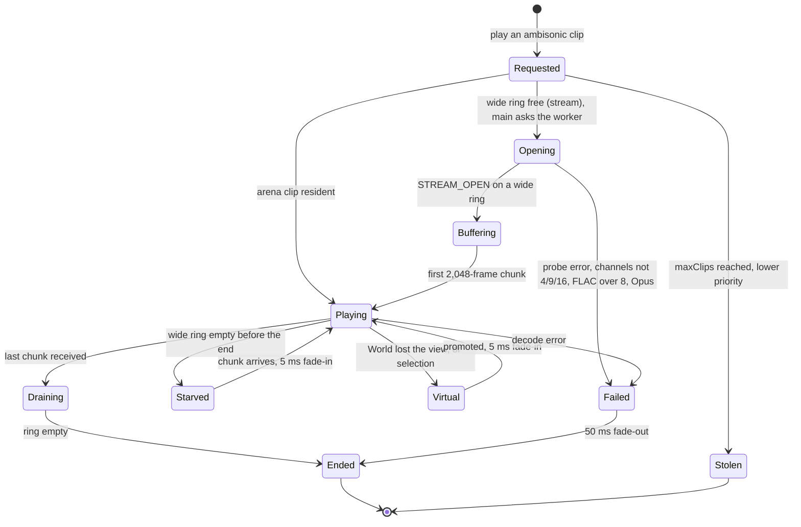
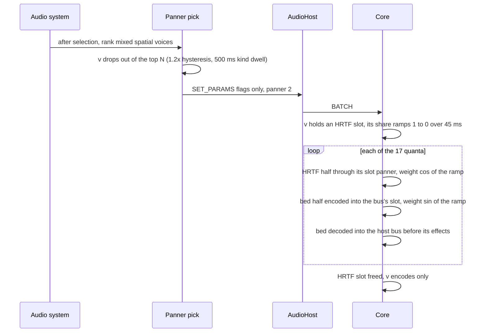
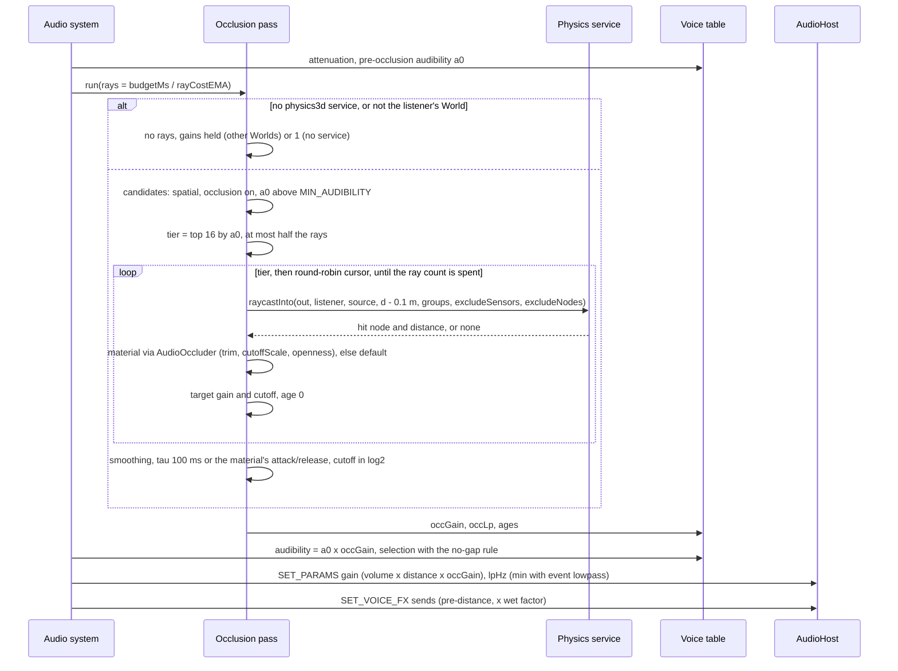
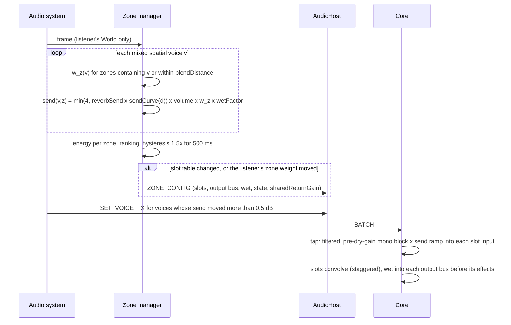
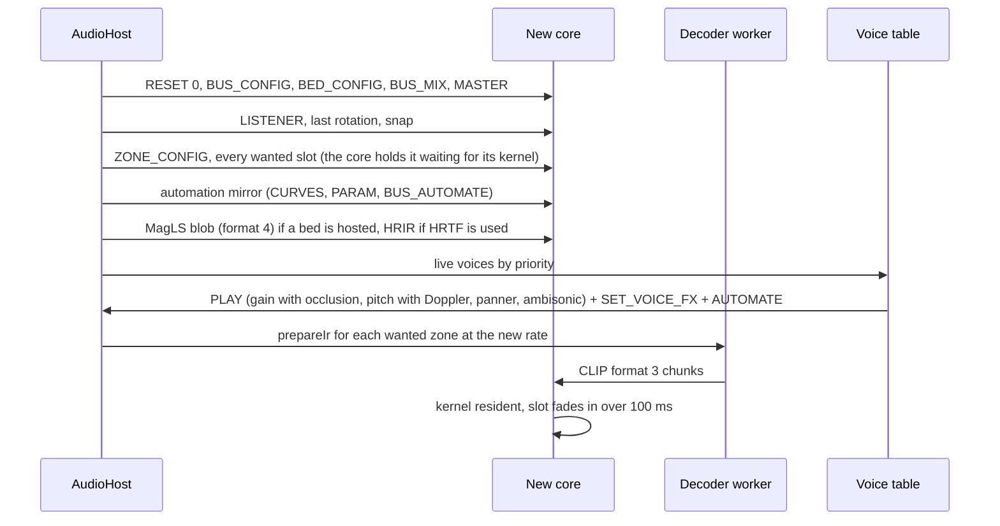
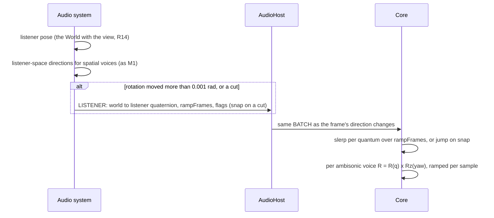
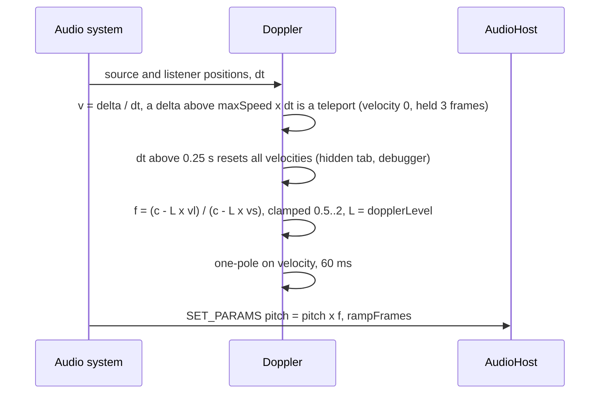

# 0162 spatial audio: system architecture (M3)

The architect's design for ADR 0162 (Accepted direction, revision 3, with the owner's decisions of 2026-11-11), **revised in round 2B** under the coordinator's rulings R1–R17 ([rulings.md](rulings.md)) and the senior engineer's review ([review-round2-senior.md](review-round2-senior.md); resolutions in §13). It extends [0157's architecture](../0157-audio-core/architecture.md) (**[A157 §n]**) and doesn't repeat it: the host, the batch, STATUS, the clock map, the arena, streams, the hard rebuild and the adaptive cap work as there unless a section here says otherwise.

Its companion, [api-and-models.md](api-and-models.md) (**[API §n]**), owns the public API, settings and their parse rules, the debug-info type, byte layouts, the Rust ABI, files, tests and tasks. This file owns components, lifecycles, interactions, timing, memory, performance, failure handling, observability and platforms. What it needs from [API] is listed in [contracts-architect.md](contracts-architect.md) (C1–C24).

**Evidence.** Numbers cite the M3 spikes: **[S]** is `spikes/audio-spatial/README.md`, and **[bed]**, **[conv]**, **[occ]** and **[res]** are its sub-READMEs. They were measured on the shared 4-vCPU container, where **p50 and p99 are usable and p99.9 and max are not** [S]. 0157's frozen coefficients are the lab VM's [A157 §6.1]. **(est.)** marks an unmeasured number. Convolver numbers are M1's **non-uniform** staged convolver [conv], never a uniform one. A quantum is 128 frames, 2,667 µs at 48 kHz.

**Owner decisions (round 3).** The owner settled the five open items; this revision keeps only the chosen option:
- **OD1:** HRTF voices are 8 where beds exist, on default as on high; low stays 4.
- **OD2:** a standby zone slot on high and default; a 150 ms eviction fade on low.
- **OD3:** the load-shedding ladder is in (§7.3).
- **OD4:** the estimate is accepted (≈ 36.7 pw, [API §10]).
- **OD5:** zones on the Babylon fallback are inert with one warning.

**Industry practice.** The owner's rule is to follow Wwise, FMOD, Steam Audio, Unity and Unreal unless there is a measured reason not to, and to say where M3 differs. Each area ends with a "Practice" line, and §12 collects them.

## 1. Overview

M3 adds no thread and no lazy module (0162 §8 amends 0157). Each thread's share:
- **Core:** beds, ambisonic clip voices, zone convolvers, per-mixed-voice filters and sends, all inside the mixer wasm.
- **Main:** the occlusion pass, zone weights, Doppler and the bed plan.
- **Decoder worker:** IR preparation.

| Component | Thread | Owns | Does |
|---|---|---|---|
| Bed planner ([API §2.1] resolution) | main | the bus → bed-slot map and each slot's host bus | Runs when the bus tree, `maxBeds`, a bus's `bed` or `bedPriority` changes; sends BED_CONFIG (§2.1); warns which buses lost a bed |
| Occlusion pass | main | per-voice occlusion targets, smoothed values, ages | Per frame, between attenuation and audibility: ranks, casts a ray count, smooths (§3.2) |
| Zone manager | main | the scene's zones, voice sends, the slot table, IR states | Per frame: weights per voice (§3.3); on change: ZONE_CONFIG; IR load and prepare requests (§2.2) |
| Doppler | main | velocity history of sources and listener | Folds a clamped factor into `pitch` (§3.6) |
| Physics World service | main | colliders, BVH | Answers `raycastInto` (C14). Optional: audio never starts it (0135) |
| Decoder worker | worker | decoders, stream cursors, IR preparation | Decodes or generates an IR at the context rate, builds its spectra, sends them **straight to the worklet** (§2.2) |
| Core: mixed-voice fx pool | audio | per mixed voice: filter state, send/aux ramps, high-pass, yaw, bed share | One entry per mixed slot (`max_mixed`), reset on promote (§4.1) |
| Core: beds | audio | bed buffers, decoder history, fold gains | Encodes kind-2 voices and ambisonic clips; decodes each bed once per quantum into its host bus before the bus's effects (§4.2) |
| Core: zone slots | audio | convolver state (fixed `Zones` region), schedules | Up to 4 staged convolvers fed by per-voice sends, wet into their output bus (§4.4) |
| Core: ambisonic voices | audio | 16-channel playheads, rotation | Read 4/9/16 channels, rotate by LISTENER and yaw, add to the bus's bed or decode privately (§2.3) |

| Channel | Direction | Carries (new in M3) | Rate | Mode |
|---|---|---|---|---|
| `node.port` | main → worklet | BATCH with BED_CONFIG (0x16), ZONE_CONFIG (0x17), SET_VOICE_FX (0x0A), LISTENER (0x20); MagLS filters (CLIP format 4, id 0xFFFF0100) | 1 batch per frame | transferred, pooled [A157 §1] |
| `node.port` | worklet → main | STATUS header growth (144 B) and `beds`, `zones`, `zoneEvents` sections (C7) | every 6 quanta | transferred |
| Worker `postMessage` | main ↔ worker | `prepareIr` / `generateIr` requests; `irPrepared` / `irFailed` replies with timings (C9) | events | clone (small) |
| `MessageChannel` port | worker ↔ worklet | zone kernels as CLIP_BEGIN/CLIP_CHUNK format 3 under 0xFFFF0200..=0xFFFF02FF; 16-channel STREAM_CHUNKs; credits back | prepare: one burst ≤ 3.2 MB; wide streams ≈ 11.7 chunks/s of 256 KB | transferred, `epoch`-tagged |
| Physics service | main → main | `raycastInto(out, …)` (C14) | ≤ the ray count per frame | synchronous, no allocation |

Main stays off every PCM path, as in M1 (R12): kernels and wide streams go worker → worklet. The Babylon fallback uses none of these channels ([API §8]).

## 2. Lifecycles

### 2.1 A bed

A bed is a slot of the fixed `Beds` region (`max_beds` slots, sized by `myco_audio_init`, R6). Main owns the plan, the core owns the buffers. BED_CONFIG (R1) carries a `u8 bedSlot` per bus (0xFF = none) and a `u16 hostBus` per slot. Slot ids stay stable across replans, so a host that keeps its slot keeps its decoder state, and one host per slot means the core can't receive inconsistent owners.

**Plan (main; the algorithm is [API §2.1]).**
- Buses asking `own` are sorted by `bedPriority` (0..255, default 128), then by depth, then by index. The first `maxBeds` host a bed.
- The root bus defaults to `bed: own` with `bedPriority` 255. The designer can change both. No rule hard-codes "Master first" (R8).
- A `parent` bus, or an `own` bus that lost, feeds the nearest hosted ancestor's slot. A bus with no hosted ancestor is Flat (equal-power).
- A bus that lost its bed is reported (`bedsRefused`; the editor names the winners).
- Main sends every non-HRTF spatial voice as panner kind 2 whenever `maxBeds > 0`. The core resolves kind 2 through the voice's bus: a bus with `bedSlot` 0xFF pans equal-power. So a replan is one record, not one per voice (C1).

**In the core.**
- A bed decodes only while something encoded into it in the last 2 quanta (two partitions of history, [bed]). A silent bus's bed costs nothing.
- A bus whose slot changes encodes into both slots for 45 ms with complementary equal-power ramps, then into the new one only.
- A freed slot decodes its remaining history for 2 quanta, so no tail is cut (S15).
- RESET clears every bed.

**Practice.** Wwise lets each bus choose an ambisonic configuration, and child buses mix into the parent's. M3 follows that routing. It differs in one way: a sharing bus has no ambisonic buffer of its own, so its effects and meter don't apply to its distant voices (its gains do, §4.3). `maxBeds` is the budget knob that Wwise leaves to the bus count.

### 2.2 A reverb zone

Each `AudioReverbZone` ([API §1.5]) is main's. A **zone slot** is the core's convolver state, in the fixed `Zones` region (R12). A **kernel** is one IR's packed partition spectra at the context rate (R7), held in the arena and shared by every zone that uses the IR.

**Load and prepare (worker).** The zone manager sends `prepareIr` (an `audio` asset) or `generateIr` (a preset: `room`, `corridor`, `hall`, `cave`, `open`, R10) to the decoder worker (C9). Main never holds a time-domain IR. The worker:
1. decodes the IR;
2. cuts it to `zones.maxIrSeconds` (1 / 2 / 4 s by preset) with a 50 ms fade, with one warning when it cuts;
3. resamples to the context rate;
4. normalises as the shared reverb does;
5. builds the packed spectra (head 128 bins and tail 2,048 bins per partition, as `convolver.rs`, R7);
6. sends them **over the worker ↔ worklet port** as CLIP format 3 under a reserved id (R5).

The core reserves the kernel in the arena outside `clipMemoryMB`, counted in the zone kernel budget. Preparation costs 1.3 / 2.5 / 5.3 ms for 1 / 2 / 4 s of IR [S]; the worker absorbs it, and its own timing is unmeasured (task C2a). The upload uses the 256 KB-per-quantum copy budget [A157 §4.7], so 3 MB takes ≈ 12 quanta. The worker keeps the encoded bytes for re-preparation ([API §5.3]).

**Worker missing.** If the decoder worker isn't running, main decodes the IR with `decodeAudioData` (the M1a path) and uploads it as **CLIP format 5** (zone IR PCM, R7). The core then builds the spectra itself, one prepare unit per quantum, into the kernel block reserved for that id. That costs +19–23 µs a quantum for 0.25–0.8 s depending on IR length [conv]. A zone that isn't prepared plays dry.

**Activity (main).**
- Prepared and Active zones are ranked by **send energy**: Σ over mixed voices of (pre-occlusion audibility × send)².
- The top `zones.maxActive` (0..2; 2 on high and default, 1 on low) are active. To replace an active zone, a challenger must beat the weakest one by 1.5× for 500 ms (est.).
- A slot whose input has been silent for its IR length plus 2 quanta stops running (the core checks this itself), so an unused slot costs nothing.

**Swaps (OD2).** The wire always carries 4 slots (R2, R4).
- **High and default: a standby slot.** Core slots = `maxActive + 1`. The incoming zone takes the free slot, which includes its kernel (kernel budget = slots), so the kernel is prepared at once. The outgoing zone's sends ramp to 0 and its tail rings out (up to the IR length) in its own slot, as the sound designer asked.
- **Low: an eviction fade.** Core slots = `maxActive` (1). The outgoing zone fades out over 150 ms (ZONE_CONFIG state 3), then the incoming zone takes the slot. Its kernel is prepared and uploaded only after the eviction, 50–200 ms later (est.). This saves ≈ 1.6 MB on the phone preset at the cost of a cut tail per swap, and the editor warns when a layout makes swaps likely.

**Rate change and REPLAY.** Kernels depend on the rate ([conv]: partition counts change at 44.1 kHz). A rate change or a hard rebuild re-prepares every Prepared and Active zone from the worker's kept bytes. Until its kernel is back, a zone is silent; then it fades in over 100 ms (§3.4).

**Practice.** M3 follows Wwise rooms: each source sends to the room it is in, and the room's tail rings out (owner decision 1). FMOD and Unity zones blend by listener position. Wwise lets every room have a reverb; M3 caps active zones at 2 for memory (3–6 MB each, [S]).

### 2.3 An ambisonic clip voice (streamed)

A clip whose sidecar has `ambisonic` ([API §2.4]) plays with PLAY flag `ambisonic` (C1). It streams by default (a 3rd-order minute is ≈ 92 MB at int16 [S]); short clips can live in the arena, which accepts 1, 2, 4, 9 and 16 channels. `audio.ambisonic.maxClips` (1 / 1 / 2, R8) caps **concurrent ambisonic voices** of either kind; the lowest priority is stolen. It also sizes the wide rings and the private decoders (R16).

| Aspect | Design |
|---|---|
| Wide rings | a separate `Wide` region of `maxClips` rings (R16): 16 channels × (16,384 ring + 2,048 chunk + 1,536 seek tail) frames, f32 = 1.22 MiB each (the architect's design, R16 as clarified). Chunks are 2,048 frames (128 KB at 16 channels), half the per-quantum copy budget, so clip and kernel uploads still fit in the same quantum ([API §5.4]). **The 16,384-frame ring must pass a 300 ms decoder-stall test** (the M1 messaging spike's case); if it fails, it grows to 32,768 frames (2.22 MiB). A main-thread stall doesn't reach this path (worker → worklet) |
| Decode | symphonia reads 4- and 16-channel WAV in file order [bed]. FuMa is converted in the worker per chunk (`STREAM_OPEN.convention`) |
| Render | 4-point resampler per channel to the context rate; one block-diagonal rotation (1 + 9 + 25 + 49 products per frame, ramped from the previous matrix [bed]) by R = R(q) · Rz(yaw), where q is LISTENER's world → listener rotation; then added into the first (N+1)² channels of the bus's bed. With no bed on its bus, it is decoded alone through one of `maxClips` **private decoders** (binaural on every preset, low included) |
| Axes (S2) | engine listener space is forward −Z, up +Y, right +X; AmbiX is X forward, Y left, Z up: (X, Y, Z)_ambix = (−z, −x, +y)_engine. A bed voice's SH encode uses the same map |
| Cost | rotate into a bed ≈ 5 µs at 3rd order, 1 µs at 1st [bed]; rotate and decode alone 23 / 7 µs p50, 37 µs p99 at 3rd order [S]; 16-channel resampler read ≈ 8 µs (est., 8× a stereo voice's 1.2–1.5 µs [bed]) |
| Limits | pitch 1 (no Doppler; a pitch binding is refused with one warning); never HRTF, never occluded, **never filtered** (R12); its zone send uses the listener's weights and taps W |

## 3. Interactions

### 3.1 A voice moves from HRTF to the bed

Selection gives HRTF to the top `voices.hrtf` spatial voices by audibility: 8 on high and default where beds exist (owner decision 3, OD1), 4 on low. Every other spatial voice is kind 2 when `maxBeds > 0`. **Three timers** govern a kind change (R13, S14):
- M1's 1.2× audibility hysteresis;
- the 3-frame mixing dwell [A157 §2.4];
- a **500 ms kind dwell** on main, in game time (R13 as clarified: 30 frames at 60 Hz).

A source therefore changes kind at most once every 500 ms of game time (30 frames at 60 Hz; R13 as clarified).

- **Law.** M1's 0↔1 crossfade stays linear (both halves carry the same, correlated signal). Any change involving kind 2 uses an **equal-power** law, because MagLS doesn't match phase above 1.5 kHz, and a linear crossfade dips 1–4 dB for one quantum [bed]. Whether the dip is gone is a listening-pass exit item.
- **Below −60°** the interaural time difference changes by up to 300 µs at the switch: M1 clamps at −45° and MagLS falls toward 0 [bed] (owner decision 5).

**Practice.** Wwise and Unreal pick binaural per object or bed by priority or distance; neither documents a crossfade law [U].

### 3.2 An occlusion frame

| Element | Design |
|---|---|
| Place | between attenuation and audibility, the slot M1 reserved [A157 §10] |
| Budget | a **ray count** per frame (R12): `budgetMs / rayCost`, with `rayCost` an EMA (α 0.1) over batches of ≥ 16 rays wherever the clock resolves ≤ 0.1 ms, else 3.5 µs [S]. Low 0.06 ms ≈ 16 rays, default 0.25 ms ≈ 70, high 0.5 ms ≈ 140 |
| Ranking | by **pre-occlusion** audibility. A tier of 16 is recast every frame using at most half the rays; a round-robin cursor covers the rest [occ] |
| Rays | default: one centre ray, first hit. High: the top 4 get 3 rays (centre ±0.5 m lateral), each followed through up to 3 hits (re-cast from 1 cm past the hit) [occ] |
| Query (R12, C14) | the D0 query excludes the source's node subtree and the listener's node, and sensors, **inside the query**, so a source inside its own capsule still sees the wall. It writes into a reused `out` and allocates nothing. The interface lives in `engine/core/worldServices.ts`, which the audio plugin may import (`plugins.test.ts`) |
| Material | the hit node's nearest `AudioOccluder` ([API §1.5]: material, `transmissionTrimDb`, `cutoffScale`, `openness`), else the default material. Per-hit dB add, cutoff = minimum over hits, floor −60 dB; over a source's rays: mean of linear gains, mean of log2 cutoffs. **Doors (R15):** a script animates `openness`, and moving colliders use the same rays |
| Smoothing | on main: one-pole, τ = `occlusion.smoothingMs` (100) or the material's attack/release, ≈ 60 ns per source [occ]. A voice's first result applies at once |
| To the core | the smoothed gain goes into SET_PARAMS `gain` (dry) and the cutoff into `lpHz`; the wet factor 1 − (1 − occGain)·`wetOcclusion` goes into SET_VOICE_FX sends; all with the frame's `rampFrames`. PLAY and promotion carry them |
| Overrun | if a pass took > 2× the budget (GC, a slow scene), the next frame's count halves and recovers by 10% a frame (est.). Sources not reached keep their result and age |
| Worlds (R14) | only the World holding the active listener casts; voices in other Worlds keep their last occlusion values |
| Staleness | ray age ≤ 3 / 5 / 22 frames at 64 / 256 / 1,024 sources (0.25 ms) [S], + τ, + asap latency |

**Practice.** Wwise and FMOD map an occlusion value set by the game to volume and low-pass, and Wwise's occlusion also reduces the wet path [res] [U]. Unreal traces each source on a timer (≈ 0.1 s) [U]. M3 follows the value model and replaces timers with a frame budget ranked by audibility, which keeps main's cost flat (casting everything costs 3.8 ms at 1,024 sources [occ]). Steam Audio's bands are an extension (§11).

### 3.3 Zone weights and sends

- **Weight.** Inside the volume, 1; outside, falling linearly to 0 over `blendDistance` (default 2 m). Overlaps are normalised by w_z / √Σw² (est.).
- **Send (R11).** The send is taken **before the distance gain** and shaped by its own send-versus-distance curve, as Wwise's aux-send curve is: `reverbSend` (0..2) × `sendCurve(d)`, clamped to 4, × the source's volume × w × the wet factor. The default curve is 1 at `minDistance` falling to 0.5 at `maxDistance` (est.; it is absolute, not relative to the dry path; the listening pass tunes it). Ambisonic and flat voices use the **listener's** weights.
- **The tap (R11 as clarified).** The core takes each zone send from the voice's mono block **after the voice's own filters** (occlusion low-pass, event filter, automation low-pass, filtered mono-once), after resample, fade/mix ramps and automation `gainMul`, and **before the distance gain** (the dry `gain` ramp). The send level from main then scales it by `wetOcclusion` and the send curve. So occlusion dulls dry and wet alike and lowers the wet by `wetOcclusion`, as Wwise's occlusion does; obstruction (later, §11) would touch the dry path only. [API §4.4] still describes a pre-filter tap and is to be aligned with this clarification. The dry `gain` ramp is then applied. Voices with no send keep M2's order (gain, then filter), so every M2 golden stays bit-identical (§4.1).
- **Bus chain.** The send also takes the voice's bus-chain gain to the root, folded per quantum in the core (§4.3), so muting Footsteps mutes its reverb. Wwise sends ignore the output bus's volume [U]; M3 differs because its buses are where designers turn things down.
- **Aux send (R2).** An event's `sends.<bus>` is a mixer-style **post-fader** send: tapped after the dry gain, equal-power panned, × the bus-chain gain, added into the named bus's buffer.
- **Return (R17).** Each zone's wet goes into its `output` bus (default Master) before that bus's effects, so it has a fader, ducking and a meter, as a Wwise aux bus does.
- **The shared reverb.** The bus `reverb` effect still feeds M1's shared convolver [A157 §1]. Its return is scaled by **1 − the listener's total zone weight** (ZONE_CONFIG `sharedReturnGain`, ramped), so it acts as the "outside any zone" reverb, like FMOD's ambient reverb. This is listener-based because the bus reverb is bus-level (senior issue 15).
- **Cost on main.** Point-in-volume per (voice, zone) ≈ 40 ns (est.); 64 zones per World, linear ([API §3.2]: 256 × 64 tests < 0.05 ms).

### 3.4 Hard rebuild (REPLAY) restoring beds and zones

ZONE_CONFIG is an idempotent table (R4), so REPLAY needs no ordering rule: a slot waits in "waiting for kernel" until its kernel is resident. Zone tails and bed histories are lost inside the rebuild's 1–3 s gap [A157 §7]. Re-preparation costs 1.3 / 2.5 / 5.3 ms per 1 / 2 / 4 s IR in the worker, or 0.25–0.8 s on the in-core PCM path (S11). Ambisonic streams reopen with a new epoch on a wide ring. A soft RESET (`keepClips` 1) keeps kernels and the MagLS blob.

### 3.5 Listener update and clip rotation

LISTENER (R3) is 36 B: the **world → listener** rotation (what clip rotation applies directly), `rampFrames` (the same as that frame's direction changes, so clips and point voices turn together: zero skew, well inside a 50 ms head-turn budget), and `flags` bit 0 **snap** for camera cuts (no ramp). Only the World holding the active listener sends it (S19). The editor's audition uses the editor camera.

### 3.6 Doppler

Doppler adds no core state: the factor rides `pitch`, so the replay's playhead tracker stays right and the resampler is unchanged ([bed]: no cost over constant pitch). The velocity estimate, guard and listener override are [API §3.2]. `doppler.maxSpeed` is 150 world units/s (R8; the listening pass tunes it), and `speedOfSound` 343 world units/s. The formula is OpenAL's; Unity and FMOD use the same form [U].

## 4. The per-voice pipeline in the core

Order for a mixed voice. Steps marked new are M3's:

1. resample;
2. fade and mix ramps, automation `gainMul`;
3. **filters** (new);
4. **zone send taps** (new);
5. dry `gain` ramp (main's volume × distance × occlusion);
6. **aux tap** (new);
7. panner 0 / 1 / 2;
8. into the bus (kinds 0 and 1) or the bed (kind 2).

A voice without sends runs M2's order (step 5 before step 3).

### 4.1 The mixed-voice pool and filters

Per-voice M3 state lives in a **pool of `max_mixed` entries** (R12), one per mixed slot, reset when a voice is promoted (as M1 resets filter state on promotion, [A157 §2.2]). Virtual voices hold nothing: main keeps the targets and sends SET_VOICE_FX with the promotion's SET_MIXED. `VOICE_SLOT_BYTES` stays 192 unless the panner fields don't fit; the senior engineer's assert decides.

| Pool entry field | Bytes (est.) |
|---|---|
| low-pass `Biquad`, high-pass `Biquad` (mono state used for mono voices) | 2 × 120 |
| low-pass / high-pass cutoff ramps (log2) | 2 × 16 |
| 16 f32 bed gains (last quantum's encode, [API §3.1]) | 64 |
| zone send ramps × 4, aux ramp, `auxBus` | 5 × 16 + 2 |
| `yaw`, bed share ramp (kind changes) | 4 + 16 |
| **Total** | **≈ 448 B** with padding and both biquads' full state (field by field in [API §3.1]) → 28 / 56 / 112 KB at 64 / 128 / 256 mixed |

| Aspect | Design |
|---|---|
| Who is filtered | a mixed, non-ambisonic voice whose effective low-pass is below 20,000 Hz or whose high-pass is above 20 Hz (R2). Others pay nothing. The bus snapshot keeps its existing off threshold (`lowpass_on`, < 24,000) so M1/M2 goldens don't move |
| Effective low-pass | `min(lpHz, lpAuto)`: `lpHz` from main (occlusion, the event's static `filter.lowpass`, the sharing chain's snapshot, already min'd, `lpBy` [API §3.2]); `lpAuto` from automation. **Lowest wins** (0158) |
| Mono once | a mono voice is filtered **once, before the resampler's copy to two channels** (senior §5). The output is bit-identical to filtering two identical channels, so M2's automation goldens hold. Stereo voices run both channels |
| Automation | `VoiceAuto.filter` migrates into the pool (same `Biquad`, same coefficients, same order; the first acceptance check of D1). A full pool can't happen: one entry per mixed slot |
| Cost | `BIQUAD` 1.2 µs per stereo pass [A157 §6.1]; ≈ 0.6 µs per mono pass (est.: half the work) |

"Lowest wins" replaces a cascade. Where a sharing bus's snapshot and an occlusion cutoff are both active, the result is up to ≈ 3 dB brighter at the lower cutoff than the cascaded filters would be (est.), accepted for one filter's cost. The debug view names the stage that won.

### 4.2 Beds: encode and decode

| Step | Design |
|---|---|
| Encode | 16 SN3D gains by polynomial (no trig) from the direction ramp's start and end values; one pass `bed[c][i] += x[i]·(a_c + i/128·s_c)` [bed]. The last quantum's 16 gains are kept in the mixed-voice pool ([API §3.1]), so the ramp starts where the previous quantum ended. Stereo clips encode their mid (L+R)/2 (est.; a listening item) |
| Gain | voice gain × the fold gain of its bus chain to the host (§4.3), ramped across the quantum |
| Decode | after every voice and **before `bus::mixdown`**, per decoding slot: 16 forward 256-point FFTs, 16 × 2 × 2 complex MACs over 128 bins, 2 inverses (MagLS, 2 partitions; ≈ 20 µs [bed]); added into the host bus's buffer, so its effects, snapshot, gain, meter and ducking apply |
| Filters | the MagLS time responses ([API §4.6], format 4, id 0xFFFF0100): 32 KB at 44.1 / 48 kHz; main resamples them for other rates (512 taps at 96 kHz, decode ×2). The core transforms them in `onmessage` (≈ 0.1 ms, est.). Loaded lazily the first time a bed is hosted; until they are resident, or if they fail to load, beds decode through the equal-power matrix |
| Equal-power mode (R9) | `audio.spatial: "equalPower"` keeps beds and decodes them through a baked 16 → 2 matrix (≈ 2 µs est.), with no HRIR or MagLS fetch. An order-3 matrix can't reproduce the equal-power law's fold at ±90° (Gibbs error). Acceptance: within 2 dB of `EqualPowerPanner` except within 10° of the fold (senior issue 12) |

### 4.3 Gain folding for `parent` buses, and ducking

A voice on bus B whose bed is hosted by ancestor A skips the buffers of B and of every bus between B and A. **The core folds those buses' gains**: it already holds each bus's BUS_MIX gain ramp and its automation `gainMul` (M2), so no wire field is needed and nothing lags a frame. The chain's snapshot low-pass is folded by main into `lpHz` (`lpBy` "parent", S3).

- Per quantum, before the voices, for each bus b feeding a bed it doesn't host: `fold0[b]` and `fold1[b]` = Π over b … (excluding the host) of (BUS_MIX gain × `gainMul`) at the quantum's first and last frame (≈ 1 µs for 32 buses, est.). The encode ramps linearly between them.
- The same walk up to the root gives the **send chain gain** (§3.3).

**Exactness against `bus.rs`.** Ducking, mute, solo, volume and snapshot gain all reach the core as the bus's BUS_MIX `gain` (`mixer.ts` `gainOf`; `coreBackend.applyMix`). The core ramps it per frame and `gainMul` linearly per quantum. The fold is exact except in three bounded cases:
1. **A ramp ending mid-quantum.** The straight line misses the knee by at most |Δg per frame| × 64 frames (< 0.1 dB for a 5 ms, 12 dB duck, est.).
2. **Two ramping factors.** Their product is a parabola, which deviates from the chord by at most Δg₁Δg₂/4 over the quantum.
3. **Order.** A sharing bus's effects don't apply to its distant voices (0162 §1). Its snapshot becomes per-voice and min-combined (§4.1).

The unit test with a ducked sharing bus asserts < 0.05 dB ([API §9]). Ducking's trigger side is unchanged: main counts every live voice per bus (0097).

### 4.4 Zone slots and the stagger planner

Each slot is an M1 staged convolver over owned state in the `Zones` region, reading its kernel in place from the arena (bit-identical to M1's [conv]).

| Planner element | Value |
|---|---|
| When | in `onmessage`, when ZONE_CONFIG starts a slot. A running slot keeps its schedule, and a record that only changes `sharedReturnGain` or `wet` doesn't re-plan |
| Model | load per quantum: one 4,096-point transform = 1.0, one partition multiply-add = 0.055 ([conv] `micro.rs`; wasm ratio unmeasured) |
| Objective | minimise the busiest quantum's modelled load over a 16-quantum cycle with f + 2 ≤ i ≤ 15. Running slots and the shared reverb (instance 0, schedule (0,15)/(1,14)) are fixed |
| Size | ≤ 4 slots × 2 channels; ≤ 50 µs per plan (est.) |
| Effect | at 4–8 zones the modelled peak halves at 2 s, and p99 falls 25–35% [S]. This retires architecture §10's "never share a tail quantum" (0162) |

## 5. Threading, state and constants

### 5.1 State ownership

| State | Owner (writes) | Copy elsewhere |
|---|---|---|
| Bed plan (bus → slot, slot → host) | main | BED_CONFIG |
| Bed buffers, decoder history, fold gains | core | STATUS `spatial` |
| Panner kind 1 vs 2 | main (panner pick) | SET_PARAMS flags; the core resolves kind 2 through the bus |
| Occlusion target, smoothed values, ages | main | `gain`, `lpHz`, sends |
| `lpHz` (occlusion, event, sharing snapshot) | main | SET_PARAMS; `lpAuto` stays the core's |
| Filter and send state, ramps | core (pool) | none |
| Zone set, weights, sends, slot table | main | ZONE_CONFIG, SET_VOICE_FX |
| Zone kernels | core arena | encoded bytes in the worker |
| Zone convolver state, schedules | core (`Zones` region) | STATUS `spatial` |
| Listener rotation | main | LISTENER |
| Doppler velocities | main | `pitch` |
| Ambisonic stream cursor | worker | chunk headers |

One owner per row (S3). The core never infers a send, a host or a cutoff; it applies, ramps and folds what it is told.

### 5.2 Staleness bounds

| Value | Normal bound | Under a main stall of *s* |
|---|---|---|
| Occlusion after a wall appears | ray age (≤ 3 / 5 / 22 frames at 64 / 256 / 1,024 sources) + τ 100 ms + asap latency (1 quantum p50, 3–5 p99 after the post, plus Λ) [A157 §4.2] | held |
| Zone send after a source enters a room | 1 frame + asap latency; a newly needed zone adds load + prepare + upload (≈ 50–200 ms, est.) + 100 ms fade | held |
| Zone active set | per frame, with 1.5× / 500 ms hysteresis | held |
| LISTENER vs voice directions | same batch, same `rampFrames`: no skew | both held |
| Doppler pitch | 1 frame + 60 ms smoothing | held, reset after dt > 0.25 s |
| Bed plan after an edit | next batch + 45 ms crossfade | — |
| STATUS `spatial` | ≤ 16 ms + 1 frame | *s* |

### 5.3 Constants

Settings are marked **S**, with defaults per preset (low / default / high). Parse rules are in [API §2.1]. Wire and core constants are generated from `audio-wire/src/schema.rs`, and this table quotes them by name (S20).

| Area | Constant | Value | Source |
|---|---|---|---|
| Beds | **S** `bed.maxBeds` (`MAX_BEDS` 4) | 0 / 2 / 4 | owner decision 6 |
| | **S** bus `bed`, `bedPriority` | `parent` (root `own`), 0..255 default 128 (root 255) | R8 |
| | `BED_CHANNELS`, order | 16, 3rd (ACN/SN3D) | 0162 §1 |
| | idle after; move crossfade | 2 quanta; 45 ms equal-power | [bed]; [A157 §2.4] |
| | MagLS cutoff, taps | 1.5 kHz; 256 at 48 kHz | [bed] |
| HRTF | **S** `voices.hrtf` | 4 / 8 / 8 (8 where beds exist; with `maxBeds` 0 as set; the high preset was 32, `audioSettingsModel.ts:213`) | owner decision 3, OD1 |
| | kind dwell; kind crossfade | 500 ms of game time (R13); 45 ms, equal-power when kind 2 is involved | R13, [bed] |
| Clips | **S** `ambisonic.maxClips` | 1 / 1 / 2 | R8 |
| | wide ring, chunk | 16,384 frames (32,768 if the stall test fails); 2,048 frames | R16 |
| Occlusion | **S** `occlusion.budgetMs` | 0.06 / 0.25 / 0.5 | 0162 §3 |
| | default ray cost; EMA | 3.5 µs; α 0.1 over ≥ 16 rays | [S]; R12 |
| | tier; multi-ray (high) | 16, ≤ ½ the rays; top 4 × 3 rays × ≤ 3 hits | [occ] |
| | ray inset; floor | 0.1 m short of the source; −60 dB | this design |
| | **S** `occlusion.smoothingMs` | 100 (per-material attack/release override) | [API §2.1] |
| | overrun | next count ÷ 2 if a pass > 2× budget, +10%/frame | this design (est.) |
| | **S** `occlusion.layers`, `defaultMaterial` | every layer (sensors excluded); `concrete` | 0162 §3 |
| Zones | **S** `zones.maxActive` | 1 / 2 / 2 (range 0..2) | R8 |
| | **S** `zones.maxIrSeconds` | 1 / 2 / 4 | R8 |
| | wire slots (`MAX_ZONE_SLOTS`) | 4 | R2, R4 |
| | core slots | low `maxActive` (1); default and high `maxActive + 1` (standby) | OD2 |
| | eviction fade (low) | 150 ms | OD2 |
| | swap hysteresis; fade in | 1.5× for 500 ms (est.); 100 ms | this design |
| | `blendDistance` default | 2 m | sound designer RFC |
| | send curve default; clamp | 1 at `minDistance` → 0.5 at `maxDistance` (est.); send × curve ≤ 4 | R11, R8 |
| | send update threshold | 0.5 dB | this design |
| | prepare when; timeout; cut fade | weight > 0 or listener within blend + 20 m; 5 s; 50 ms | this design |
| | planner model | transform 1.0, MAC 0.055, cycle 16 | [conv] |
| | zones per World | 64 | [API §3.2] |
| Doppler | **S** `speedOfSound`, `doppler.maxSpeed` | 343, 150 world units/s | 0162 §5, R8 |
| | clamp; smoothing; reset | 0.5..2; 60 ms on velocity; dt > 0.25 s | 0162 §5, [API §3.2] |
| Filters | voice low-pass off; high-pass off | ≥ 20,000 Hz; ≤ 20 Hz | R2 |
| Listener | resend threshold | 0.001 rad | S2 |

## 6. Memory

| Item | Formula | Low / default / high (48 kHz) |
|---|---|---|
| `Beds` region | `max_beds` × (8 KB bed + 40 KB decoder history) | 0 / 96 / 192 KB [bed] |
| Private decoders | `maxClips` × 48 KB | 48 / 48 / 96 KB |
| MagLS spectra (arena, 0xFFFF0100) | 64 KB at ≤ 48 kHz, 128 KB above 88.2 kHz | 0 (none hosted) / 64 / 64 KB |
| Mixed-voice pool | `max_mixed` × ≈ 448 B | 28 / 56 / 112 KB |
| Fold and chain tables | 256 buses × 12 B | 3 KB |
| `Zones` region (state) | core slots × (whole zone − kernels) at `maxIrSeconds` | 1 × 0.9 / 3 × 1.6 / 3 × 3.1 MB [conv] |
| Zone kernels (arena, outside `clipMemoryMB`) | kernel budget = core slots × kernel size | 0.8 / 4.4 / 8.8 MB [conv] |
| **Zones total** | | **1.7 / 9.2 / 18.0 MB** (low: eviction fade, 1 slot; default and high: standby slot, OD2) |
| `Wide` region | `maxClips` × 1.22 MiB (2.22 MiB at 32,768 frames) | 1.22 / 1.22 / 2.44 MiB |
| Ambisonic arena clips | 16-ch int16: 1.5 MB/s | under `clipMemoryMB` |
| **M3 total, fixed** | | **≈ 3.0 / 10.7 / 20.9 MB** |

Zone memory doubles at 96 kHz. Zones run at 44.1–96 kHz and are refused above that with a warning; 44.1 and 48 kHz are tested (S17). The kernel budget is one kernel per core slot (on default and high the standby slot includes its kernel). Kernels of zones that are Prepared but not in a slot stay resident (LRU) only while that budget has room, so walking back into the last room usually needs no new preparation. The arena is never compacted [A157 §5.2]. Zone state is never allocated there (R12).

**Wasm size.** Est. +40–50 KB on the mixer's 178.6 KB, under the 256 KB tripwire ([API §5.5]). The decoder gains ≈ +27 KB for IR preparation ([conv] `probe_zone`).

**STATUS (S9).** [API §4.3]: the header grows from 112 to 144 B, followed by `beds` (≤ 4 × 8 B), `zones` (≤ 4 × 12 B) and `zoneEvents` (≤ 16 × 4 B) sections. The worst-case block is 15,904 B of the 16,384 B pool buffers [A157 §4.7], leaving 480 B of headroom. No other M3 STATUS growth is planned.

## 7. Performance

### 7.1 The model

0157's per-quantum formula [A157 §6.1] gains:

*T*_q += *B*·*c*_dec + *N*_bed·*c*_enc + *A*·(*c*_rot + *c*_wide) + *A*_priv·*c*_dec + Σ_z *c*_zone(len_z) + *P*_m·*c*_bq,mono + *P*_s·*c*_bq + *S*·*c*_send + *X*·*c*_aux − Δ*N*_hrtf·*c*_hrtf

where:
- *B* is the number of beds decoding and *N*_bed the number of kind-2 voices;
- *A* is the number of ambisonic voices, *A*_priv of them decoding privately;
- *P*_m and *P*_s are the mono and stereo filter passes, with *P*_m + *P*_s ≤ mixed voices (clips are never filtered; a voice with both filters counts twice);
- *S* is the number of nonzero (voice, slot) sends and *X* the number of aux sends;
- Δ*N*_hrtf is the number of HRTF voices removed.

No credit is taken for bed voices skipping the moving equal-power matrix (`c_mov` 0.86 µs); that waits for the bench, so the model is conservative.

| Term | Value (wasm, container p50 unless noted) | `cap::wu` | Source |
|---|---|---|---|
| *c*_dec | 20 µs (p99 33) | `BED_DECODE` 20,000 | [S] |
| *c*_enc | 0.5 µs (0.4–0.7) | `BED_VOICE` 500 | [S] |
| *c*_rot (3rd order, into a bed) | 5 µs | `AMBI_ROTATE` 5,000 | [bed] |
| *c*_wide | 8 µs (est.) | `AMBI_READ` 8,000 | est. |
| *c*_zone | 1 s ≈ 13; 2 s 20 (p99 72); 4 s 30 (p99 76) µs; two blending 2 s zones 47 (p99 107) | `ZONE_BASE` 8,500 + `ZONE_PER_S` 4,500 | [conv], [S] |
| *c*_bq stereo / mono | 1.2 / 0.6 µs (mono est.) | `BIQUAD` 1,200 / `BIQUAD_MONO` 600 | [A157 §6.1] |
| *c*_send | 0.15 µs (mono, pre-panner, est.) | `REVERB_SEND` 150 | [A157 §6.1] |
| *c*_aux | 0.3 µs (panned, est.) | `AUX_SEND` 300 | est. |
| *c*_hrtf | 7.4 µs (lab VM) | `HRTF_VOICE` 7,400 | [A157 §6.1] |

**HRTF room.** On high, 32 → 8 removes 24 × 7.4 ≈ **178 µs** (those 24 voices are counted in *N*_bed at 0.5 µs). Kernel computations are capped per quantum and don't change. On default, 16 → 8 removes 8 × 7.4 ≈ 59 µs (OD1).

### 7.2 Scenes per preset (est.)

Mono content is assumed for spatial voices. Event voices carry a high-pass. Zone slots follow OD2: standby on high and default, eviction on low.

| Scene (wasm, container p50) | Terms (µs) | Net |
|---|---|---|
| **Typical high** (0162 §8): 2 beds, 240 bed voices, one 3rd-order clip into a bed, 2 blending 2 s zones, 32 filtered, 240 sends | 40 + 120 + 13 + 47 + 19 + 36 = 275; − 178 | **≈ 0.10 ms** (gross 0.28) |
| **Worst high**: 4 beds, 248 bed voices, 2 clips (one private), 3 slots of 4 s, 256 low-pass + 32 high-pass mono, 496 sends, 32 aux | 80 + 124 + (13 + 31) + 90 + 173 + 74 + 10 = 595; − 178 | **≈ 0.42 ms** (gross 0.60) |
| **Typical default**: 2 beds, 120 bed voices, 1 clip into a bed, 2 blending 2 s zones, 16 filtered, 120 sends | 40 + 60 + 13 + 47 + 10 + 18 = 188; − 59 | **≈ 0.13 ms** (gross 0.19) |
| **Worst default**: 2 beds, 120 bed voices, 1 private clip, 3 slots of 2 s, 128 + 16 filtered, 240 sends, 16 aux | 40 + 60 + 31 + 60 + 86 + 36 + 5 = 318; − 59 | **≈ 0.26 ms** (gross 0.32) |
| **Typical low**: no beds, one 1st-order clip private, 1 zone of 1 s, 16 filtered, 60 sends | 9 + 13 + 10 + 9 | **≈ 0.04 ms** |
| **Worst low**: one 3rd-order private clip, 1 slot of 1 s (eviction swaps), 64 + 8 filtered, 60 sends, 8 aux | 31 + 13 + 43 + 9 + 2 | **≈ 0.10 ms**; phone unverified (owner) |

**Tails.** p99 on the container is roughly twice these numbers (summing component p99s, an upper estimate; typical high gross ≈ 0.54 ms). On the lab VM the high preset's p99.9 is 2.6× its p50 [A157 §6.1]; applied to the gross figure, M3's typical high adds ≈ 0.7 ms at p99.9 before the HRTF room and ≈ 0.26 ms net (est.).

**Against the budget.** M1's high preset is already 2.07 ms p50 and 5.45 ms p99.9 on the lab VM, against 1.3 ms ([A157 §6.1]). With the 32 → 8 room, M3's typical net on high is small (≈ 0.1 ms), and the worst case adds ≈ 0.4 ms. The 4-quantum burst rule (7.5 ms) was already missed at high on the lab VM [A157 §6.2]. 0162 §8 stands: the presets' M3 numbers are set from the owner's lab-VM run, not from this table.

### 7.3 The adaptive cap and load shedding

The cap moves only on underruns and qualifying late commands ([A157 §6.3], owner 2026-11-10). M3 changes:
- **Model.** The work-unit model gains the terms above. It is informational: STATUS `workUnits` and the per-bed `workUs` in debug (S12).
- **Score order unchanged (S13).** The cap demotes by `score` as before; a bed voice is a voice like any other. **It never turns off a zone or a bed.**
- **The floor the cap can't shed** grows by decodes, zone slots and clips: ≈ 0.21 ms at worst high (80 + 90 + 44 µs), ≈ 0.13 ms at worst default, ≈ 0.04 ms at worst low.
- **The load-shedding ladder (OD3).** It is triggered like the cap, and only once the cap sits at its floor of 16 with underruns continuing for 1 s. Step 1 cuts releasing zones' tails with a 100 ms fade. Step 2 lowers `maxActive` by 1 for the session. Each step counts in `m3Shed`. It never touches beds or `voices.hrtf`, because those change where sounds are placed. Without it, sustained underruns would leave zones and beds running at their floor cost once the cap can shed nothing more.

### 7.4 Main thread

| Item per frame | Budget | Evidence |
|---|---|---|
| Occlusion rays | `budgetMs` (0.06 / 0.25 / 0.5) | [S]: p50 tracks the budget |
| Occlusion bookkeeping | ≈ 60–75 ns per source (1,024 → 0.07 ms) | [occ] |
| Zone weights | ≈ 40 ns per (voice, zone) test | est.; [API §3.2] < 0.05 ms at 256 × 64 |
| Doppler | ≈ 30 ns per spatial voice | est. |
| Extra records | SET_VOICE_FX (52 B) for changed voices, LISTENER (36 B) | ≈ 0.01 ms (est.) |

Main allocates nothing per frame ([A157 §6.4]). The ray query writes a reused result (R12), and zone and occlusion state are typed arrays sized at scene load ([API §3.2]).

### 7.5 Benchmark method

| Track | What | Gate |
|---|---|---|
| Lab (`audio-bench`) | [API §9]'s scenes (`m3-bed`, `m3-clip`, `m3-zones`, `m3-filters`, `m3-typical`) plus `m3-worst-high`, `m3-worst-default`, `m3-worst-low` (§7.2), all `pace=1`; ≥ 5 runs × 60 s after a 5 s warm-up; p50/p99/**p99.9**/max; `mode=fit` sweeps for every C18 coefficient, including mono vs stereo biquad; `mode=memory` for §6 | informational until the owner's lab-VM run, which sets the presets |
| CI (metered) | [API §9]'s metered scenes plus `m3-worst-high` | +10% fails |
| Main | the occlusion pass under the real `audioSystem.ts` with the allocation-free query, 64 / 256 / 1,024 sources ([API §9] occlusion bench) | frame p50 within budget + 0.08 ms |
| Streams | a 16-channel stream through a 300 ms decoder stall (R16) | 0 starves, or rings grow to 32,768 |
| Lab VM, phone | as M2's E5.5; the phone stays unverified (owner) | sets the presets |

No long runs on the container: its p99.9 tracks the VM (working notes). **Intensive tests run at wave end, not per task** (owner; [working-notes.md](working-notes.md)): e2e, `@slow` specs, long benches and soaks run once per wave on the merged result; a task runs its unit, golden, loopback and metered checks.

## 8. Failure modes

| Failure | Detection | Handling | User-visible | Counters |
|---|---|---|---|---|
| More `own` buses than `maxBeds` | bed planner | the highest `bedPriority` win; the rest share the parent's bed (still 3D) | editor warning naming the buses | `bedsRefused` |
| More zones in use than `maxActive` | ranking | the top by send energy play; the shared reverb follows the listener weight | one console warning per zone faded; editor overlap warning | `zonesFaded` |
| IR longer than `maxIrSeconds` | worker | cut with a 50 ms fade | one warning | `irTruncated` |
| IR fetch/decode/prepare failure, refused upload | `irFailed`, kernel event, 5 s timeout | the zone sends nothing; an active old kernel keeps playing | one warning naming the zone | `irFailures`, `kernelRefused` |
| Decoder worker missing | client crash or load failure | main decodes and uploads format 5; the core prepares spread over quanta | the zone is late by 0.25–0.8 s | `irPrepInCore` |
| No physics service, 2D World, other World | service lookup, R14 | no rays: gain 1, or the last values in other Worlds | one debug note if `AudioOccluder`s exist | `occlusionNoPhysics` |
| Ray budget overrun | a pass > 2× budget | the next count halves, then recovers | results age | `occlusionOverruns`, `oldestOcclusionAgeFrames` |
| 16-channel stream underrun | wide ring empty | hold, silence, 5 ms fade-in | ambience dropout | `wideStarved` |
| `maxClips` reached | main | steal the lowest priority | that clip stops | `stolen` |
| Invalid ambisonic clip | import or probe | refused with the order and container named | silent | `decodeErrors` |
| Sample-rate change | [A157 §3.7] | rebuild; MagLS resampled; kernels re-prepared | zones silent until ready, then fade in | `rebuilds`, `irPrepares` |
| MagLS blob missing | fetch error | beds decode through the equal-power matrix | flatter distant placement | `bedFilterLoadFailure` |
| Below −45° | main counts kind-2 voices below −45° | none in M3 (owner decision 5: SADIE II if the floor-below check fails) | below-listener sources approximate (8–20 dB above 4 kHz [bed]) | `belowHorizonVoices` |
| Kind thrash | kind changes per voice-second (main) | the 500 ms dwell bounds it | debug warning above 2 per voice-second | `bedSwitches` |
| M3 load under underruns | cap at floor, underruns continue | the ladder (§7.3): tails cut, then one active zone fewer | a tail cut or a zone fewer | `m3Shed` |

## 9. Observability

**Health thresholds (S8)**, shown in the Audio Debug panel at 4 Hz:

| Counter | Green | Amber | Red |
|---|---|---|---|
| `oldestOcclusionAgeFrames` (0.25 ms budget) | ≤ 8 | 9–30 | > 30 |
| `occlusionOverruns` | 0 | ≤ 1 per s | > 1 per s |
| `bedsRefused`, `zonesFaded`, `kernelRefused` | 0 | non-zero | — |
| `irFailures`, `bedFilterLoadFailure` | 0 | — | non-zero |
| `wideStarved` | 0 | — | any increment |
| `bedSwitches` per voice-second | ≤ 2 | > 2 | — |
| `m3Shed` | 0 | — | any step |

**What the panel shows:**
- **Per voice:** panner kind and bed slot; occlusion gain, cutoff, age, material and hit node; the `occluded` reason; the low-pass in effect and **who set it** (`lowpassBy`: occlusion, event, automation, parent (sharing snapshot), bus snapshot); sends by zone; Doppler factor.
- **Per bed:** host, sharing buses, denied buses and why, voices, `workUs`.
- **Per zone:** state, weight, energy, slot, kernel memory, prepare time and where it ran, the `why` reason.
- **Occlusion:** rays and budget, measured ray cost, oldest age.
- **Memory:** beds, zones, kernels, wide rings.

The field list is [API §1.6] (C15). STATUS carries the header counters and the `beds`, `zones` and `zoneEvents` sections (C7); `bedSwitches`, `zonesFaded` and the occlusion counters are main's.

**Editor.** [API §7]: zone and occluder gizmos through `registerViewportTool` (no new SDK point), the occlusion overlay, the material table in Project Settings > Audio, and the backend label in the audition.

## 10. Platform matrix

| | Core: Chromium (Chrome, Edge, WebView2, Android WebView) | Core: WebKit (Safari, WKWebView, WebKitGTK) | Core: Firefox | Babylon fallback (macOS desktop default) |
|---|---|---|---|---|
| Beds, ambisonic clips, occlusion with low-pass, zones, Doppler, event effects | full | full | full | best effort, [API §8]: `PannerNode` instead of beds, W-only clips, **gain-only occlusion** (owner decision 4), **zones inert with one warning** (OD5: the pinned Babylon exposes bus nodes only through underscore members, which 0157 declined to use), `playbackRate` Doppler, filters and aux skipped with warnings |
| Evidence | M3 spikes in headless Chromium 153 (the bed in a worklet) [bed] | not run | not run | — |

Tauri: Windows WebView2 takes the core path (M1's C3 soak passed); Linux WebKitGTK and macOS follow the WebKit and fallback columns. WebKit and Firefox runs of the M3 scenes are owed as release checks, as M1's were.

## 11. Extension points

| Extension | M3 provides |
|---|---|
| Source spread | the encoder's per-order gains are one multiply per order away from order-weighted spread (≈ +0.05 µs a voice, est.) |
| Obstruction | dry (`gain`, `lpHz`) and wet (`wetOcclusion`) are already separate; obstruction is a second ray class that scales only the dry path |
| Rooms and portals | zones are per-source volumes with an output bus; a portal would set a neighbouring zone's send through its aperture (Wwise-style), on main |
| Steam Audio 3-band transmission | a material row gains 3 band gains (800 Hz and 8 kHz edges [res] [U]); the pool adds a low-shelf next to the low-pass |
| Positioned room reverb | a zone's return could be encoded into a bed at the zone's direction (Wwise room spatialisation) |
| Lower-order beds on phones | the order is a constant; a 1st-order bed is a preset value if the phone run asks for it |

## 12. Where M3 follows or differs from industry practice

| Area | Follows | Differs, and why |
|---|---|---|
| Beds | Wwise's per-bus ambisonic configuration, children mixing into the parent | a sharing bus loses its effects and meter for distant voices; `maxBeds` caps the decode cost |
| Bed decode | MagLS binaural decoding (SAF, IEM [res]) | M1's HRIR set lacks data below −45° (decided by listening) |
| Occlusion | Wwise/FMOD occlusion value → volume and low-pass, wet reduced; rays are the game's | a frame budget ranked by audibility instead of Unreal's per-source timers |
| Reverb zones | Wwise rooms (per-source membership, aux sends with a distance curve, tails, aux-bus returns, R17) | FMOD and Unity zones are listener-based; at most 2 active (memory) |
| Doppler | OpenAL/Unity/FMOD formula; Unity's `dopplerLevel` | teleport guard and hidden-tab reset added |
| Event effects | FMOD event effects | per voice, because voices are panned one by one |
| Per-voice filters | Wwise voice filters affect dry and wet [U] | lowest cutoff wins (0158) instead of a cascade |
| Sends and bus volume | Unity mixer sends from groups; aux as a post-fader send | zone sends take the voice's bus-chain gain (Wwise's don't) |

## 13. Resolutions of the senior engineer's round-2A review

### 13.1 Issues 1–15

| # | Item | Outcome |
|---|---|---|
| 1 | `init_spatial` can't add regions | **Taken** (R6): one `myco_audio_init` with the new parameters; regions before the arena (§2.1, §6, C8) |
| 2 | kernel blob bins; no CLIP_BEGIN flags | **Taken** (R7): packed 128 / 2,048 bins; format 3 = prepared kernel, format 5 = IR PCM; ids per R5 (C6) |
| 3 | the second biquad isn't 40 B | **Taken with changes:** moot, since filters move to the mixed-voice pool (≈ 448 B × `max_mixed`, §4.1, §6), not `VoiceAuto` per logical voice |
| 4 | where sends, hp and yaw live | **Taken:** the pool (§4.1); targets of virtual voices stay on main and ride promotion |
| 5 | the aux send was dropped | **Taken** (R2): SET_VOICE_FX carries `auxBus`, `auxLevel`; a post-fader send (§3.3) |
| 6 | "Master always first" overrides `bedPriority` | **Taken** (R8): rule dropped; the root defaults to `own` with priority 255 (§2.1) |
| 7 | doors | **Taken** (R15): `openness`; moving colliders use the same rays (§3.2) |
| 8 | sends see the occlusion low-pass | **Taken, stated** (R11 as clarified): the send taps after the voice's own filters and before the distance gain, then `wetOcclusion` and the curve (§3.3, §4) |
| 9 | `maxClips` is three limits | **Taken:** it caps concurrent ambisonic voices and sizes rings and decoders; the lowest priority is stolen (§2.3) |
| 10 | presets generated on main | **Taken:** generated in the worker (§2.2) |
| 11 | Babylon `ConvolverNode` | **Taken:** zones are inert on the fallback with one warning (OD5, §10) |
| 12 | equal-power fold at ±90° | **Taken** (R9): acceptance within 2 dB except within 10° of the fold (§4.2) |
| 13 | send curve default | **Taken with changes** (R11): the send is pre-distance with its own absolute curve, default 1 → 0.5 (§3.3) |
| 14 | `LP_TOP` vs `lowpass_on` | **Taken with changes:** voice filters are off at ≥ 20,000 Hz (and high-pass ≤ 20 Hz, R2); the bus snapshot keeps `lowpass_on` (< 24,000) so M1/M2 goldens hold (§4.1) |
| 15 | `sharedReturnGain` is listener-based | **Taken:** stated as unavoidable for a bus-level reverb (§3.3) |

### 13.2 Their S1–S20 statuses against this document

| # | Outcome |
|---|---|
| S1 | met (§5.2) |
| S2 | **taken:** axis map and quaternion direction (§2.3, §3.5) |
| S3 | **taken with changes:** gains fold in the core; the sharing snapshot low-pass folds on main (`lpBy` parent) (§4.3) |
| S4 | **taken** (R16): a separate `Wide` region (the architect's design), 16,384 frames with the stall test, 2,048-frame chunks (§2.3) |
| S5 | met: MagLS 0xFFFF0100 (R5); missing blob → the equal-power matrix (§4.2) |
| S6 | **taken:** per-preset table (eviction on low, standby on default and high) and the pool (§6) |
| S7 | **taken:** mono passes, 0.15 µs sends, filters capped at mixed voices, 32 → 8 (§7) |
| S8 | **taken:** health thresholds (§9) |
| S9 | **taken:** their header and sections, 15,904 B worst case, 480 B headroom (§6) |
| S10 | met; private decoders give low-preset clips binaural (§2.3) |
| S11 | **taken:** preparation times in §3.4 |
| S12 | met (§7.3) |
| S13 | **taken:** score order unchanged; never zones or beds (§7.3) |
| S14 | **taken with changes** (R13 as clarified): a 500 ms game-time dwell in both directions, not only HRTF → bed (§3.1) |
| S15 | met (§2.1) |
| S16 | met; zone wet to the output bus (R17) |
| S17 | **taken:** 44.1–96 kHz, tested at 44.1 and 48 (§6) |
| S18 | **taken:** the interface in `engine/core/worldServices.ts`; allocation-free (§3.2) |
| S19 | **taken:** listener's World only (R14) (§3.2, §3.5) |
| S20 | **taken:** constants quoted by name from `schema.rs` (§5.3) |
