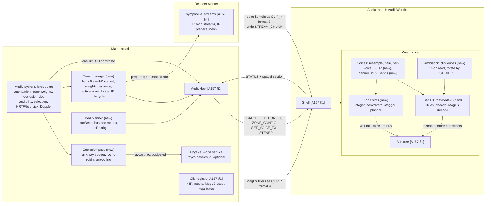
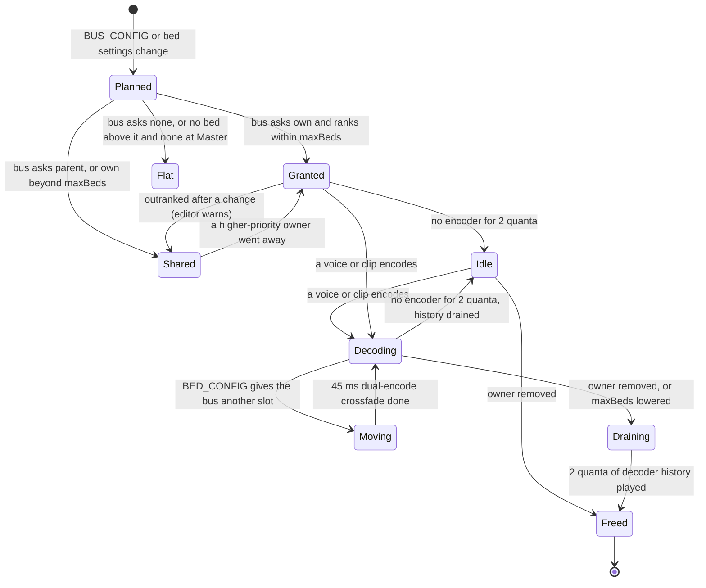
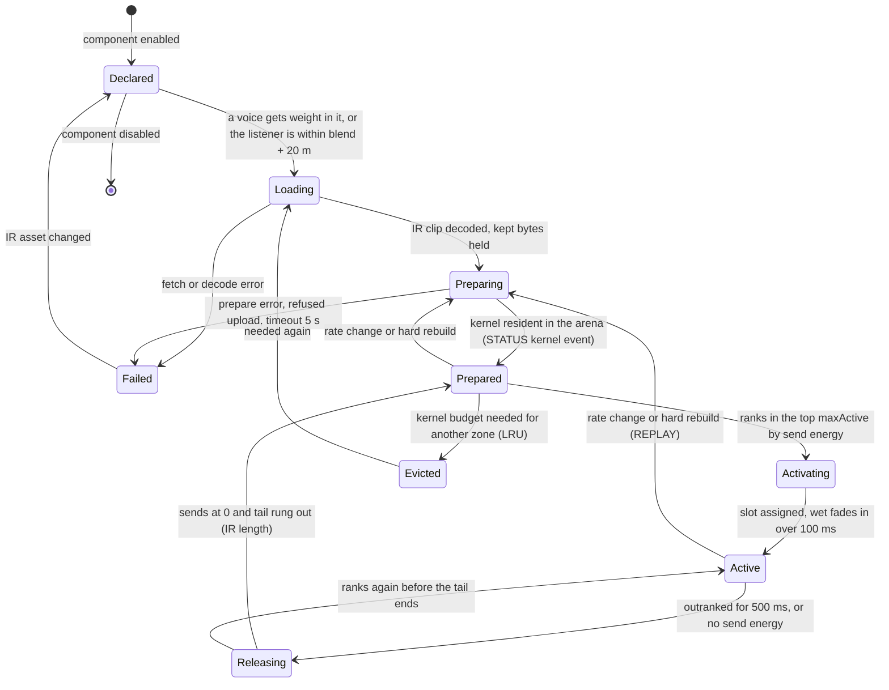
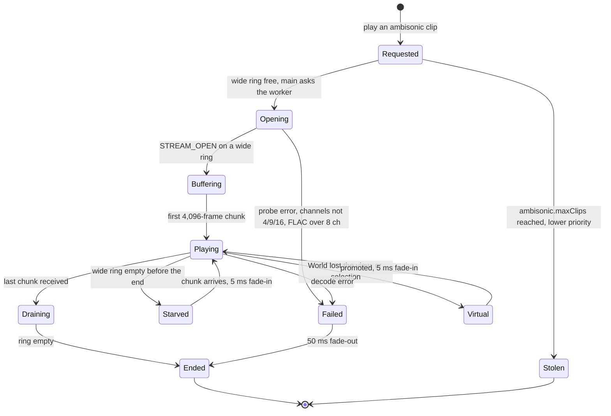
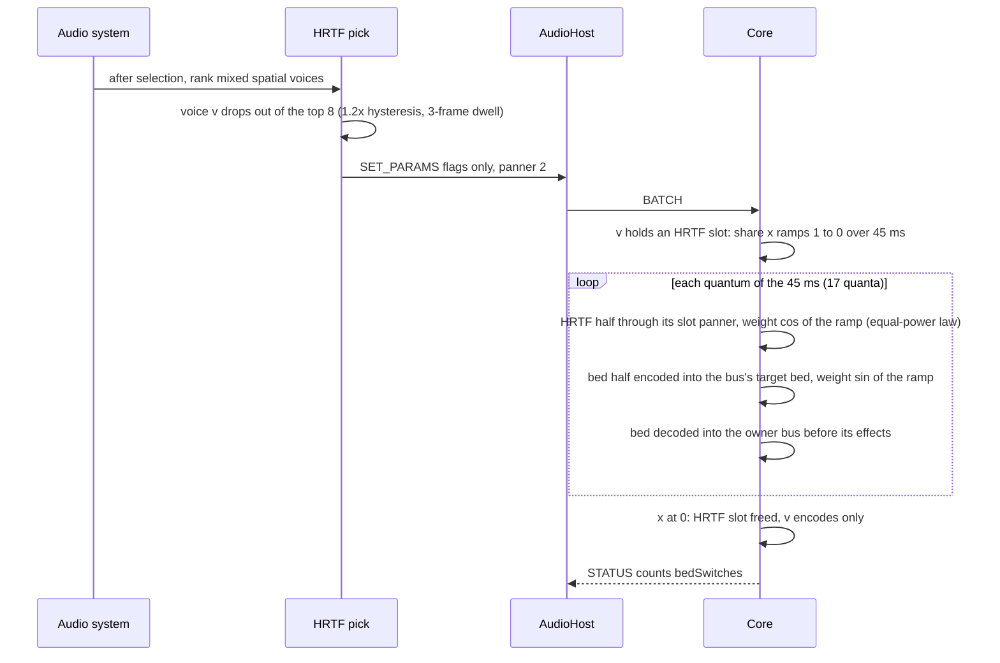
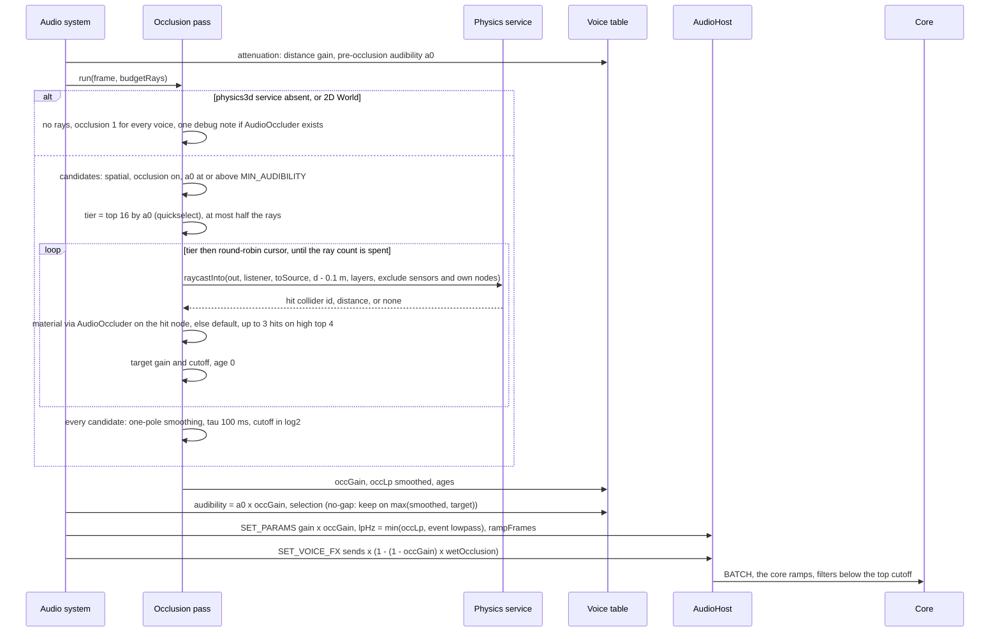
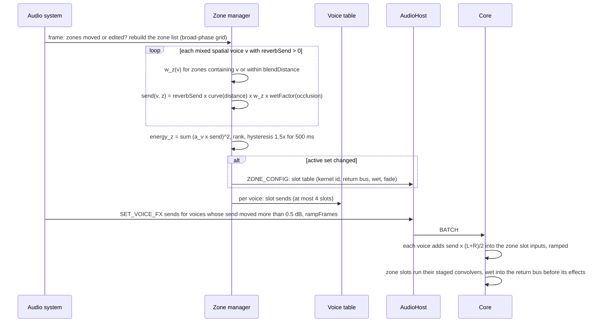
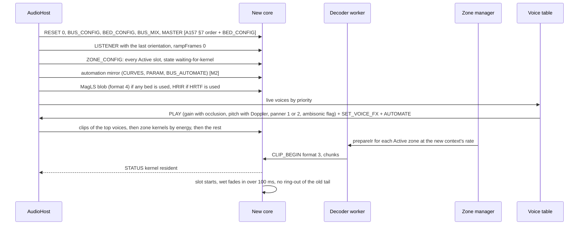
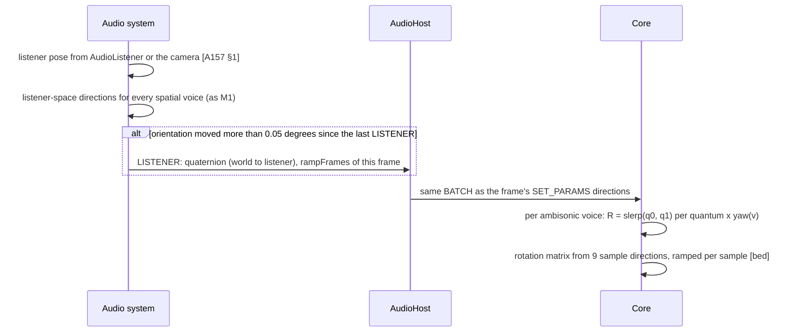
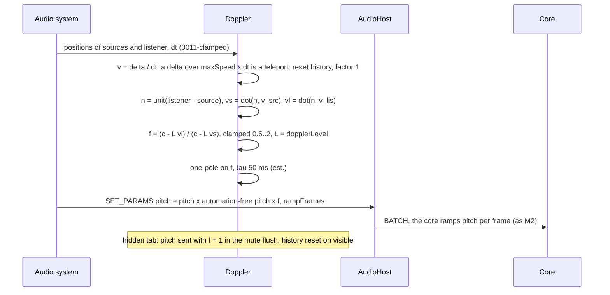

# 0162 spatial audio: system architecture (M3)

The architect's design for ADR 0162 (Accepted direction, revision 3, with the owner's decisions of 2026-11-11). It extends [0157's architecture](../0157-audio-core/architecture.md) (cited as **[A157 §n]**) and does not repeat it: the host, the batch, STATUS, the clock map, the arena, streams, the hard rebuild and the adaptive cap work as there unless a section here says otherwise. Its companion, `api-and-models.md` (the senior engineer's, cited as **[API]**), owns the public API, settings, data models, byte layouts, the Rust ABI, files, tests and tasks. What this file needs from it is listed as contracts **C1–C24** in [contracts-architect.md](contracts-architect.md); the shapes written here are the ones assumed there.

**Evidence.** Numbers cite the M3 spikes (`spikes/audio-spatial/`): **[S]** is the top-level README, **[bed]**, **[conv]**, **[occ]** and **[res]** the sub-READMEs, or code by path. They were taken on the shared 4-vCPU container: **p50 and p99 are usable there; p99.9 and max are not** [S]. 0157's frozen coefficients are the lab VM's [A157 §6.1]. **(est.)** marks a number nobody measured. The convolver numbers are M1's **non-uniform** staged convolver [conv], never a uniform one. A quantum is 128 frames, 2,667 µs at 48 kHz.

**Industry practice.** The owner's rule is to follow Wwise, FMOD, Steam Audio, Unity and Unreal where possible and to say where M3 differs. Each area ends with a short "Practice" line; §12 collects them.

## 1. Overview

M3 adds no thread and no lazy module (0162 §8 amends 0157). The core gains beds, ambisonic clip voices, zone convolvers, per-voice filters and sends inside the mixer wasm; main gains the occlusion pass, zone weights, Doppler and the bed assignment; the decoder worker gains IR preparation.

| Component | Thread | Owns | Does |
|---|---|---|---|
| Bed planner | main | the bed assignment: which bus owns which bed slot, which buses share it | Runs when the bus tree, `audio.bed.maxBeds` or a bus's `bed`/`bedPriority` changes (§2.1); sends BED_CONFIG (C2); warns which buses lost their bed |
| Occlusion pass | main | per-voice occlusion target, smoothed value, age, cause | Per frame, after attenuation: ranks by pre-occlusion audibility, casts rays in budget, smooths (§3.2) |
| Zone manager | main | the scene's zones, each voice's zone sends, the active-zone choice, IR state per zone | Per frame: weights per voice (§3.3); on change: ZONE_CONFIG (C5); IR load and prepare requests (§2.2) |
| Doppler | main | velocity history of sources and listener | Folds a clamped factor into the voice's `pitch` (§3.6) |
| Physics World service | main | colliders, the BVH | Answers an allocation-free ray query (C14). Optional: audio never starts it (0135) |
| Decoder worker | worker | decoders, stream cursors, **IR preparation** | Decodes and resamples an IR to the context rate, builds its partition spectra, sends them straight to the worklet (§2.2) |
| Core: per-voice filters | audio | biquad state | Low-pass for every voice whose cutoff is below the top, high-pass for event filters, in the voice's `VoiceAuto` (§4) |
| Core: beds | audio | bed buffers, decoder history, fold gains | Encodes kind-2 voices and ambisonic clips into a 16-channel bed; decodes each bed once per quantum into its owner bus before the bus's effects (§4.2) |
| Core: zone slots | audio | convolver state, schedules | Runs up to `zoneSlots` staged convolvers fed by per-voice sends; adds their wet output to each zone's return bus (§2.2, §4.4) |
| Core: ambisonic clip voices | audio | 16-channel playheads, rotation matrices | Reads 4/9/16 channels, rotates by LISTENER and yaw, adds into the bus's bed or decodes alone (§2.3) |

| Channel | Direction | Carries (new in M3) | Rate | Mode |
|---|---|---|---|---|
| `node.port` | main → worklet | BATCH with BED_CONFIG (0x16), ZONE_CONFIG (0x17), SET_VOICE_FX (0x0A), LISTENER (0x20) payload; CLIP_* format 4 (MagLS) | 1 batch per frame | transferred, pooled [A157 §1] |
| `node.port` | worklet → main | STATUS with a `spatial` section: beds, zone slots, kernel events (C7) | every 6 quanta | transferred |
| Worker `postMessage` | main ↔ worker | `prepareIr` requests (asset, context rate, slot token, IR cap); `irPrepared`/`irFailed` replies with timings (C9) | events | clone (small) |
| `MessageChannel` port | worker ↔ worklet | zone kernels as CLIP_BEGIN/CLIP_CHUNK format 3 under reserved ids; 16-channel STREAM_CHUNKs; credits back | prepare: one burst of ≤ 3 MB; wide streams ≈ 11.7 chunks/s of 256 KB | transferred, `epoch`-tagged |
| Physics service call | main → main | `raycastInto(out, origin, dir, maxDist, groups, flags, exclude)` | ≤ ray budget per frame | synchronous, no allocation |

Main stays off every PCM path, as in M1: kernels and wide streams go worker → worklet. The Babylon fallback uses none of these (§9).

## 2. Lifecycles

### 2.1 A bed

A bed is a slot of the core's fixed bed region (`maxBeds` slots, sized at init, C8). Main owns the assignment; the core owns the buffers.

**Assignment (main, the bed planner).** Inputs: the bus tree, each bus's `bed` (`own` | `parent` | `none`, default `parent`) and `bedPriority`, `audio.bed.maxBeds` (C10). Steps, in `onmessage`-free main code when the tree changes:
1. Candidates are the buses with `own`. Sort by `bedPriority` (high first), then depth (shallow first), then index. The first `maxBeds` get slots 0..k−1 in that order. **Master always ranks first among candidates if it asks `own`**; if no bus asks `own` and `maxBeds > 0`, Master gets slot 0 implicitly, so `parent` everywhere still yields a 3D bed (0162 §1: "falls back to the master bus's bed").
2. Every other bus resolves its **target bed**: `own`-granted → its slot; `parent` or overflow `own` → the nearest ancestor with a slot, else Master's; `none` → 0xFF (equal-power). A losing `own` bus is reported (`bedDenied`, the editor warns with the winning buses and their priorities).
3. Slots are kept stable across replans: a bus that keeps a slot keeps its index, so a replan moves only the buses whose result changed.

BED_CONFIG (C2) carries, per bus, the target slot and whether it **owns** (decodes) it. Main sends every non-HRTF spatial voice as panner kind 2 whenever `maxBeds > 0`; the core resolves kind 2 through the voice's bus (a bus with target 0xFF pans equal-power). So a replan sends one record, never a record per voice.

**In the core.** A bed decodes only while something encoded into it in the last two quanta (the decoder holds two 128-frame partitions of history, [bed] "2 partitions per filter"), so a silent bus's bed costs nothing. A bus that moves to another slot encodes into both for 45 ms with complementary ramps (the HRTF crossfade time, [A157 §2.4]), then only into the new one. A freed slot keeps decoding its history for 2 quanta so no tail is cut. RESET clears every bed.

**Practice.** Wwise: each bus picks a channel configuration, ambisonic ones included; child buses mix into the parent's ambisonic bus. M3 follows that for routing (`parent` mixes into the ancestor's bed) and differs in one place: a sharing bus has no ambisonic buffer of its own, so its effects and meter don't apply to its distant voices (its gains do, §4.3). A per-bus bed for every bus would cost ≈ 20 µs and 48 KB each; `maxBeds` is the budget knob Wwise leaves to the bus count.

### 2.2 A reverb zone

Each `AudioReverbZone` (C11) is main's object; a **zone slot** is the core's convolver state; a **kernel** is one IR's partition spectra at the context rate, shared by every zone using that IR.

**Load and prepare.** The IR is an `audio` clip (0162 §4, 0143) or a procedural preset generated on main (M1's IR generator, `audio-dsp/src/convolver/ir.rs`, at the context rate). The zone manager asks the decoder worker to **prepare** it (C9): decode, take the first `maxIrSeconds` of it (the preset's cap, §5.4; longer IRs are cut with a 50 ms fade and one warning), resample to the context rate, run M1's normalisation and transforms (the head's 256-point and the tail's 4,096-point FFTs per partition, [conv] "`Prep`"), and send the spectra **straight to the worklet** as a CLIP_BEGIN/CLIP_CHUNK blob of format 3 under a reserved id (C6). The core reserves it in the arena outside `clipMemoryMB`, counted in the zone budget. Preparation in the worker takes 1.3 / 2.5 / 5.3 ms for 1 / 2 / 4 s at once [S] (an audio-thread cost the worker absorbs; the worker's own timing is unmeasured, [S] "Still unverified"). Upload goes through the 256 KB-per-quantum copy budget [A157 §4.7]: 3 MB in ≈ 12 quanta.

**Worker missing.** If the decoder worker isn't running (it crashed, or failed to load), main decodes the IR as M1a does (`decodeAudioData`, resample, int16→f32) and uploads the **time-domain IR** as a format 3 blob with a `pcm` flag; the core then builds the spectra itself spread over quanta, one prepare unit per quantum ([conv]: +19–23 µs a quantum for 0.25–0.8 s depending on length), into the kernel block it reserved for that id, so no second buffer set is needed. A zone that isn't prepared plays dry.

**Activity.** Main ranks Prepared and Active zones by **send energy**, Σ over mixed voices of (voice audibility × send)² (§3.3). The top `maxActive` (2 high and default, 1 low) are active; a zone must beat the weakest active one by 1.5× (3.5 dB) for 500 ms to replace it (est., hysteresis against swap thrash). The incoming zone takes the **standby slot**, so slots = `maxActive + 1` (§5.4); the outgoing zone's sends ramp to 0 and it rings out its tail (up to the IR length) in its slot before the slot is free again. A slot whose input has been silent for its IR length plus 2 quanta stops running (the core checks, no message), so an inactive zone costs nothing.

**Rate change and REPLAY.** Kernels are rate-bound ([conv]: partition counts change at 44.1 kHz; `convolver.rs` sizes by rate). A rate change or hard rebuild re-prepares every Prepared and Active zone from the kept IR bytes; until its kernel is back a zone is silent, then fades in over 100 ms (§3.4).

**Practice.** Wwise rooms: a source sends to the room it is in (per-source membership, game-defined aux sends, the room's reverb rings out after the listener leaves). M3 follows that (owner decision 1). FMOD and Unity reverb zones blend by **listener** position; M3 differs on purpose. Wwise lets every room have a reverb; M3 caps active zones at 2 (memory: 3–6 MB per zone, [S]) and says so in the editor.

### 2.3 An ambisonic clip voice (streamed)

A clip with a sidecar `ambisonic: { order, convention }` (0162 §2, C16) plays as a voice with PLAY flag `ambisonic` (C1). It streams by default (a 3rd-order minute is ≈ 92 MB in int16 [S]); short clips with `stream: false` go to the arena, which accepts 4, 9 and 16 channels (C6).

| Aspect | Design |
|---|---|
| Rings | **Wide rings**: a separate region of `audio.ambisonic.maxClips` rings (2 high, 1 default, 1 low), each 16 channels × the M1 ring's 38,400 frames of storage (C8), so the 2-channel rings are untouched [A157 §5.1]. A 4- or 9-channel stream uses a wide ring at its own channel count |
| Decode | symphonia reads 4- and 16-channel WAV (PCM and float, extensible with and without the B-format GUID) in file order [bed]; FuMa is converted in the worker per chunk (reorder and W × √2 for 1st order; 2nd/3rd-order FuMa per the MaxN→SN3D table, [res] [U], verified by a unit test) |
| Render | the 4-point resampler per channel to the context rate; then one rotation (block-diagonal 1 + 9 + 25 + 49 products a frame, ramped from the previous matrix, [bed]) by R = (listener orientation)⁻¹ · yaw(clip); then added into the bus's target bed (lower orders fill the first (N+1)² channels). With no bed on its bus (target 0xFF, or `maxBeds` 0) it is decoded alone through one of `maxClips` private decoders (C8) |
| Cost | rotate into a bed ≈ 5 µs (3rd order), 1 µs (1st); rotate and decode alone ≈ 23–26 µs / 7–8 µs at p50, 37 µs p99 3rd order [S], [bed]; the 16-channel resampler read ≈ 8 µs (est.: 8× a stereo voice's 1.2–1.5 µs resampler, [bed] Doppler) |
| Pitch | an ambisonic voice plays at pitch 1 (Doppler and `pitch` don't apply; a pitch automation binding is refused at load with one warning) |
| Selection | it ranks by its gain × bus gain (no distance); it is never HRTF and never occluded; its zone send uses the listener's zone weights (it has no position) |

## 3. Interactions

### 3.1 A voice moves from HRTF to the bed

Selection gives HRTF to the top `voices.hrtf` (8 on high, owner decision 3) spatial voices by audibility with M1's 1.2× hysteresis and 3-frame dwell [A157 §2.4]; every other spatial voice is kind 2 when `maxBeds > 0`.

- **Law.** M1's 0↔1 crossfade is linear (both halves are the same signal, correlated). Any change involving kind 2 uses an **equal-power** law, because MagLS matches magnitude, not phase, above 1.5 kHz, so the two halves are partly uncorrelated and a linear crossfade dips ([bed]: 1–4 dB for one quantum; equal-power was the first remedy it named, untried). The bed decoder's missing history for the entering voice is covered by the HRTF half still being near full for the first two quanta of the 45 ms. Whether the dip is gone is a listening-pass exit item (0162 §1).
- **Below −60°** a voice's interaural time difference changes by up to 300 µs at the switch ([bed]: M1 clamps at −45°, MagLS falls toward 0). Listening-pass item (owner decision 5).
- **Thrash guard.** The debug panel counts `bedSwitches` per second; > 4 per voice-second (est.) is shown as a warning, since 8 slots make the boundary busier than 16.

**Practice.** Wwise and Unreal choose per-object binaural vs. bed by priority or distance; neither documents a crossfade law [U]. M3's audibility ranking with hysteresis is M1's.

### 3.2 An occlusion frame

| Element | Design |
|---|---|
| Place | between attenuation and audibility, the slot M1 reserved [A157 §10] |
| Budget | a **ray count** per frame, not a timer: `performance.now()` is coarse on pages that aren't cross-origin isolated (architect RFC, `docs/rfc/0162/architect.md`), so the count is `budgetMs / rayCost`, with `rayCost` an EMA (α 0.1) of measured time per batch of ≥ 16 rays where the clock resolves it (≤ 0.1 ms), else the default 3.5 µs [S]. Default 0.25 ms ≈ 70 rays, high 0.5 ms ≈ 140, low 0.06 ms ≈ 16 (0162 §3) |
| Ranking | by **pre-occlusion** audibility a0 (so a muffled source isn't recast less often, mid-engineer RFC). Tier 16 every frame, at most half the rays; round-robin over the rest from a cursor; a source cast in the tier is skipped by the cursor that frame [occ] |
| Rays | default: one centre ray per source, first hit only. High: the top 4 of the tier get 3 rays (centre and ±0.5 m lateral, perpendicular to the ray in the horizontal plane) and each ray continues through up to 3 hits (re-cast from 1 cm past each hit, [occ] "R1x3") |
| What occludes | colliders on `audio.occlusion.layers` (default every layer, sensors excluded by a query flag, so no collider changes layer, 0162 §3); the source's own node subtree and the listener's node are excluded (a character's capsule doesn't occlude its own footsteps) |
| Material | the hit collider's node → its `AudioOccluder` (cached by collider id, invalidated when the component is added, removed or edited) → its material row, else `audio.occlusion.defaultMaterial` (C12). A row: `transmissionDb`, `cutoffHz`, `wetOcclusion` |
| Combine | per ray: gains multiply (dB add) over its hits, cutoff = min over hits; floor −60 dB. Over a source's rays: linear mean of gains, mean of log2 cutoffs. No hit: gain 1, cutoff top |
| Smoothing | on main: one-pole, τ 100 ms for gain and log2 cutoff (≈ 60 ns per source, [occ]); a voice's first result applies at once (no fade from clear); a promoted voice starts at its smoothed value |
| To the core | the smoothed gain folds into SET_PARAMS `gain`, the cutoff into `lpHz` (min with the event's static `filter.lowpass`); the wet factor into SET_VOICE_FX sends (C3); all with the frame's `rampFrames` [A157 §4.3]. PLAY carries them, so a promote or replay starts occluded |
| Overrun | the ray count is fixed before the pass; if a frame's measured pass exceeds 2× budget (a GC or a slow scene), the next frame's count halves and recovers by +10% a frame (est.). Sources not reached keep their last result; the age shows in debug |
| Staleness | a source's result is at most `ceil(S_rr / (rays − tier rays))` frames old: 3 frames at 64 sources, 5 at 256, 22 at 1,024 for 0.25 ms [S]; smoothing then adds ≈ 100 ms |

**Practice.** Wwise and FMOD leave the ray work to the game and expose an occlusion value mapped to volume and low-pass; Wwise's occlusion reduces dry and wet, obstruction only dry [res] [U]. Unreal's built-in occlusion traces each source on a timer (≈ 0.1 s interval) with an interpolation time [U]. M3 follows the value model (gain and low-pass, wet scaled by `wetOcclusion`) and differs in scheduling: a frame budget ranked by audibility replaces per-source timers, which keeps the main-thread cost flat at 1,024 sources ([occ]: casting everything is 3.8 ms a frame). Steam Audio's 3-band transmission is an extension (§11).

### 3.3 Zone weights per source and send

- **Weight.** Inside the volume, 1; outside, falling linearly to 0 over `blendDistance` (default 2 m, sound designer RFC) measured to the box or sphere surface. Overlapping zones are normalised so Σ w ≤ 1 by equal-power division (w_z / √Σw_z², est.: overlapping rooms share the send rather than doubling it).
- **Send.** `reverbSend` (default 1 for spatial sources) × the send-versus-distance curve (0158's curve type, default a rise from 0.5 at `minDistance` to 1 at `maxDistance`, est.) × w × the wet factor 1 − (1 − occGain) × `wetOcclusion`. Ambisonic clip voices and non-spatial voices use the **listener's** weights.
- **What the send carries.** The voice's post-gain, post-filter, pre-panner block, summed to mono, into both inputs of the zone's stereo convolver (cost `REVERB_SEND` 0.15 µs per send, est. [A157 §6.1]). The send also takes the voice's **bus-chain gain to the root** (§4.3), so muting Footsteps mutes footsteps' reverb. (Wwise sends ignore the output bus's volume [U]; M3 differs because its buses are where designers turn things down.)
- **Return.** Each zone's wet output goes into its `output` bus (default Master), before that bus's effects, so it has a fader, ducking and a meter.
- **The shared reverb.** The bus `reverb` effect still feeds M1's shared convolver [A157 §1]. Its return is scaled by **1 − the listener's total zone weight** (ramped), so the shared reverb is the "outside any zone" reverb (FMOD's ambient reverb [U]) and doesn't double a zone's. (Under-specified in 0162 §4; see the reply's flags.)
- **Cost on main.** A uniform grid over zone bounds (cell 8 m, est.), then point-in-volume per candidate zone: ≈ 40 ns per (voice, zone) test (est.); 256 voices × 3 nearby zones ≈ 30 µs.

### 3.4 Hard rebuild (REPLAY) restoring beds and zones

- Zone tails and bed histories are lost; the rebuild's gap (≈ 1–3 s, [A157 §7]) hides them. A zone becomes audible only once its kernel is resident, with a 100 ms fade, so two zones returning at different times don't jump (architect RFC).
- Ambisonic streams reopen with a new epoch on a wide ring [A157 §3.4]. Occlusion and Doppler need nothing: main's smoothed values ride PLAY.
- A **soft** RESET (`keepClips` 1, the idle reset) keeps kernels and the MagLS blob in the arena.

### 3.5 Listener update and clip rotation

The quaternion uses the **same `rampFrames`** as that frame's direction changes, and the core interpolates it per quantum (the rotation matrix ramps per sample inside the quantum), so clips and point voices turn together (architect RFC issue 10). LISTENER is asap like SET_PARAMS. Voices keep listener-space directions from main; the core doesn't rotate them.

### 3.6 Doppler

Doppler adds no core state: the factor rides `pitch`, so `PlayheadTracker.rateOf` (`core/replay.ts`) keeps replay offsets right and the resampler needs nothing ([bed]: no measurable cost over constant pitch). Velocity is projected with OpenAL's formula, which Unity and FMOD also use [U]; `audio.speedOfSound` is in world units per second (default 343).

## 4. The per-voice pipeline in the core

M3's per-voice order (changes in bold): resample → distance/cone gain (main) → gain and fade ramps → automation `gainMul` → **low-pass and high-pass** → **sends** → **panner (0 equal-power, 1 HRTF, 2 bed encode)** → bus (kinds 0/1) or bed (kind 2).

### 4.1 Per-voice filters

| Aspect | Design |
|---|---|
| Who is filtered | every mixed voice whose effective cutoff is below `LP_TOP` (20,000 Hz) or whose `hpHz` is above `HP_BOTTOM` (10 Hz); others pay nothing and render bit for bit as M2 |
| Effective low-pass | `min(lpHz, lpAuto, foldLp)`: `lpHz` from main (occlusion and the event's static `filter.lowpass`, already min'd), `lpAuto` from automation (0158), `foldLp` from a sharing bus chain's snapshot low-pass (§4.3). **Lowest wins**, as 0158 decided for automation |
| Filter | the biquad already in each voice's `VoiceAuto` (M2, `automation.rs`), same Q as the snapshot low-pass; coefficients at most once per quantum, the cutoff ramped per quantum in log2 over `rampFrames` |
| High-pass | a second biquad in `VoiceAuto` (C17), for event `filter.highpass` only |
| Active list | a voice joins `VoiceAuto`'s dense list when it gets a cutoff below the top, as a voice with bindings does; it leaves when both filters are off for a quantum (state cleared) |
| Cost | 1.2 µs per filter (`BIQUAD` 1,200 WU, [A157 §6.1]) |

"Lowest wins" replaces a cascade: a voice behind a 2 kHz wall on a bus with a 5 kHz snapshot is filtered once at 2 kHz, not twice. Where both are active the result is up to 3 dB brighter at the lower cutoff than a cascade (est., two second-order sections), accepted for one filter's cost. The debug view names the stage that won (§8).

### 4.2 Beds: encode and decode

| Step | Where | Design |
|---|---|---|
| Encode | voice render, panner kind 2 | 16 SN3D gains from the unit direction by polynomial (no trig) at the quantum's start (from the direction ramp's start value) and end; one pass `bed[c][i] += x[i]·(a_c + i/128·s_c)` with gains ramped across the quantum [bed]. Stereo clips encode their mid (L+R)/2 (est.; a listening item). No per-voice state |
| Gain | | the voice's gain × fold gain of its bus chain to the bed owner (§4.3), ramped per quantum |
| Clips | ambisonic voice render | rotated block-diagonally and added into the first (N+1)² channels (§2.3) |
| Decode | after every voice, **before `bus::mixdown`** | per bed that is Decoding: 16 forward 256-point FFTs, 16 × 2 × 2 complex MACs over 128 bins, 2 inverse FFTs (MagLS, 2 partitions; [bed] ≈ 20–22 µs); added into the owner bus's `buf`, so the bus's effects, snapshot low-pass, gain, meter and ducking apply as to any voice [A157 §1] |
| Filters | MagLS time responses shipped per rate as an asset (C6): 32 KB at 44.1 and 48 kHz (16 ch × 2 ears × 256 taps f32, [bed]); other rates resample the 48 kHz responses on main with M1's HRIR resampler (`core/hrir.ts`), 512 taps at 96 kHz (4 partitions, decode ×2, est.). The core transforms them to spectra (64 KB at 48 kHz) in `onmessage` when the blob commits (64 FFTs, ≈ 0.1 ms, est.). Loaded lazily, the first time a bus gets a bed; until resident beds decode through the equal-power matrix |
| Equal-power mode | `audio.spatial: "equalPower"` | beds decode through a 16 → 2 gain matrix (the SH projection of Blink's equal-power law, baked offline, 128 B; ≈ 2 µs est.), never fetching HRIR or MagLS data |

### 4.3 Gain folding for `parent` buses, and ducking

A voice on bus B whose target bed is owned by ancestor A skips B…child-of-A's buffers. Their gains must still apply. **The core folds them**, not main: it already holds each bus's BUS_MIX gain ramp and its automation `gainMul` (M2), so no new wire field is needed and nothing lags by a frame.

- Per quantum, before voices render, for each bus b with a target bed it doesn't own: `fold0[b]`, `fold1[b]` = Π over the chain b, parent(b), …, up to but excluding the owner, of (BUS_MIX gain × `gainMul`) at the quantum's first and last frame. A walk of ≤ depth multiplies per bus, ≤ 256 buses, in `onmessage`-free render code (≈ 1 µs for 32 buses, est.).
- `foldLp[b]` = min over the same chain of the snapshot low-pass `min(lpHz, lpAuto)`; it feeds §4.1. Voices on a chain with no snapshot pay no filter.
- The encode ramps the voice gain × fold linearly from `fold0` to `fold1` across the quantum.

**Exactness against `bus.rs`.** Ducking, mute, solo, volume and snapshot gain all reach the core as the bus's BUS_MIX `gain` (`mixer.ts` `gainOf`: volume × snap × duck × autoGain, 0 when muted; `coreBackend.applyMix`). The core ramps that gain **per frame** over `rampFrames` and `gainMul` **linearly across the quantum** (`bus.rs`, `automation.rs`). Folding is therefore exact except in three bounded cases:
1. A ramp that ends inside a quantum: the fold's straight line misses the knee by at most |Δg per frame| × 64 frames (est., < 0.1 dB for a 5 ms duck of 12 dB at 48 kHz: the ramp moves 0.05 dB a frame, but only one quantum per change is affected).
2. Two ramping factors in the chain: the product of two lines is a parabola; its deviation from the chord is at most Δg₁·Δg₂ / 4 of full scale over that quantum (est.).
3. Order: unshared, a bus applies its gain after its effects; shared voices have no effects of their own, so order matters only for the snapshot low-pass, which becomes per-voice and min-combined (§4.1).

Ducking's **trigger** side is unchanged: main counts every live voice per bus, bed or not (0097, [A157 §1]). A sharing bus's meter no longer shows its distant voices (they show on the owner's meter), as 0162 §1 states.

### 4.4 Zone slots and the stagger planner

Each zone slot is an M1 staged convolver over owned buffers ([conv] "`src/conv.rs`", bit-identical to M1's), with its kernel in the arena and its state in the zone region (§5.4). M1's convolver runs per channel on a 16-quantum tail schedule `(f, i)`, `f + 2 ≤ i ≤ 15` [conv].

| Planner element | Value |
|---|---|
| When | in `onmessage` when ZONE_CONFIG starts a slot (never while a slot runs: a running slot keeps its schedule) |
| Model | per quantum load: a 4,096-point transform 1.0, one partition multiply-add 0.055 ([conv] `examples/micro.rs`: 20.7 µs, 1.06 µs native; wasm ratio unmeasured) |
| Objective | minimise the busiest quantum's modelled load (`plan_stagger`, depth-first with a cap search), with running slots and M1's shared reverb (left (0, 15), right (1, 14)) fixed |
| Search size | ≤ 4 slots × 2 channels; ≤ 50 µs per plan (est.) |
| Effect | at 4–8 zones the modelled peak halves (2 s) and p99 falls 25–35% [S]; 0162 retires "never share a tail quantum" |

Inputs come from voice sends (§3.3), summed into each slot's stereo input buffer during voice render; the slot runs after voices, alongside bed decode, and adds its wet output × `wet` × its fade ramp into its return bus's `buf` before `mixdown`.

## 5. Threading, state and constants

### 5.1 State ownership

| State | Owner (writes) | Copy elsewhere |
|---|---|---|
| Bed assignment (bus → slot, owner flag) | main (bed planner) | BED_CONFIG |
| Bed buffers, decoder history, fold gains | core | bed voices and cost in STATUS `spatial` |
| Panner kind 1 vs 2 | main (HRTF pick) | SET_PARAMS flags; the core resolves kind 2 through the bus |
| Occlusion target, smoothed gain/cutoff, age, cause | main | folded into `gain`, `lpHz`, sends |
| Per-voice filter state | core | none |
| Zone set, weights, sends, active choice | main (zone manager) | ZONE_CONFIG, SET_VOICE_FX |
| Zone kernels (spectra) | core arena | kept IR bytes on main or the worker's cache |
| Zone convolver state, schedules | core | slot state in STATUS `spatial` |
| IR preparation | worker | `irPrepared` timings to main |
| Listener orientation | main | LISTENER |
| Doppler velocity history | main | folded into `pitch` |
| Ambisonic stream cursor | worker | chunk headers [A157 §4.1] |

One owner per row, as in M1. The one split value is the low-pass: main owns `lpHz`, automation owns `lpAuto`, the bus tree owns `foldLp`; the core takes the minimum and reports which won.

### 5.2 Staleness bounds

| Value | Normal bound | Under a main stall of *s* |
|---|---|---|
| Occlusion heard after a wall appears | ray refresh (≤ 3 / 5 / 22 frames at 64 / 256 / 1,024 sources, 0.25 ms) + τ 100 ms + asap latency 53–63 ms [A157 §4.3] | ramps hold at the last target |
| Zone send after a source enters a room | 1 frame + asap latency; a new zone becomes audible after load + prepare + upload (≈ 50–200 ms, est.) + 100 ms fade | held |
| LISTENER vs voice directions | same batch, same `rampFrames`: 0 skew | both held |
| Doppler pitch | 1 frame + 50 ms smoothing | held, then reset on resume |
| Bed assignment after a settings edit | next batch (asap) + 45 ms crossfade | — |
| STATUS `spatial` (bed cost, slot states) | ≤ 16 ms + 1 frame [A157 §4.2] | *s* |

### 5.3 Constants

Every M3 constant, in one table. Settings (C10) are marked **S** with their per-preset defaults (low / default / high); the rest are code constants.

| Area | Constant | Value | Source |
|---|---|---|---|
| Beds | **S** `audio.bed.maxBeds` | 0 / 2 / 4 (range 0..4) | 0162 owner decision 6 |
| | bus `bed` default | `parent` | 0162 §1 |
| | bus `bedPriority` | 0..255, default 128 (as `priority`) | this design |
| | Ambisonic order of beds | 3 (16 ch, ACN/SN3D) | 0162 §1 |
| | Bed idle after | 2 quanta with no encoder | [bed] decoder history 2 partitions |
| | Bed move crossfade | 45 ms | [A157 §2.4] |
| | MagLS cutoff, partitions | 1.5 kHz; 256 taps (2 × 128) at 48 kHz | [bed] |
| HRTF | **S** `voices.hrtf` | 4 / 16 / 8 (8 on high where beds exist; stays as set when `maxBeds` 0) | owner decision 3; 0157 §2.4 for low/default |
| | Kind change involving 2 | 45 ms, equal-power law | [bed] finding 5 |
| | Kind 0↔1 | 45 ms, linear (M1) | [A157 §2.4] |
| | `bedSwitches` warning | > 4 per voice-second (est.) | this design |
| Clips | **S** `audio.ambisonic.maxClips` (= wide rings = private decoders) | 1 / 1 / 2 | this design (memory, §5.4) |
| | Orders, containers | 1st: WAV, FLAC; 2nd–3rd: WAV only; no Opus | 0162 §2, [bed] |
| | Rotation ramp | per sample from the previous matrix | [bed] |
| Occlusion | **S** `audio.occlusion.budgetMs` | 0.06 / 0.25 / 0.5 (clamp 0.02..2) | 0162 §3, [S] |
| | Default ray cost | 3.5 µs (≈ 300 rays/ms) | [S] |
| | Ray-cost EMA | α 0.1 over batches of ≥ 16 rays | this design |
| | Tier | 16 sources, ≤ ½ the rays | [occ] |
| | Multi-ray (high only) | top 4: 3 rays (±0.5 m lateral), ≤ 3 hits each | 0162 §3; [occ] R1x3 |
| | Ray inset | start at the listener, stop 0.1 m short of the source | [occ] used 0.05 m |
| | Smoothing τ | 100 ms (gain; cutoff in log2) | 0162 §3, [occ] |
| | Transmission floor | −60 dB | this design |
| | Overrun response | next frame's rays ÷ 2 if a pass > 2× budget, +10% per frame after | this design (est.) |
| | **S** `audio.occlusion.layers` | every layer (sensors excluded) | 0162 §3 |
| | **S** `audio.occlusion.defaultMaterial` | `"concrete"` | sound designer RFC |
| | `wetOcclusion` default per material | 0.5 | 0162 §3 |
| Zones | **S** `audio.zones.maxActive` | 1 / 2 / 2 | 0162 §4 |
| | Zone slots | maxActive + 1 (standby) | this design |
| | **S** `audio.zones.maxIrSeconds` | 1 / 2 / 4 | 0162 §4 memory budget |
| | Swap hysteresis | 1.5× energy for 500 ms (est.) | this design |
| | Fade in (activate, after REPLAY) | 100 ms | architect RFC |
| | Slot stops after | IR length + 2 quanta of silent input | this design |
| | `blendDistance` default | 2 m | sound designer RFC |
| | Send-distance curve default | 0.5 at `minDistance` → 1 at `maxDistance` (est.) | 0162 §4 |
| | Zone send update threshold | 0.5 dB | this design |
| | Prepare request when | a voice has weight, or listener within blend + 20 m | this design |
| | Prepare timeout | 5 s, then Failed | this design |
| | Planner model | transform 1.0, MAC 0.055; cycle 16; f + 2 ≤ i ≤ 15 | [conv] |
| | IR cut fade | 50 ms | this design |
| Doppler | **S** `audio.speedOfSound` | 343 world units/s | 0162 §5 |
| | **S** `audio.doppler.maxSpeed` (teleport guard) | 150 world units/s (est.) | 0162 §5 (value: this design) |
| | Clamp | factor 0.5..2 (±1 octave) | 0162 §5 |
| | Smoothing τ | 50 ms (est.) | this design |
| Filters | `LP_TOP`, `HP_BOTTOM` | 20,000 Hz, 10 Hz | this design |
| Listener | LISTENER resend threshold | 0.05° | this design |
| Streams | Wide ring | 16 ch × 38,400 frames storage (32,768 ring + 4,096 chunk + 1,536 seek tail) f32 | [A157 §5.1] |
| | Wide chunk | 4,096 frames × ≤ 16 ch = 256 KB (the copy budget per quantum) | [A157 §4.7] |

## 6. Memory

### 6.1 New regions and blobs

| Item | Formula | Low / default / high (48 kHz) |
|---|---|---|
| Bed region | `maxBeds` × (8 KB bed + 40 KB decoder history) | 0 / 96 KB / 192 KB [bed] |
| Private clip decoders | `maxClips` × 48 KB | 48 / 48 / 96 KB |
| MagLS spectra (arena, reserved id) | 64 KB at 44.1/48 kHz; 128 KB above 88.2 kHz | 0 (none without beds, unless a clip decodes alone) / 64 / 64 KB |
| Fold table | 256 buses × 12 B | 3 KB |
| Second biquad per voice (`VoiceAuto` growth) | logical × ≈ 40 B (est.) | 40 / 160 / 320 KB |
| Zone region (state) | slots × (whole zone − kernels) at the IR cap | 2 × 897 KB = 1.75 MB / 3 × 1,633 KB = 4.8 MB / 3 × 3,137 KB = 9.2 MB [conv] |
| Zone kernels (arena, outside `clipMemoryMB`) | kernel budget = slots × kernels at the IR cap | 2 × 768 KB = 1.5 MB / 3 × 1,504 KB = 4.4 MB / 3 × 3,008 KB = 8.8 MB [conv] |
| **Zones total** | | **3.3 / 9.2 / 18.0 MB** |
| Wide stream rings | `maxClips` × 16 × 38,400 × 4 B = 2.34 MiB each | 2.34 / 2.34 / 4.69 MiB |
| Ambisonic clips in the arena | 16-ch int16: 1.5 MB/s at 48 kHz | under `clipMemoryMB` |
| **M3 total, fixed** | | **≈ 5.8 / 12.0 / 23.4 MB** |

**Versus 0162 §4.** The record's zone budget (1.7 / 6 / 12 MB) counts the active zones only. A swap needs the standby slot, and a released zone rings out its tail in its slot, so the peak is `maxActive + 1` zones (flagged in the reply). Zone memory scales with the context rate: at 96 kHz double it (partition counts double).

Kernels for zones that are Prepared but not slotted stay in the arena while the kernel budget allows (LRU), so walking back into the last room re-uses its kernel without preparing again. The arena is never compacted [A157 §5.2]; kernel blocks use the clip classes, and a reset on empty applies to them too.

### 6.2 Wasm size

The bed runtime spike was 115 KB including allocator, FFT and panic code already in the mixer; the increment is unmeasured [bed]. Est. +30–50 KB for beds, rotation, zone slots and the planner on the mixer's 178.6 KB (M2), under the 256 KB tripwire. The decoder gains IR preparation, ≈ +27 KB ([conv] `probe_zone`), on 749 KB; the AAC build (1,073 KB of 1,280 KB) gets it too.

## 7. Performance

### 7.1 The model

0157's per-quantum formula [A157 §6.1] gains M3's terms:

*T*_q += *B*·*c*_dec + *N*_bed·*c*_enc + *A*·(*c*_rot + *c*_wide) + *A*_solo·*c*_dec + Σ_z *c*_zone(len_z) + (*P*_lp + *P*_hp)·*c*_bq + *S*·*c*_send + *c*_fold − *N*_bed·*c*_mov

*B* beds decoding, *N*_bed kind-2 voices, *A* ambisonic clip voices (*A*_solo of them decoding alone), *P* filtered voices, *S* nonzero (voice, slot) sends. Bed voices don't run the moving equal-power matrix, so *c*_mov is credited (architect RFC issue 3); the credit is conservative only if *c*_enc is measured inside `audio-core`, which the spike didn't [bed].

| Term | Value (wasm p50 / p99, container) | `cap::wu` proposal | Source |
|---|---|---|---|
| *c*_dec | 20 / 33 µs | `BED_DECODE` 20,000 | [S] perf table |
| *c*_enc | 0.4–0.7 µs | `BED_VOICE` 500 | [S] |
| *c*_rot (3rd order) | ≈ 5 µs | `AMBI_ROTATE` 5,000 | [bed] clip_o3_rot |
| *c*_wide (16-ch resample) | ≈ 8 µs (est.) | `AMBI_READ` 8,000 | est. from [bed] |
| *c*_zone | 1 s ≈ 13; 2 s 20 / 72; 4 s 30 / 76 µs | `ZONE_BASE` 8,500 + `ZONE_PER_S` 4,500 | [conv] finding 1, [S] |
| *c*_bq | 1.2 µs | `BIQUAD` 1,200 (exists) | [A157 §6.1] |
| *c*_send | 0.15 µs (est.) | `REVERB_SEND` 150 (exists) | [A157 §6.1] |
| *c*_mov credit | 0.86 µs | `MOVING_VOICE` 860 (exists) | [A157 §6.1] |
| HRTF voices 16 → 8 | −8 × (7.4 − 0.5) ≈ −55 µs | | 0162 §1, architect RFC issue 4 |

### 7.2 Scenes per preset (est.)

| Scene (wasm, container) | p50 | p99 | p99.9 (est.) |
|---|---|---|---|
| **Typical high** (0162 §8): 2 beds, 240 bed voices, 1 3rd-order clip, 2 blending 2 s zones, 32 filtered voices, 240 sends | 40 + 120 + 13 + 47 + 38 + 36 − 55 ≈ **0.24 ms** | ≈ 0.5 ms (0162 §8; component p99s summed, an upper estimate) | ≈ 0.6–0.8 ms (lab-VM p99.9/p50 ratio 2.6 at high, [A157 §6.1], applied to the p50) |
| **Worst high**: 4 beds, 248 bed voices, 2 clips (one alone), 3 slots of 4 s (a swap with ring-out), 256 low-passed + 32 high-passed, 496 sends | 80 + 124 + 49 + 90 + 346 + 74 − 55 ≈ **0.71 ms** (27% of the quantum) | ≈ 1.2 ms | ≈ 1.8 ms |
| **Worst default**: 2 beds, 112 bed voices, 1 clip, 3 slots of 2 s, 128 filtered, 224 sends | 40 + 56 + 13 + 60 + 154 + 34 ≈ **0.36 ms** | ≈ 0.7 ms | ≈ 0.9 ms |
| **Worst low**: no beds, 1 clip alone, 2 slots of 1 s, 64 filtered, 60 sends | 31 + 26 + 77 + 9 ≈ **0.14 ms** | ≈ 0.3 ms | phone: unverified (owner) |

The per-voice filters dominate the worst cases (an indoor scene with 80% of rays blocked [occ] filters most voices). They scale with mixed voices, so the adaptive cap sheds them.

**Against the quantum and 0157's budget.** M1's high preset is already 2.07 ms p50 and 5.45 ms p99.9 on the lab VM against a 1.3 ms p99.9 budget [A157 §6.1]. M3 adds ≈ 0.24 ms (typical) to 0.7 ms (worst) at p50. The 4-quantum burst rule (7.5 ms, [A157 §6.2]) was already missed at high on the lab VM (9.4 ms); M3 makes it ≈ 10.4–12 ms (est.) there. 0162 §8 accepts this: the presets' M3 numbers are set from the lab-VM run, not from this table.

### 7.3 The adaptive cap

The cap moves only on underruns and qualifying late commands (owner, 2026-11-10, [A157 §6.3]). M3 changes:
- The work-unit model gains the terms above (informational, reported in STATUS `workUnits`).
- **The floor the cap can't shed** grows by bed decodes, zone slots and clip work: ≈ 0.2 ms at high worst (4 × 20 + 3 × 30 + 26 µs), 0.11 ms default.
- **A shedding ladder for M3** (proposal, for the owner; same triggers as the cap, acting only once the cap is at its floor of 16 and underruns continue for 1 s): (1) cut ring-out tails of releasing zones with a 100 ms fade; (2) `maxActive` − 1 for the session; (3) beds idle faster (1 quantum). Each step is reported in STATUS and the debug panel. The ladder never changes the bed assignment or `voices.hrtf` (those change the sound's placement).

### 7.4 Main thread

| Item per frame | Budget | Evidence |
|---|---|---|
| Occlusion rays | `budgetMs`: 0.06 / 0.25 / 0.5 ms | [S]: p50 tracks the budget; p99 0.3–0.9 ms in smoke (VM jitter, per-hit allocation) |
| Occlusion bookkeeping (rank, smooth, materials) | ≈ 60–75 ns per source: 1,024 → 0.07 ms | [occ] |
| Zone weights | ≈ 40 ns per (voice, nearby zone): 256 × 3 → 0.03 ms | est. |
| Doppler | ≈ 30 ns per spatial voice (est.) | [S] gives 60 ns for smoothing and transmission |
| Extra records | SET_VOICE_FX (44 B) for voices whose sends moved, LISTENER (32 B) | ≈ 0.01 ms (est., [A157 §6.4] 0.1 ms at 1,024 voices) |

Main still allocates nothing per frame: the ray query writes into a preallocated result (C14; today each hit allocates a result and two `Vector3`s, `Physics.ts:83-85`), zone lists and weight arrays are typed arrays sized at scene load, and Doppler history lives in the voice table.

### 7.5 Benchmark method

| Track | What | Gate |
|---|---|---|
| Lab (`audio-bench`) | an integrated **`m3-high`** scene layered on the frozen high scene [A157 §6.5]: 2 beds, 240 bed voices moving, one 3rd-order clip streamed, 2 zones of 2 s blending with 240 sends, 32 occluded voices filtered, Doppler on 64 voices, a parameter batch every 6 quanta; **`m3-worst`** per preset (the §7.2 rows); `pace=1`; ≥ 5 runs × 60 s after 5 s warm-up; p50/p99/**p99.9**/max; `mode=fit` sweeps for `BED_VOICE`, `BED_DECODE`, `AMBI_*`, `ZONE_*`, the zone-prep spread unit; `mode=memory` for §6 | informational until the owner's lab-VM run; that run sets the presets' M3 numbers (0162 §8) |
| CI (metered) | new fixed scenes in the metered wasm [A157 §6.5]: `bed-64`, `bed-256`, `bed-xfade`, `ambi-o3`, `zones-2x2s`, `zones-swap`, `filters-256`, `m3-high` | +10% instruction count fails |
| Main | the occlusion pass under the real `audioSystem.ts` with the allocation-free query, 64 / 256 / 1,024 sources, Node and one Chromium run on a COOP/COEP page (one short run: the ratio, not the tail) | frame p50 within budget + 0.08 ms |
| Lab VM (owner) | `m3-high`, `m3-worst high`, the low scene, as M2's E5.5 | sets the presets |
| Phone | the low scene on the low-end Android device | unverified for now (owner) |

No long runs on the container: its p99.9 tracks the VM (working notes, rule 3).

## 8. Failure modes

| Failure | Detection | Handling | User-visible | Counters |
|---|---|---|---|---|
| More `own` buses than `maxBeds` | bed planner | the highest `bedPriority` win; the rest share the parent's bed (still 3D) | editor warning naming the buses and why; debug lists them | `bedDenied` |
| `maxBeds` 0 | settings | every non-HRTF spatial voice is equal-power; clips decode alone | flatter distance placement | — |
| Zones in use > `maxActive` | zone manager ranking | the top by send energy play, the rest are silent (shared reverb by the listener weight) | one console warning per zone faded out; editor warns when a layout's overlaps exceed the preset | `zonesSuppressed` |
| IR longer than `maxIrSeconds` | prepare | cut with a 50 ms fade | one warning naming the asset and cap | `irTruncated` |
| IR fetch/decode/prepare failure, refused upload | worker `irFailed`, STATUS kernel refused, 5 s timeout | the zone plays dry (no send); the old kernel keeps playing if one was active | one warning naming the zone and asset | `irFailures`, `kernelRefused` |
| Decoder worker missing | `decoderClient` crash or load failure | main decodes, uploads PCM; the core prepares spread over quanta | the zone arrives 0.25–0.8 s later | `irPrepInCore` |
| Physics service absent, 2D World | `_worldServiceOf(world, PHYSICS_3D)` null | no rays, occlusion 1 | one debug-panel note if `AudioOccluder`s exist | `occlusionNoPhysics` |
| Ray budget overrun | a pass > 2× budget | next frame's rays halve, recover 10%/frame | results age; debug shows the oldest | `occOverruns`, `occOldestAgeFrames` |
| 16-channel stream underrun | wide ring empty before the end | hold, silence, 5 ms fade-in [A157 §2.3] | ambience dropout | `starved` (per kind: `wideStarved`) |
| No wide ring free | main | `ambisonic.maxClips` steals the lowest priority | that clip stops | `stolen` |
| Ambisonic clip invalid (channels not 4/9/16, FLAC > 8, Opus) | import or probe | refused with a message naming the order and container | that clip silent | `decodeErrors` |
| Sample-rate change | [A157 §3.7] | rebuild; MagLS at the new rate (shipped or resampled); every kernel re-prepared | zones silent until prepared, fade in | `rebuilds`, `irPrepares` |
| MagLS blob missing | fetch error | beds decode through the equal-power matrix | flatter distance placement | `bedFilterLoadFailure` |
| Below −45° elevation | main counts kind-2 voices below −45° | none in M3; the owner's listening pass decides SADIE II (owner decision 5) | below-listener sources approximate (8–20 dB above 4 kHz [bed]) | `belowHorizonVoices` |
| Bed switch thrash | `bedSwitches` per voice-second | none (hysteresis already applies) | debug warning | `bedSwitches` |
| M3 load under underruns | cap at floor, underruns continue | the ladder (§7.3) | a zone tail cut or a zone fewer | `m3Shed` |

## 9. Observability

**STATUS `spatial` section** (C7), every STATUS period: per bed slot (owner bus, voices and clips encoded, decoding or idle, `workUnits`), per zone slot (kernel id, state, input peak, wet peak, schedule `(f, i)` per channel, quanta since input), kernel events (resident, refused), counters (`bedSwitches`, `wideStarved`, `irPrepInCore`, `m3Shed`).

**`Audio.debug()` additions** (C15), shown in the Audio Debug panel at 4 Hz:

| Group | Fields |
|---|---|
| Per voice | panner kind (0/1/2) and bed slot; occlusion gain (dB), cutoff, age (frames), hit material and node, cause `occluded` when occlusion lowered audibility below selection's line; low-pass in effect and **who set it**: `occlusion` \| `event` \| `automation` \| `bus` (the sharing chain's snapshot) \| `snapshot` (its own bus, for unshared voices, shown for reference); zone sends by zone name; Doppler factor |
| Beds | per bed: owner bus, sharing buses, buses denied and why, voices, clips, modelled cost (µs), state |
| Zones | per zone: state (§2.2), weight sum, send energy, rank, slot, kernel memory, IR length at the context rate, prepare time (worker or core), last failure |
| Occlusion | rays this frame / budget, measured ray cost, tier size, candidates, oldest age, overruns, `noPhysics` note |
| Memory | bed region, zone region, kernels resident and budget, wide rings |

**Editor.** An occlusion debug view in the scene viewport (rays coloured by result, labelled by age); zone gizmos with blend shells; the occluder material table in Project Settings > Audio (0162 §9).

## 10. Platform matrix

| | Core (Chromium: Chrome, Edge, WebView2, Android WebView) | Core (WebKit: Safari, WKWebView, WebKitGTK) | Core (Firefox) | Babylon fallback (macOS desktop default, engines without AudioWorklet/`simd128`) |
|---|---|---|---|---|
| Beds, MagLS | full | full | full | **none**: every spatial voice uses `PannerNode` (HRTF where offered) |
| Ambisonic clips | full (16-ch wide streams) | full | full | W channel as mono, one warning |
| Occlusion | gain + low-pass | same | same | **gain only** (owner decision 4) |
| Reverb zones | per-source, `maxActive` | same | same | one `ConvolverNode` for the zone with the most send energy, listener-blended; IR at the context rate by the browser |
| Doppler | `pitch` | same | same | `playbackRate` |
| Event filters, sends | per voice | same | same | skipped, one warning (as `lowpass` automation today) |
| Evidence | M3 spikes in headless Chromium 153 (bed worklet) [bed] | not run | not run | — |

Tauri: Windows WebView2 is the core path (C3 soak passed for M1, build log); Linux WebKitGTK and macOS follow the WebKit and fallback columns. WebKit and Firefox runs of the M3 scenes are owed as release checks, as M1's were.

## 11. Extension points

| Extension | M3 provides |
|---|---|
| Source spread (size) | the encoder's per-order gains are one multiply per order away from an order-weighted spread (in the SH domain, est. +0.05 µs a voice) |
| Obstruction (direct blocked, reflections open) | occlusion already separates dry (gain, `lpHz`) and wet (`wetOcclusion`); obstruction is a second ray class whose result scales only the dry path |
| Rooms and portals | zones are per-source volumes with a return bus; a portal would set a zone's send from a voice in a neighbouring zone through the portal's aperture (Wwise-style), on main |
| Steam Audio 3-band transmission | the material row gains 3 band gains (800 Hz, 8 kHz edges [res] [U]); the per-voice filter becomes a low-shelf plus low-pass pair (one extra biquad) |
| Positioned room reverb | each zone's return could be encoded into a bed at the zone's direction instead of added stereo (Wwise room spatialisation) |
| Lower-order beds on phones | the bed order is a constant; a 1st-order bed (4 ch) would be a preset value if the phone run asks |

## 12. Where M3 follows or differs from industry practice

| Area | Follows | Differs, and why |
|---|---|---|
| Beds | Wwise's per-bus ambisonic configuration with children mixing into the parent | a sharing bus loses its effects and meter for distant voices; `maxBeds` caps decode cost |
| Bed decode | MagLS binaural decoding (SAF, IEM practice [res]) | M1's HRIR set lacks data below −45° (listening decides) |
| Occlusion | Wwise/FMOD occlusion value → volume + low-pass, wet path reduced; game does the rays | a frame budget ranked by audibility instead of per-source timers (Unreal) |
| Reverb zones | Wwise rooms: per-source membership, aux sends, tails ring out | FMOD/Unity zones are listener-based; at most 2 active zones (memory) |
| Doppler | OpenAL/Unity/FMOD formula, per-source `dopplerLevel` (Unity's name) | a teleport guard and hidden-tab reset added |
| Event effects | FMOD event effects | FMOD filters an event after mixing its tracks; M3 filters per voice, because voices are panned one by one |
| Per-voice low-pass | Wwise combines several LPF sources per voice [U] | lowest cutoff wins (0158) rather than a sum or cascade |
| Sends and bus volume | Unity mixer sends from groups | sends take the voice's bus-chain gain (Wwise sends don't) |
