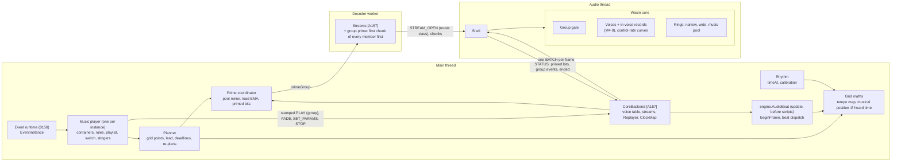
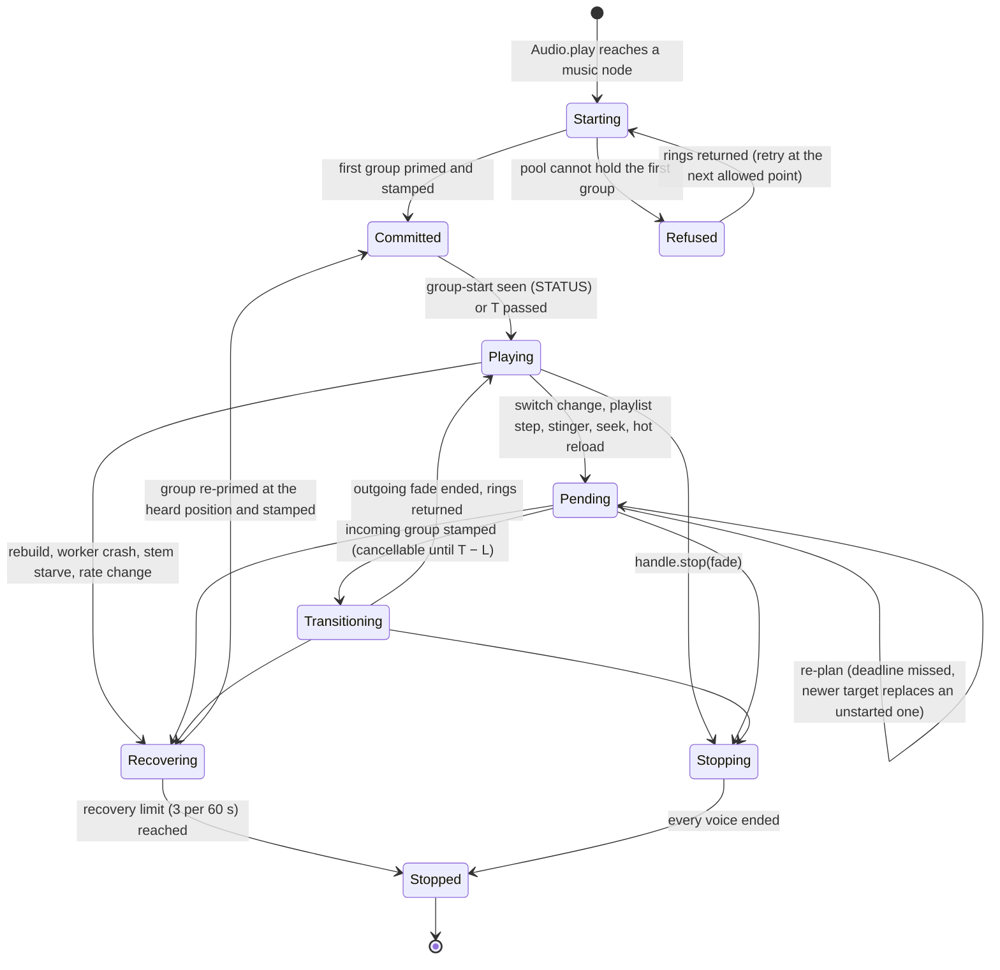
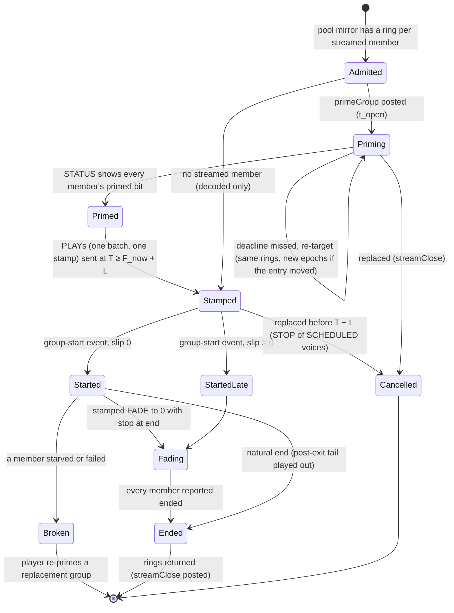
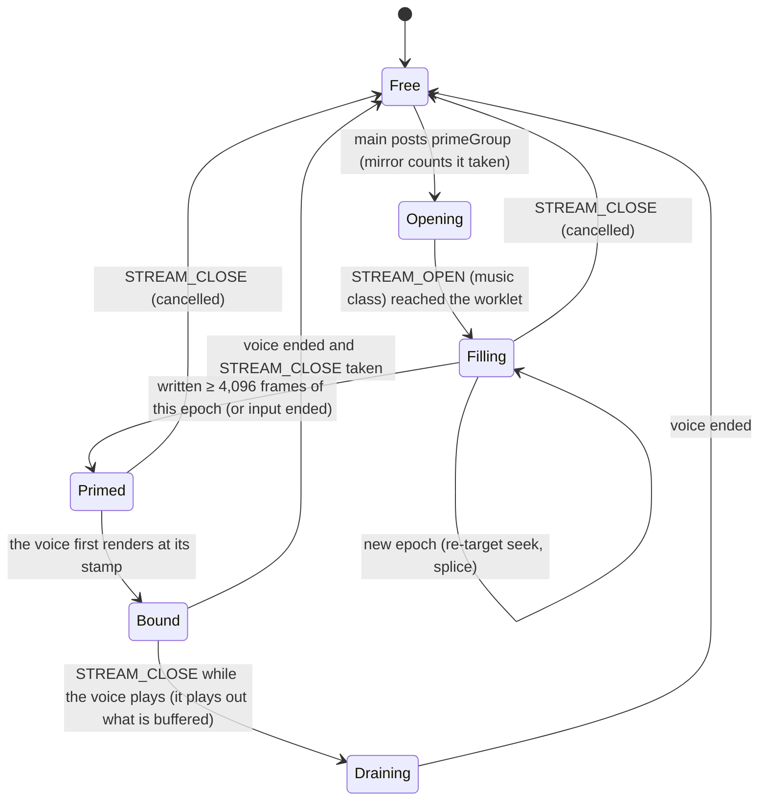
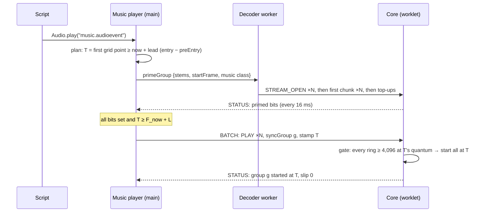
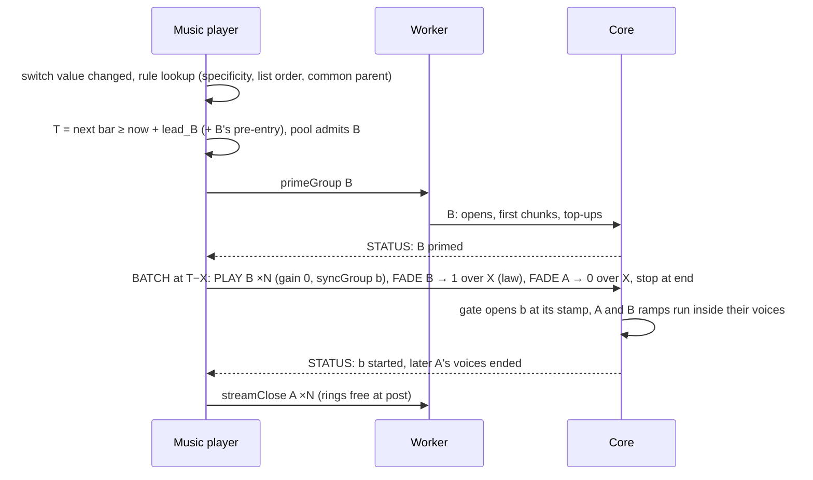
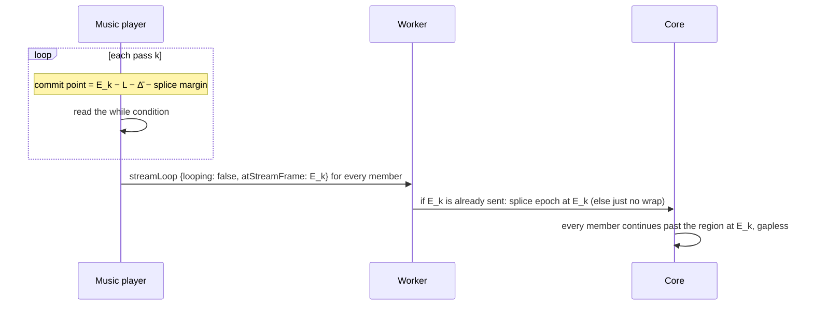
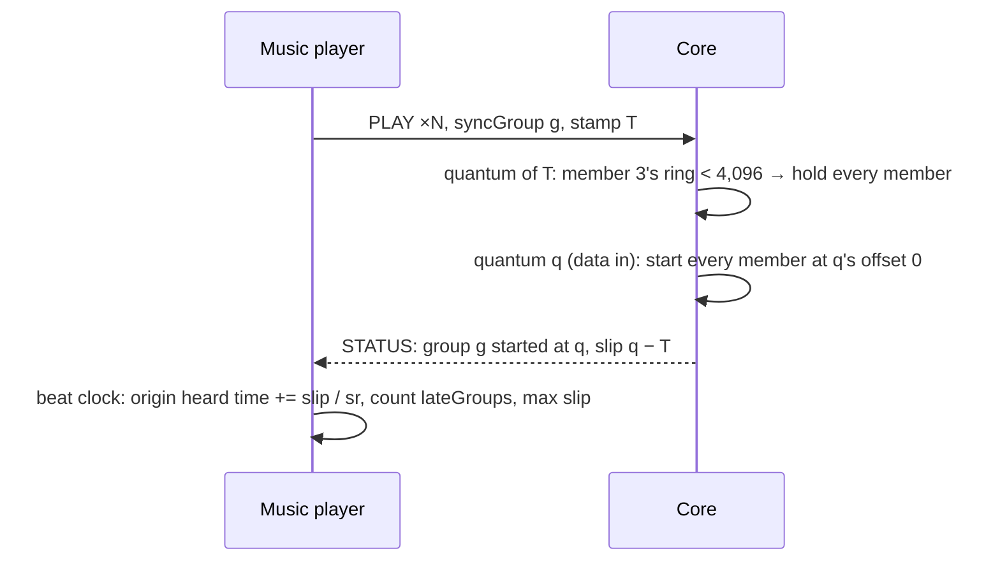
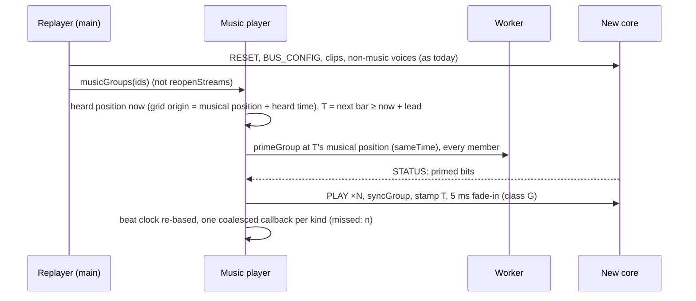

# 0166 interactive music: system architecture (M4)

The architect's design for ADR 0166 (Accepted, revision 2 with the owner's decisions of 2026-11-11). Round 1. It extends [0157's architecture](../0157-audio-core/architecture.md) (**[A157 §n]**) and [0162's](../0162-audio-spatial/architecture.md) (**[A162 §n]**) and doesn't repeat them: the host, the batch, STATUS, the clock map, streams, the hard rebuild and the adaptive cap work as there unless a section here says otherwise.

Its companion, `api-and-models.md` (**[API]**, the senior engineer's), owns the public API signatures, settings keys, the event file format and its ids, byte layouts, the wire and the Rust ABI. This file owns components, state machines, timing, constants, memory, performance, failure handling, observability and platforms. What it needs from [API] is listed in [contracts-architect.md](contracts-architect.md) as **C1–C18**.

**Evidence.** **[S]** is `spikes/audio-music/README.md`; **[S1]** `streams-align/`, **[S2]** `stream-throughput/`, **[S3]** `beat-clock/`, **[S4]** `cost/`, **[S5]** `rhythm/`, **[S0]** `research/`. They were measured on the shared 4-vCPU container, where **p50 and p99 are usable and p99.9 and max are not** [S]. **(est.)** marks an unmeasured number. A quantum is 128 frames, 2,667 µs at 48 kHz. Times in this file are at 48 kHz and a 60 Hz display unless stated.

**Reference factor.** The record assumes the reference machine is 2× this container. S4 measured the container's base scenes at ≈ 1.45× the ADR's reference ([S4] "Timed run", `cost/README.md:104`). This file uses **÷ 1.45** to convert container µs to reference µs, the more conservative of the two (the architect RFC asked for one factor).

**Two code facts this design rests on, checked here.**
- **A stamped PLAY doesn't split the quantum; every other stamped voice record does.** `scheduler::submit` writes a PLAY's slot at once with its start frame (`native/audio/crates/audio-core/src/scheduler.rs:38-40, 218-221`) and `render_range` starts it at its offset inside the range (`voices.rs:375-396`). STOP, SET_PARAMS, FADE, SET_PAUSED, SEEK, SET_LOOP and SET_VOICE_FX go to the pending queue (`scheduler.rs:41-43, 57`), and `render` splits the quantum for **every** live voice at each such record's offset (`voices.rs:310-325`). The record's revision 2 says PLAY splits too; the code says it doesn't (Open point 1).
- **The worker wraps loops, not the core** (`stream.rs:72-73`); `streamOpened` is posted before any chunk, on the worker→main port, while chunks go worker→worklet (`decoder/streams.ts:312-315`); `pump` fills one stream's whole credit window before returning (`:498-510`); a hard rebuild relaunches each stream asap from its own playhead (`core/coreBackend.ts:1406-1422`).

**Industry practice.** The owner's rule is to follow Wwise, FMOD and Unreal Quartz unless there is a measured reason not to, and to say where M4 differs. Sections end with a "Practice" line where it matters; §12 collects them.

## 1. Overview

M4 adds no thread. Each thread's share:
- **Main:** the music player per playing instance (its containers, rules, playlist and switch state, stingers), the planner, the prime coordinator (ring-pool mirror, lead estimate), the grid maths, the beat clock and its dispatch, rhythm mode's input mapping and calibration.
- **Decoder worker:** group priming (breadth-first), loop wraps and region releases (as today).
- **Core:** stamped starts with a **group gate**, **in-voice stamped records** (M4-0), curve fades at control rate, the **music ring pool**, per-ring **primed** bits and **group-start events** in STATUS.

| Component | Thread | Owns | Does |
|---|---|---|---|
| Music player | main | one instance's container cursors, playlist bags and loop counts, switch value, current and pending groups, stinger queue, beat cursors | Ticks once per frame in `engine.Audio` (lateUpdate), after scripts set parameters; asks the planner for every start (§2.1) |
| Planner | main | none (pure functions over the player's state) | Picks the grid point T for a start, the fade frames, the deadline; decides re-plans and refusals (§4.1) |
| Prime coordinator | main | the music-pool mirror (rings open, priming, closing), the prime-time estimate Ê, the per-ring primed bits from STATUS | Admits or refuses a group, posts `primeGroup`, reports "all primed", measures prime time (§4.2) |
| Grid maths | main | per segment, the tempo map's prefix sums (seconds at each marker) | Musical position ⇄ segment seconds ⇄ heard time ⇄ frames; next grid line (§4.5) |
| Beat clock | main | per instance, the last fired index per kind (beat, bar, cue) | Predicts events from the grid and `Audio.time`; dispatches them before `update` (§4.5) |
| Rhythm | main | the calibration offset per output device | `Audio.timeAt`, `positionAt`, `Calibration.fromTaps` (§4.6) |
| Decoder worker | worker | decoders, stream cursors, region wraps | Primes a group breadth-first: every member's first 4,096-frame chunk before any member's second (§4.2) |
| Core: group gate | audio | per group: members, stamp, ready state | Starts a group's voices together at the stamp, or holds all of them and starts them together late, and reports it (§4.3) |
| Core: in-voice records | audio | per quantum, the due records by voice; per voice, a curve-fade state | Applies stamped records inside the target voice; no other voice is touched (§4.4) |
| Core: music ring pool | audio | 8 / 12 / 16 rings of 32,768 frames | Holds music streams only; reports primed per ring (§4.2) |

| Channel | Direction | Carries (new in M4) | Rate | Mode |
|---|---|---|---|---|
| `node.port` | main → worklet | BATCH: PLAY with `syncGroup` (C3); FADE, SET_PARAMS and STOP with a fade law (C5) | one batch per frame; while hidden, one per planner tick | transferred, pooled [A157 §1] |
| `node.port` | worklet → main | STATUS: music-ring primed bits (C2), group-start events and slip counters (C4) | every 6 quanta (16 ms); 48 quanta (128 ms) when no batch came for 250 ms (`audio-wire/src/schema.rs:72-74`) | transferred |
| Worker `postMessage` | main → worker | `primeGroup` (C8): every member's encoded bytes, start frame, region, music class | one per group start or re-target | transferred (bytes) |
| Worker `postMessage` | worker → main | `groupOpened` with per-member open times and errors (diagnostics only, never an ack) | one per group | clone (small) |
| `MessageChannel` port | worker → worklet | STREAM_OPEN of class music (C1), chunks in breadth-first order | prime: N first chunks, then top-ups | transferred, epoch-tagged |

Main stays off every PCM path, as in M1.

## 2. Lifecycles

### 2.1 The music player

A music player exists for each event instance whose tree reaches a music node (`segment`, `playlist`, `musicSwitch`). `EventInstance.playNode` creates it when the walk reaches the music node, as it creates voices for clips today (`events/eventRuntime.ts:1140-1173`), and it registers with `EventSystem` for a per-frame tick (the same loop that pops its timer heap, `eventRuntime.ts:286-295`). It holds no voices of its own; every voice is an ordinary voice in the backend's table, tagged with the player's group.

- **Starting:** the first group needs the same prime-then-stamp as a transition, so `Audio.play` of a streamed music event starts one lead later (≈ 100 ms, §5.3). A purely decoded first segment starts at the horizon. `handle.music` is readable from Starting on, with `segment` set and `time` the planned start.
- **Pending** holds **at most one pending transition per container** (architect RFC issue 6). A newer target replaces an unstarted one: its rings are closed, or if stamped, its SCHEDULED voices get STOP, which is immediate and exact for a voice that hasn't started (`voices.rs:1394-1396`). A replacement is possible until T − L, after which the stamped records may already be in the core; then the newer target becomes the next transition, planned from the committed one.
- **Hidden:** not a state of its own. While the page is hidden the tick is driven from the STATUS handler instead of the frame (§3.8).
- **Recovering** owns every stem of its groups: the backend's `Replayer` hands music groups to the player instead of `reopenStreams` (C16).

### 2.2 A group

A **group** is the set of voices that must start on one frame: a segment's stems (streamed and decoded alike) for one pass, or a single stinger, or one alternative-take seam. Its id is the player's, sent on each PLAY as `syncGroup` (C3; distinct from PLAY's existing `group`, which is the automation instance group, `audio-wire/src/schema/batch.rs:142, 304`).

A primed ring can't empty before its stamp: the voice binds only when it first renders (`voices.rs:675-681`) and the worker idles at its credit window (`decoder/streams.ts:8`). Only RESET (a rebuild) or a worker crash can take a primed ring away, and both go through Recovering.

### 2.3 A ring of the music pool

Main counts a ring **free when it posts `streamClose`**. Close and later opens from the same worker travel on one port in order, so the core frees the ring before it sees the next STREAM_OPEN that needs it. The record's rule "rings return as soon as the core reports the voice's end" (rev. 2 #7) is met: the voice's end arrives in STATUS, main frees the voice in the STATUS handler (`mirror.freeEndedInMessage`, used today while hidden, `core/background.ts`), and posts the close there, not on the next frame.

## 3. Interactions

### 3.1 Segment start

If the deadline (T − L − Δ̄) passes first, the planner moves T to the next allowed grid point and keeps the rings priming (§4.1).

### 3.2 Quantised transition with crossfade

A rule `exit: bar, enter: entryCue, fadeOut 1 beat, fadeIn 1 beat`:

X is the fade length in frames from the rule's beats through B's (or A's, for fadeOut) tempo map at that position. Fade offsets shift the ramp stamps, never T. The FADE records are class G (§4.4): none of them splits the quantum.

### 3.3 Bridge (transition segment)

A → bridge → B. The bridge is planned like any segment against A's exit; B is planned against the **bridge's** exit cue with its own rule fades. Both may be primed at once if the pool has rings for A + bridge + B. If not, B is primed when A's rings return at the bridge's start: B needs `lead_B` before the bridge's exit, so the bridge must be at least A's fade-out + one STATUS + lead_B long (≈ 0.1 s + fade, est.). A shorter streamed bridge is refused at that point with `refusals.pool` and A keeps playing (the transition is retried at the next allowed point, §8). Bridges ≲ 30 s should be decoded clips (the record's rule for loops and stingers, §3), which need no ring.

### 3.4 Stinger

A stinger is a one-member group, normally a decoded clip (no priming):
1. T = the next `at` grid point (`beat`, `bar`, `cue(name)`) ≥ now + L; `immediate` is now + L.
2. If that point is inside the lead (only for a streamed stinger, whose lead is the prime lead): `ifTooLate` decides: `nextGrid` (default, with one warning per stinger), `playNow` (at the earliest feasible frame, off the grid), or `skip`.
3. `dontRepeat` is checked against the last stinger start of the same trigger, in heard seconds.
4. One PLAY, stamped. A stamped PLAY never splits the quantum (code fact above), so a stinger costs only its voice.

At most **4 stingers sound at once per instance** (S4's worst scene); a fifth steals the oldest, with a 5 ms fade. The stinger doesn't change the grid; its voices count in the mixed cap.

### 3.5 Loop region exit with `while`

The worker loops the region by wrapping inside a chunk (`decoder/streams.ts:22-34`), so the core sees one continuous signal and main **predicts** each pass end E_k from the group's start frame and the region length (exact while no member starves and pitch is 1, `core/streams.ts` header; music tracks carry no pitch automation, C13).

- The condition is read **at the commit point**, not at E_k. That is the condition's latency, as the record states (rev. 2 #6): L + Δ̄ + 10 ms (est.) ≈ 60 ms at 60 Hz. The splice must land ≥ 368 frames ahead of the voice, or the voice begins its starve fade (`voices.rs:754-760`; S1 Q4 measured ≥ 325 frames exact); 10 ms (480 frames) covers it.
- All members get the same stream frame, because a segment's stems share one length (format rule) and one start frame.
- `count` loops need nothing: the worker wraps `count` times, and main predicts the passes for the beat clock.
- **Loop tails** (a tail mixed over the loop start): one decoded voice per stem plays the clip's span `[loopEnd, loopEnd + tail)`, stamped at each E_k. That needs a clip registry entry for a span of an asset (C14). Rings are unchanged; the tail voices count in the mixed cap.

### 3.6 Late group

A late group can only follow a ring loss between Primed and the stamp (RESET, worker crash) or a STOP/close race, because main stamps only after every primed bit is set. The gate is the defence:

The stems stay aligned. The outgoing segment's stamped STOP or fade isn't shifted, so the seam has a hole of the slip's length (Extension: linked outgoing records, §11). A group not started by T + max(2 × lead, 1 s) is stopped and re-planned (`groupTimeouts`).

### 3.7 Hard rebuild (REPLAY), worker crash, rate change

- Music is silent from the rebuild until T (≈ one bar at most plus lead). Today each stem reopens asap from its own playhead (`coreBackend.ts:1406-1422`) and skews permanently (S1 Q1c); this path replaces that for music groups only.
- A **new context at another rate** works the same way. Origins are stored as a musical position plus a heard time, never raw frames (rev. 2 #9), so frames are recomputed at the new rate; `Audio.time` stays monotonic across the swap (`ClockMap.rebase`, `core/clock.ts:124-140`).
- A **worker crash** fails every stream (`core/streams.ts` header, "Errors"); the player sees one group failure per group, the backend connects a new channel, and the player re-primes as above.
- All three take one from the recovery rate limit (3 per sliding 60 s, `core/recovery.ts`, `rateLimit.ts`); past it the player stops with one warning.
- In rhythm mode the re-entry is stamped, never asap, and callbacks for the instance are held until the group's start is stamped (§4.6).

### 3.8 Hidden tab

rAF stops while hidden; STATUS keeps flowing under `mute` and `play` (`core/background.ts:4-10`), at the idle cadence of 48 quanta (128 ms) once no batch arrived for 250 ms.
- **`play`:** when a segment starts, the player immediately commits its successor: a playlist's next item is primed and stamped at the current segment's exit cue, cancellable while SCHEDULED. A playlist therefore always holds its next segment primed (rev. 2 #8). While hidden, the tick runs from the STATUS handler with Δ̄ replaced by the STATUS interval, and the player flushes its own batch (as `background.ts` already flushes MASTER at once when hidden). Switch changes while hidden are planned the same way, with the larger Δ̄.
- **`mute`:** the record says the player re-plans on resume (rev. 2 #8): the current segment plays out silently; a playlist that reaches its exit cue with nothing committed stops there; on resume the player starts from the heard position at the next bar (Open point 6 suggests using the `play` path here too).
- **`pause`:** the context is suspended and every voice freezes with it; on resume the ClockMap re-anchors (`clock.ts:146-197`, `STALL_MS` 250) and the player re-plans from the heard position. No backlog accrues because nothing played.
- On resume in every mode, missed callbacks coalesce to one per kind with `missed: n` (§4.5).

Commit-ahead costs rings: a 4-stem playlist on low holds both sets (8 of 8). A primed-but-unstarted successor is **evictable**: a switch transition outranks it, closes its rings and re-primes it later.

### 3.9 Music seek

`handle` seek to a musical position (via [API]) is a transition: exit `immediate`, enter at the position, incoming group primed at that position, T = now + lead, and a 5 ms crossfade (the stream seek fade, `STARVE_FADE_SECONDS`, `stream.rs:116`). Per-stem SEEK epochs (`core/streams.ts:15-18`) are never used for music: they would skew stems the way a rebuild does.

### 3.10 Hot reload

When the event file changes while it plays (the composer's loop, rev. 2 #13):
- Rules, playlists, switches and stingers apply to the next decision at once.
- If the playing segment changed (stems, cues, tempo map), the player primes the new version as a group and transitions at the next bar: `sameTime` when the segment's length and tempo map at that bar are unchanged, else `entryCue`. The beat clock adopts the new tempo map at the swap.
- An invalid file keeps the old version, with the validator's error once.

## 4. The core pipeline

### 4.1 The planner

**Inputs:** the rule (from the precedence lookup), A's grid, B's group (members, streamed or not, pre-entry), the current Ê, L and Δ̄ from the ClockMap.

**Lead.** For a group with streamed members that aren't primed yet:

  lead = 1.25 × Ê + L + Δ̄

For a group whose members are all decoded, or already primed and waiting: lead = L. Ê starts at **40 ms**, so the first lead at 60 Hz is 1.25 × 40 + 33.3 + 16.7 = **100 ms**, the record's starting value. The record writes the lead as max(horizon, 1.25 × EMA) and the deadline as T − L − Δ̄; those two are only consistent if the measured prime time is followed by L + Δ̄, which this formula states (Open point 2).

**Grid point.** T is the first allowed point (per `exit`: next beat, bar, `grid(n)` line, next cue, or A's exit cue) such that T − preEntry_B ≥ now + lead and A's fade-out start ≥ now + L. `immediate` takes now + lead exactly. Grid lines come from A's tempo map (§4.5).

**Deadline.** At each tick in Priming: if every member is primed and T_start ≥ F_now + L (the batch's `firstFrame`, `lookahead.ts:41-43`), stamp now. If not primed and T_start < F_now + L + Δ̄ (the batch that leaves next frame would be late), **re-plan**.

**Re-plan rules.**
1. The rule's own `exit` kind picks the next point; the planner never degrades a `bar` rule to a beat. A `nextCue` or `exitCue` re-plan may be many seconds away; that is musically right (Wwise behaves the same) and is reported (`replans.deadline`).
2. Rings keep priming across a re-plan. A `sameTime` or explicit-position entry whose start position moved with T re-targets the group: new epochs from the new position (C8), so it re-primes from zero. A re-target aims at the point after next when the last prime took longer than half the gap between points (est.), so a slow worker doesn't chase every bar.
3. Three re-plans in a row for one transition warn once (`replanStorm`).
4. A parameter change before stamping re-runs the rule lookup; a change to the same target is a no-op.

**Refusals (pool full).** Admission counts the free music rings in the mirror. If the group needs more:
1. evict a primed-but-unstarted successor (§3.8);
2. otherwise refuse **this grid point**: keep the current music, count `refusals.pool`, warn once per cause, and retry at the next allowed point after rings return (an outgoing fade's end). A refused stinger is dropped, not retried.

This keeps the record's "refuses, keeps the current music, counts and warns" (rev. 2 #7) and adds the retry (Open point 5).

**Practice.** Wwise's transition timing is the same shape (source exit point, destination entry, fade offsets); Wwise streams with a per-track look-ahead time set by the designer [S0, U]. M4 measures the look-ahead instead of asking for it, because the phone's prime time is unknown.

### 4.2 Priming and the pool

**Prime protocol** (rev. 2 #1–#3):
1. Admission (above), then `primeGroup` (C8) with every member's encoded bytes (transferred), start frame (entry − pre-entry, in file frames), region, epoch and class `music`.
2. The worker opens every member and posts each one's STREAM_OPEN and **first chunk** before any second chunk, then tops all up round-robin. Today `pump` fills each stream's whole window first (`decoder/streams.ts:498-510`), so stem N's first chunk waits behind N − 1 full rings: 8 × 1.62 ms (Vorbis full ring, native p50) instead of 8 × 1.13 ms (open + seek + first chunk) [S1 results-decode].
3. The worklet commits chunks between quanta; the core sets a ring's **primed bit** when it holds ≥ 4,096 frames of the current epoch, or the input ended (C2). STATUS carries the bits every 6 quanta.
4. Main sees all bits on the frame after the STATUS lands; Ê takes the sample `t_seen − t_open` (ms, `performance.now()`), which includes the fetch, the post, the decode, the delivery tail, the STATUS cadence and the frame wait.
5. Main stamps the PLAYs in one batch (§4.1). The gate (§4.3) checks again in the core.

**Estimate Ê.** An EMA, asymmetric so a slow sample raises the lead at once and a fast one lowers it slowly: α = 0.5 upward, 0.1 downward (est.). It is per backend, not per asset; it resets to 40 ms on a new context. When lead > one beat at the current tempo, the player warns once per instance (`leadOverBeat`): beat-quantised changes will land a beat or more late (rev. 2 #4).

**Expected prime time (cached bytes).**

| Platform | 8 stems, open + seek + first chunk, serial | + delivery tail p99, STATUS, frame | Ê | lead | Source |
|---|---|---|---|---|---|
| container, native | MP3 1.6 ms, Vorbis 9 ms (p50) | + 13 + 16 + 17 ms | 47–55 ms | 109–119 ms | [S1] Q2 |
| desktop wasm (×1.5–3) | 2.4–27 ms | same | 48–73 ms | 110–141 ms | (est.) |
| phone (×8 of wasm desktop) | 20–220 ms | same | 66–266 ms | 133–383 ms | (est.), unverified |

A cold fetch adds the network or disk read [U]. At 120 BPM a beat is 500 ms; at 180 BPM, 333 ms: the phone's beat-quantised transitions are within a beat on this estimate, at the edge for fast tempi. The phone run is a milestone exit check (rev. 2 #4).

**Pool.** The music ring class (C1) has 8 / 12 / 16 rings (owner decision 2), separate from today's `max_mixed / 16` narrow rings (4 / 8 / 16, `stream.rs:118-120`) and the wide rings. A music STREAM_OPEN never takes a narrow ring and the reverse, so music and sound effects can't starve each other. Main's mirror never posts more opens than free music rings, so the core's refusal (stream event 3, `scheduler.rs:319-331`) is a bug signal, counted (`musicRingRefused`).

**Encoded bytes.** The worker holds each open stream's whole encoded file (owner decision 4; `audio-decode/src/lib.rs:270`). Main fetches through `Assets` on each prime (the HTTP cache on web, a file read on Tauri) and transfers the bytes; it keeps no copy. The fetch is inside Ê.

### 4.3 The group gate

In `render`, before the voice loop, for each group with a member whose stamp is before the quantum's end:
- **ready** if every streamed member's ring has ≥ 4,096 frames of its epoch (or input ended); decoded members are always ready;
- **ready and first time:** every member starts at its stamp's offset (all share one stamp), as today;
- **not ready:** every member is held SCHEDULED, including decoded ones, and the group is marked late;
- **late and now ready:** every member starts at offset 0 of this quantum (ring commits happen between quanta, so readiness can only change at a boundary); the group-start event carries the start frame and the slip.

The gate needs every member present: all PLAYs of a group come in one batch, and PLAY carries the member count (C3). A member whose STREAM_OPEN was refused keeps the group closed; main's timeout (§3.6) ends it. Groups per core: at least 16 (est.: 2 instances × (current + next + bridge) + alternatives + stingers, with room), each ≈ 16 B. The check is one compare per member per quantum while a group waits, nothing once started.

Rebuild, seek and recovery reopen a group as a group (§3.7, §3.9); the core never reopens a stem by itself.

**Practice.** Wwise and FMOD start a segment's tracks together inside their own scheduler [U]; Quartz schedules quantised commands at sample offsets on the render thread [S0, U]. None documents a group gate; it exists here because streamed stems are separate rings fed by one worker.

### 4.4 In-voice stamped records (milestone M4-0)

**Goal.** No stamped record splits the quantum for any voice but its target (rev. 2 #5). The +538 µs native / +810 µs wasm per split quantum [S4 timed] becomes the target voice's own cost.

**Scope.** The records the pending queue holds: STOP, SET_PARAMS, FADE, SET_PAUSED, SEEK, SET_LOOP and SET_VOICE_FX (`scheduler.rs:41-43, 57`; SET_VOICE_FX through `fxpool`, A162 D1). PLAY already starts in its voice. This applies to every stamped record in the engine, not only music (an amendment to 0157).

**How `render` changes.**
1. `pop_due` still pops every record due in the quantum (`voices.rs:308`), but into a per-quantum **due list** (≤ 256 records, est.; more spill to the old split path and count `dueOverflow`) instead of splitting. Each record marks its slot with a "due" flag (one bit; the slot has a spare byte, `voices.rs:149-150`).
2. `render_range(0, QUANTUM)` runs **once**. A voice without the flag renders as today.
3. A flagged voice applies its records in frame order, by class:
   - **Class G (gain-like): FADE; SET_PARAMS whose mask is gain only; STOP.** Applied **inside the gain loop**: the voice's gain and fade ramps hold until sample k, then `set_target` at k, then move. STOP with fade 0 at k truncates the voice's frames to k (n = k − from, then ENDED), as `stopping` already shortens n (`voices.rs:737-740`). No second range. Cost: a start-sample compare, ≈ 0.1 µs per voice per quantum [S4 Q2 "linear starting at sample 37"].
   - **Class S (state): SET_PARAMS with pitch, bus, direction, low-pass or score; SET_PAUSED; SEEK; SET_LOOP; SET_VOICE_FX.** A **voice-local split**: this voice alone renders `[from, k)`, applies the record, then `[k, to)`. Cost: one more pass of this voice's per-range work, ≤ one voice render, ≈ 2.3–3.9 µs native (est. from S4's +52k instructions per voice per split, `cost/README.md:63`).
4. Two class G records for one voice at different offsets in one quantum fall back to a voice-local split.

Per-range work for sends and beds (`render_range` taps them per range, `voices.rs:349-360`) is already range-correct, so a voice-local split needs no change there.

**Fade laws, cheap in wasm.** The voice runs every fade as its linear `Ramp` (`audio-dsp/src/ramp.rs`). A curve law retargets that ramp at each quantum boundary to the law's value there:
- `linear`: one ramp to the end;
- `sCurve`: smoothstep 3u² − 2u³, evaluated once per quantum;
- `equalPower`: a 1,024-point quarter-sine table with linear interpolation (`sin` for in, `cos` for out; power-complementary, table error 3.6e-7 [S4]).

Per-voice state while a curve runs: law, u, du per quantum (≤ 12 B, C6). Per sample the cost is the linear ramp's; per quantum, one law evaluation (one table read or 4 multiplies). Never `libm` `sinf` or `sqrtf` per sample: `sqrtf` runs 4.5× slower in wasm (1,080 vs 241 ns per voice per quantum) and `sinf` 861 ns in wasm [S4 timed]. Piecewise-linear error against the exact curve is ≤ (Δu)² × max|f″| / 8: for a 250 ms fade (94 quanta) of the equal-power law, ≈ 3.5e-5 (−89 dB) (est.); for fades under 20 ms the shape is inaudible anyway.

**Goldens.** Unstamped (asap) work is bit-identical: its path is unchanged. A stamped record's target voice renders exactly as under today's split (same sub-ranges); other voices now render in one range, so the stamped goldens are re-recorded once, and the existing exactness tests keep asserting onset frames (`audio-core/tests/golden_native.rs:476, 500, 519`). A metered bench scene with one stamped record every quantum must add ≤ 60k instructions per quantum over its twin (one voice; today +13.2M, `cost/README.md:46`), and a core counter of whole-quantum splits must read 0 in every test after M4-0 (C7).

**REPLAY of pending ramps.** The `Replayer` (main) keeps, per voice, its last stamped class G record (frame f, length n, from, to, law) and any stamped STOP. At a rebuild at frame F:
- f + n ≤ F: send the settled gain;
- f ≤ F < f + n: send the ramp's remainder stamped at the replay's first frame, with `startPhase` u₀ = (F − f) / n so a curve resumes mid-shape (C5);
- f > F: re-send stamped as is in the same context, or at its heard time × the new rate in a new context.

Music groups are excluded: the player re-plans them (§3.7).

**Practice.** Wwise and FMOD apply fades sample-accurately inside the voice [U]; M4-0 makes the core match. The control-rate curve with linear interpolation is FMOD's and Unreal's usual envelope practice [U].

### 4.5 The beat clock

**Model (design A, measured [S3]).** For each instance and each active segment pass, main holds:
- the **grid origin** as (musical position p₀, heard time t₀): the group's stamped start frame gives t₀ = f₀ / sr on `Audio.time`'s base (`lookahead.ts:45-53`), and p₀ = entry − pre-entry;
- the tempo map's prefix sums: seconds at each marker, so a position converts by one binary search (cached marker index; S4 Q3: 4.7 ns per quantum per instance even searching, `cost/README.md:71`);
- per kind (beat, bar, cue), the index of the last fired event.

The heard time of position p is t₀ + sec(p) − sec(p₀); predicted loop passes add k × region length; the next pass of a playlist adds the committed successor's origin.

**Dispatch before `update`.** A new built-in system `engine.AudioBeat` runs in the `update` phase, `before: ["engine.UpdateScripts"]` and after `engine.UIDocumentEvents` (systems sort topologically, `src/engine/core/systems.ts:255-282`; script hooks are `engine.UpdateScripts`, `World.ts:1032`). It:
1. calls `clockMap.beginFrame()`, idempotent per rAF time (`clock.ts:148`), so every script's `update()` reads this frame's `Audio.time` instead of last frame's (today `engine.Audio` runs in `lateUpdate`, `audioSystem.ts:124-129`);
2. for each instance, fires every event with heard time t < `Audio.time` + Δ̄ whose index is past the last fired (the window this display frame covers) [S3 Method].

Each event carries its exact `time`, `heardIn` = time − `Audio.time` (seconds until heard, ≥ 0 unless missed), and `missed` (C15).

**Coalescing.** If a kind has more than one due event in one dispatch (a long frame, a re-anchor after `STALL_MS`, a hidden tab), it fires **once**, for the latest, with `missed: n` (rev. 2 #9). At 60 Hz one frame (16.7 ms) is far below a beat, so normal frames never coalesce. Cues have names, and coalescing drops the skipped names (Open point 4).

**Correction from STATUS.** The only grid changes the core decides are a late group start (§3.6) and a starve (§8). A late start shifts t₀ by slip / sr. A correction never re-fires an index: the cursor counts indices, not times, so a correction can't double or skip (S3: 0 missed, doubled or phantom over 6 timed runs).

**Accuracy.** Against Chromium's heard clock, 66 of 69 steady beats fired in the ideal frame and 3 one frame early by 1.66 ms; all tempo-change and transition beats in the ideal frame; ClockMap tracks the audio clock to 0.04 ms p50 [S3 confirming run]. Real devices are [U] (a loopback is owed).

**Before M4c.** `handle.music` is readable from M4a through the same grid maths; callbacks arrive in M4c (owner decision 5). The early `beginFrame` step costs nothing and can land in M4a.

**Practice.** Wwise's music sync callbacks and FMOD's timeline beat callback are delivered at render or update time, not output-latency compensated [S0, U]; Quartz queues delegates back to the game thread, about a frame late [S0, U]. M4 differs: callbacks fire in the frame the beat is heard, with the exact heard time, because the measured render-ahead is 31–35 ms [S3].

### 4.6 Rhythm mode

`audio.rhythmMode` (project setting, off by default; key in [API]):
- **Latency.** The context is created with `latencyHint: 0` (numeric, the smallest) and `baseLatency` and `outputLatency` are read back for the debug panel. Chromium's fake sink gave 2.9 ms base and 8 ms output latency at 0, against 10 / 32 ms at `interactive` [S5]. Toggling the setting rebuilds the context on the device path (A3.4c), rate-limited like any rebuild. The lookahead floor (1,024 frames), the limiter and the STATUS cadence stay (≈ 4 ms of the 25–55 ms total [S5]).
- **Input.** `Audio.timeAt(performanceTime)` = (pt × sr / 1000 + o − D) / sr − calibration, the same map as `Audio.time` (`clock.ts:248-265`) applied to an event's `timeStamp`; `positionAt` adds the grid. Error 0.04 ms p50 against 9.4 ms for reading `Audio.time` in a handler [S3]. Available without rhythm mode too (owner decision 6, record §6).
- **Calibration.** `Calibration.fromTaps`: drop 4 warm-up taps, median of the next ≥ 16, MAD for confidence; "unsteady, retry" above 40 ms MAD (est.) [S5]. p95 error ≈ 10 ms simulated. Persisted per output device; a `devicechange` marks it stale.
- **Stamped only.** Every music command is stamped in both modes (the planner never sends asap music records; `handle.stop(fade)` is stamped at the horizon too). Rhythm mode adds: recovery re-entry is stamped, and callbacks for an instance are held from a recovery's start until its group is stamped, so no old-grid callback fires after a change [S3: at hint 0 a STATUS confirmation can arrive 12.5 ms after the beat is heard].

## 5. Threading, state and constants

### 5.1 State ownership

| State | Owner (writes) | Copy elsewhere |
|---|---|---|
| Container cursors, playlist bags, loop counts, switch value, pending transition, matched rule | main (player) | `Audio.debug().music` |
| Grid origins (musical position + heard time), tempo prefix sums | main | none (frames derived) |
| Beat cursors (last index per kind) | main | none |
| Prime estimate Ê, lead | main (coordinator) | debug |
| Music-pool occupancy | main mirror (admission) | the core's ring table (truth for priming) |
| Primed bit per ring | core | STATUS (C2) |
| Group membership, stamp, gate state | core (from PLAY) | group-start event (C4) |
| Stream cursor, region wraps, splices | worker | chunk headers, STREAM_OPEN |
| Voice gain, fade, curve state | core | none |
| Last stamped class G record per voice | main (Replayer) | for REPLAY only |
| Calibration offset | main, persisted per device | none |

### 5.2 Staleness bounds

| Value | Normal bound | Under a main stall of s |
|---|---|---|
| Primed bits seen on main | ≤ 16 ms STATUS + one frame after the chunk commit | s |
| Group start / slip | ≤ 16 ms + one frame | s; stamped audio is unaffected |
| Ring free for admission | 0 (counted at `streamClose` post) | — |
| Voice end → ring close | ≤ 16 ms (128 ms at the hidden idle cadence) | handled in the STATUS handler, not the frame |
| Parameter → switch decision | same frame (`engine.Audio` runs after scripts) + lead | s + lead |
| `while` condition | read at E_k − L − Δ̄ − 10 ms | if s spans the commit point, the loop runs one more pass |
| Beat callback | the frame whose window covers the heard time; error = clock error (0.04 ms p50 [S3]) | coalesced, `missed: n` |
| `handle.music` | this frame's `Audio.time` | s |

### 5.3 Constants

**S** marks a setting (key and parse rules in [API]). Wire and core constants are generated from `audio-wire/src/schema.rs` and quoted by name.

| Area | Constant | Value | Source |
|---|---|---|---|
| Streams | `START_FRAMES` (ready threshold, primed bit) | 4,096 frames | `stream.rs:114` |
| | `RING_FRAMES`, ring bytes | 32,768 frames (0.68 s); 307,200 B (300 KiB) | `stream.rs:95, 108`; [S1] |
| | **S** music rings | 8 / 12 / 16 | owner decision 2 |
| | narrow rings (unchanged) | `max_mixed / 16` clamped 4..16: 4 / 8 / 16 | `stream.rs:118-120` |
| | splice margin | ≥ 368 frames; 10 ms used | `voices.rs:754-760`; [S1] Q4 |
| | stream fault stop fade | 50 ms | `core/streams.ts` header |
| Lookahead | L | clamp(2 Δ̄, 1,024 frames, 100 ms): 33.3 ms at 60 Hz | `lookahead.ts:13-17, 27-31` |
| | Δ̄ EMA gain, start | 0.1, 16.7 ms | `clock.ts:31-33` |
| Planner | prime margin | 1.25 | record §2; [S1] `prime.rs` |
| | Ê seed | 40 ms (first lead 100 ms at 60 Hz) | this design, from [S1]'s 20–60 ms (est.) |
| | Ê gains | 0.5 up, 0.1 down | this design (est.) |
| | lead (needs priming); lead (decoded or primed) | 1.25 Ê + L + Δ̄; L | §4.1 |
| | deadline | T_start < F_now + L + Δ̄ while unprimed → re-plan | record rev. 2 #2 |
| | cancel point | T_start − L | `voices.rs:1394-1396` |
| | re-plan storm | 3 in a row | this design (est.) |
| | far re-target | point after next when last prime > ½ the gap | this design (est.) |
| | group timeout | T + max(2 × lead, 1 s) | this design (est.) |
| | lead warning | lead > one beat | record rev. 2 #4 |
| Rules | default rule | `*`→`*`, exit `bar`, enter `entryCue`, 1-beat crossfade | record §1 |
| | pending transitions per container | 1 | architect RFC #6 |
| Stingers | concurrent per instance | 4 (fifth steals the oldest, 5 ms fade) | [S4] worst scene (est.) |
| | `ifTooLate` default | `nextGrid`, one warning | record rev. 2 #10 |
| Core | groups | ≥ 16, ≈ 16 B each | this design (est.) |
| | due list per quantum | 256 records (overflow: old split, counted) | this design (est.) |
| | curve state per voice | ≤ 12 B | §4.4 |
| | equal-power table | 1,024 points | record §4; [S4] |
| | curve retarget step | one quantum (128 frames) | this design |
| Recovery | re-entry fade-in; seek crossfade | 5 ms (`STARVE_FADE_SECONDS`) | `stream.rs:116` |
| | rebuild rate limit | 3 per sliding 60 s | `core/recovery.ts`; `rateLimit.ts` |
| Clock | stall re-anchor | 250 ms | `clock.ts:35` |
| | offset EMA; reject; re-anchor after | 0.1; 5 ms; 10 rejections | `clock.ts:21-25` |
| STATUS | cadence; idle cadence; idle after | 6 quanta (16 ms); 48 (128 ms); 250 ms | `schema.rs:72-74` |
| Rhythm | **S** `audio.rhythmMode` | off | record §6 |
| | `latencyHint` in rhythm mode | 0 (numeric) | [S5] |
| | calibration | 4 warm-up + ≥ 16 taps, median; MAD retry > 40 ms | [S5] (est. threshold) |

## 6. Memory

| Item | Formula | Low / default / high |
|---|---|---|
| Music rings (core) | rings × 300 KiB | 2.34 / 3.52 / 4.69 MiB |
| Narrow rings (unchanged) | 4 / 8 / 16 × 300 KiB | 1.17 / 2.34 / 4.69 MiB |
| Encoded files in the worker, two full sets streaming (MP3 192 kbps, 3 min) | rings × 4.4 MiB | 35 / 53 / 70 MiB [S2] |
| Same in Vorbis (+1.7 MB decoder state per stream) | rings × ≈ 6.1 MiB | 49 / 73 / 98 MiB [S2] (est.) |
| Same in FLAC | 8 stems ≈ 190 MiB | warns on low (record §3) |
| Fetch transient on main | one stem's bytes until transferred | ≈ 4.4 MiB per stem in flight, GC'd |
| Curve state (core) | max_logical × ≤ 16 B if the slot grows (C6) | 16 / 64 / 64 KiB (est.) |
| Group table, due list (core) | 16 × 16 B; 256 × 48 B | ≈ 12 KiB (est.) |
| STATUS growth | primed bits + ≤ 8 group events | ≈ 0.2 KiB per block (est.) |
| Main, per asset | tempo prefix sums, rule index | < 16 KiB (est.; limits: 64 markers, 64 cues, 256 rules) |
| Main, per instance | player state, beat cursors | ≈ 2 KiB (est.) |
| Loop-tail span clips | tail × channels × 2 B per stem | content-dependent (2 s stereo: 375 KiB) |

Decoded alternatives, stingers and bridges count against the clip ceiling (64 MB on low, `audioSettingsModel.ts:235`), as today. The worker's encoded copies are the largest item: the record accepts them for M4 (owner decision 4).

## 7. Performance

### 7.1 The model

Calibrated on S4's metered instruction counts (exact) and timed `mus-worst` delta (99 µs native p50 for 1,316k instructions: 0.075 µs per 1k instructions on the container). Per quantum, container native (est.):

| Term | Instructions | µs container | µs reference (÷ 1.45) | Source |
|---|---|---|---|---|
| streamed stem | 51.6k | 3.9 | 2.7 | [S4] cost model |
| decoded voice (stinger, bridge, tail) | 40k | 3.0 | 2.1 | [S4] |
| first live automation binding (once) | 245k | 18.4 | 12.7 | [S4] finding 6 |
| each automated voice | 2.5k | 0.19 | 0.13 | [S4] |
| class G record (target voice) | — | ≈ 0.1 | ≈ 0.07 | [S4] Q2 |
| class S record (target voice) | ≤ 52k | ≤ 3.9 | ≤ 2.7 | [S4] (est.) |
| curve law per fading voice per quantum | — | ≤ 0.15 | ≤ 0.1 | §4.4 (est.) |
| group gate per waiting member | — | < 0.01 | < 0.01 | (est.) |
| whole-quantum split (removed by M4-0) | 13.2M | 538 measured | 371 | [S4] timed |

The model reproduces S4's scenes: typical 34 µs (measured 43–63), transition 74 (75), worst 97 (99).

### 7.2 Scenes per preset

Worst case per preset: every music ring streaming (two full sets mid-crossfade), the most concurrent stingers, every music voice automated and fading.

| Preset | Typical: 4 stems, 1 fading | µs ref (est.) | Worst | µs container | µs ref (est.) | Allowance (record §7) typical / worst |
|---|---|---|---|---|---|---|
| high | 34 container (43–63 measured) | 23–43 | 16 stems + 4 stingers | 97 (99 measured) | 68 | 50 / 80 |
| default | same | 23–43 | 12 stems + 3 stingers | 77 | 53 | 50 / 60 |
| low | same | 23–43 | 8 stems + 2 stingers | 58 | 40 | 40 / 40 |

The record's default and low worst allowances were set when those presets had 8 and 4 rings [S4 Q5]; with 12 and 8 music rings the worst scene uses all of default's headroom margin below 50% and exactly meets low's (Open point 3). Music counts inside the mixed-voice cap (owner decision 3), so the preset's **total** doesn't grow: each stem displaces an average voice of ≈ 130k instructions [S4 Q5]. The rule for the gate: **music's own line** is checked at the worst scene above, and the preset total by the existing benches.

### 7.3 Main thread

- Beat dispatch: per instance per frame, one compare per kind plus the due events; the grid search is cached. Nanoseconds per instance (S4 Q3 measured the same arithmetic at 4.7–35 ns).
- Planner: a rule lookup on each decision, linear over ≤ 256 rules in four tiers, a few µs (est.); nothing per frame while idle.
- Prime: one fetch per streamed member (an ArrayBuffer, transferred). GC pressure, not CPU.
- No budget line, as the record says (§7).

### 7.4 Decoder worker

Per stream ≈ 0.16% of a container core steady [S2]. The prime burst is the peak: N × (open + seek + first chunk), then the top-ups. 12 streams on a phone at 8× ≈ 30–43% of one core (est.) [S]. The breadth-first order doesn't change the total work, only which chunk comes first.

### 7.5 Benchmark method

Three tiers (architect RFC): (1) the repo's meter in CI for the music scenes and the stamped-record scene (exact, the regression gate); (2) the lab VM for p99.9 (owner's run); (3) the phone for prime time (request → all primed, p50/p99, 8 cached Vorbis and MP3 stems), worker CPU at 12 streams over 10 minutes, the audio thread on low, and the beat-callback frame error with real output latency. Container runs stay p50/p99 and short (working notes rule 1). Targets: prime p99 ≤ 0.8 × lead; re-plans < 1% of transitions on default; `streamStartsLate` 0 and `lateGroups` 0 over a sample soak; whole-quantum splits 0.

## 8. Failure modes

| Failure | Detection | Handling | User-visible | Counter |
|---|---|---|---|---|
| Prime deadline missed (slow worker, cold fetch) | planner tick (§4.1) | re-plan to the next point of the rule's kind; rings keep priming | the change lands one grid step (or cue) later | `replans.deadline`, `replanStorm` |
| Lead longer than a beat | lead vs tempo | warn once per instance | beat-quantised changes land late | `leadOverBeat` |
| Pool full | admission | evict a primed successor, else refuse this point, retry when rings return; drop a stinger | the change waits; the current music plays on | `refusals.pool`, one warning per cause |
| Music ring refused by the core | stream event 3 on a music stream | stop the group, re-plan | as late transition | `musicRingRefused` (a bug) |
| Mixed-cap pressure | selection | music by its priority; a virtual stem keeps time while its ring has data (`voices.rs:638-640`) | quieter or missing layer | `musicVirtual` |
| Late group | group-start event slip > 0 | aligned late start; beat clock shifted | a hole of the slip at the seam | `lateGroups`, `streamStartsLate`, `maxSlipFrames` |
| Group never starts | timeout | stop, re-plan | as late transition | `groupTimeouts` |
| A stem starves mid-piece | STATUS `starved` lists a group member | the group is Broken: re-prime it at `sameTime` and swap at the next bar; meanwhile the starved stem fades out (5 ms) and holds | one layer drops for up to a bar | `musicResyncs.starve` |
| A stem fails to fetch or decode | stream error, fetch rejection | before stamping: the group plays without it, one warning; all fail: refuse. After start: 50 ms fade (today's path) | a layer missing | `stemFailures` |
| Decoder worker crash | every stream errors | new channel, re-prime every group at the heard position (§3.7), rate-limited | music gap up to a bar + lead | `musicRecoveries.worker` |
| Hard rebuild (trap, stall) | `onRebuilt` | §3.7 | music gap up to a bar + lead | `musicRecoveries.rebuild` |
| Rate or device change | A3.4c | as rebuild; frames recomputed; rhythm calibration stale | gap; calibration prompt (game's UI) | `musicRecoveries.device` |
| Recovery limit reached | rate limit | the player stops, one warning | music stops | `musicRecoveries.refused` |
| Main hitch during a pending transition | — | stamped audio plays on time; an unprimed deadline in the hitch re-plans | late change; coalesced callbacks | `replans.deadline`, `missedBeats` |
| Hidden tab | `visibilitychange` | §3.8 | none under `play` | `hiddenCommits` |
| Stinger inside the lead | planner | `ifTooLate` | stinger on a later grid point, off-grid, or skipped | `stingers.late`, `stingers.skipped` |
| Hot reload of an invalid file | validator | keep the old version | one error | `reloadRejected` |
| Due list overflow (> 256 stamped records in one quantum) | core | the overflow uses the old global split | none (cost only) | `dueOverflow` |

## 9. Observability

`Audio.debug().music` (fields in [API], C11) lists per instance:
- event path, current segment and pass, bar:beat:tick, tempo and metre, heard time;
- the pending transition: from, to, T as bar:beat, **the rule that matched** (id and tier: exact, from, to, wildcard; or the common parent that supplied it);
- group states (Priming, Primed, Stamped, Started, Late), primed members n/N, prime time last and Ê, the lead;
- counters: re-plans by reason, refusals by cause, late groups and max slip, recoveries by cause, missed beats, stinger outcomes;
- engine-wide: music rings in use, high-water mark, refusals; whole-quantum splits (must be 0).

**Health thresholds** (Audio Debug panel, 4 Hz, as M3's):

| Counter | Green | Amber | Red |
|---|---|---|---|
| `replans.deadline` per 100 transitions | < 1 | 1–10 | > 10 |
| `refusals.pool`, `leadOverBeat`, `stingers.skipped` | 0 | non-zero | — |
| `lateGroups`, `streamStartsLate`, `groupTimeouts` | 0 | — | any |
| `musicResyncs`, `musicRecoveries` | 0 | ≤ 1 per minute | more |
| whole-quantum splits, `musicRingRefused` | 0 | — | any (a bug) |
| lead (ms) | ≤ 150 | 150–330 | > one beat |

The debug panel is the composer's live music monitor (rev. 2 #13); the segment view's playhead reads the same `handle.music`.

## 10. Platform matrix

| | Core: Chromium desktop (Chrome, Edge, WebView2) | Core: Android system WebView | Core: WebKit (Safari, WKWebView, WebKitGTK) | Core: Firefox | Babylon fallback |
|---|---|---|---|---|---|
| Segments, playlists, switches, rules, bridges, stingers, stems | full | full | full | full | best effort: segments play, playlists step, switches change at bar boundaries planned on main |
| Sample-exact streamed stems | full | full; prime time unverified (§4.2) | full | full | no: HTML5 streams, unaligned, one warning (`babylonBackend.ts:85-91`) |
| Stamped decoded starts | full | full | full | full | `waitTime` on decoded clips (`babylonBackend.ts:284-287`) |
| Stamped fades, curve laws | full (M4-0) | full | full | full | fades start on the frame (`setVolume` with a duration, `babylonBackend.ts:317`), linear only |
| Beat callbacks | heard clock | heard clock; `getOutputTimestamp` noise [U] | heard clock; `outputLatency` Safari 18.4+ [S5] | heard clock | from `currentTime`, uncorrected (`babylonBackend.ts:873-875`): early by the output latency |
| Rhythm mode | full | full; `latencyHint` effect device-dependent [S5, U] | full where `outputLatency` exists | full | unavailable, one warning |
| Evidence | S1–S5 in headless Chromium | none (owner: phone unverified) | not run | not run | — |

Tauri: Windows WebView2 takes the Chromium column; macOS and Linux follow the WebKit column, or the fallback where 0157 puts it. WebKit and Firefox runs of the music scenes are owed as release checks, as M1's and M3's were.

## 11. Extension points

| Extension | M4 provides |
|---|---|
| Range-request streaming | the worker holds whole files (owner decision 4); `primeGroup` already carries per-member bytes, so a range source replaces the bytes with a reader |
| A music clock in the core | S4 measured 5–35 ns per quantum; the group-start event is the seam if stamped transitions ever need core-side timing |
| Linked outgoing records | a stamped STOP or fade could name a group and shift by its slip, turning a late group's hole into a shift |
| Group hold on starve | the gate's group table could also hold every member while one starves, removing the bar-long resync |
| Cross-file splice at a loop end | the core's splice takes any content (S1 Q4: exact with ≥ 325 frames of lead); needs a worker op to continue with another file |
| Worker-side encoded cache | keep closed music files in the worker for re-primes of the same segment, trading memory for fetches |
| Tempo ramps | the grid maths takes a ramp segment (integral of tempo); deferred by the record |
| Signal-driven ducking | M5; duck ramps on music buses can start on a grid point through M4-0's class G records |
| Free clip arrangement | deferred by the owner; segments and groups are the runtime it would compile to |

## 12. Where M4 follows or differs from industry practice

| Area | Follows | Differs, and why |
|---|---|---|
| Structure | Wwise: segments, playlist and switch containers, transition matrix, stingers, pre-entry and post-exit [S0] | tempo and metre maps inside a segment (FMOD's markers), the owner's "both, as one model" |
| Rule precedence | Wwise: specificity, then the nearest common parent's table | first listed wins inside a tier, with a validator warning |
| Transition timing | Wwise exit points (immediate, beat, bar, grid, cue, exit cue) and fade offsets; Godot's beat-length fades | the look-ahead is measured per session (Ê), not a designer value per track |
| Stream starts | Wwise/FMOD prefetch before a scheduled start [U] | prime-then-stamp with a worklet-side primed bit and a core group gate, because stems are separate rings fed by a worker |
| Fades | sample-accurate in the voice (Wwise, FMOD) [U] | curve laws at control rate with linear interpolation, cheap in wasm (S4) |
| Clock and callbacks | Quartz: quantised scheduling at sample offsets; FMOD/Wwise beat, bar and marker callbacks | callbacks fire in the frame the beat is **heard**, with the heard time; Wwise and FMOD deliver render-time events [S0, U] |
| Missed callbacks | — | coalesced to one per kind with `missed: n` (no burst after a hidden tab) |
| Rhythm games | Unity `dspTime` practice: input timestamps against the audio clock, per-device calibration [S0] | a project setting with calibration built in |
| Loops with conditions | FMOD's conditional loop regions | the condition is read one commit point before the pass ends |

## Open points for the coordinator

1. **Stamped PLAY doesn't split the quantum.** The record's revision 2 ("every stamped record splits, not only gain records", citing `voices.rs:310-325`) and the brief's gotcha say PLAY splits. In the code PLAY is written to its slot at once and starts inside `render_range` at its offset (`scheduler.rs:38-40, 57, 218-221`; `voices.rs:375-396`); only STOP, SET_PARAMS, FADE, SET_PAUSED, SEEK, SET_LOOP and SET_VOICE_FX are queued and split. M4-0's scope is those records; PLAY needs no change. S4's README was right on this point. This shrinks M4-0 slightly; the record's correction note should be amended.
2. **Lead formula.** The record's lead max(horizon, 1.25 × EMA) and its deadline T − L − Δ̄ conflict when the EMA is small: the stamp needs L + Δ̄ after priming ends. This design uses lead = 1.25 Ê + L + Δ̄ with Ê seeded at 40 ms, so the first lead is still the record's 100 ms. The coordinator should confirm this reading.
3. **Default and low worst-case allowances.** The record's 0.06 / 0.04 ms worst allowances were sized for 8 and 4 rings. With 12 and 8 music rings the worst scene models at ≈ 53 / 40 µs reference (est.), below the 50% headroom the spike asked for on default and at zero headroom on low. Music sits inside the voice cap, so totals don't grow; this is a tripwire, and the build log should record raising them to ≈ 0.08 / 0.06 ms.
4. **Cue coalescing drops names.** "Each callback kind fires once for the latest, with `missed: n`" loses the names of skipped custom cues, which game logic may key on. The API might add the skipped cue names to the coalesced event (senior engineer's ground; owner's call).
5. **Refusal then retry.** A pool refusal here refuses one grid point and retries at the next allowed point once rings return; a stinger is dropped. The record says "refuses ... keeps the current music"; the retry is this design's reading.
6. **Hidden tab under `mute`.** The record re-plans on resume under `mute` and commits ahead only under `play`. Running the `play` path under `mute` too costs nothing audible and keeps playlists stepping, so the resume lands in the right place. Behaviour change: owner's call.
7. **Stem starvation mid-piece** skews a group permanently, as a slipped start did; the gate covers starts only. This design resyncs at the next bar. A core-side group hold on starve (§11) is more core work; priority is the owner's.
8. **Music tracks can't carry pitch automation** (or the beat clock and loop prediction break). That is a validation rule in the format (C13), a scope restriction the owner should see.
