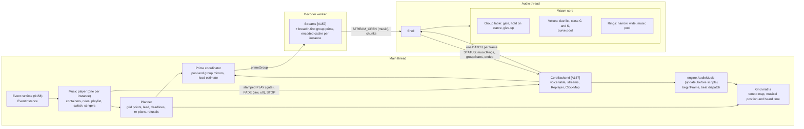
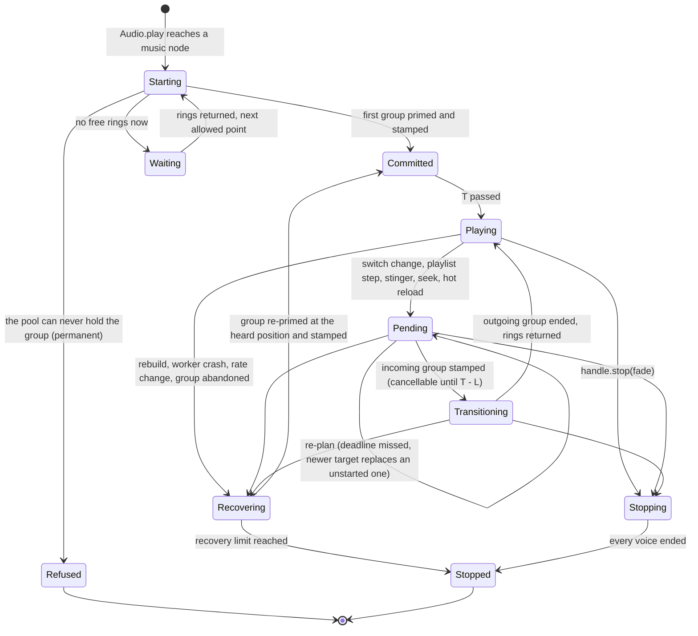
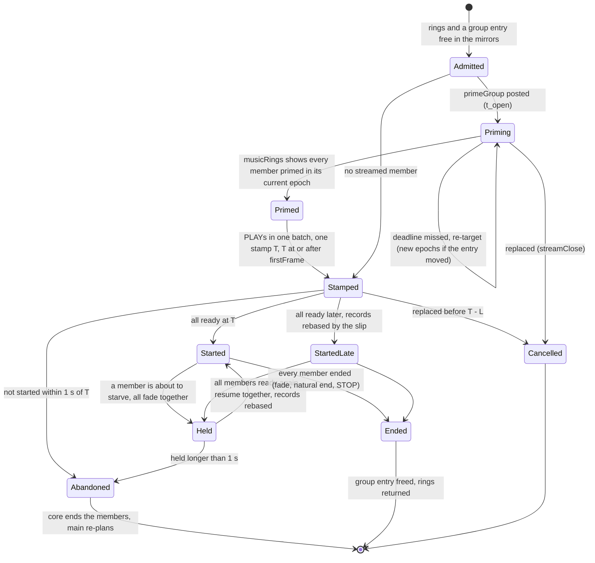
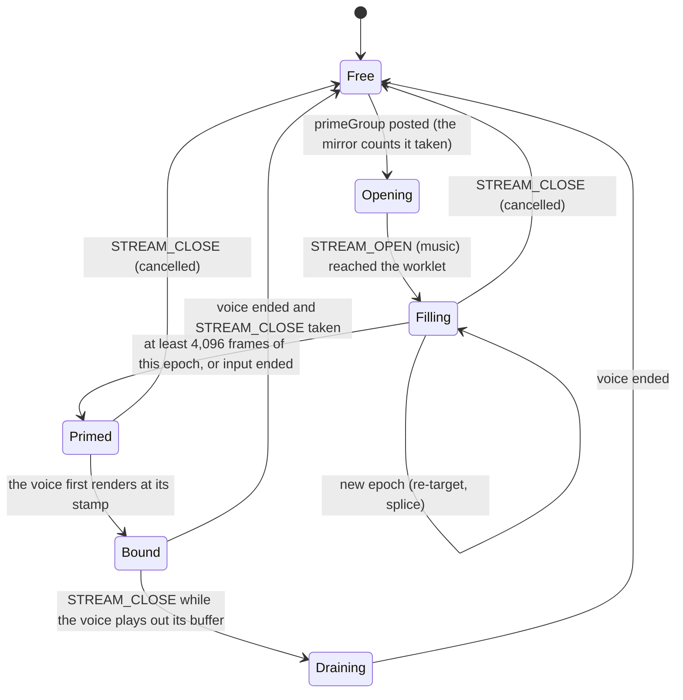
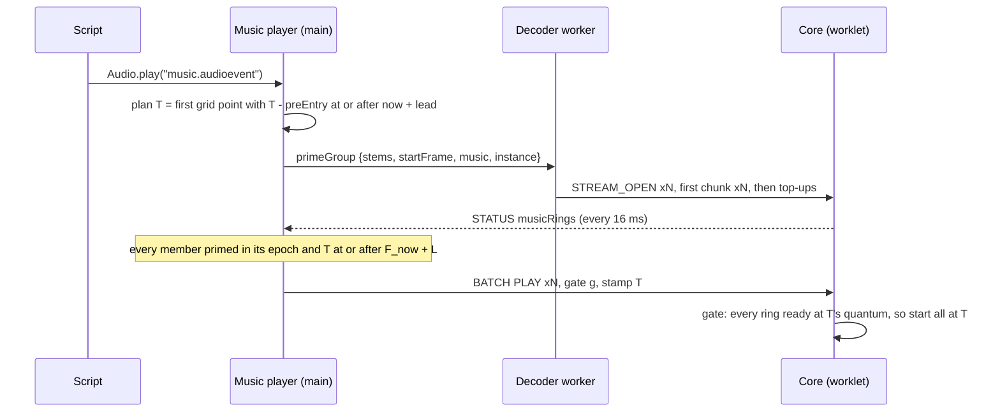
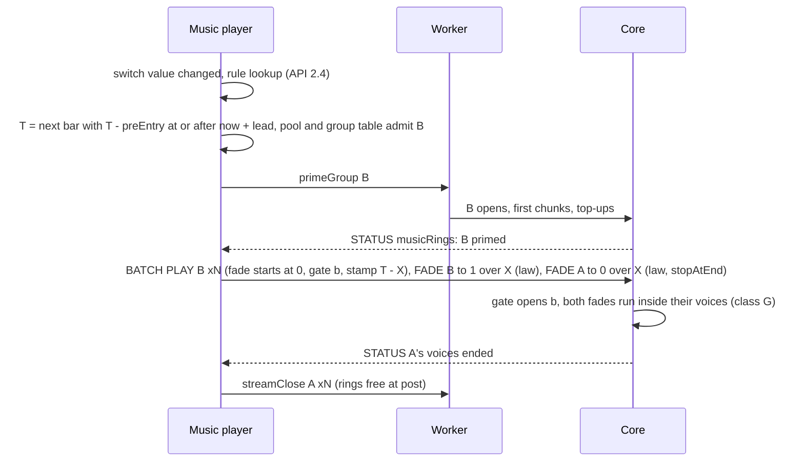
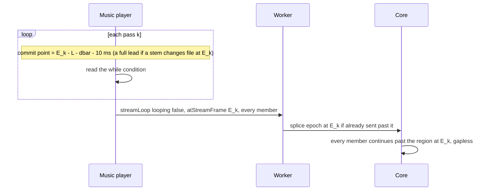
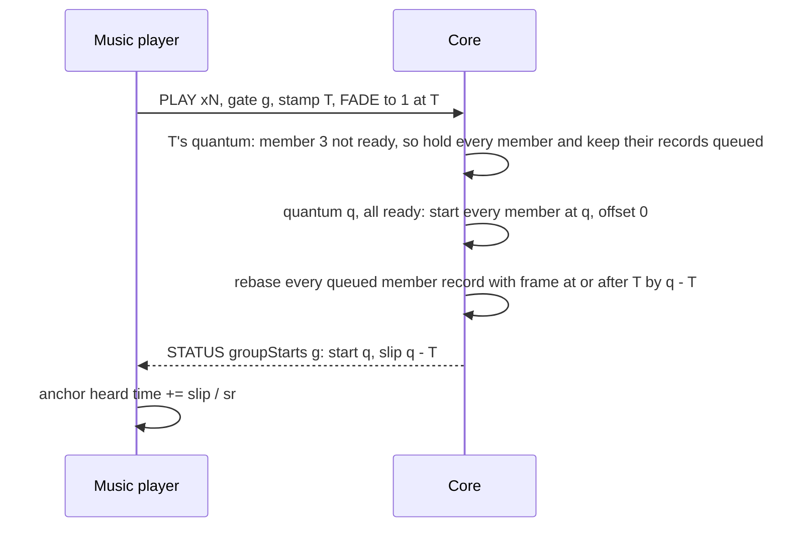
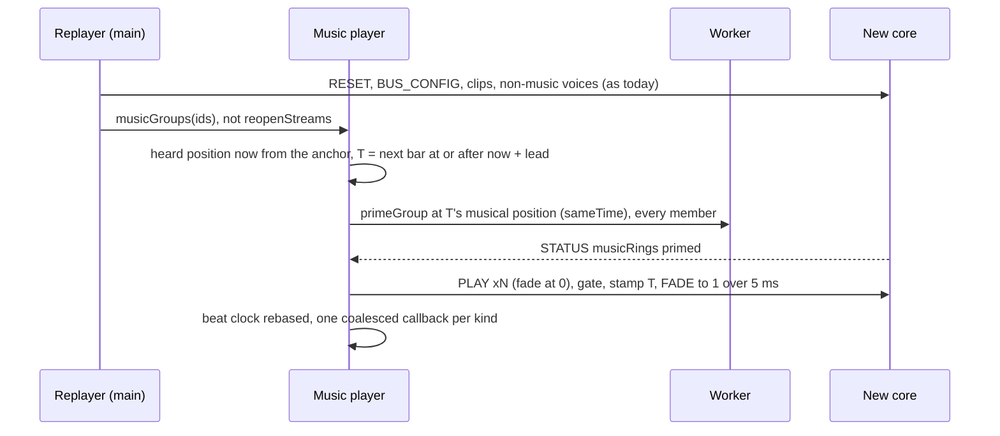

# 0166 interactive music: system architecture (M4)

The architect's design for ADR 0166 (Accepted, revision 2 with the owner's decisions of 2026-11-11). **Round 2B**, revised under the coordinator's rulings R1–R24 ([rulings.md](rulings.md)) and the senior engineer's review (`review-round2-senior.md`; resolutions in §13). It extends [0157's architecture](../0157-audio-core/architecture.md) (**[A157 §n]**) and [0162's](../0162-audio-spatial/architecture.md) (**[A162 §n]**) and doesn't repeat them: the host, the batch, STATUS, the clock map, streams, the hard rebuild and the adaptive cap work as there unless a section here says otherwise.

Its companion, `api-and-models.md` (**[API §n]**), owns:
- the public API and its signatures;
- settings keys and parse rules;
- the event format, its limits and ids, and the rule precedence (**[API §2]**);
- byte layouts, the wire and the ABI (**[API §4]**);
- the Babylon mapping (**[API §8]**), the tests and the task table.

This file owns components, state machines, timing, constants, memory, performance, failure handling, observability and platforms. What it needs from [API] is listed in [contracts-architect.md](contracts-architect.md) as **C1–C19**.

**Evidence.** **[S]** is `spikes/audio-music/README.md`; **[S1]** `streams-align/`, **[S2]** `stream-throughput/`, **[S3]** `beat-clock/`, **[S4]** `cost/`, **[S5]** `rhythm/`, **[S0]** `research/`. They were measured on the shared 4-vCPU container, where **p50 and p99 are usable and p99.9 and max are not** [S]. **(est.)** marks an unmeasured number. A quantum is 128 frames, 2,667 µs at 48 kHz. Times are at 48 kHz and a 60 Hz display unless stated.

**Reference factor (R23).** Container µs are converted to reference µs by **÷ 1.45 (est.)**: S4's base scenes measured 1.45× the ADR's reference (`cost/README.md:104`). The factor is soft: it compares the container's p50 with the ADR's p99.9 figure, so allowances are set from measured deltas, not from the model.

**Code facts this design rests on (checked; R1–R4).**
- **A stamped PLAY doesn't split the quantum.** It is written to its slot at once and starts at its offset inside `render_range` (`scheduler.rs:38-40, 218-221`; `voices.rs:375-396`).
- **Every other stamped voice record splits the quantum for every live voice.** STOP, SET_PARAMS, FADE, SET_PAUSED, SEEK, SET_LOOP and SET_VOICE_FX are queued (`scheduler.rs:41-43, 57`), and `render` splits at each one's offset (`voices.rs:310-325`). A stamped spatial play with non-default effects already splits today: its SET_VOICE_FX goes at the PLAY's frame (`core/coreBackend.ts:1458-1459`).
- **FADE moves the voice's `fade` ramp,** a multiplier that starts at 1 (`voices.rs:159`), not `gain`.
- **The slot is 192 B and full;** `reserved` is its one spare byte (`voices.rs:149-150`, `layout.rs:29`).
- **Streams:**
  - the worker wraps loops, not the core (`stream.rs:72-73`);
  - `streamOpened` reaches main before any chunk reaches the worklet, on another port (`decoder/streams.ts:312-315`);
  - `pump` fills one stream's window before returning (`:498-510`);
  - a hard rebuild relaunches each stream asap from its own playhead (`core/coreBackend.ts:1406-1422`).

**Industry practice.** The owner's rule is to follow Wwise, FMOD and Unreal Quartz unless there is a measured reason not to, and to say where M4 differs. §12 collects it.

## 1. Overview

M4 adds no thread. Each thread's share:
- **Main:** a music player per playing instance, the planner, the prime coordinator, the grid maths, the beat clock and rhythm mode's input mapping.
- **Decoder worker:** priming groups breadth-first, keeping each instance's encoded files (R16), loop wraps and releases as today.
- **Core:**
  - stamped starts through a **group gate**, which also holds a group on starve (R11);
  - **in-voice stamped records** (M4-0, R2);
  - control-rate curve fades (R6);
  - the **music ring pool**;
  - music-ring state and group events in STATUS (R7).

| Component | Thread | Owns | Does |
|---|---|---|---|
| Music player | main | one instance's container cursors, playlist bags and plays, switch value, groups, stinger queue, beat cursors | Ticks in `engine.Audio` step 9 (lateUpdate, [API §6]), after scripts set parameters; asks the planner for every start (§2.1) |
| Planner | main | none (pure functions over player state) | Picks T, the fade frames and the deadline; decides re-plans and refusals (§4.1) |
| Prime coordinator | main | pool mirror, group-table mirror, Ê, the last `musicRings` state | Admits a group, posts `primeGroup`, sees "all primed", measures prime time (§4.2) |
| Grid maths | main (`engine/audio/musicGrid.ts`) | per segment, tempo-map prefix sums | Musical position, seconds, heard time and frames; next grid line (§4.5) |
| Beat clock | main | per instance, the last fired index per kind | Predicts and dispatches before `update` (§4.5) |
| Decoder worker | worker | decoders, stream cursors, the per-instance encoded cache | Breadth-first group prime; keeps an instance's files until it ends (§4.2) |
| Core: group table | audio | 16 groups: members, stamp, state, hold start | Gate at the stamp, hold on starve, give-up, events (§4.3) |
| Core: in-voice records | audio | per quantum, the due list; a 255-entry curve pool | Applies every per-voice stamped record inside its voice (§4.4) |
| Core: music pool | audio | 8 / 12 / 16 rings of 32,768 frames | Music streams only (§4.2) |

The channels are [A157 §1]'s. M4 adds traffic in four places:
- **BATCH:** PLAY's gate field and fade-at-zero flag, and FADE and SET_PARAMS with a law and u₀ (C3, C5).
- **STATUS:** the `musicRings` section and `groupStarts` events (C2, C4), every 6 quanta (16 ms), or every 48 (128 ms) when no batch arrived for 250 ms (`schema.rs:72-74`).
- **Main → worker:** `primeGroup` and the instance cache release (C8).
- **Worker → worklet:** music-class STREAM_OPEN and chunks in breadth-first order.

Main stays off every PCM path.

## 2. Lifecycles

### 2.1 The music player

`EventInstance.playNode` creates a player when the tree walk reaches a `segment`, `playlist` or `musicSwitch` (`events/eventRuntime.ts:959-1010`). It registers for the per-frame tick (`eventRuntime.ts:286-295`). Every voice it starts is an ordinary voice in the backend's table, tagged with its group.

- **Starting:** the first streamed group needs a full prime, so `Audio.play` starts one lead later (≈ 100 ms at first, less once the worker caches the files, §4.2). With `at`, the entry lands on the first allowed grid point ≥ max(`at`, now + lead), never off the grid (R12). The first segment has no grid yet, so its "next allowed point" is the earliest stampable frame ≥ max(`at`, now + lead), and that frame anchors the grid. `handle.music` is readable from Starting on.
- **Pending:** at most one pending transition per container. A newer target replaces an unstarted one:
  - its rings are closed;
  - if it is already stamped, its SCHEDULED voices get STOP, which ends a voice that hasn't started at once and exactly (`voices.rs:1394-1396`).

  A replacement is possible until T − L. After that the newer target becomes the next transition.
- **Hidden:** not a state; while hidden, the tick runs from the STATUS handler (§3.8).
- **Recovering** owns every member of its groups: `Replayer.restore` hands music groups to the player, never to `reopenStreams` (C16).

### 2.2 A group

A group is the set of voices that must start on one frame:
- a segment's stems for one pass, streamed and decoded alike;
- a streamed alternative hand-over at a wrap;
- a streamed stinger.

Decoded stingers, bridges and tail voices are ungated (gate id 0): a decoded voice always starts on its stamp. The gate's encoding (10-bit id, 6-bit size, R8) is [API §4.1].

Between Primed and the stamp a primed ring can't empty. The voice binds only when it first renders (`voices.rs:675-681`), and the worker idles at its credit window. Only RESET or a worker crash takes a primed ring away, and both go through Recovering.

### 2.3 A ring of the music pool

Main counts a ring **free when it posts `streamClose`**:
- close and later opens travel on the worker's one port to the worklet in order (`decoder/streams.ts:453`), so the core frees the ring before it sees the next open;
- main posts the close in the STATUS handler that reports the voice's end (`mirror.freeEndedInMessage`, `core/background.ts`), not on the next frame.

So "rings return as soon as the core reports the voice's end" (record rev. 2 #7) holds with no one-STATUS window. A full core pool is stream event 4 (`musicFull`, [API §4.3]); main's admission makes it a bug signal.

## 3. Interactions

### 3.1 Segment start

If the deadline (§4.1) passes first, T moves to the next allowed point and the rings keep priming.

### 3.2 Quantised transition with crossfade

Take a rule with `exit: bar`, `enter: entryCue`, a 1-beat fade-out and a 1-beat fade-in. Crossfades run on the voice's **`fade` ramp**, so `gain` stays free for stem automation by parameters (R5):

- X is the fade length in frames, converted from the rule's beats through the tempo map at that position.
- Fade offsets shift the FADE stamps, never T.
- An equal-power crossfade uses `equalPowerIn` on B and `equalPowerOut` on A, which is power-complementary.
- None of these records splits the quantum.

### 3.3 Bridge (transition segment)

A → bridge → B. The bridge is planned against A's exit; B against the bridge's exit cue, with the bridge leg's fades [API §2.4].
- Bridges ≲ 30 s are **decoded** clips, like stingers and short loops (R15). A decoded bridge needs no ring, so a bridge works on low.
- A streamed bridge (longer than 30 s) primes beside A, and B primes when A's rings return at the bridge's start. That needs a bridge at least A's fade-out + one STATUS + lead_B long (≈ fade + 0.12 s, est.).
- The lint counts the rings the sequence needs **at its peak** [API §2.6], and a sequence that never fits is refused permanently (R14).

### 3.4 Stinger

A stinger is one decoded ungated voice (a streamed stinger is a one-member group):
1. T = the next `at` point ≥ now + L (`immediate`: now + L).
2. Only a streamed stinger can find its point inside its lead; `ifTooLate` then applies ([API §2.5]).
3. `dontRepeat` is checked in heard seconds against the trigger's last start.
4. The PLAY is stamped, and a stamped PLAY never splits.

At most **4 stingers sound at once per instance**, a format limit (R20, [API §2.5]). A fifth steals the oldest, with a 5 ms FADE. Stingers never change the grid.

### 3.5 Loop region exit with `while`

The worker loops a region by wrapping inside a chunk (`decoder/streams.ts:22-34`). Main **predicts** each pass end E_k from the group's start frame and the region length. The prediction is exact because a held group's hold time is reported and added (§4.3), and pitch is 1 (owner list item 2).

- **Condition latency (R13):** the condition is read at the commit point, ≈ 60 ms before E_k at 60 Hz.
- **Splice margin:** 10 ms (480 frames) covers the ≥ 368 frames a splice needs ahead of the voice (`voices.rs:754-760`; S1 Q4: exact at ≥ 325).
- **File change at the wrap:** if a streamed alternative changes file at E_k, the next pass is a primed hand-over group, and the commit point moves back by a full prime lead.
- **Count loops:** `count` loops need nothing sent; main predicts the passes for the beat clock.
- **Loop tails (R15)** are **decoded span clips** (C14), one per stem, stamped at each E_k and ungated. A span the clip ceiling refuses is dropped with one warning (`tailRefused`) and the loop goes on.

### 3.6 Late group and held records

A late group follows only a ring loss between Primed and the stamp, because main stamps after every primed bit (in the current epoch, R7) is set. The gate is the defence:

**Held records (R10).**
- While a member is held, its stamped records stay in the pending queue across quanta; the due list doesn't consume them, and they aren't counted late.
- When the group starts (or resumes after a hold, §4.3), every queued record of a member whose frame is ≥ the stamp (or ≥ the hold start) is shifted by the slip.
- Fades therefore stay aligned to the music, not the clock.
- Parked records (those of held voices) are capped at **128** across the core: 2 held groups × 16 members × 4 records. Past the cap a record applies at its own frame, unrebased, and counts `parkedOverflow`.
- Records of non-members (the outgoing A's fade-out) aren't shifted, so a late start leaves a hole of the slip's length at the seam (§11: linked outgoing records).

### 3.7 Hard rebuild (REPLAY), worker crash, rate change

- **Gap:** music is silent from the rebuild to T, at most one bar plus a lead. It re-enters at the **heard position** (`sameTime`), not the last grid point.
- **Rate change:** a new context at another rate works the same way. Anchors are musical position plus heard time (record rev. 2 #9), so frames are recomputed, and `Audio.time` stays monotonic (`ClockMap.rebase`, `core/clock.ts:124-140`).
- **Worker crash:** every stream fails (`core/streams.ts` header). The worker's encoded cache is lost with it, so the re-prime fetches again.
- **Rate limit:** all three take one from the recovery limit (3 per sliding 60 s, `core/recovery.ts`). Past it the player stops with one warning.
- **REPLAY of other voices:** a running curve fade is re-sent with u₀ at its current phase (R5), and a future stamped record at its frame (same context) or at heard time × the new rate.
- **Rhythm mode:** re-entry is stamped, and callbacks for the instance are held until its group is stamped (§4.6).

### 3.8 Hidden tab

rAF stops while hidden. STATUS keeps flowing under `mute` and `play` (`core/background.ts:4-10`), at 128 ms once no batch has arrived for 250 ms.
- **`play`:** when a segment starts, the player commits its successor at once: a playlist's next item is primed and stamped at the current exit cue, and stays cancellable while SCHEDULED. While hidden the tick runs from the STATUS handler, with Δ̄ replaced by the STATUS interval, and the player flushes its own batch, as `background.ts` flushes MASTER. A `count: 0` loop needs nothing. Scripts don't run while rAF is stopped, so switch changes while hidden are rare; one that comes from a message handler is planned the same way.
- **`mute`:** the record re-plans on resume. The playing segment plays out silently, and a playlist with nothing committed stops at its exit cue. The resume gap is up to one bar + lead. Commit-ahead under `mute` too is owner list item 5.
- **`pause`:** the context freezes. On resume the ClockMap re-anchors (`STALL_MS` 250, `clock.ts:35`), and the player re-plans from the heard position with no backlog.
- **Ê** isn't sampled while hidden (R12). On resume, missed callbacks coalesce (§4.5).

A primed-but-unstarted successor is **evictable**: a transition outranks it.

### 3.9 Music seek (internal; public seek is owner list item 4)

Audition and hot reload seek: exit `immediate`, enter at a position, the incoming group primed there, T = now + lead, and a 5 ms crossfade (`STARVE_FADE_SECONDS`, `stream.rs:116`). Per-stem SEEK epochs (`core/streams.ts:15-18`) are never used for music, because they skew stems the way a rebuild does.

### 3.10 Hot reload

- Rules, playlists, switches and stingers apply to the next decision.
- A changed playing segment is primed as a group and swapped at the next bar: `sameTime` if its length and tempo map are unchanged there, else `entryCue`. The worker's cache keeps the unchanged files.
- An invalid file keeps the old version, with one error.

## 4. The core pipeline

### 4.1 The planner

**Lead (R12).**
- For a group with unprimed streamed members: **lead = 1.25 Ê + L + Δ̄**.
- For a group that is decoded or already primed: **lead = L**.
- Ê is seeded at **40 ms**, so the first lead is 1.25 × 40 + 33.3 + 16.7 = **100 ms** at 60 Hz, the record's figure. The record's max(horizon, 1.25 × EMA) is corrected at step 9.

**Grid point.**
- T is the first point of the rule's `exit` kind with T − preEntry_B ≥ now + lead and A's fade start ≥ now + L.
- `immediate` takes now + lead exactly.
- Every music change is stamped, in both modes (R19).

**Deadline.** At each tick in Priming:
- every member primed in its current epoch and T_start ≥ F_now + L (the batch's `firstFrame`, `lookahead.ts:41-43`): stamp now;
- not primed and T_start < F_now + L + Δ̄: **re-plan**.

**Re-plan rules.**
1. The rule's own kind picks the next point; a `bar` rule never degrades to a beat. A `nextCue` or `exitCue` re-plan may be seconds away (Wwise's behaviour), and it is reported.
2. Rings keep priming. A `sameTime` or position entry whose start moved re-targets: new epochs from the new position (C8). When the last prime took more than half the gap between points, it aims at the point after next (est.).
3. Three re-plans in a row warn once (`replanStorm`).

**Refusals (R14).** Admission checks the pool mirror and the group-table mirror.
1. **Permanent:** a group that can't fit even with every other music group closed, or that needs more than the pool minus the playing group, is refused at once. One warning names the numbers ("needs N rings, this preset has M"), and the change is dropped. The lint reports it at load.
2. **Temporary:** first evict a primed-but-unstarted successor. Otherwise refuse this point and retry at **each allowed point** until the rings are free or the target changes. The current music plays on.
3. A refused stinger is dropped.

**Least delay of a quantised change (S1, for the guide):** lead plus the wait to the grid point.

| Target | Lead at 60 Hz | Then |
|---|---|---|
| decoded or already primed | L: 33 ms (21.3 ms at ≥ 96 Hz) | + up to one grid interval (a beat is 500 ms at 120 BPM) |
| streamed, first prime | 100 ms | same |
| streamed, files cached in the worker (R16) | ≈ 63–90 ms (est.: Ê ≈ 10–30 ms) | same |
| phone, streamed | ≈ 133–383 ms (est., §4.2) | same |

### 4.2 Priming, the pool and the encoded cache

**Protocol** (record rev. 2 #1–#3):
1. Admission, then `primeGroup` (C8): every member's start frame (entry − pre-entry), region, epoch, music class and instance. The bytes are the worker's cached copy when it holds them; otherwise they are fetched by main and transferred.
2. **Breadth-first:** the worker posts every member's STREAM_OPEN and **first chunk** before any second chunk, then tops up round-robin. Today `pump` fills each stream first (`decoder/streams.ts:498-510`), so stem N waits behind N − 1 full rings: 8 × 1.62 ms against 8 × 1.13 ms for Vorbis, native p50 [S1].
3. The core marks a music ring **primed** at ≥ 4,096 frames of its **current epoch**, or once its input has ended. `musicRings` lists every open music ring with stream id, epoch and flags every STATUS (R7). Main accepts only its current epoch, so a STATUS taken before a re-target's STREAM_OPEN can't trigger a stamp.
4. **Ê sample (R12):** from `primeGroup`'s post to the arrival (the message handler's `performance.now()`) of the STATUS that shows every member primed. It **excludes Δ̄**, which the lead adds once. It isn't sampled while hidden.
5. Stamp (§4.1); the gate checks again in the core.

**Estimate Ê.** An asymmetric EMA: 0.5 upward, 0.1 downward (est.), floor 0. There is one per backend, reset to 40 ms on a new context, and it tracks the slowest format the planner meets. A lead longer than one beat warns once per instance (`leadOverBeat`, record rev. 2 #4).

**Expected prime time** for 8 stems with cached bytes (open + seek + first chunk, serial, plus the delivery tail p99 13 ms and the STATUS cadence 16 ms):

| Platform | Decode | Ê | Lead | Source |
|---|---|---|---|---|
| container, native | MP3 1.6 ms, Vorbis 9 ms (p50) | 31–38 ms | 89–98 ms | [S1] Q2 |
| desktop wasm (×1.5–3) | 2.4–27 ms | 31–56 ms | 89–120 ms | (est.) |
| phone (×8 of desktop wasm) | 20–220 ms | 49–249 ms | 111–361 ms | (est.), unverified |

The phone run is a milestone exit check.

**Pool.**
- **Size:** 8 / 12 / 16 music rings (owner decision 2), beside today's `max_mixed / 16` narrow rings (`stream.rs:118-120`).
- **Separation:** music opens never take narrow rings and the reverse.
- **Admission:** the mirror never posts more opens than free music rings.

**Encoded cache (R16).**
- The worker keeps the encoded bytes of every file a music instance has opened, refcounted by path, until the instance ends (main posts the release).
- A re-prime then moves nothing through main, and Ê becomes unimodal after the first prime.
- Main's own cache (32 MB, `core/encodedCache.ts`) isn't used for music.
- **Protected files:** files of a segment that is playing, primed, or a candidate successor (a rule target from the playing segment, or the playlist's next item) are never evicted.
- **Budget:** 48 / 96 / 160 MiB (est.) on low / default / high (§6). Above it the worker evicts unprotected files, least recently closed first. If protected files alone exceed the budget, nothing protected is evicted, and one warning names the instance (`encodedOverBudget`).
- **A miss:** a re-prime whose file was evicted re-fetches through main and transfers the bytes. Ê takes that slow sample like any other: its 0.5 up-gain raises the lead at once, and the 0.1 down-gain brings it back over about ten later primes.

### 4.3 The group table: gate, hold on starve, give-up

The core's group table has **16 entries** (R9).
- An entry is **taken** by the first PLAY of its group.
- It is **freed** when every member has ended or been stopped, or the group is abandoned, or on RESET.
- A started group keeps its entry for its whole life, because the starve hold (R11) needs the membership. So 8 entries don't suffice:
  - one instance can hold up to 4 live groups at once: the playing group, the outgoing group fading, the stamped incoming group, and a wrap hand-over or streamed stinger;
  - two music instances (say level music and an ambience bed) need 8, with no margin.
- Main mirrors occupancy and never exceeds it. A PLAY whose group finds no entry starts ungated and counts `groupTableFull` (a bug signal).

The entry layout, the voice flags (due, gated, group index in `flags2`) and the curve link are [API §3.1] (R4).

**Per quantum, before the voice loop:**

| Group state | Condition | Action |
|---|---|---|
| Stamped, the stamp in this quantum or earlier | every gated member present and ready: ≥ 4,096 frames of its epoch, or input ended (decoded members are always ready) | start every member at the stamp's offset (on time) or offset 0 (late); rebase held records (§3.6); report a late start |
| Stamped | a member missing (incomplete) or not ready | hold every member SCHEDULED, decoded ones too |
| Started | any gated mixed member would starve this quantum (the existing check: buffered < n + a 5 ms fade, `voices.rs:752-760`) | **hold:** every gated member takes the 5 ms starve fade together, then holds silent with its position pinned |
| Held | every member has ≥ 4,096 frames buffered, or input ended | resume every member at offset 0 with a 5 ms fade-in; rebase their queued records by the hold length; report a resume with the slip |
| Stamped or Held | more than **1 s** past the stamp, or held for more than 1 s | **abandon:** end every member (a 5 ms fade if sounding) and report it; main re-plans (§8) |

Other rules:
- A member STOPped while held leaves the group, and the size shrinks.
- A virtual member is still a member under the same readiness rule: a virtual stream voice binds and consumes.
- An ungated stream voice behaves as today, and a late start of one counts in `streamStartsLate` [API §4.4].
- **Events:** one event per group per start, resume or abandon, with group id, kind, slip and start frame (C4, ≤ 8 per STATUS). Main adds each slip to the anchor's heard time.
- **Cost:** the check is one compare per member per quantum while a group waits or holds, and one flag read once it plays.

This replaces round 1's next-bar resync (R11): no second ring set is needed exactly when the worker is slow. When one stem runs dry, the whole music dips and resumes together (owner list item 6).

**Practice.** Wwise and FMOD start a segment's tracks inside their own scheduler and stream with per-track prefetch [S0, U]; neither documents a gate. M4 needs one because its stems are separate rings fed by a worker.

### 4.4 In-voice stamped records (milestone M4-0)

**Goal.** Only the target voice pays for a stamped record (R1, R2). S4 measured +538 µs native / +810 µs wasm per whole-quantum split.

**`render` (R2):**
1. `pop_due` (`voices.rs:308`) moves each due **per-voice** record into a per-quantum **due list** (256 records, est.) and sets the voice's due flag. Records of held voices stay queued (§3.6).
2. `render_range(0, QUANTUM)` runs once. A voice without the flag renders as today, so unstamped work is bit-identical.
3. A flagged voice applies its records in frame order:
   - **Class G** (FADE, gain-only SET_PARAMS, STOP with or without a fade) applies **inside the gain loop**. The `fade` or `gain` ramp holds until sample k, then retargets. A STOP with fade 0 at k truncates the voice's frames to k, as `stopping` already shortens n (`voices.rs:737-740`). Cost ≈ 0.1 µs [S4 Q2].
   - **Class S** covers every other per-voice record: SET_PARAMS pitch, low-pass, direction, bus or score; SET_VOICE_FX; SET_PAUSED; SEEK; SET_LOOP. It is a **voice-local split**: this voice alone renders `[from, k)`, applies the record, then renders `[k, to)`. Cost ≤ one voice render, ≈ 2.7 µs reference (est., S4's +52k instructions per voice per split, `cost/README.md:63`). Sends and beds already tap per range (`voices.rs:349-360`).
   - Two class G records at different offsets in one voice in one quantum use the class S path.
4. **Still queued:** records that aren't per voice (BUS_MIX, MASTER, LISTENER, configuration tables) keep splitting the quantum and count in `splitQuanta`. So does a due-list overflow. Voice-local splits count in `voiceSplits` (R3).

**Crossfades on the `fade` ramp (R5).**
- A fade-in is a PLAY with the `fadeZero` flag (its `fade` ramp starts at 0), then a stamped FADE to 1 with a law. FADE (28 B), SET_PARAMS (60 B) and STOP (24 B) each carry one `shape` word, holding the law and u₀ [API §4.2]. A fade-out is a FADE to 0 with `stopAtEnd`.
- `gain` stays free for automation, including `quantize` bindings (applied as a 20 ms class G `gain` ramp at the grid point, `QUANTIZE_RAMP_MS`, est.; a low-pass binding is class S).
- FADE, SET_PARAMS gain and STOP-with-fade carry a **law** and a **start phase u₀** (C5). The FADE `from` field is gone.

**Fade laws at control rate (R6).**
- The voice runs each fade as its linear `Ramp` (`audio-dsp/src/ramp.rs`). A curve retargets it at the start sample k and at every quantum boundary, to the law's value at u there.
- u is defined at both ends of each piece, so a mid-quantum start has no kink.
- The laws:
  - `linear`: one ramp;
  - `sCurve`: 3u² − 2u³;
  - `equalPowerIn` / `equalPowerOut`: sin / cos from a 1,024-point quarter-sine table with linear interpolation (table error 3.6e-7 [S4]).
- The state lives in the **curve pool** (255 entries, linked from the slot's spare byte, R4). If the pool is full, the fade degrades to linear and counts `curvePoolFull`.
- Cost: the linear ramp per sample, plus one law evaluation per quantum (≤ 0.15 µs per fading voice, est.).
- Never `libm` `sinf` or `sqrtf` per sample: `sqrtf` costs 1,080 ns per voice per quantum in wasm, against 241 ns native [S4 timed].
- Error against the exact curve: ≤ (Δu)² · max|f″| / 8, ≈ 3.5e-5 (−89 dB) for a 250 ms equal-power fade (est.). Retargeting every quantum also bounds the ramp's f32 step accumulation to 128 steps (≤ 7.6e-6).

**Seam-golden tolerance (R6).** The offline reference evaluates the same law at the same knots (k and each quantum boundary) and interpolates linearly in f64. Seams null to **1e-5** absolute. Against the exact curve the tolerance is **1e-4** for fades ≥ 250 ms; shorter fades are checked only against the same-knot reference. S1's linear crossfade measured 1.2e-5 with one 4,800-frame ramp; per-quantum retargets keep it under 1e-5.

**Goldens and gates (R3, R22).**
- M1–M3 digests stay unchanged; stamped cases are re-recorded once.
- The exactness asserts stay (`audio-core/tests/golden_native.rs:476, 500, 519`).
- M4-0 exit:
  - `splitQuanta` reads 0 in the music scenes and in a scene of stamped spatial plays with sends;
  - a metered scene with a stamped record every quantum adds ≤ 60k instructions over its twin (today +13.2M, `cost/README.md:46`).

**REPLAY.** The Replayer keeps each voice's last stamped class G record and any stamped STOP [API §3.2].
- A finished ramp is sent settled.
- A running one is sent with u₀ = (F − f) / n over its remaining frames.
- A future one is re-sent stamped.

**Practice.** Wwise and FMOD fade sample-accurately in the voice [U], and M4-0 matches. Control-rate envelopes with linear interpolation are common middleware practice [U].

### 4.5 The beat clock

**Model (design A [S3]).** Per instance and active pass:
- **the anchor** ([API §3.2] `GridAnchor`): musical position p₀ plus heard time t₀. t₀ = f₀ / sr (`lookahead.ts:45-53`) from the stamp, plus every reported slip.
- **the tempo map's prefix sums:** a position converts with one binary search from a cached index (S4 Q3: ns per instance). The rounding rule is [API §2.2].
- **a per-kind index** of the last event fired.

Heard time of position p = t₀ + sec(p) − sec(p₀). Loop passes add k × the region length; a committed successor has its own anchor.

**Dispatch (R17).** `engine.AudioMusic` runs in the update phase before `engine.UpdateScripts` [API §1.4, §6].
1. It calls `clockMap.beginFrame()`, which does nothing the second time at the same rAF time (`clock.ts:148`), so `update()` reads this frame's `Audio.time`. Nothing reads the clock between it and `engine.Audio`'s call.
2. Per instance, it fires each event with heard time < `Audio.time` + Δ̄ past the last fired index.

`MusicEvent` fields are [API §1.1].

**Coalescing.** A kind with more than one due event in a dispatch fires **once**, for the latest, with `missed: n`. Cue events add `skippedCues` (R20). At 60 Hz a frame is far below a beat, so only long frames, re-anchors and hidden tabs coalesce.

**Corrections.** The core decides only late starts, holds and abandons. Each one shifts t₀ by its slip.
- Indices never re-fire, so no correction can double or skip an event.
- A correction under Δ̄ is invisible.
- A correction over one beat makes the next dispatch coalesce.
- Corrections of any size are applied.

**Tolerances (S4, for tests on the spike's traces):**
- ≥ 95% of steady beats in the ideal frame (S3 got 66 of 69), the rest within one frame;
- every tempo-change and transition beat in the ideal frame;
- 0 missed, doubled or phantom;
- ClockMap error 0.04 ms p50 against Chromium's heard clock [S3].

Real devices are [U]; a loopback is owed.

**Staging.** `handle.music` arrives in M4a, together with the early `beginFrame`; callbacks arrive in M4c.

**Practice.** Wwise and FMOD deliver beat callbacks at render or update time, not compensated for output latency; Quartz delegates arrive a frame or so late [S0, U]. M4 fires in the frame the beat is **heard**, because the render runs 31–35 ms ahead [S3].

### 4.6 Rhythm mode

`audio.rhythmMode` [API §1.5, §2.1]:
- **Latency.**
  - The context is created with `latencyHint: 0`. Chromium's fake sink reported 2.9 ms base and 8 ms output latency, against 10 / 32 ms at `interactive` [S5].
  - A clamped hint is read back into `Audio.latency` and shown, never warned about.
  - **`Audio.latency.reliable`** is true when `outputLatency` is finite with 0 < x < 0.5 s **and** it changed at least once in the first 10 s or `getOutputTimestamp` is valid. A constant 0 or an absurd value is unreliable, and the debug panel says to calibrate.
  - Toggling the setting rebuilds the context on the device path, rate-limited.
  - The lookahead floor, the limiter and the STATUS cadence stay, since they add ≈ 4 ms of a 25–55 ms total [S5].
- **Input (R18).** `Audio.timeAt` is the raw clock map applied to `event.timeStamp`: 0.04 ms p50, against 9.4 ms for reading `Audio.time` in the handler [S3]. Calibration is subtracted only in `positionAt().judged`.
- **Calibration** follows [API §1.5]: 4 warm-up taps, then the median of ≥ 16, with MAD; p95 ≈ 10 ms simulated [S5]. It is marked stale on `devicechange`.
- **Stamped only (R19).** Every music change is already stamped. Rhythm mode refuses nothing. It adds stamped recovery re-entry, and holds callbacks from a recovery's start until its group is stamped. A STATUS confirmation can arrive 12.5 ms after the beat is heard at hint 0 [S3].
- **Glitches at hint 0** are a milestone exit check on the owner's devices and show in the existing underrun counters.

## 5. Threading, state and constants

### 5.1 State ownership

| State | Owner (writes) | Copy elsewhere |
|---|---|---|
| Container cursors, playlist state, switch value, pending transition, matched rule | main (player) | `Audio.debug().music` |
| Anchors, tempo prefix sums, beat cursors | main | none |
| Ê, lead, pool and group mirrors | main | debug |
| Primed and bound flags per music ring | core | STATUS `musicRings` |
| Group membership, stamp, gate and hold state | core | `groupStarts` events |
| Encoded files of an instance | worker | none |
| Stream cursor, wraps, splices | worker | chunk headers |
| Voice gain, fade, curve state | core | none |
| Last stamped class G record and STOP per voice | main (Replayer) | REPLAY only |
| Calibration | main, persisted per device | none |

### 5.2 Staleness bounds

| Value | Normal bound | Under a main stall of s |
|---|---|---|
| Primed flags seen on main | ≤ 16 ms after the chunk commit + one frame | s |
| Group start, hold, abandon | ≤ 16 ms + one frame | s; the core acts alone (gate, hold, give-up) |
| Ring free for admission | 0 (counted at `streamClose` post) | — |
| Voice end to ring close | ≤ 16 ms (128 ms hidden) | handled in the STATUS handler |
| Parameter to switch decision | same frame + lead | s + lead |
| `while` condition | read at E_k − L − Δ̄ − 10 ms | a stall over the commit point runs one more pass |
| Beat callback | the frame whose window holds the heard time; error = clock error | coalesced |

### 5.3 Constants

**S** is a setting [API §2.1]. Generated constants ([API §4.5]) are quoted by name.

| Area | Constant | Value | Source |
|---|---|---|---|
| Streams | `START_FRAMES` (ready, primed) | 4,096 frames | `stream.rs:114` |
| | `RING_FRAMES`; `RING_BYTES` | 32,768 frames (0.68 s); 307,200 B | `stream.rs:95, 108` |
| | **S** `music.rings` (`MAX_MUSIC_RINGS` 16) | 8 / 12 / 16 | owner decision 2 |
| | narrow rings (unchanged) | 4 / 8 / 16 | `stream.rs:118-120` |
| | splice margin | 10 ms (≥ 368 frames) | `voices.rs:754-760`; [S1] Q4 |
| | stream fault stop fade | 50 ms | `core/streams.ts` |
| Lookahead | L | clamp(2 Δ̄, 1,024 frames, 100 ms): 33.3 ms at 60 Hz | `lookahead.ts:13-17, 27-31` |
| | Δ̄ gain, start | 0.1, 16.7 ms | `clock.ts:31-33` |
| Planner | prime margin | 1.25 | record §2; [S1] |
| | Ê seed; gains | 40 ms; 0.5 up, 0.1 down | R12; this design (est.) |
| | lead | 1.25 Ê + L + Δ̄ (unprimed); L (decoded or primed) | R12 |
| | deadline | unprimed and T_start < F_now + L + Δ̄ | record rev. 2 #2 |
| | cancel point | T_start − L | `voices.rs:1394-1396` |
| | re-plan storm; far re-target | 3 in a row; last prime > ½ the gap | this design (est.) |
| | lead warning | > one beat | record rev. 2 #4 |
| Rules | default rule; pending per container | `*`→`*` bar, entryCue, 1-beat crossfade [API §2.4]; 1 | record §1; architect RFC |
| | `QUANTIZE_RAMP_MS` | 20 | this design (est.) |
| Stingers | concurrent per instance | 4 (format limit) | R20; [S4] worst scene |
| Core | group entries (`MAX_GROUPS`) | 16 | R9, §4.3 |
| | group give-up | 1 s after the stamp, or 1 s held: a ring holds 0.68 s, so a 1 s hold means the worker is > 1.7 s behind, and a re-prime is faster than waiting | R11, this design (est.) |
| | parked records (held voices) | 128 (overflow applies unrebased, `parkedOverflow`) | R10, this design (est.) |
| | hold fades | 5 ms out, 5 ms in (`STARVE_FADE_SECONDS`) | `stream.rs:116` |
| | due list | 256 per quantum | this design (est.) |
| | curve pool | 255 entries | R4 |
| | `FADE_CURVE_TABLE_POINTS`; retarget step | 1,024; one quantum | R6; [S4] |
| Recovery | re-entry fade-in; seek crossfade | 5 ms | `stream.rs:116` |
| | rate limit | 3 per sliding 60 s | `core/recovery.ts` |
| Clock | stall; offset EMA, reject, re-anchor | 250 ms; 0.1, 5 ms, 10 | `clock.ts:21-35` |
| STATUS | cadence; idle; idle after | 6 quanta (16 ms); 48; 250 ms | `schema.rs:72-74` |
| Worker | encoded cache | refcounted by path; protected: playing, primed, candidate successors; budget 48 / 96 / 160 MiB, evict unprotected least recently closed | R16 (senior's bound), this design (est.) |
| Rhythm | `latencyHint`; reliable latency | 0; 0 < x < 0.5 s and changed or timestamp valid | [S5]; this design |

## 6. Memory

| Item | Formula | Low / default / high |
|---|---|---|
| Music rings | rings × 300 KiB | 2.34 / 3.52 / 4.69 MiB |
| Narrow rings (unchanged) | 4 / 8 / 16 × 300 KiB | 1.17 / 2.34 / 4.69 MiB |
| Worker encoded copies, two sets streaming (MP3 192 kbps, 3 min) | rings × 4.4 MiB | 35 / 53 / 70 MiB [S2] |
| Same, Vorbis (+1.7 MB state per open stream) | rings × ≈ 6.1 MiB | 49 / 73 / 98 MiB (est.) |
| **Encoded cache budget** (eviction of unprotected files; lint warning) | | **48 / 96 / 160 MiB** (est.) |
| FLAC | 8 stems ≈ 190 MiB | warns on low |
| Core regions `Due`, `Curves` (255), `Groups` (16) | [API §3.1] | 15,360 + 8,160 + 2,560 = 26,080 B on every preset |
| STATUS growth | header 176 B; `musicRings` ≤ 16 × 12 B; ≤ 8 group events × 16 B | worst case 16,192 of 16,384 B (192 B spare) [API §4.4] |
| Mixer wasm | due list, classes G and S, curve pool, 4 KiB table, group table with hold | +10–14 KB (est.; [API §5] says +14) from 265,952 B, against the 320 KB tripwire |
| Main, per asset; per instance | tempo prefix sums, rule index; player state | < 16 KiB; ≈ 2 KiB (est.) |
| Loop-tail span clips | tail × channels × 2 B per stem | 2 s stereo: 375 KiB each |

Decoded bridges, stingers, alternatives and tail spans count against the clip ceiling (64 MB on low, `audioSettingsModel.ts:235`). Music rings and the worker's encoded copies don't.

## 7. Performance

### 7.1 The model

Calibrated on S4's metered counts and its timed `mus-worst` (99 µs native p50 for 1,316k instructions, 0.075 µs per 1k on the container):

| Term | Instructions | µs container | µs reference (÷ 1.45, est.) | Source |
|---|---|---|---|---|
| streamed stem | 51.6k | 3.9 | 2.7 | [S4] |
| decoded voice (stinger, bridge, tail) | 40k | 3.0 | 2.1 | [S4] |
| first live automation binding (once) | 245k | 18.4 | 12.7 | [S4] |
| each automated voice | 2.5k | 0.19 | 0.13 | [S4] |
| class G record | — | ≈ 0.1 | ≈ 0.07 | [S4] Q2 |
| class S record | ≤ 52k | ≤ 3.9 | ≤ 2.7 | [S4] (est.) |
| curve law per fading voice per quantum | — | ≤ 0.15 | ≤ 0.1 | (est.) |
| group check per waiting or held member | — | < 0.01 | < 0.01 | (est.) |
| whole-quantum split (removed for per-voice records) | 13.2M | 538 measured | 371 | [S4] |

The model reproduces S4's scenes: typical 34 µs (measured 43–63), transition 74 (75), worst 97 (99).

### 7.2 Scenes per preset (R23)

Worst case: every music ring streaming, the most stingers, every music voice automated and fading.

| Preset | Typical, ref (4 stems, 1 fading) | Worst scene | Worst, ref (est.) | Allowance typical / worst |
|---|---|---|---|---|
| high | 30–43 µs (measured ÷ 1.45) | 16 stems + 4 stingers | 68 µs (99 measured) | 0.05 / 0.08 ms |
| default | same (est.) | 12 stems + 3 stingers | 53 µs | 0.05 / **0.08** ms (tripwire move) |
| low | same (est.) | 8 stems + 2 stingers | 40 µs | 0.04 / **0.06** ms (tripwire move) |

Music counts inside the mixed-voice cap (owner decision 3): each stem displaces an average voice of ≈ 130k instructions [S4 Q5], so preset totals don't grow. Music's own line is gated at the worst scene; totals are gated by the existing benches. Both tripwire moves and the mixer size go in the build log (R23).

### 7.3 Main thread and worker

- **Main:**
  - beat dispatch: nanoseconds per instance per frame;
  - rule lookup: a few µs per decision (est.);
  - priming: no fetch after an instance's first prime (R16).

  No budget line.
- **Worker:**
  - steady: ≈ 0.16% of a core per stream [S2];
  - prime burst: N × (open + seek + first chunk);
  - phone at 8×: 12 streams ≈ 30–43% of a core (est.) [S].

### 7.4 Benchmark method

Three tiers:
1. The meter in CI. The new scenes are gated at 10% (M3's rule).
2. The lab VM for p99.9 (the owner's run).
3. The phone, for:
   - prime time p50/p99 for 8 cached Vorbis and MP3 stems;
   - worker CPU at 12 streams over 10 minutes;
   - the audio thread on low;
   - beat-frame error with real output latency.

Container runs stay short and p50/p99.

Targets:
- prime p99 ≤ 0.8 × lead;
- re-plans < 1% of transitions on default;
- `groupsLate`, `streamStartsLate` and abandons all 0 over a sample soak;
- `splitQuanta` 0.

## 8. Failure modes

| Failure | Detection | Handling | User-visible | Counter |
|---|---|---|---|---|
| Prime deadline missed | planner tick | re-plan to the next point of the rule's kind | the change lands one grid step (or cue) later | `replans.deadline`, `replanStorm` |
| Lead > one beat | lead vs tempo | warn once per instance | beat-quantised changes land late | `leadOverBeat` |
| Pool can never fit the group | admission, lint | refuse at once, one warning with N and M, no retry | that change never happens | `refusals.permanent` |
| No free rings now | admission | evict a primed successor, else retry at each allowed point | the change waits | `refusals.pool` |
| Group table full | main mirror; core | never sent; the core starts it ungated | none (a bug) | `groupTableFull` |
| Music pool full in the core | stream event 4 | stop the group, re-plan | late change | `musicRingRefused` (a bug) |
| Mixed-cap pressure | selection | music by priority; a virtual member keeps time (`voices.rs:638-640`) | a quieter or missing layer | `musicVirtual` |
| Late group | group event, start slip > 0 | aligned late start, records rebased, anchor shifted | a hole of the slip at the seam | `groupsLate`, `maxSlipFrames` |
| A stem about to starve | core check | the whole group holds (5 ms fade) and resumes together | the music dips, then resumes in step | `groupHolds`, hold slips |
| Group not started or held > 1 s | core | abandon: end members, report | music stops, then re-enters at the next bar + lead | `groupsAbandoned` |
| A stem fails to fetch or decode | stream error, fetch failure | before the stamp: dropped from the group, one warning; all streamed stems fail: refuse. After start: a 50 ms fade, and the group goes on without it | a missing layer | `stemFailures` |
| Worker crash | every stream errors | new channel, re-prime every group at the heard position, rate-limited | gap ≤ one bar + lead | `musicRecoveries.worker` |
| Hard rebuild, rate or device change | `onRebuilt`, A3.4c | §3.7; rhythm calibration stale | gap ≤ one bar + lead | `musicRecoveries.rebuild`, `.device` |
| Recovery limit | rate limit | the player stops, one warning | music stops | `musicRecoveries.refused` |
| Main hitch during a pending change | — | stamped audio plays on time; a missed deadline re-plans; the core acts alone | a late change, coalesced callbacks | `replans.deadline`, `missedBeats` |
| Stinger inside the lead | planner | `ifTooLate` | later, off-grid or skipped | `stingers.late`, `.skipped` |
| Tail span refused | clip ceiling | the loop goes on with no tail, one warning | no tail | `tailRefused` |
| Curve pool full | core | the fade runs linear | a slightly different fade shape | `curvePoolFull` |
| Due-list overflow | core | the old whole-quantum split | none (cost only) | `splitQuanta` |
| Hot reload invalid | validator | keep the old version | one error | `reloadRejected` |

## 9. Observability

`Audio.debug().music` and `musicTotals` are [API §1.6] (C11): per instance, the segment, position, pending transition and **matched rule** (tier, or the common parent that supplied it), group states, primed n/N, prime time, Ê and lead, and the counters above. The engine-wide totals include the pool high-water mark and `splitQuanta` / `voiceSplits`. Each refusal, re-plan, slip and hold warns once per cause.

**Health thresholds** (Audio Debug panel, 4 Hz):

| Counter | Green | Amber | Red |
|---|---|---|---|
| `replans.deadline` per 100 transitions | < 1 | 1–10 | > 10 |
| `refusals.pool`, `leadOverBeat`, `stingers.skipped`, `tailRefused`, `curvePoolFull` | 0 | non-zero | — |
| `refusals.permanent` | 0 | — | any (content too big for the preset) |
| `groupsLate`, `groupHolds`, `streamStartsLate` | 0 | — | any |
| `groupsAbandoned`, `musicRecoveries` | 0 | ≤ 1 per minute | more |
| `splitQuanta` in music, `musicRingRefused`, `groupTableFull` | 0 | — | any (a bug) |
| lead (ms) | ≤ 150 | 150–330 | > one beat |

The panel's Music section is the composer's live monitor (record rev. 2 #13).

## 10. Platform matrix

| | Core: Chromium desktop (Chrome, Edge, WebView2) | Core: Android system WebView | Core: WebKit (Safari, WKWebView, WebKitGTK) | Core: Firefox | Babylon fallback [API §8] |
|---|---|---|---|---|---|
| Containers, rules, bridges, stingers, stems | full | full | full | full | main-side logic the same; switches on bar boundaries |
| Sample-exact streamed stems, group hold | full | full; prime time unverified | full | full | no: HTML5 streams, unaligned, one warning |
| Stamped decoded starts | full | full | full | full | `waitTime` (`babylonBackend.ts:284-287`) |
| Stamped fades with laws | full (M4-0) | full | full | full | linear, starting on the frame (`babylonBackend.ts:317`) |
| Beat callbacks | heard clock | heard clock; `getOutputTimestamp` noise [U] | heard clock; `outputLatency` Safari 18.4+ [S5] | heard clock | `currentTime` (`babylonBackend.ts:873-875`), early by the output latency |
| Rhythm mode | full | `latencyHint` effect device-dependent [S5, U] | where `outputLatency` exists; else `reliable` false | full | unavailable, one warning |
| Evidence | S1–S5 headless Chromium | none (phone unverified) | not run | not run | — |

Tauri: WebView2 follows the Chromium column; macOS and Linux follow WebKit or the fallback, as 0157 places them. WebKit and Firefox runs are owed at milestone ends.

**Mixed rates (S10).** A segment's stems share a file rate (C13); segments may differ. A seam between segments is a primed start on new rings, and the voice binds its rate at its first render (`voices.rs:677-680`), so 44.1 kHz and 48 kHz segments meet exactly at the seam. A splice (loop release, region change) only ever continues **the same file**, hence the same rate and channels. The worker never splices another file, so the core's stale-`rate_ratio` case can't arise.

## 11. Extension points

| Extension | M4 provides |
|---|---|
| Range-request streaming | `primeGroup` carries per-member bytes or a cache reference; a range reader replaces them |
| Core music clock | 5–35 ns per quantum [S4]; group events are the seam |
| Linked outgoing records | a non-member record could name a group and shift by its slip, closing a late start's hole |
| Cross-file splice at a loop end | the core's splice takes any content (S1 Q4); needs a worker op and the same rate |
| Tempo ramps | grid maths integrates a ramp segment; deferred by the record |
| Signal-driven ducking (M5) | duck ramps on music buses can start on a grid point as class G records |
| Free clip arrangement | segments and groups are the runtime it would compile to |

## 12. Where M4 follows or differs from industry practice

| Area | Follows | Differs, and why |
|---|---|---|
| Structure | Wwise: segments, playlist and switch containers, a transition matrix, stingers, pre-entry and post-exit [S0] | tempo and metre maps inside a segment (FMOD), the owner's "both, as one model" |
| Precedence | Wwise: specificity, then the nearest common parent | first listed wins inside a tier, with a validator warning |
| Transition timing | Wwise's exit points and fade offsets; Godot's beat fades | the look-ahead is measured (Ê), not a designer value |
| Stream starts | prefetch before a scheduled start [U] | prime-then-stamp, a worklet-side primed flag, a core gate and a hold on starve: stems are separate rings fed by one worker |
| Fades | sample-accurate in the voice [U] | curve laws at control rate, cheap in wasm [S4] |
| Clock and callbacks | Quartz scheduling at sample offsets; FMOD/Wwise beat, bar and marker callbacks | fired in the frame the beat is heard, with the heard time [S3] |
| Missed callbacks | — | coalesced, with `missed` and `skippedCues` |
| Rhythm | Unity `dspTime` practice: timestamps against the audio clock, calibration per device [S0] | a project setting with calibration built in |
| Loops with conditions | FMOD conditional loop regions | read one commit point before the pass ends |

## 13. Resolutions of the senior engineer's round-2A review

### 13.1 Issues 1–16

| # | Issue | Resolution |
|---|---|---|
| 1 | The slot can't carry the due bit, curve state and group | **Taken** (R4): due, gated and group index in `flags2`; curve link in the spare byte; a 255-entry curve pool; the group table is its own region with membership (§4.3, §4.4, §6) |
| 2 | A fade-in specified as FADE on `gain` 0 | **Taken with changes** (R5): the fade-in stays a FADE, on the `fade` ramp, from a PLAY flagged to start at 0; `gain` stays free for automation (§3.2, §4.4) |
| 3 | Stamped records of a voice that hasn't started | **Taken, extended** (R10): held voices' records stay queued, aren't counted late, and are rebased by the slip at start and after a hold (§3.6) |
| 4 | Every prime re-fetches the encoded bytes | **Taken** (R16): a worker cache refcounted by path; playing, primed and candidate-successor files are protected; budget 48 / 96 / 160 MiB (§4.2, §6) |
| 5 | A refusal that can never resolve | **Taken** (R14): permanent refusals with N and M; temporary ones retry at each allowed point (§4.1) |
| 6 | Starve resync details | **Superseded** (R11): a core group hold with a 1 s give-up replaces the next-bar resync and P12 (§4.3) |
| 7 | `timeAt` minus calibration | **Taken** (R18): `timeAt` is raw; `judged` subtracts (§4.6) |
| 8 | Kinks and the golden reference | **Taken** (R6): u defined at k and at each boundary; the seam tolerance is stated (§4.4) |
| 9 | Ê double counts Δ̄; hidden and cold samples | **Taken** (R12, R16): Ê excludes Δ̄ and isn't sampled while hidden; the cache removes cold samples (§4.2) |
| 10 | The core gives up on a group | **Taken** (R11): 1 s after the stamp or 1 s held; abandon reported (§4.3) |
| 11 | ÷ 1.45 is soft; allowances from measurements | **Taken** (R23): high from measured deltas, default and low est.; the factor marked est. (intro, §7.2) |
| 12 | Pitch on `AudioSource` and `EventOptions` too | **Taken**, as owner list item 2 (C13) |
| 13 | Music seek has no API | **Taken**: internal only (§3.9); public seek is owner list item 4 |
| 14 | `skippedCues` | **Taken** (R20, §4.5, C15) |
| 15 | Hidden tab under `mute` | **Open**: owner list item 5 (§3.8) |
| 16 | Four stingers is a format limit | **Taken** (R20, §3.4) |

### 13.2 Their contract statuses

| Their status | Resolution |
|---|---|
| S1 partly (guide figure missing) | §4.1 table "least delay" |
| S2 partly (virtual members, held records, give-up, membership) | §4.3 table and rules; §3.6 |
| S3 met (permanent refusal) | §4.1 refusals |
| S4 partly (tolerances, largest correction) | §4.5 "Tolerances", "Corrections" |
| S5 met | — ([API §4.4] recomputes the worst case for R7) |
| S6 partly (group table, curve state, wasm size) | §4.3, §6 (curve pool, group region, mixer +10–14 KB) |
| S7 met; 10% gate | §7.4 |
| S8 met | §8 |
| S9 mostly (resume gap under `mute`) | §3.8: ≤ one bar + lead; owner list item 5 |
| S10 mostly (44.1/48 splice) | §10 "Mixed rates" |
| S12 met (the name) | R17: `engine.AudioMusic` (§4.5) |
| S13 partly (sanity rule, clamp, glitches) | §4.6 |
| S14 mostly (tail refusal) | §3.5: one warning, the loop goes on |
| C1 event 4 | **Taken** (§2.3, §8) |
| C12 disagreement | **Taken**, theirs (R18) |

## Owner list (open; my recommendations)

These come from the rulings' owner list; I don't decide them.
1. **Estimate and reserve:** I recommend 20%, because M3 drew none of its 14 reserve days.
2. **No pitch on music** (pitch automation on tracks, plus `pitch` on `AudioSource` and `EventOptions` ignored for music): **take it.** The beat clock, loop prediction and group hold need rate 1, and Wwise music tracks don't pitch.
3. **`handle.onMusic(kind, fn)`** (+0.5 d): **take it.** Otherwise a script-played music event gets no callbacks.
4. **Public seek** (`handle.music.seek(position)`, +1.5 d): **take it.** Wwise seeks on music events and FMOD sets timeline position, and the internal path (§3.9) exists.
5. **Hidden tab under `mute`:** **commit ahead as under `play`.** Music resumes in place; the cost is holding a second set of rings while silent.
6. **Starve behaviour (R11):** **keep the group hold.** A brief dip of the whole music is better than one stem permanently out of step, and it needs no extra rings.

## Open points for the coordinator

None open. R16's bound is settled as the senior engineer relayed it: protected files, a 48 / 96 / 160 MiB budget, a re-fetch on a miss (§4.2).
