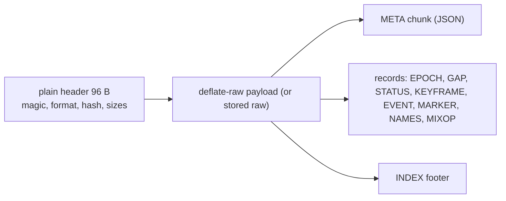
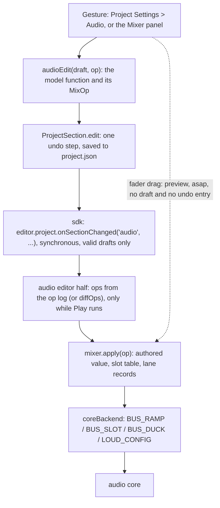
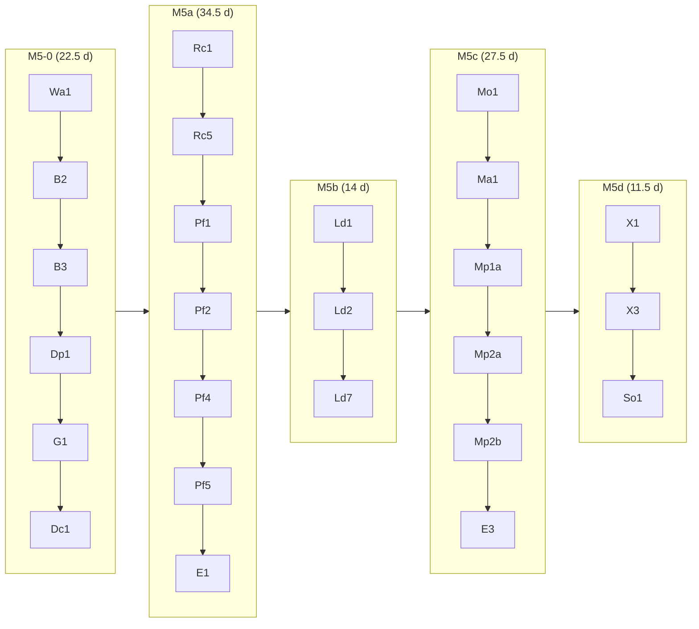

# 0171 audio mix (M5): API, data models, formats and plan, round 2B

Senior engineer's design for ADR 0171 (Accepted; "RFC round (revision 2)" and "Owner decisions (accepted)" win over the text above them), revised after round 2A and the coordinator's rulings **R1-R25** ([rulings.md](rulings.md)). Companion to [architecture.md](architecture.md) (cited **[ARCH §n]**: lanes, the dip, the clock, CPU, loudness flow, the ring, constants, failure behaviour), to M4's `../0166-audio-music/api-and-models.md` (whose shape this follows) and to [goal.md](goal.md). It owns the public API, the `audio` settings changes, every byte layout (STATUS, commands, ABI, the capture file), the mix-operation encoding and slot table as data, the SDK hook, the editor models, the module layout, the test plan and the task table. What I need from the architect is **S1-S14** in [contracts-senior.md](contracts-senior.md) (written "contract S4" below, spikes "spike S4"); their needs from me are C1-C26, answered in §14. Semantics the architecture owns are cited, not restated.

Units: seconds on the heard clock (`Audio.time`'s base) unless a field says otherwise; audio frames at the context rate; `perfMs` is `performance.now()`; gain is linear; levels are dBFS, LUFS or dBTP as named; little-endian; offsets from a record's first byte, head included. Line numbers cite this worktree at 2026-11-12. Owner rules applied: follow Wwise, FMOD, Unity and Unreal (inline); no feature flags and no migration (the samples change, §1.4); no run that cannot change a decision (§10). Settled text is cited, never reopened; where it is wrong or under-specified §12 says so with evidence.

## 1. Public API

Everything public is exported from `src/myco.ts` through `src/plugins/audio/runtime/index.ts`; the types live in the engine (`src/engine/audio/`) so the engine core imports no plugin. Nothing names Babylon, three.js, Rapier or Howler (ADR 0010).

### 1.1 `Bus`: two volumes, loudness, duck gain

Today `Bus.volume` reads and writes the one number the project authors (`src/engine/audio/mixer.ts:49-50`; `configure` initialises it to the authored value, `:87`, so the comment "1 = as authored" at `:48` is already wrong). M5 separates them (record changes 15, 16).

```ts
// src/engine/audio/mixer.ts
export class Bus {
  readonly name: string;
  readonly exists: boolean;
  /** Runtime multiplier, linear 0..2, default 1, set by scripts. Acts on top of `authoredVolume`; never written to project.json. Authored 2 x runtime 2 = 4 is legal; the master limiter catches it. A fade in progress reads its current value on the heard clock. */
  volume: number;
  /** The project's value (`audio.buses[i].volume`), read-only to scripts; the editor changes it through `mixer.apply`. */
  readonly authoredVolume: number;
  /** Runtime switches set by scripts, default false; effective mute = authored mute OR this OR a monitor control. */
  mute: boolean;
  solo: boolean;
  readonly authoredMute: boolean;
  readonly activeVoices: number;
  readonly peak: number;                 // unchanged: newest peak, decayed for display
  /** Product of every gain up the tree, all seven lanes. */
  readonly effectiveGain: number;
  /** The duck lane's gain, 1 = not ducked, 0..1, from STATUS (a block old); always 1 on the Babylon fallback, which ducks on main. */
  readonly duckGain: number;
  /** Ease `volume` to `v` over `seconds` (0 jumps over `BUS_MIN_RAMP_MS`, never an unramped step). One stamped ramp, not one per display frame. */
  fadeTo(v: number, seconds: number): void;
  /** Loudness readings and controls; a stable object allocated once per bus, like `peak`. */
  readonly loudness: BusLoudness;
}
```

`fadeTo` keeps today's meaning (linear in volume, `mixer.ts:176-182`) but acts on the multiplier: authored 0.8 with `fadeTo(0.5, 1)` plays at 0.4 and the editor's fader still shows 0.8. A `Bus.volume` read during a fade is main's own evaluation of the ramp at the heard clock; nothing is read back from the core. `mixer.configure(settings)` (project load) still clears every script value (`mixer.ts:79-91`); the new `mixer.apply(op)` (§6) does not.

```ts
// src/engine/audio/loudnessTypes.ts (pure; no plugin import)
export type LoudnessResetWhat = "integrated" | "maxPeak" | "all";
export type LoudnessTargetState = "waiting" | "ok" | "high" | "low" | "suspended";
export interface LoudnessTargetReading {
  readonly name: string;           // an entry of audio.loudnessTargets
  readonly integrated: number;     // LUFS goal
  readonly tolerance: number;      // LU, +/-
  readonly truePeak: number;       // dBTP ceiling
  readonly deviation: number;      // integrated - goal, LU; -Infinity until integrated has a value
  readonly state: LoudnessTargetState;
  readonly peakOver: boolean;      // maxTruePeak > truePeak
}
export interface BusLoudness {
  // readings: LUFS, LU, dBTP; -Infinity while gated, empty or unmetered; never NaN
  readonly momentary: number;      // last 0.4 s (4 sub-blocks)
  readonly shortTerm: number;      // last 3 s (30 sub-blocks)
  readonly integrated: number;     // gated, since the last reset
  readonly lra: number;            // LU; -Infinity until two short-term blocks pass the gates
  readonly maxTruePeak: number;    // dBTP: max(true peak, sample peak)
  readonly truePeakBound: "exact" | "lowerBound";   // lowerBound: true peak was gated off in quanta below the ceiling's gate
  readonly maxMomentary: number;
  readonly elapsed: number;        // seconds of metered audio since the last reset, paused, shed and gap time excluded
  // state
  readonly metered: boolean;       // false: not chosen in the project (or the Babylon fallback); readings -Infinity
  readonly paused: boolean;        // by pause() or by the shedding ladder
  readonly pausedBy: "script" | "ladder" | null;
  readonly incomplete: boolean;    // sub-blocks lost (a stall over 3.2 s), a shed span or a rebuild gap since the last reset
  readonly tainted: boolean;       // a monitor control or Compare affected this meter since the last reset
  readonly target: LoudnessTargetReading | null;   // null when the project has no targets
  // controls
  reset(what?: LoudnessResetWhat): void;           // default "all"
  pause(): void;
  resume(): void;
}
```

**Empty and flag semantics (record change 13; the mid-level review's debugging table).** `momentary` is `-Infinity` for 0.4 s after a reset, `shortTerm` for 3 s, `integrated` until a 400 ms block passes the -70 LUFS gate; digital silence keeps `integrated` where it was. An unmetered bus has `metered === false`, every reading `-Infinity` and every control a no-op, never a throw (`Audio.bus("nope").loudness` is the inert object a missing bus already returns, `mixer.ts:41`). **`tainted` comes from monitor controls and Compare only (R20):** a monitor mute of X taints X, its ancestors and master; a monitor solo taints every meter. MASTER not 1, authored or script mutes and the hidden-tab mute do **not** taint; they and any monitor control make `target.state` **`suspended`**. `tainted` and `incomplete` stay set until `reset("all")` or `reset("integrated")`. `target.state` is `waiting` while `integrated` is `-Infinity`. A ladder pause sets `incomplete` on resume ([ARCH §4.8]). A script reads and resets as with FMOD's meter:

```ts
const m = Audio.bus("Master").loudness;   // the root bus reads the final output, after the reverb return and the limiter
m.reset("all");
console.log(m.integrated, m.maxTruePeak, m.target?.state);
```

`Audio.loudnessTarget: string | null` (read/write) names the entry of `audio.loudnessTargets` in force; default the first; an unknown name is ignored with one warning. The Mixer panel picks one through it (record change 23).

### 1.2 `Audio.capture`

```ts
export interface AudioCapture {
  /** "idle" -> "loading" (recorder chunk fetching) -> "recording" -> "stopped" (a take exists to save). */
  readonly state: "idle" | "loading" | "recording" | "stopped";
  readonly seconds: number;      // the ring's content; 0 while idle
  readonly bytes: number;
  /** True when the ring wrapped over the take's start: the file begins at a later keyframe and is marked truncated. */
  readonly truncated: boolean;
  /** Load the recorder (a lazy chunk, absent from a game that never calls this) and begin a take. Resolves once recording; rejects with a message if the chunk or the core is unavailable. A second call while recording joins it, writes a marker and resolves at once. */
  start(): Promise<void>;
  /** End the caller's hold. The ring keeps recording while the Profiler panel is open (one ring, shared). */
  stop(): void;
  /** A timeline marker at the current frame, cut to `CAPTURE_MARK_BYTES` (120) UTF-8 bytes. No-op while no ring runs. */
  mark(text: string): void;
  /** Compress and save the take; resolves with the web file name or the app-data path. Rejects with "nothing recorded: call Audio.capture.start() first" when there is no take. */
  save(name?: string): Promise<string>;
}
```

`start()` returns a Promise because the recorder loads lazily and earlier events would be lost (record change 33). A **take** is a (start, end) pair over the shared ring: `start()` marks the nearest keyframe at or before now and `save()` writes from the **latest take's** start keyframe to the newest record (or to `stop()`); a `start()` from Held begins a new take after a GAP (R16, [ARCH §2.1]), so older takes stay in the ring for the panel but not in the file. `save(name)` is sanitised to `[A-Za-z0-9._-]` (64 characters, `.mycap` appended); absent, `capture-YYYYMMDD-HHMMSS`. Platform paths: §5.7. On the Babylon fallback it records main-side events and keyframes only (§9) and the header says so.

### 1.3 `Audio.debug()` additions and capability flags

`AudioDebugInfo` (`src/plugins/audio/runtime/backend.ts:137-162`) gains, for every backend (record change 32, C23):

```ts
mixCaps: { loudness: boolean; levelDucking: boolean; cpu: boolean; cpuReason: string | null; stampedBusRamps: boolean; capture: "full" | "mainSideOnly" };
cpu: { loadPermille: number | null; windowMs: number; clockStepMs: number; clockSteps: number; refitResidual: number | null; sections: { voices: number; buses: number; spatial: number; music: number; loudness: number } | null; hidden: string | null };
mix: { slots: { name: string | null; slot: number; state: "live" | "tombstone" | "free" }[]; monitorActive: boolean; metersPaused: number; loudnessLadderStep: 0 | 1; busRecordsEarly: number; sidechainLate: number; liveRefused: number;
       ducking: { target: string; trigger: string; mode: "level" | "presence"; gain: number }[] };
recorder: { state: string; owners: number; bytes: number; segments: number; evicted: number; truncated: boolean } | null;
```

`cpu.loadPermille` is main's figure (the window of [ARCH §4.3]); it is `null` before the first window fills ("CPU not yet measured"), never 0 for unknown, and `hidden` carries the reason when the clock is too coarse. The core backend reports all flags true and `capture: "full"`; the Babylon fallback `loudness`, `levelDucking`, `cpu`, `stampedBusRamps` false, `capture: "mainSideOnly"`. `AudioBackend` (`backend.ts:585,587`) gains `applyOp(op: MixOp): ApplyResult`, `flushNow()` and `mixCaps`.

### 1.4 Compatibility against today

| Member | Today | M5 |
|---|---|---|
| `Bus.volume` | the authored number, `mixer.ts:49-50` | runtime multiplier, default 1; `authoredVolume` added |
| `Bus.mute`, `Bus.solo` | one runtime field, mute initialised from the authored value (`:87`) | runtime switches, default false; authored mute separate; the Mixer panel's mute and solo are a third layer (monitor), never written to `project.json` |
| `Bus.fadeTo` | per-frame main-side ramp (`:183-215`) | one stamped ramp on the runtime lane |
| `Bus.effectiveGain`, `peak` | unchanged meaning | all seven lanes |
| `Bus.loudness`, `duckGain`, `authoredVolume`, `authoredMute` | absent | added |
| `audio.ducking[i]` | `{ target, trigger, amount, attack, release }`, presence only (`settings.ts:66-75`, `:364-368`) | `mode` required (§2.1) |
| A bus's reverb send | taken before the bus's gain (`bus.rs:540` against `:547-568`): a muted bus still feeds the reverb | scaled by the dip and monitor lanes; post-fader recommended (§4.6, owner item O1) |
| `Audio.debug()` | no capability record | `mixCaps`, `cpu`, `mix`, `recorder` |
| `Audio.capture`, `Audio.loudnessTarget` | absent | added |
| `mixer.configure` | clears script state | unchanged, for project load; `mixer.apply(op)` is new and keeps it |
| `BUS_MIX` (opcode 0x11) | per-frame bus gain and cut-off | retired; asap `BUS_RAMP` on a lone lane is bit-identical (R3, §4.2); ABI 4.0 |
| Samples | `fadeTo` at `flappy/.../GameManager.ts:17,22`, `sound-lab/.../Buses.ts:17`, `stress/.../Stress.ts:208`; `mute` at `Buses.ts:14`, `Stress.ts:212,219` | keep working on the new layers (stress's random volumes now multiply the authored value, so its range is rescaled); ducking rules rewritten in `samples/sound-lab/project.json:91` and `samples/stress/project.json:908`; a sample test asserts every `ducking` entry has a `mode` |

**Proof that no migration is needed.** The engine is unpublished and only the samples read `audio`; `parseAudioSettings` is lenient and reports what it drops (`settings.ts:364-368`); the one old input that changes meaning is a ducking rule without `mode`, in two sample projects, edited in Sa1 under a test that fails on any `audio` problem in `samples/*/project.json`. No flag, no shim, no old-format reader.

## 2. Settings: the `audio` section

### 2.1 Keys

| Key | Type, range | Default | Parse rule (lenient with `problems[]`, as `settings.ts` does) |
|---|---|---|---|
| `buses[i].meter` | `"loudness"` | absent (off) | any other value dropped with a problem; never written when absent (as `bed`, `settings.ts:42-43`). On the root bus: dropped with "Master is always metered". More than `MAX_LOUDNESS_BUSES` (8) non-root buses carry it: the first 8 in list order keep it, each other is dropped with a problem |
| `loudnessTargets` | list, 1..8 entries `{ name, integrated, tolerance, truePeak }` | the two owner entries | `name` unique, non-empty, up to 32 characters; `integrated` -70..0 LUFS; `tolerance` 0..12 LU, default 2; `truePeak` -20..0 dBTP, default -1. Bad entries dropped with a problem; an empty list gives the defaults; the first entry is the default target. Written only when it differs from the default list |
| `loudnessResetOnPlay` | boolean | `true` | applies to the editor's Play; an exported game's integrated measure starts at engine start (record change 21) |
| `ducking[i].mode` | `"level"` \| `"presence"` | required | absent or other: the rule is dropped with a problem |
| `ducking[i].detector` | `"peak"` \| `"rms"` | `"rms"` (level only) | on a presence rule ignored with a problem |
| `ducking[i].threshold` | -80..0 dBFS | -30 (level only) | clamped with a problem; on a presence rule ignored with a problem |
| `ducking[i].amount` | 0..1, the multiplier the target heads for | 0.4 | as today (`:368`) |
| `ducking[i].attack`, `release` | seconds 0..10 | 0.1, 0.5 | as today; both modes share field names and units |

Defaults of `loudnessTargets` (owner decision 4; published guidance, **unverified** here): `console` -24 LUFS ±2 LU, -1 dBTP and `mobile` -18 LUFS ±2 LU, -1 dBTP. The three meanings of "loudness" stay apart (senior RFC): bus field `meter`, project table `loudnessTargets`, reader `Bus.loudness`. The detector and threshold defaults are the record's example (change 24); the law is [ARCH §4.6].

```jsonc
"audio": {
  "buses": [
    { "name": "Master" },
    { "name": "Music", "parent": "Master", "volume": 0.8 },
    { "name": "Voice", "parent": "Master", "meter": "loudness" }
  ],
  "ducking": [
    { "target": "Music", "trigger": "Voice", "mode": "level", "detector": "rms",
      "threshold": -30, "amount": 0.4, "attack": 0.05, "release": 0.4 },
    { "target": "Music", "trigger": "Voice", "mode": "presence", "amount": 0.4, "attack": 0.1, "release": 0.6 }
  ]
}
```
(Both modes stack by min in the core, record change 15.)

### 2.2 Validation

Added to today's checks (`settings.ts:366-367` refuses only `target === trigger`):
1. **Ancestor trigger** (either mode): dropped with "audio.ducking[i]: Voice is above Music in the tree, so its level can't be measured before Music is mixed" (walk over `parent` links; `Mixer.chain`, `mixer.ts:228-230`, does the walk today).
2. **Level-rule cycles (R5):** Kahn's algorithm over child-to-parent edges plus one trigger-to-target edge per **level** rule; a cycle (A ducks B and B ducks A, or A to B to C to A) drops the closing rule with a message **naming the rules in the cycle**. Presence rules add no edge and are exempt.
3. **Counts:** at most `MAX_DUCK_RULES` (32) rules and at most `MAX_LEVEL_RULES` (8) of them level rules; the rest dropped with a problem.
4. **Buses:** the parse cap stays `MAX_BUSES` 32 (`settings.ts:209,345`); during a session tombstones count (§6.3).
5. **Where problems show:** the settings section lists them under the field (`audioProblems`, `audioSettingsModel.ts:51`), the Mixer panel banners any problem of a live key, `Engine.create` logs them (`Engine.ts:185`).

The model functions refuse what the parse would drop and return the draft unchanged with a message (the ninth `meter` toggle: "At most 8 buses can be metered").

## 3. Internal models

### 3.1 Main-side state

`BusState` (`mixer.ts:17-35`) gains: `slot` (core index, §6.3); one `Ramp` record (start frame, frames, from, to, law) per main-written lane: `authored` = `authoredVolume` × authored mute, `runtime` = script volume, its fade and script mute, `snapshot` (and its low-pass), `monitor` = monitor mute × the solo gate (main evaluates solo over the slot tree from script and monitor solo, `mixer.ts:234-238`'s rule), `dip`; and `duck`, the last STATUS value. Lane semantics, composition and exactness are [ARCH §4.5] (R1). Main evaluates its own ramps at the heard clock for getters and `effectiveGain`'s audibility estimate (`coreBackend.ts:690-692`); each setter emits `BUS_RAMP` records (§4.2) for exactly what moved, replacing the whole-mix re-send of `coreBackend.ts:523-526`.

### 3.2 Loudness statistics (main)

Ported from spike S1's `Feed` / `Gating` / `Hist` (`spikes/audio-mix/loudness/src/loud.rs`) to TypeScript: the last 30 sub-block energies (momentary = last 4, short-term = last 30), the 400 ms-block gate with two 1,000-bin histograms (24 kB per bus, within 0.11 LU of exact), running maxima. Zero allocation per STATUS: `Uint32Array`s sized for nine meters. `LoudnessHub.feed(block)` runs in the STATUS handler after the mirror and recorder and writes each `BusLoudness` in place; main cost ≤ `BUDGET_LOUD_MAIN_US_PER_S` ([ARCH §5.3], 50 µs per second). The Worker uses the same `LoudnessStats` to recompute M and S between keyframes (§5.5).

## 4. Binary formats: wire and ABI

One schema (`audio-wire/src/schema/*.rs`) generated into Rust and TypeScript by `gen_wire` (`npm run build:audio`). A new `schema/mix.rs` (opcodes, constants, STATUS sections) joins `SCHEMA_SOURCES` (`schema.rs:22-30`); the hash covers it. The whole layout lands **once, in M5-0's wire task**; fields of later milestones read 0 until filled (M4's rule).

### 4.1 Versions and constants

| | Today | M5 | Why |
|---|---|---|---|
| ABI (`audio-wasm/src/lib.rs:29-30`) | 3.0 (0x300) | **4.0 (0x400)** | STATUS offsets and sections move, `BUS_MIX` is retired, stamped configuration changes behaviour; a stale wasm must fail the hash test and the first STATUS's `abiVersion`. `myco_audio_init` is **unchanged** |
| Envelope (`schema.rs:62-63`) | 1.2 | 1.3 | new opcodes are minor |
| `STATUS_HEADER_BYTES` (`:71`) | 176 | **256** | |
| `STATUS_BUFFER_BYTES` (`:73`) | 16,384 | **20,480** | |
| `STATUS_WORST_CASE_BYTES` (`:74`) | 16,192 | **17,824** | §4.3 |
| Pool | 8 x 16 KB | 8 x 20 KB | +32 KB (change 28) |

Constants `gen_wire` emits (the architecture quotes them by name, contract S11): `MAX_LOUDNESS_BUSES` 8, `LOUD_METERS` 9 (8 plus the final-output tap), `LOUD_RING_SUBBLOCKS` 32, `LOUD_OUTPUT_TAP` 0xFFFF, `BUS_MASTER_OUT` 0xFFFF (BUS_RAMP's bus for the output gain), `LANE_AUTHORED` 0, `LANE_RUNTIME` 1, `LANE_SNAPSHOT` 2, `LANE_MONITOR` 3, `LANE_DIP` 4, `LANE_DUCK` 5, `LANE_AUTOMATION` 6, `MAX_DUCK_RULES` 32, `MAX_LEVEL_RULES` 8, `BUS_MIN_RAMP_MS` 5, `DRAG_RAMP_MS` 10, `FADER_COALESCE_MS` 4, `TOMBSTONE_TAIL_FRAMES` 128, `COMPRESSOR_SMOOTH_MS` 20. `DIP_FRAMES` = round(0.020 x sampleRate) is computed on both sides ([ARCH §3.3]).

### 4.2 Commands

Unchanged: every record not named, including `BUS_CONFIG`'s item layout (`schema/batch.rs:63-72`) and `BUS_AUTOMATE` (0x15). Free ids: 0x18-0x1F, 0x21+, 0x31+ (taken: 0x01-0x0A, 0x10-0x17, 0x20, 0x30).

**`BUS_RAMP` (0x18), 32 B, the third stamped class in `due.rs`** (change 27). `voiceId` = bus slot (`BUS_MASTER_OUT` = the output gain MASTER sets today); `frameOffset` = start frame or `ASAP`:

| Off | Type | Field |
|---|---|---|
| 12 | u16 | `lane`: 0-4 main-written; 5 duck and 6 automation are core-owned and a record naming them is ignored and counted |
| 14 | u16 | `mask`: bit 0 `gain`, bit 1 `lpHz` (lane 2 only; the snapshot low-pass) |
| 16 | f32 | `gain` target, >= 0 (clamped to 4); a non-finite value leaves the target |
| 20 | f32 | `lpHz` target, 10..24,000 (24,000 = off) |
| 24 | u32 | `frames`: ramp length from the start frame; **0 is a literal step**, used by replay and RESET only (R2) |
| 28 | u32 | `shape`: law and start phase as FADE's (`schema/batch.rs:25-30`; linear only in M5), plus bits 3-15 `sequenceId` (0 = none, C27) |

Semantics are [ARCH §4.5]: linear from the lane's value at its start frame; two records for one lane in a quantum apply in frame order; a record that finds the due list full applies at the quantum's start and counts `busRecordsEarly`, never splitting (R6). **An asap `BUS_RAMP` on a lone lane uses `Ramp::next`'s arithmetic and lanes at identity are skipped (R3)**, so every existing bus golden keeps its digest through a harness that sends `BUS_RAMP` where it sent `BUS_MIX`; stamped ramps use the exact start-sample segments (spike S4: 5e-8). Ramp lengths main chooses: `DRAG_RAMP_MS` for continuous drags, `BUS_MIN_RAMP_MS` for toggles and as the floor for script jumps (R2).

**`BUS_SLOT` (0x1C), variable, R7:** one slot's configuration, so a parameter edit no longer resends the tree. Head, then:

| Off | Type | Field |
|---|---|---|
| 12 | u16 | `slot` |
| 14 | u16 | `flags`: bit 0 `structural` (applies at quantum granularity and obeys the gate below), bit 1 `fresh` (the slot starts zeroed with unity lanes: a re-add after recycling) |
| 16 | u16 | `sequenceId`: the structural sequence this record belongs to (13 bits, 0 = none, C27) |
| 18 | u16 | reserved, 0 |
| 20 | u32 | reserved, 0 |
| 24 | u16 | `parent` (`BUS_ROOT` 0xFFFF for a root) |
| 26 | u16 | `effectCount` (at most 4 are kept) |
| 28 | 32 B each | effects in `BusConfigBusesEffects` form (`u32 type; f32 p[7]`) |

**The sequence tag is how the core enforces R8's late-batch rule (C27).** The dip-down `BUS_RAMP`, the `BUS_SLOT` and the dip-up `BUS_RAMP` carry one `sequenceId` and main never splits a sequence across batches. When the core pops the dip-down with start frame F0 before the current quantum's first frame q, it shifts all three records by s = ceil((q - F0) / 128) x 128 frames, counts `lateCommands` once and raises `maxLatenessFrames` once per sequence (no new STATUS field); a later sequence that would start before the in-flight one's shifted end is shifted too. When a `BUS_SLOT` applies (a re-parent), the core re-runs the bus order, as it does for `BUS_CONFIG` and `BUS_DUCK`. Direct edits carry `flags = 0`, `ASAP`, and only a compressor's parameters are smoothed (`COMPRESSOR_SMOOTH_MS`; filter, Q and send levels stay direct, spike S4 measured them clean, R7). `BUS_CONFIG` stays the full-tree record for init and replay.

**`BUS_DUCK` (0x19), replace-all, asap only (R6):** `u32 ruleCount` (<= 32, at most 8 level), items 24 B: `u16 target`, `u16 trigger`, `u32 flags` (bit 0 `level`, bit 1 `rms`), `f32 thresholdDb`, `f32 amount`, `f32 attack`, `f32 release`. A rule naming a tombstone or an ancestor trigger is made inert by the core's own check. Recomputes the order (§4.4).

**`BUS_PRESENCE` (0x1A), 16 B:** `u32 mask`, bit b set while slot b has a voice (virtual and locked included, as `coreBackend.ts:779` counts); **stamped at the frame of the voice start or explicit stop** (a natural end reaches main one STATUS block later, as today); applies at the start of the quantum holding its frame. Presence mode runs in the core from M5-0 (R4); level mode arrives in M5c.

**`LOUD_CONFIG` (0x1B), replace-all, asap only:** `f32 tpGateDbfs` (the selected ceiling minus 6 dB; a target change re-sends it and is not a reset), `u32 meterCount` (<= 8; **master is implicit**), items 4 B: `u16 slot`, `u16 reserved`. Replacing keeps the state of meters that stay.

**Tombstone (R9).** No wire sentinel: a removed bus is a **silent root**: `BUS_SLOT` with `parent` `BUS_ROOT`, no effects, and main holds its `dip` lane at 0 until the slot is recycled (`TOMBSTONE_TAIL_FRAMES` 128 after the config frame, no live voice); a re-add sends `fresh`. `BUS_CONFIG` bytes for an untombstoned tree stay identical to today's.

**Retired:** `BUS_MIX` (0x11), its id reserved. `MASTER` (0x12) keeps its layout for the first send and the idle reset (`bus.rs:427-452`); live master changes go through `BUS_RAMP` on `BUS_MASTER_OUT` with the product target volume x not-muted (`coreBackend.ts:808,817` send it today). RESET settles every lane **on its target**, as `bus.rs:437-452` does for gains (R12). **The replay** (`replay.ts:5,17-18,491`) after RESET sends, in order: `BUS_CONFIG` (slot order, tombstones as silent roots), `BUS_DUCK`, `BUS_PRESENCE`, `LOUD_CONFIG`, then lanes: `runtime` and `snapshot` as their **remaining ramp**, `authored`, `monitor` and a drag at their value, a dip at its **end state** (lane 1 with the new layout; 0 for a tombstone); then MASTER. Stamping rules for configuration: [ARCH §4.7]; `BUS_SLOT` and `BUS_PRESENCE` carry a frame, `BUS_DUCK` and `LOUD_CONFIG` do not.

### 4.3 STATUS

Header 176 to **256 B** (offsets absolute, envelope counted); fields 16..175 unchanged (`reserved` at 172 stays 0). **`loadPermille` (80) stays 0 on the wire (R18):** main computes the figure ([ARCH §4.3]); `mirror.loadPermille` (`mirror.ts:52,246`) is set by the CPU meter.

| Off | Type | Field | Writer |
|---|---|---|---|
| 176 | f64 | `busyMsTotal`: sum of `Date.now()` deltas around `process()`, ms, since the driver started | shell |
| 184 | f64 | `quantaTotal` | shell |
| 192 | f64 x5 | `wuVoices`, `wuBuses` (buses, effects, sidechain, ramps), `wuSpatial`, `wuMusic`, `wuLoudness`: cumulative work units | core |
| 232 | u16 | `loudBusCount` (<= 9) | core |
| 234 | u16 | `loudEnergyCount` (<= 288) | core |
| 236 | u16 | `duckCount` (<= 32) | core |
| 238 | u16 | `clockStepMs`: the smallest non-zero `Date.now` delta seen; 0 = none yet | shell |
| 240 | u32 | `loudSubBlockFrames`: `round(sampleRate / 10)` | core |
| 244 | u16 | `clockSteps`: wall-clock steps clamped (saturating) | shell |
| 246 | u16 | `loudShed`: the ladder's loudness step in force, 0 or 1 (`m3Shed` keeps counting bed and zone steps, R21) | core |
| 248 | u16 | `busRecordsEarly` (cumulative, saturating) | core |
| 250 | u16 | `sidechainLate` (cumulative, saturating) | core |
| 252 | u32 | reserved, 0 | |

Cumulative values are f64 (the model has no u64, `model.rs:10-17`; exact to 2^53, no wrap logic on main). The shell writes its fields where it writes `dateMs` (`coreDriver.ts:386,1040`); a driver restart restarts them at 0, which main reads as an epoch change, never a negative delta. Window and cadence rules: [ARCH §4.3].

New sections after `groupStarts`:

| Section | Item | Max | Bytes at max |
|---|---|---|---|
| `loudBuses` | **16 B**: `u16 slot` (`LOUD_OUTPUT_TAP` = the final output), `u16 flags` (bits 0-5 new-block count 0..32; 6 paused by the ladder, 7 reset, 8 lost, 9 gated, 10 tp gate active), `u32 firstSeq`, `f32 truePeak` (linear, max(true peak, sample peak) since the last successful take), `u32 gatedQuanta` (cumulative) | 9 | 144 |
| `loudEnergies` | `f32 energy`: K-weighted L+R mean square of a sub-block; bus-major in `loudBuses` order, oldest first | 288 | 1,152 |
| `busDuck` | `u16 slot`, `u16 pad`, `f32 gain`: **only buses that are the target of a rule** | 32 | 256 |

The core keeps the 32-entry ring and sends the sub-blocks since the last **successful** `status_take` (the shell takes only with a pooled buffer, `coreDriver.ts:1017-1028`), so a main stall of up to 3.2 s loses nothing; `firstSeq` shows a loss ([ARCH §4.4]). **Worst case: 16,192 - 176 + 256 + 144 + 1,152 + 256 = 17,824 B of 20,480, 2,656 B spare** (the architect needs >= 1 KB). The 16 B item and the targets-only duck section keep the raw STATUS growth near 0.7 MB per minute, which is what [ARCH §4.2]'s ring durations assume. `StatusReader` parses the new sections into preallocated arrays with the old checks and error codes; tests that hard-code the old size read the constants in Wa2 (`mirror.test.ts:133,141`, `bufferPool.test.ts:96`, `wire.m4.test.ts:200`).

### 4.4 Bus order

`bus.rs:386-399` sorts by depth, deepest first, ties by index. M5-0 computes it by Kahn's algorithm over child-to-parent edges plus one trigger-to-target edge per **level** rule, deepest first then lowest index (R5): with no level rule it equals today's order, and **presence rules add no edge** (their input is `BUS_PRESENCE`, not a buffer). It runs at `BUS_CONFIG`, `BUS_SLOT` and `BUS_DUCK`. Because only level rules read a buffer, the sort changes no sound until M5c (§12 item 2).

### 4.5 Tests of the wire

`vectors/wire.json` gains a golden for each new opcode, a `BUS_SLOT` with a sequence tag, a STATUS with the three sections at their caps (the 17,824 B case) and at zero; the fuzz adds truncated and over-count `BUS_RAMP`/`BUS_DUCK`/`LOUD_CONFIG`/`BUS_SLOT`, `loudEnergyCount` past its cap, a count sum that disagrees with it, NaN and infinite targets, an unknown lane, a slot past the configured count.

### 4.6 Reverb sends and the lanes (R11, owner item O1)

The send is taken inside `slot.fx.process` (`bus.rs:540`) before the gain stage (`:547-568`), so today no gain lane silences it: a muted bus still feeds the reverb. M5 **must** scale the send by the `dip` and `monitor` lanes (a dip would otherwise let a reset chain step into the convolver, and a monitor solo would still ring muted buses' reverb). **Recommended (post-fader, FMOD's default):** the send also follows every other lane, so a muted or ducked bus stops feeding the reverb. **Alternative:** only `dip` and `monitor` scale it, and the fader and script mutes keep today's pre-fader send. There is **no setting either way** (no flags). The API side: nothing changes in `Bus`; the compatibility table above names the behaviour. **Golden exception:** either choice changes the render of a muted bus that has a send, the one named exception to R3: G1 adds a golden (`bus-mute-send`) and, under post-fader, re-records only the goldens whose bus has a send and a gain other than 1 (found by running them). `fx.process` writes the reverb contribution to a 1 KB scratch that is multiplied by the bus's gain for the quantum before it joins the convolver input; a settled gain of 1 skips the multiply, so it is bit-identical (priced in Rv1). The shared convolver runs out until its input has been silent for the IR length plus `IDLE_MARGIN_QUANTA` and then resets ([ARCH §3.3]); Rv1 builds both.

## 5. The capture file

A capture is the profile stream saved (record §1); the architecture owns the stream's semantics ([ARCH §4.1, §4.2]). This section is byte-exact, with limits for **untrusted input** (record change 4).

### 5.1 Layout



The header is **not** compressed, so a wire mismatch or a size bomb is refused before any inflate. After it comes one `deflate-raw` stream (`CompressionStream`, byte-equal to zlib, spike S3) of the META chunk, the records and the INDEX record; with no `CompressionStream` the payload is stored raw and `compressed` is clear.

| Off | Size | Field |
|---|---|---|
| 0 | 8 | magic `"MYCAP\0"`, `0x01`, `0x1A` |
| 8 | 2 | `format` u16 = 1 |
| 10 | 2 | `flags`: bit 0 `truncated`, bit 1 `mainSideOnly` (Babylon: no STATUS records), bit 2 `hasIndex`, bit 3 `compressed` |
| 12 | 16 | wire `SCHEMA_HASH` (`wire.generated.ts:7`) |
| 28 | 4 | `abiVersion` u32 (0x400) |
| 32 | 2+2 | envelope major, minor |
| 36 | 4 | `statusBytesMax` u32 = `STATUS_BUFFER_BYTES` at record time |
| 40 | 4 | `sampleRate` u32 (the first epoch's) |
| 44 | 2 | `quantumFrames` u16 (128) |
| 46 | 1 | `statusEveryQuanta` u8 (6) |
| 47 | 1 | `preset` u8 (0 low, 1 default, 2 high) |
| 48 | 8 | `startDateMs` f64 |
| 56 | 4 | `keyframeIntervalMs` u32 = 1000, measured in rendered frames at the epoch's rate (R13) |
| 60 | 4 | `metaBytes` u32 |
| 64 | 4 | `recordBytes` u32: the records after inflate, INDEX included |
| 68 | 4 | `uncompressedBytes` u32 = `metaBytes + recordBytes` |
| 72 | 4 | `recordCount` u32 |
| 76 | 4 | `indexBytes` u32: the INDEX record's length (0 when `hasIndex` is clear) |
| 80 | 4 | `ringBytes` u32 |
| 84 | 4 | reserved, 0 |
| 88 | 8 | `firstFrame` f64: the oldest kept frame |

**Reading, each step refusing with a `CaptureError` and its code before the next:** length >= 96 and magic (`badMagic`); `format` 1 (`newerFormat`/`olderFormat`); `SCHEMA_HASH` equal to this build's (`wireMismatch`, whose message names both ABI versions and says "re-record with this build"); `uncompressedBytes <= CAPTURE_MAX_UNCOMPRESSED_BYTES` (64 MiB, R16) (`tooLarge`); inflate with a hard stop at `uncompressedBytes + 1` (`inflateOverrun`); then META, then records. No header count sizes an allocation; arrays grow by the records read, up to the caps.

### 5.2 META chunk

UTF-8 JSON, at most `CAPTURE_META_MAX_BYTES` (1 MiB): `{ project: { name, version }, engine, device: { preset, sampleRate, deviceMemory?, userAgent: first 120 bytes }, audio: <the project's audio section at the take's start>, target: <loudnessTarget in force>, names: { clips, buses, events, parameters, snapshots, targets } }`. Data only: `JSON.parse` on a size-checked string, every name coerced to a string and cut to 256 bytes, kept in `Map`s, never evaluated. `audio` lets the profiler name tombstoned buses and judge loudness against the target as it stood; exporting a capture exports those names (owner item, §13).

### 5.3 Record framing

Every record is a **20 B head** then `len` bytes (C1):

| Off | Type | Field |
|---|---|---|
| 0 | u8 | `type` |
| 1 | u8 | `flags`: bit 0 **`deferred`**: the record's frame is F_now because its real stamp is more than 1 s past the newest STATUS frame; the stamp (f64) travels first in the payload |
| 2 | u16 | `epoch` |
| 4 | u32 | `len` (<= `statusBytesMax` for STATUS, <= `CAPTURE_RECORD_MAX_BYTES` 262,144 otherwise) |
| 8 | u32 | `seq`: capture-wide, +1 per record |
| 12 | f64 | `frame` in the epoch's context (a STATUS's `currentFrame`; for a main event the frame of the command it causes, or now) |

Canonical order is (epoch, frame, seq); **within one epoch no record's frame is more than 1 s before that of an earlier-written record** (the `deferred` bit keeps the bound), so a reader sorts within one keyframe segment. Event payloads begin with `f64 perfMs`. Types:

| `type` | Name | Payload |
|---|---|---|
| 0x01 | EPOCH | `u8 reason` (0 start, 1 trap, 2 stall, 3 device, 4 rate, 5 latency, 6 mode: one per `RebuildReason`, `recovery.ts:32-38`; **resume is not an epoch**), `u8[3]`, `u32 sampleRate`, `u32 limiterLatencyFrames`, `u32 outputLatencyFrames`, `f64 timeOffset` (s), `f64 perfMs`. A KEYFRAME follows in the same epoch |
| 0x02 | GAP | `u8 reason` (1 paused, 2 rebuild, 3 held, 4 dropped, 5 recordTooLarge; `paused` means only `audio.background: "pause"`), `u8[3]`, `f64 perfFrom`, `f64 perfTo`, `u32 firstSeq`, `u32 lastSeq` (for `dropped`) |
| 0x03 | STATUS | the block's raw bytes, copied in `CoreLink.handleMessage` before the RECYCLE (`core/context.ts:239-247`), no delta encoder |
| 0x04 | KEYFRAME | §5.5 |
| 0x05 | EVENT | `f64 perfMs`, `u8 kind`, `u8 reason`, `u16 argc`, `argc` x `u32`, an optional trailing `f32` per kind (§5.6) |
| 0x06 | MARKER | `f64 perfMs`, `u16 n`, `n` UTF-8 bytes (<= 120): owner joins and Compare swaps write one |
| 0x07 | NAMES | `u8 table` (0 clip, 1 bus, 2 event, 3 parameter, 4 snapshot, 5 target), `u8[3]`, `u32 id`, `u16 n`, `n` bytes: a name first used after the META chunk |
| 0x08 | MIXOP | one `MixOp` (§6.2's byte form), `f64 perfMs`, origin (0 editor, 1 script, 2 undo, 3 redo, 4 compare) |
| 0x09 | WRAP | the writer jumped to offset 0; ring only, stripped by the saver |
| 0x7F | INDEX | §5.4 |

An unknown `type` below 0x80 is skipped by `len`; at or above 0x80 it is refused (`unknownRequired`).

### 5.4 Epochs, gaps, the index

Epoch and gap semantics, the heard-clock statement and the live link's framing are [ARCH §4.1] (R14): a record at frame f is heard at `Audio.time` = f / rate + `timeOffset`; a STATUS at `currentFrame` f is heard about f minus the limiter and output latencies. The editor's axis is rendered frames with `timeOffset` continuity across epochs. **INDEX** (written at save): `u32 keyframeCount`, then per keyframe `u16 epoch`, `u16 pad`, `f64 frame`, `u32 byteOffset`, `u32 seq`; then `u32 truncatedFromSeq`. Without it, or if it fails its bounds, the reader scans record heads for KEYFRAMEs (0.1-0.9 ms for 30 s, spike S3).

### 5.5 KEYFRAME payload

Main-side state at one instant, one per `keyframeIntervalMs` of STATUS frames and at each epoch's first block ([ARCH §4.2]), written into the ring with no allocation (R13). Sections in order, each `u16 count` then items:
- **voices** (<= **8,192**, `audioSettingsModel.ts:207`): **24 B**: `u32 id`, `u32 clip`, `u8 slot`, `u8 state` (0 playing, 1 virtual, 2 stolen, 3 waitingForData, 4 busMuted, 5 locked), `u8 priority`, `u8 reason` (§5.6), `f32 gain`, `u16 pitch` (u4.12), `u16 audibility` (u0.16), `u32 playheadFrames`. 8,192 rows are 196,608 B, so a keyframe stays under the 256 KB largest record.
- **buses** (<= 32): 56 B: `u8 slot`, `u8 pad`, `u16 gen`, `u16 flags` (authored mute, runtime mute, monitor mute, monitor solo, tombstone, metered), `u16 pad`, then each main-written lane's **value and target** (`authored`, `runtime`, `snapshot`, `monitor`, `dip`: 10 x f32) and the last reported `duck` and `automation` (2 x f32).
- **metered buses** (<= 9): 36 B: `u16 slot`, `u16 flags` (paused, incomplete, tainted, lower bound), then M, S, I, LRA, max true peak, max M, elapsed (7 x f32), `u32 pad`. Between keyframes the Worker recomputes M and S exactly from recorded sub-blocks (the shared `LoudnessStats`) and holds I and LRA at the last keyframe's value (at most 1 s stale), so a **truncated** file shows the live meter's integrated value ([ARCH §4.2]).
- **events** (<= 1,024): 16 B: `u32 id`, `u32 asset`, `u16 voices`, `u8 state`, `u8 pad`, `u32 paramsHash`. **music** (<= 16): 40 B: `u32 id`, `u32 segment`, `u8 state`, `u8 pass`, `u16 bar`, `u8 beat`, `u8 tick`, `u16 tempo`, `u32 pendingTo`, `f32 pendingTimeSec`, 12 reserved.
- **mix** (one): `u32 slotTableVersion`, `u8 monitorActive`, `u8 loudnessPausedMask`, `u8 targetIndex`, `u8 pad`, `u32 snapshotName`, `f32 masterVolume`, `u8 hiddenMute`.

A reader reconstructs the table at t from the nearest keyframe at or before it plus at most one segment of records (spike S3: 0.2-0.7 ms p50).

### 5.6 Events and reasons

`kind`: 1 voiceStart (`id, clip, busRef, flags, atFrameLo`, `f32 gain`), 2 voiceStop (`id`), 3 voiceSteal (`victim, thief`), 4 voiceVirtual, 5 voiceReal, 6 voiceRefused (`clip, busRef`), 7 voiceQueued (`clip, busRef`), 8 eventStart, 9 eventStop, 10 parameter, 11 snapshot (`name, f32 seconds`), 12 stateChange, 13 musicTransition, 14 busRamp (`busRef, lane, frames`, `f32 target`), 15 monitor (`mask`), 16 loudnessControl (reset, pause, resume, target), 17 ladder (step, shed or restored), 18 masterChange (`f32 volume`, `muted`), 19 hiddenTab. `busRef` = `gen << 8 | slot` (§6.3). `reason` extends `AudioReason` (`backend.ts:18`): stop 1 ended, 2 stopped, 3 faded, 4 world-released, 5 failed; steal 1 busMaxVoices (`voiceTable.ts:655`), 2 globalLimit, 3 priority; virtual 1 cap-demoted (STATUS `demoted`), 2 below-audibility, 3 paused, 4 world-inaudible; real 1 promoted, 2 cap-raised; refused 1 busFull, 2 poolFull, 3 neverFits, 4 loadFailed, 5 capRefused; queued 1 clipLoading, 2 streamPriming. The taps are the voice table's allocate path (`voiceTable.ts:584`), `noteStolen` (`:888-889`), `onFree` (`:266-270`), selection's promote and demote, `coreBackend`'s refusals and the mixer's setters, all behind one `ProfileSink` whose null object is a pointer comparison.

### 5.7 Limits, saving, sizes

| Limit | Value |
|---|---|
| Header | 96 B |
| `CAPTURE_MAX_UNCOMPRESSED_BYTES` | **64 MiB**, from the header before inflate and while inflating (R16) |
| Largest record | 256 KB (a keyframe at 8,192 voices is about 215 KB) |
| Record count | `uncompressedBytes / 20` |
| META | 1 MiB; a name 256 B; at most 65,536 names |
| MARKER text | 120 B |
| `CAPTURE_TRIGGER_MAX_FILES` | **16**: oldest deleted first on Tauri and Android (`Storage.list`, `delete`); on the web, where a download cannot be deleted, the trigger stops at 16 per session with a message (R16) |

The decoder runs in the Worker through one bounds-checked `Reader` that throws `CaptureError` (`code`, `offset`, `message`) and never reads past `recordBytes`; any error aborts the open with a banner, never a partial profile. **Saving:** the web a `Blob` and `a[download]`; Tauri desktop and Android `Storage.save(key, bytes, "cache")` (`<appDataDir>/cache/<key>.bin`, `platform/Storage.ts:5`); off Android: `adb exec-out run-as` on a debug build, **unverified** (owner decision 3). **Sizes (R15, spike S3's raw column; synthetic scenes, estimates):** a saved minute is **0.27 / 0.84 / 2.45 MB** compressed at 64 / 256 / 1,024 live voices; the ring holds raw records, 1.70 / 4.08 / 10.85 MB per minute plus M5's STATUS growth ([ARCH §4.2] has the durations). A full 32 MB ring at 1,024 voices saves to about 7 MB. These stay **unverified until spike S3's scene is re-run through the real core** (Bn2).

## 6. Live editing: operations, the slot table and the SDK hook

### 6.1 The path



Two paths reach `mixer.apply`: the **preview path** (a fader drag: the Mixer model calls `mixer.apply` and `backend.flushNow()` directly, never through the hook, R22) and the **commit path** (every edit that enters the undo history, through the hook). A drag's commit is one undo step on release (`AudioSettingsSection` commits each field through `onCommit` with a label, `AudioSettingsSection.tsx:93-109,187-188`); re-applying an absolute `set` the mixer already holds is a no-op, so preview and commit never fight. Timing and classes: [ARCH §3.2, §4.7].

### 6.2 `MixOp`

```ts
// src/engine/audio/mixOps.ts (pure; no plugin, no DOM)
export type OpClass = "direct" | "smoothed" | "dip" | "config" | "none";
export type MixOp =
  | { op: "setBus"; bus: string; key: "volume" | "mute" | "maxVoices" | "bed" | "bedPriority" | "meter"; value: number | boolean | string | null }
  | { op: "addBus"; name: string; parent: string; index?: number }
  | { op: "removeBus"; bus: string }                     // the bus and its descendants (audioSettingsModel.ts:90-99)
  | { op: "renameBus"; from: string; to: string }
  | { op: "moveBus"; bus: string; parent: string }
  | { op: "addEffect"; bus: string; index: number; effect: BusEffect }
  | { op: "removeEffect"; bus: string; index: number }
  | { op: "moveEffect"; bus: string; from: number; to: number }
  | { op: "setEffect"; bus: string; index: number; key: string; value: number }
  | { op: "addSnapshot" | "removeSnapshot" | "renameSnapshot"; index: number; name?: string }
  | { op: "setSnapshot"; index: number; bus: string; key: "volume" | "lowpass"; value: number | null }
  | { op: "setDucking"; index: number; rule: DuckingRule | null; insert?: boolean }
  | { op: "setAutomation"; index: number; rule: BusAutomation | null; insert?: boolean }
  | { op: "setTarget"; index: number; target: LoudnessTarget | null; insert?: boolean }
  | { op: "setOption"; key: "loudnessResetOnPlay"; value: boolean };
export interface MixOpEntry { ops: MixOp[]; inverse: MixOp[] }
export interface ApplyResult { ok: boolean; class: OpClass; deferred?: string; restartRequired?: string }
export function applyOpToDraft(d: SettingsDraft, op: MixOp): SettingsDraft;   // calls the model functions of audioSettingsModel.ts
export function opClass(op: MixOp, settings: AudioSettings): OpClass;
export function invert(op: MixOp, before: AudioSettings): MixOp;
export function diffOps(before: AudioSettings, after: AudioSettings): { ops: MixOp[]; restartRequired: string[] };
```

Operations are **not** diffs (record change 17): a rename is `renameBus`, so the bus's voices, slot and the handles scripts hold survive. `applyOpToDraft` calls the model functions the settings section already uses (`addBus`, `removeBus`, `renameBus`, `setBusParent`, `setBusValue`, `addEffect`, `removeEffect`, `setEffectValue`, the snapshot, ducking and automation functions, `audioSettingsModel.ts:81-198,409-466`); the section's handlers build an op and call `audioEdit`, which returns the next draft and registers `{ ops, inverse }` for it. Byte form (the capture's MIXOP record only): `u8 op`, `u8 class`, `u16 argc`, `argc` `u32` words (floats as bit patterns, strings as name ids, buses as `busRef`, §6.3).

| Class | Ops | Wire |
|---|---|---|
| direct | `setBus` volume, mute, maxVoices; `setEffect` on a filter, Q or send level; `addEffect` at the end; `addBus`; snapshot, ducking, automation, meter and target edits | `BUS_RAMP` (authored lane, `DRAG_RAMP_MS` for drags, `BUS_MIN_RAMP_MS` for toggles), `BUS_SLOT` (asap), `BUS_DUCK`, `BUS_AUTOMATE`, `LOUD_CONFIG` |
| smoothed | `setEffect` on a **compressor** | `BUS_SLOT`; the core blends over `COMPRESSOR_SMOOTH_MS` (R7) |
| dip | `moveBus`, `removeBus`, `removeEffect`, `moveEffect`, `addEffect` before the end, removing the last send, moving a playing sound to another bus | §6.5 |
| config | `renameBus` (no wire), `setBus` bed and bedPriority (`replanBedsOnSettings`, `coreBackend.ts:759-762`), `setOption` | none, or the bed plan |

A key no live path serves (voices, backend, clip memory and format, codecs, spatial, limiter look-ahead, music rings, rhythm mode, occlusion, zones) yields `restartRequired`; the Mixer panel says "Applies at the next Play: ..." and the edit is still saved.

### 6.3 The session slot table

Data in `src/engine/audio/slotTable.ts` (pure); `coreBackend` owns one instance per session ([ARCH §2.3, §4.7]).

```ts
interface Slot { state: "free" | "live" | "tombstone"; name: string | null; gen: number /* u16 */; parent: number /* slot, -1 root */; recycleAfterFrame: number /* epoch frames */ }
class SlotTable {
  readonly slots: Slot[];                 // <= MAX_BUSES (32): tombstones count
  readonly byName: Map<string, number>;
  readonly aliases: Map<string, string>;  // old name -> new, for held `Bus` handles after a rename
  version: number;                        // bumped by every structural op; stored in keyframes
  add(name: string, parent: string): number | { deferred: string };
  remove(name: string, frame: number): number[];      // the bus and its descendants
  rename(from: string, to: string): void;             // no wire; aliases the old name (one warning on use)
  move(name: string, parent: string): void;
  recycle(frame: number, liveVoicesOn: (slot: number) => number): number[];
  configWire(): BusConfigBuses[];         // slot order; tombstones are silent roots
  busRef(slot: number): number;           // gen << 8 | slot
  reset(settings: AudioSettings): void;   // at the next configure: slot = position in project.json (`coreBackend.ts:766-770`)
}
```
Until the first structural edit the table is today's mapping (`busIndexByName`, `coreBackend.ts:766-770`) and no wire byte changes. `add` takes the first `free` slot, else the next index; **with none it returns `deferred` (R10)**: the edit stays in `project.json`, is queued, and is retried at every recycle (a bus removed and two added within one dip resolves in about 40 ms, Ma3); only the fifth effect on a bus waits for the next Play, and the message says which. `remove` makes silent roots (main first re-routes the voices, `coreBackend.ts:787-790`; the dip hides the change); a slot is recyclable when its dip has ended, no voice references it (`busLive[slot]` = 0, `coreBackend.ts:779`) and `TOMBSTONE_TAIL_FRAMES` (128) have passed (R9); `gen` increments then, so a capture's `busRef` never names two buses. Undoing a remove before recycling resurrects the same slot; after it, a new one (`fresh`). A rename keeps the slot and a held handle resolves through `aliases`. **Replay** on a rebuild sends `configWire()` and lanes per §4.2 (R12), an in-flight dip as its end state. **Compaction at Stop** is `reset(settings)` at the next `configure`.

### 6.4 The SDK hook (amends ADR 0147)

`ProjectSurface.changed()` exists with no arguments (`src/editor/sdk/project.ts:42-43,67-68`), so the record's `editor.project.changed(sectionKey, ops)` cannot keep that name (§12 item 1):

```ts
// src/editor/sdk/project.ts
export interface SectionChange {
  readonly key: string;                       // the top-level project.json key: "audio"
  readonly before: unknown;                   // the section's value before and after, as parsed drafts
  readonly after: unknown;
  readonly cause: "edit" | "undo" | "redo" | "external";
}
export interface ProjectSurface {
  onSectionChanged(key: string, listener: (change: SectionChange) => void): () => void;
}
```
**Timing (R22):** the shell fires it synchronously from `Session.edit` right after `history.push` and from `step` (undo, redo), where `stepped` is already synchronous (`projectSection.ts:139-146`), and from the restart path of `reconcile` for an outside change, only when the draft has no problems and `JSON(before[key]) !== JSON(after[key])`. A failed write leaves the live sound and an unsaved draft with its error. The shell knows nothing of ops: it passes the draft values, whose **object identity the undo history preserves**; the audio editor half keeps a `WeakMap<audioValue, MixOpEntry>` filled by `audioEdit`: on `edit` and `redo` it applies `entry(after).ops`, on `undo` `entry(before).inverse`, with no entry (an outside edit, an untagged function such as `applyVoicesPreset`) `diffOps(before, after)` (a rename it cannot see becomes remove plus add, with a note). The handler does nothing unless `editor.scene.playState === "playing"`. The registry lives in `sdk/project.ts` and imports no plugin, so 0147's rule that the SDK's imports never reach `src/plugins/` holds, and the internal-tier list is unchanged.

**The 0147 amendment** (appended to ADR 0147, which is Proposed; text for Dc4):

> **Amendment (ADR 0171, 2026-11-12).** `editor.project` gains `onSectionChanged(key, listener): () => void`. The listener receives `{ key, before, after, cause }` synchronously when an edit, undo, redo or outside change to the top-level `project.json` key `key` produces a valid draft whose value differs from the previous one, and never for a draft with problems. It exists so a plugin can apply a saved edit to a running Engine (the audio plugin applies mix edits to the play Engine's mixer). The SDK holds the listener registry and imports no plugin. Previews that never enter the undo history do not use it. `changed()` keeps its meaning.

### 6.5 Structural edits: the dip

The dip is one stamped sequence: dip-down ramps, the `BUS_SLOT` change and dip-up ramps in **one batch from one F0 = now + lookahead** (`lookahead.ts:27-31`), `DIP_FRAMES` = round(0.020 x sampleRate) each, and all three records carry one **`sequenceId`** (§4.2, C27) so a late batch is shifted whole by the core and the `BUS_SLOT` never applies before its dip-down has reached 0 (R8; [ARCH §3.3]); main never splits a sequence across batches. Roots: the moved bus; the edited bus for effect edits and send removal; the removed bus for a removal (tombstoned in the same sequence); children re-parented by a mid-tree insert; a **voice** moved to another bus dips alone with M4-0's per-voice `FADE` and `SET_PARAMS bus` (`schema/batch.rs:25-30`). One sequence is in flight at a time, same-frame ops coalesce and later ones queue; a rebuild replays the end state (§6.3). The dip silences the bus's reverb send too (§4.6). A structural edit is not under the fader gate: it is heard within lookahead plus two `DIP_FRAMES`.

### 6.6 Monitor controls, taint, Compare, the fader gate

- **Monitor mute and solo** live in the `monitor` lane (mute x solo gate), set by `mixer.setMonitor({ mute, solo })`, never by `apply`, never saved. Taint follows §1.1 (R20): a monitor mute of X taints X, its ancestors and master; a solo taints every meter.
- **Compare with Play start** keeps a `structuredClone` of `audio` taken when Play begins; on toggle it applies `diffOps(current, playStart)` through `mixer.apply` with origin "compare", no undo entry and no project write, and the inverse on the way back, writing a MARKER each swap; faders lock meanwhile and affected meters are `tainted` (R20).
- **Session controls:** loudness resets at Play start (`loudnessResetOnPlay`); Reset, Pause and the elapsed readout.
- **The fader gate (R2):** interactive edits are **asap, never stamped** (a stamp would wait the lookahead, 67 ms at 30 fps), posted with `flushNow()` and at most one post per `FADER_COALESCE_MS` (4); drags ramp `DRAG_RAMP_MS` (10), toggles `BUS_MIN_RAMP_MS` (5). The gate, **≤ 50 ms from the input event to the first changed rendered sample**, is measured on the audio clock (loopback host: input event frame to first changed frame, p95 over 100 drags), never by a wall-clock tolerance; device output latency (`Audio.latency.total`) is reported beside it, and the real-worklet figure stays **unverified on phones**.

## 7. Editor models and thin views

The owner's UI/UX note governs: behaviour is decided here, placement is not; every view is a thin layer over pure tested models; new audio UI registers through the editor SDK in **one** function; the rework comes after audio is feature complete, so M5 builds in today's layout.

**Registration.** `src/plugins/audio/editor/mix/index.ts` exports `registerMixPanels(context)`, called once from `editor/index.ts` beside `registerMusicPanels` (`music/index.ts:33-52`): panels `audioprofiler` and `audiomixer` through `context.registerPanel`, the new controls inside the existing section, nothing else (no menu entry, toolbar button or global shortcut).

**Models** (pure, each with a `.test.ts`, in `src/plugins/audio/editor/mix/`):

| Module | Owns |
|---|---|
| `profilerSource.ts` | `ProfileSource`: duration, `seek(t)`, `range(t0, t1, columns)`, markers, truncation; **one `CaptureSource` over the Worker for files and for the live ring** (live segments appended every second, R17; protocol [ARCH §3.7], C26) |
| `timelineModel.ts` | viewport (zoom, pan, clamp, follow-live), the track list, min/max downsampling into pixel buckets |
| `cursorModel.ts` | live, paused, scrubbing; step by one STATUS block; previous and next underrun, late command, ladder step, marker; the name filter |
| `voiceTableModel.ts`, `busFactorsModel.ts` | rows at the cursor with reason text and the thief of a steal (at most 64 rendered while counting the rest, as `MAX_VOICE_ROWS`); each bus's seven lane factors and their product |
| `loudnessTrackModel.ts`, `emptyStates.ts` | series from recorded sub-blocks and keyframe readings, target marks (warn, never adjust); the strings ("Not playing", "Recording starts when the panel opens in Play", "CPU not yet measured", "Not metered", "Truncated: the ring wrapped", "Babylon fallback: no CPU line") |
| `mixerModel.ts`, `meterModel.ts` | strips from `AudioSettings` plus `Bus` readings sampled every 50 ms (`BusMeters.tsx:10`); peak hold and clip latch, extending `meterFill` (`BusMeters.tsx:17-21`) |
| `faderModel.ts`, `monitorModel.ts`, `compareModel.ts`, `sessionModel.ts`, `duckModel.ts` | dB taper, drag to preview ops and one undo step, effective gain beside the authored value; monitor and taint; Compare; reset, pause, elapsed, target; per-rule gain-reduction meters and the cycle message |

The profiler's **drawing budget in Play is ≤ 2 ms per display frame** (change 10): `drawTimeline.ts` redraws a `<canvas>` from transferred typed arrays on `requestAnimationFrame` only when dirty, never renders Preact per STATUS block; table signals update at most every 66 ms; scrubbing a live recording includes the Worker `seek` in that budget.

**Views** (`ProfilerPanel.tsx`, `MixerPanel.tsx`, `MixerStrip.tsx`, `drawTimeline.ts`; layout and events, theme tokens only). **Profiler** (record §3, changes 8, 9): CPU with "estimated share" sections and the window label; voices by state; underruns, late commands and `minSlackFrames` as the click headline; the ladder and cap; bus levels and loudness; event instances; music; a cursor that pauses, scrubs, steps and jumps to underruns; record, stop, save, open, drop a file; a name filter; an empty state per view; a banner when the capture's `audio` section differs from the open project's (warn; refuse only a different wire); "Viewing, not replaying". **Mixer** (change 22, owner decision 5): per bus a fader (authored value, effective gain beside it), monitor mute and solo, peak meter with hold and clip latch, momentary and short-term LUFS and integrated on metered buses with the target line, a gain-reduction meter on level-ducked buses; snapshot buttons (one at a time), the target picker, Reset, Pause, elapsed, Compare. Effect editing stays in Project Settings, which applies live. **Project Settings > Audio**: the ducking `mode`, `detector`, `threshold`, the `meter` toggle with its 8-bus message, the targets table, `loudnessResetOnPlay`. `LoudnessStats` (§3.2) is shared by the runtime hub and the Worker, so the live meter and a reopened capture agree.

## 8. Layout

**Native** (`native/audio/crates/`):

| Where | New | Changed |
|---|---|---|
| `audio-wire/src/schema/` | `mix.rs` (opcodes, constants, STATUS fields and sections), in `SCHEMA_SOURCES` | `status.rs`, `batch.rs` (retire BUS_MIX), `envelope.rs`, `schema.rs` |
| `audio-dsp/src/` | `loudness.rs` (f64 K-weighting, sub-blocks, 4x true peak with simd128; libebur128's formulas, MIT notice kept), `sidechain.rs` | `biquad.rs`, `ramp.rs`, `compressor.rs` (smoothing) |
| `audio-core/src/` | `lanes.rs` (seven lanes, class B), `bus_order.rs` (Kahn), `loudness.rs` (taps, 32-entry ring, STATUS fill, ladder pause), `duck.rs` (rules, presence, min combine) | `bus.rs`, `due.rs`, `fx.rs`, `sends.rs`, `counters.rs`, `status.rs`, `cap_controller.rs`, `zones.rs`, `bed.rs`, `core.rs`, `layout.rs` |
| `audio-wasm` | none (init unchanged) | version constants |

**TypeScript:**

```
src/engine/audio/        loudnessTypes.ts mixOps.ts slotTable.ts (new)    mixer.ts settings.ts (changed)
src/plugins/audio/runtime/
  mix/    loudnessStats.ts loudnessHub.ts cpuMeter.ts profileSink.ts            (new)
  capture/ format.ts reader.ts ring.ts recorder.ts capture.ts save.ts events.ts  (new; recorder.ts is the lazy chunk)
  core/   commandWriter.ts statusReader.ts mirror.ts coreBackend.ts replay.ts debug.ts bufferPool.ts context.ts zones.ts (changed)
  worklet/coreDriver.ts (busy, quanta, clock step, `clockSteps`)    Audio.ts backend.ts babylonBackend.ts index.ts
src/plugins/audio/editor/mix/   (§7)  index.ts     src/editor/sdk/project.ts projectSettingsSection.ts projectSection.ts (hook)
src/export/   node.ts main.ts format.ts webBuild.ts (audioCapture option)   src/editor/ui/ExportDialog.tsx
```
The plugin boundary test holds: the audio plugin imports nothing from other plugins; the types the engine needs (`BusLoudness`, `MixOp`) live in `src/engine/audio/`, as `musicTypes.ts` does.

## 9. Babylon fallback (best effort)

Checked against `babylonBackend.ts` (`configureBuses` `:930`, `applyMix` `:946`, the volume ramp `:875`).

| Feature | On the fallback |
|---|---|
| Live mixing | direct ops set Babylon `AudioBus` volumes, mutes and filters; structural ops rebuild the bus graph with the existing short volume ramp; no dip, a click is accepted (stated in the panel) |
| Lanes | multiplied on main into one volume per bus (the pre-M5 behaviour), through `AudioParam` automation where Babylon exposes it [U] |
| Ramps | main-side per-frame steps as today (`stampedBusRamps` false) |
| Ducking | presence mode as today on main; a level rule shows "Needs the audio core" and does nothing |
| Loudness | `metered` false, readings `-Infinity`, controls no-ops; the panel says so |
| CPU | `cpu.loadPermille` null, reason "Babylon fallback has no audio core" |
| Profiler and capture | main-side events and keyframes only (`mainSideOnly`); the CPU, underrun and loudness tracks are absent with the reason |

## 10. Test plan

Cadence (owner rule): **per task** `npm run typecheck`, the unit tests of the files touched, `cargo test -p <crate>`. **Wave end:** full `npm test`, `npm run build`, Chromium e2e, `check:audio-metered`, short benches. **Milestone end:** `@slow` e2e, WebKit and Firefox, long benches and soaks; the lab-VM and phone runs are the owner's. M4's retrospective adds standing rules: **timing assertions use the audio clock or the frames that ran, never a wall-clock tolerance**; every milestone adds an **exported-game smoke** and a **discontinuity check** on its new scenes; e2e specs exercise **every option a control offers**; at most two agents run Playwright at once.

| Layer | What |
|---|---|
| Unit (cargo) | `BUS_RAMP` laws, exactness (5e-8), start offset in a quantum, lane product, retarget mid-ramp, frame order, the overflow rule; `BUS_SLOT` with its sequence tag (a late batch shifts all three records by whole quanta and counts `lateCommands` once), tombstones as silent roots; the Kahn order (equal to `bus.rs:386-399` with no level rule; every level trigger first; a level cycle detected); detector and gain computer (spike S4's checks); **the 189 checks of spike S1**, the 32-entry ring and loss flags at both cadences; the convolver run-out and reset; wire round trips and the §4.5 fuzz |
| Golden (Node, real wasm) | **every M1-M4 and bus golden digest unchanged** through a harness sending `BUS_RAMP` where it sent `BUS_MIX` (R3); new goldens for stamped ramps, stamped config and the **one named exception**, a muted bus with a send (R11); a presence duck against an offline reference; **sidechain null tests** (threshold above the level is bit-identical to no rule; a duck against an offline reference to 1e-5); **EBU Tech 3341/3342**: the synthesised members at ±0.1 LU and a harness for the real files behind `EBU_FILES` (hosts blocked here: unverified); the `ebur128` crate cross-check (within 1e-3 LU) as a dev-only test |
| **Click tests** | spike S4's live-edit method on the real core at 8 phases: **every class including rename, remove, move, mid-list insert, last-send removal, the send during a dip and the convolver run-out**; the discontinuity check on the Mixer scenes |
| Pure TypeScript | `mixOps` (`invert` round trip, `diffOps(a,b)` applied to `a` gives `b`); `slotTable` properties (`configWire()` consistent with live voices, replay equals the live layout, recycle never frees a referenced slot, deferral retries); the settings parse (every limit and message of §2, the level-cycle message, the sample test); `LoudnessStats` against the Rust implementation; `CpuMeter` with a **fake `Date.now`** (1 ms steps): the 96-quantum window, the 384-quantum window at a 2 ms step, a 6 to 48 cadence switch, a skipped post, a backwards step (clamped, `clockSteps`), the coarse-clock hide, the refit, the epoch restart |
| Loudness integrity | a 3 s main stall loses nothing, a 4 s stall sets `incomplete`, an EPOCH keeps integrated and restarts `seq`, a ladder pause sets `incomplete` on resume (Ld8, Ld7) |
| Ladder | the loudness step first, skipped with only master metered, given back last through the 0170 recovery (`ladderRecoveryLoopback.test.ts` extended) |
| Capture | **round trip** through the real core at **five cursor positions** (table, lanes, readings); a truncated ring opens from a keyframe and shows the live integrated value; live scrubbing through the Worker; **decode fuzz and bombs** (a corrupted byte in every header field and record type, a lying `len`, a count past its cap, 4 GB declared, a deflate bomb, a 10 MB name, invalid UTF-8, an unknown required type): each a `CaptureError` with no allocation past the caps; the recorder **allocation test** over 10,000 STATUS records; the `deferred` bit and the 1 s disorder bound |
| Loopback | preview then commit, undo and redo, a rename keeping voices, remove then undo, a deferred add retried at recycle, a rebuild mid-dip replaying the end state and a mid-ramp fade continuing, a hidden tab and its GAP, monitor mute tainting exactly X, its ancestors and master, Compare; **the 50 ms gate on the audio clock** |
| Babylon | each §9 row against the mocks |
| Bench, metered | 8 buses ramping; 32 buses with **master + 8** metered (typical and worst, a hot signal); 2 and 8 level rules; STATUS parse at 17,824 B; the recorder at 1,024 voices (main <= 1 ms per second, zero allocation); all through `check:audio-metered` at 10%; the real core with M5 added end to end and spike S3's scene re-run idle |
| Playwright (wave end) | Profiler: record, pause, scrub, step, underrun jump, save, reopen, drop a file; Mixer: faders heard, mute and solo with the taint banner, snapshots, targets; edits kept after Stop and undone; level ducking audible; the fader gate from `event.timeStamp` to the first changed core sample; an **exported game smoke** and a **capture recorded in an export and opened in the editor**; a release export without the option contains no recorder chunk |
| Listening pass (owner) | structural dips, level against presence ducking, fader zipper, fade and snapshot timing with the lag removed, post-fader sends, loudness against a reference file |

**Exit checks.** **M5-0:** every existing digest unchanged and `splitQuanta` 0 in the ramp scenes; a presence duck starts on its stamped frame; a late batch's sequence is shifted whole; the named golden exception recorded; mixer size recorded. **M5a:** zero allocation per block over 10 minutes; a capture round-trips at five positions; `loadPermille` reads a real number in Chromium and a reason where the clock is coarse. **M5b:** spike S1's checks and the synthesised EBU goldens on native and wasm; a -23 dBFS tone reads -22.99 LUFS in Play; the scenes are inside the allowances. **M5c:** every edit class passes the click test; the gate passes on the audio clock; an edit made in Play is on disk after Stop and undoable. **M5d:** a game exported with the option records and saves a capture the editor opens; the samples play warning-free; every owner listening item has a key or scene.

## 11. Task breakdown

Level S (senior), M (mid), J (junior). Days are focused human effort. **Bold is the longest chain inside each milestone** (milestones ship in order, so cross-milestone dependencies are satisfied by the order, as in M4). Every task is at most 5 days. A task's acceptance is the per-task cadence of §10; a row that names a golden, bench or spec is satisfied by the wave-end or milestone-end run. Pure-TypeScript tasks with no dependency (Mx1, Sa1, Ld1, Ld3, Ld5, Sm1, Mo1) may start with M5-0. Round 2B applies R23: B1 is split into B1a and B1b, Rv1, Rc1b, Rc6, Ld8 and Ma3 are added, Mx3 is dropped (R1), Bn3 meters master + 8, Ld2 depends on B1b. The table is summed and its chains computed **by script** from the rows.

### M5-0 the core's mix timing: stamped bus ramps, index-stable configuration, trigger-first order, smoothing, presence ducking (57 days, 11.4 person-weeks)

| ID | Task | Files | Depends | Lvl | d | Acceptance |
|---|---|---|---|---|---|---|
| **Wa1** | **Wire, the whole M5 layout once: `schema/mix.rs` (BUS_RAMP, BUS_DUCK, BUS_PRESENCE, LOUD_CONFIG, BUS_SLOT), the seven lane ids, STATUS header 256 B and the `loudBuses`, `loudEnergies`, `busDuck` sections, buffer 20,480, worst case 17,824 B, ABI 4.0, envelope 1.3, BUS_MIX retired, hash, vectors, fuzz** | `audio-wire` schema, `wire.generated.ts`, `vectors/wire.json`, `audio-wasm` version | - | M | 5 | round trip and fuzz of every new record and section; worst case 17,824 B parses; a stale wasm fails `npm test`; later fields read 0 |
| Wa2 | Main wire: `commandWriter` writers for the new records, `StatusReader` sections into preallocated arrays, `bufferPool` at the new size, `mirror` fields, replay order without BUS_MIX; the tests that hard-code 16,384 (`mirror.test.ts:133,141`, `bufferPool.test.ts:96`) and `wire.m4.test.ts:200` updated | `core/commandWriter.ts`, `statusReader.ts`, `mirror.ts`, `bufferPool.ts`, `replay.ts` | Wa1 | M | 4 | reader allocates nothing per block; every `WireError` code of the old reader still fires; the three hard-coded sizes read the constants; replay order test |
| B1a | Core lanes: the seven-lane product, `BUS_RAMP` on a lone lane with `Ramp::next` arithmetic and identity lanes skipped, the output gain through `BUS_MASTER_OUT`, BUS_MIX removed, RESET settling lanes on their targets | `audio-core` `lanes.rs`, `bus.rs`; `audio-dsp` `ramp.rs` | Wa1 | S | 4 | every existing bus golden keeps its digest through a harness that sends `BUS_RAMP` where it sent `BUS_MIX`; unstamped work bit-identical |
| B1b | Core class B: stamped lane ramps in the due list with start-sample compares, frame order for two records of a lane in a quantum, the overflow rule (apply at the quantum start, count `busRecordsEarly`, never split) | `audio-core` `due.rs`, `lanes.rs`, `scheduler.rs` | B1a | S | 3 | a stamped ramp moves only its bus and is exact to 1e-7; `splitQuanta` reads 0; a full due list degrades without a split |
| Rv1 | Reverb sends and the lanes: the send scaled by the dip and monitor lanes (and by the fader and mutes, the post-fader recommendation, owner item O1), the shared convolver running out until its input has been silent for the IR length plus `IDLE_MARGIN_QUANTA` and then resetting | `audio-core` `bus.rs`, `fx.rs`, `sends.rs` | B1a | S | 4 | a dipped or monitor-muted bus stops feeding the reverb; removing the last send rings the tail out and a later send replays nothing stale; the reverb contribution goes to a 1 KB scratch multiplied by the bus gain, a settled gain of 1 skipping the multiply (bit-identical); the one new golden for a muted bus with a send |
| **B2** | **Core index-stable configuration: `BUS_SLOT` (one slot, a frame, the sequence tag of the late-batch rule C27), tombstone as a silent root, kept state per index; `BUS_SLOT`, `BUS_PRESENCE` stamped at quantum granularity, `BUS_DUCK` and `LOUD_CONFIG` asap** | `audio-core` `bus.rs`, `scheduler.rs`, `due.rs`, `core.rs` | Wa1 | S | 5 | a tombstoned bus mixes nothing, keeps its index and holds lanes at 0; a stamped slot record applies at the first quantum holding its frame; a late sequence is shifted whole by whole quanta (`lateCommands` once, `maxLatenessFrames` raised); a re-parent re-runs the bus order; asap config unchanged |
| **B3** | **Core bus order with trigger edges (Kahn at `BUS_CONFIG` and `BUS_DUCK`), the rule table stored and validated, ancestor-trigger read a quantum late; no detector yet** | `audio-core` `bus_order.rs`, `duck.rs`, `bus.rs` | B2 | S | 3 | a `BUS_SLOT` re-parent re-runs it; with no level rule the order equals `bus.rs:386-399`'s; every level rule's trigger comes first (spike S4's 36 of 90 and 438 of 992 pairs); presence rules add no edge; a level cycle is detected |
| B4 | Core parameter smoothing: compressor parameters blended per quantum over `COMPRESSOR_SMOOTH_MS`; snapshot filter coefficients blended per quantum (spike S4: +370 instructions per filter) | `audio-dsp` `compressor.rs`, `biquad.rs`; `audio-core` `fx.rs` | B1a | S | 4 | a compressor threshold step reads abrupt <= 0.23 (spike S4's smooth bound); the unsmoothed control still clicks |
| **Dp1** | **Core duck lane with presence mode: `BUS_DUCK` presence rules, `BUS_PRESENCE` flags stamped at the voice frame, exponential attack and release per quantum, the `busDuck` STATUS section; main stops computing presence ducks** | `audio-core` `duck.rs`, `bus.rs`, `status.rs`; `mixer.ts`, `coreBackend.ts` | B3, Wa2 | S | 3 | a presence duck starts on its stamped frame and releases with `release`; `Bus.duckGain` reads it |
| **G1** | **Goldens: M1-M4 digests unchanged, bus goldens re-recorded for stamped ramps, stamped ramp against an offline reference, tombstone and stamped-config cases, a presence duck against an offline reference, native equals wasm** | `audio-core/tests`, `golden/` | B1a, B1b, B2, B4, Dp1 | S | 5 | every M1-M4 and bus golden digest unchanged; stamped cases new; tombstone and stamped-config cases; native equals wasm |
| Mx1 | Mixer model on main: authored, runtime, snapshot, monitor and dip lane state with `Ramp` evaluation on the heard clock; `Bus.volume` (multiplier), `authoredVolume`, `mute`, `solo`, `fadeTo`, `duckGain`; snapshots as lane ramps; `duckGain` read from STATUS | `engine/audio/mixer.ts`, `loudnessTypes.ts` | - | S | 5 | fade, snapshot and presence-duck curves equal today's at the heard clock to the ramp's exactness; `configure` still clears script state |
| Mx2 | Core backend lane writer: replaces `applyMix`, replay and rebuild order, master through `BUS_RAMP`, hidden-tab mute, selection's audibility from the lane product, `effectiveGain` | `core/coreBackend.ts`, `replay.ts`, `recovery.ts` | Wa2, B1b, Mx1 | S | 5 | a loopback fade lands on its stamp; a rebuild restores every lane's remaining ramp; the bus effective-gain loopback tests pass |
| Sa1 | Format break done once: `mode`, `detector`, `threshold` in the parse with the ancestor, level-rule cycle (naming the rules) and rule-count (32, at most 8 level) validation, samples rewritten, the sample-parse test, `fadeTo` and `mute` sample checks | `engine/audio/settings.ts`, `samples/*`, tests | - | M | 3.5 | every sample parses with no `audio` problem; each limit and message of section 2 tested |
| Bn1 | Metered scenes: 8 buses ramping, 32 buses, baselines, mixer size check against 320 KB (a recorded tripwire move) | `audio-bench`, `tools/audio-bench` | B1b, B2 | M | 2 | `check:audio-metered` within 10%; size recorded in the build log |
| **Dc1** | **Docs: amendment text for 0097 (bus section), 0157 section 4.7 (`loadPermille`), 0158 (automation lane), status rows, a guide note on fades** | `docs/*` | G1 | J | 1.5 | `check:links` clean |

### M5a the stream, the CPU figure and the Profiler (97.5 days, 19.5 person-weeks)

| ID | Task | Files | Depends | Lvl | d | Acceptance |
|---|---|---|---|---|---|---|
| Cp1 | CPU counters: the shell writes `busyMsTotal`, `quantaTotal` (f64), `clockStepMs` and `clockSteps` beside `dateMs`; the core writes the five cumulative work-unit totals; `loadPermille` stays 0 | `worklet/coreDriver.ts`; `audio-core` `counters.rs`, `status.rs`, `cap.rs` | Wa1 | S | 3.5 | cumulative and monotonic across cadence switches and skipped posts; a restart resets to 0 |
| Cp2 | `CpuMeter` on main: the 96-quantum window by `quantaTotal` (384 at a 2 ms step, hidden above), clamped deltas, live work-unit refit, `mirror.loadPermille`, `Audio.debug().cpu` | `runtime/mix/cpuMeter.ts`, `mirror.ts`, `debug.ts` | Wa2, Cp1 | M | 4 | fake-`Date.now` tests of section 10 pass; 7-15 permille p50 on S2's traces |
| **Rc1** | **Capture format: header, META, record framing, every record codec, `CaptureError`, limits, INDEX, vectors, fuzz and bomb tests (pure TypeScript)** | `runtime/capture/format.ts`, `reader.ts` | Wa1 | S | 5 | round trip of every record; every corrupted field ends in a `CaptureError`; no allocation past the caps |
| Rc1b | Keyframe and name codecs: 24 B voice rows (cap 8,192), buses with each lane value and target, metered-bus readings, event states, the active snapshot, in-stream NAMES | `runtime/capture/format.ts` | Rc1 | S | 1.5 | a keyframe of 8,192 voices fits 256 KB; round trip |
| Rc2 | Recorder ring: preallocated `Uint8Array`, STATUS raw copy inside the callback, keyframe built straight into the ring, eviction by keyframe segment on preallocated offsets, truncation flag, sizing from preset and `deviceMemory` | `runtime/capture/ring.ts`, `recorder.ts`, `core/context.ts` | Rc1, Wa2 | S | 5 | zero allocation over 10,000 blocks; eviction leaves a decodable ring; 1,024 voices within the main-thread budget |
| Rc3 | Event taps behind `ProfileSink`: voice start, stop, steal, virtual, real, refused, queued with reasons; event instances, parameters, snapshots, music transitions, mixer setters, EPOCH on rebuild, GAP on trap, stall and hidden tab, markers; the null object | `voiceTable.ts`, `selection.ts`, `coreBackend.ts`, `events/eventRuntime.ts`, `music/*`, `mixer.ts`, `capture/events.ts` | Rc2 | M | 5 | every 5.6 kind recorded in a loopback scene; a build with no recorder pays a pointer compare |
| Rc4 | `Audio.capture`: the lazy chunk, takes over the shared ring (a start from Held begins a new take after a GAP), `start`, `stop`, `mark`, `save` (deflate-raw, the uncompressed fallback, name sanitising, web Blob, Tauri `Storage`), the empty-save rejection, rotation of 16 through `Storage.list` and `delete` | `Audio.ts`, `capture/capture.ts`, `save.ts` | Rc2, Rc3 | M | 5 | a game that never calls `start` loads no recorder; web and Storage paths against the fakes |
| **Rc5** | **Capture Worker: bounds-checked open, index, `seek(t)`, `range(t0, t1, columns)` into transferred typed arrays, progress and cancel** | `capture/reader.ts`, `editor/mix/profilerSource.ts`, a Worker entry | Rc1 | S | 5 | jump to any moment under 16 ms on a 10-minute capture; open under 2 s; a bomb is refused |
| Rc6 | Worker live append: the recorder hands each sealed segment to the Worker every second, so a live recording scrubs through the same decoder as a file | `capture/recorder.ts`, `capture/reader.ts`, `editor/mix/profilerSource.ts` | Rc2, Rc5 | M | 2 | scrubbing a live recording redraws under 2 ms with the `seek` call included |
| **Pf1** | **Profiler models I: `profilerSource` (one `CaptureSource` over the Worker for files and live), `timelineModel` (viewport, min/max downsampling), CPU, voices, counters and ladder series** | `editor/mix/profilerSource.ts`, `timelineModel.ts`, `cpuTrack.ts` | Rc5, Cp2 | M | 5 | downsampling keeps every underrun tick; pure tests |
| **Pf2** | **Profiler models II: `cursorModel` (live, paused, scrubbing, step, previous and next underrun, late command, ladder step, marker), `voiceTableModel`, `busFactorsModel`, `emptyStates`, the name filter** | `editor/mix/cursorModel.ts`, `voiceTableModel.ts`, `busFactorsModel.ts`, `emptyStates.ts` | Pf1 | M | 5 | the cursor reconstructs the table of a recorded scene at five positions; empty-state strings per view |
| Pf3a | Timeline canvas engine: viewport interaction (zoom, pan, drag the cursor, selection), dirty-flag redraw on `requestAnimationFrame`, theme tokens | `editor/mix/drawTimeline.ts` | Pf1 | M | 5 | redraw under 2 ms at 1,024 voices on a 10-minute capture |
| Pf3b | Track renderers I: CPU with the estimated-share sections and the 256 ms label, underruns, late commands, `minSlackFrames`, ladder and cap | `editor/mix/tracks/cpu.ts`, `counters.ts` | Pf3a | M | 4.5 | a recorded underrun is visible at every zoom |
| Pf3c | Track renderers II: voice counts by state, bus levels, bus gain factors | `editor/mix/tracks/voices.ts`, `buses.ts` | Pf3a | M | 4.5 | counts equal the keyframe table |
| Pf3d | Track renderers III: event instances, music state and transitions, markers, hover tooltips | `editor/mix/tracks/events.ts`, `music.ts`, `markers.ts` | Pf3a | M | 4.5 | tooltip text is the model's string; markers jump the cursor |
| **Pf4** | **Profiler panel chrome: record, stop, save, open, drop a file, banners (truncated, project mismatch, wire mismatch, Babylon), registration in `registerMixPanels`** | `editor/mix/ProfilerPanel.tsx`, `index.ts` | Pf2, Pf3a, Rc4 | M | 5 | all banners shown on fixtures; one registration point |
| **Pf5** | **Tables: the windowed voice table at the cursor (reasons, the thief), the bus table with factors, the event and music rows, the filter UI** | `editor/mix/VoiceTable.tsx`, `BusTable.tsx` | Pf2, Pf4 | M | 5 | 1,024 voices scroll with at most 64 rows rendered |
| Pf7 | Live follow: segments appended to the Worker, model updates at most every 66 ms, stop recording when the panel closes and no take runs | `editor/mix/liveFollow.ts` | Pf1, Rc6 | M | 3 | no Preact render per STATUS block; the ring is released with no take |
| Pf8 | Open and save experience: progress, cancel, error banners with the `CaptureError` code and both versions, keyboard stepping, accessibility labels | `editor/mix/*` | Pf4 | M | 4 | each error code has a message test |
| Bb1 | Babylon M5a: main-side events and keyframes, `mainSideOnly`, `cpu` null with its reason | `babylonBackend.ts` | Rc3 | M | 2.5 | section 9 rows against the mocks |
| Dbg1 | `Audio.debug()` additions (`mixCaps` with `cpuReason`, `cpu`, `mix` with the slot table, the recorder, `busRecordsEarly`, `sidechainLate`, `liveRefused`, the ladder step) and the debug panel rows | `backend.ts`, `debug.ts`, `AudioDebugPanel.tsx`, `audioDebugRows.ts` | Cp2 | M | 3.5 | flags per backend tested; panel rows |
| Bn2 | Benches: recorder at 1,024 voices (main <= 1 ms per second, zero allocation), STATUS parse at 17,824 B, spike S3's capture scene re-run idle through the real core | `audio-bench`, `tools/audio-bench`, `capture/*.bench` | Rc2, Rc3 | M | 3.5 | within the allowances of contract S12; real-core sizes recorded |
| **E1** | **Playwright: record in Play, pause, scrub, step, jump to underrun, save, reopen, drop a file, every empty state, every filter option** | `tests/e2e/audio-mix-a.spec.ts` | Pf4, Pf5 | M | 4.5 | 3 of 3 repeats at wave end |
| Dc2 | Docs: guide chapter on the profiler and capture files | `docs/guide` | Pf4 | J | 2 | `check:links` clean |

### M5b loudness (45.5 days, 9.1 person-weeks)

| ID | Task | Files | Depends | Lvl | d | Acceptance |
|---|---|---|---|---|---|---|
| **Ld1** | **`audio-dsp/loudness.rs`: K-weighting in f64, sub-block accumulators, 4x true peak with simd128, libebur128's formulas, MIT notice; spike S1's 189 checks as cargo tests** | `audio-dsp` `loudness.rs`, `third_party` notice | - | S | 5 | 189 of 189 on native and wasm at 48 and 44.1 kHz |
| **Ld2** | **Core loudness: taps at bus outputs and the final output after the limiter, `LOUD_CONFIG` apply, the 32-entry ring and take semantics, flags, true-peak gate and gated count, `wuLoudness`, STATUS fill** | `audio-core` `loudness.rs`, `bus.rs`, `status.rs` | Ld1, B1b, B2, Wa1 | S | 5 | zero lost sub-blocks at both cadences; a 3 s stall loses nothing and a 4 s stall sets `incomplete` |
| **Ld7** | **The new first ladder step: pause non-master metering, skipped when only master is metered, reported in `loudShed` (`m3Shed` unchanged), restored last under 0170; sidechain never shed** | `audio-core` `cap_controller.rs`, `zones.rs`, `bed.rs`, `loudness.rs`; `runtime/core/zones.ts`; `ladderRecoveryLoopback.test.ts` | Ld2 | S | 4 | step order test through the 0170 recovery; `pausedBy` reads `ladder`; a pause sets `incomplete` on resume |
| Ld3 | `LoudnessStats` on main in TypeScript: ring, gates, two histograms, M, S, I, LRA, maxima, reset, pause, `incomplete`, `tainted`, rebuild continuity with a marked gap; zero allocation | `runtime/mix/loudnessStats.ts` | - | M | 5 | bit-close to the Rust `Feed` on the same sub-blocks |
| Ld4 | `LoudnessHub` and the stable `Bus.loudness`: empty values, targets and `Audio.loudnessTarget`, taint rules, Babylon shape | `runtime/mix/loudnessHub.ts`, `mixer.ts`, `Audio.ts` | Ld3, Mx1 | M | 4.5 | every row of the empty-state text of 1.1 tested |
| Ld5 | Settings for metering: `meter`, `loudnessTargets`, `loudnessResetOnPlay`: parse, limits, messages, model functions, the section's toggle with its 8-bus message and targets table | `settings.ts`, `audioSettingsModel.ts`, `AudioSettingsSection.tsx` | - | M | 4 | the ninth meter is refused with its message; defaults not written |
| Ld6 | Goldens: spike S1's synthesised EBU Tech 3341/3342 set at +/- 0.1 LU, the real-file harness behind `EBU_FILES`, the crate cross-check as a dev test, the Annex 2 table harness | `audio-dsp/tests`, `golden/loudness/` | Ld1 | S | 4 | synthesised set passes; the harness runs when files are present |
| Ld8 | Loudness integrity tests: a 3 s main stall loses nothing, a 4 s one sets `incomplete`, an EPOCH keeps integrated and restarts `seq`, a shed span | `runtime/mix/loudnessIntegrity.test.ts`, `audio-core/tests` | Ld2, Ld3 | M | 1.5 | each case on the loopback host |
| Bn3 | Metered scenes: master + 3 gated, **master + 8** full, a hot signal, instruction conversion with 0169's floor profile, the ladder step; mixer size recorded against 319,799 B | `audio-bench`, `tools/audio-bench` | Ld2 | M | 3 | inside the allowances of contract S12; size recorded |
| Pf6 | Profiler loudness: the series from recorded sub-blocks in the Worker (the shared `LoudnessStats`), M, S and I at the cursor, target marks | `editor/mix/loudnessTrackModel.ts`, `tracks/loudness.ts` | Ld3, Rc5, Pf3a | M | 4 | a reopened capture reads the live meter's values |
| Bb2 | Babylon M5b rows: the inert shape and the panel text | `babylonBackend.ts` | Ld4 | J | 1 | section 9 rows |
| E2 | Playwright: a tone reads -22.99 LUFS in Play, target warning, reset, pause, taint on mute, the ladder flag | `tests/e2e/audio-mix-b.spec.ts` | Ld4, Ld5, Pf6 | M | 3 | 3 of 3 repeats at wave end |
| Dc3 | Docs: guide chapter on loudness, targets and `Bus.loudness` | `docs/guide` | Ld4 | J | 1.5 | `check:links` clean |

### M5c live mixing and sidechain ducking (71 days, 14.2 person-weeks)

| ID | Task | Files | Depends | Lvl | d | Acceptance |
|---|---|---|---|---|---|---|
| Sc1 | Core level mode: peak and RMS detector per sample, gain computer once per quantum, the pre-fader tap, the duck lane as the min of level and presence | `audio-core` `duck.rs`, `bus.rs`; `audio-dsp` `sidechain.rs` | Dp1 | S | 4 | spike S4's checks; a rule over threshold ducks to `amount`; a bus ducked by both modes takes the min |
| Gs1 | Sidechain goldens: a rule with threshold above the level is bit-identical to none, a duck against an offline reference to 1e-5, presence and level combine by min | `audio-core/tests`, `golden/` | Sc1 | S | 3 | digests recorded; native equals wasm |
| Sm1 | `slotTable.ts`: slots, tombstones, recycle, aliases, `configWire`, replay, `reset`; property tests | `engine/audio/slotTable.ts` | - | M | 4.5 | any op sequence keeps `configWire()` consistent with live voices; recycle never frees a referenced slot |
| **Mo1** | **`mixOps.ts`: ops, `applyOpToDraft` over the model functions, `opClass`, `invert`, `diffOps`, byte form** | `engine/audio/mixOps.ts`, `audioSettingsModel.ts` | - | S | 5 | `diffOps(a,b)` applied to `a` gives `b`; `invert` round trip for every op |
| **Ma1** | **`mixer.apply` and `coreBackend.applyOp`: direct and smoothed classes, append and diff of `BUS_CONFIG`, `BUS_DUCK`, `LOUD_CONFIG`, automation rebind, bed replan, `restartRequired`, the asap preview path and `flushNow`** | `mixer.ts`, `core/coreBackend.ts`, `coreAutomation.ts`, `backend.ts` | Mo1, Sm1, Mx2, B2 | S | 5 | each direct op reaches the core in the same batch; a script's `volume` survives an edit |
| Ma2 | Structural dip as one stamped sequence from one F0 = now + lookahead (dip-down, `BUS_SLOT`, dip-up, one `sequenceId`, never split across batches), coalescing and queueing, the per-voice dip, rebuild replay, tombstone recycling at `TOMBSTONE_TAIL_FRAMES` | `core/coreBackend.ts`, `slotTable.ts` | Ma1 | S | 5 | a move, remove and mid-list insert pass the click test; a rebuild mid-dip lands on the end state |
| Ma3 | Deferred live adds: an addition with no free slot is kept in `project.json`, queued, retried at each tombstone recycle, with `ApplyResult.deferred` and its message | `core/coreBackend.ts`, `mixer.ts` | Ma1, Sm1 | M | 1.5 | a bus removed and two added within one dip applies both; the fifth effect says it applies at the next Play |
| Hk1 | The SDK hook `onSectionChanged`, fired synchronously from `Session.edit` and `step` when the draft is valid; the audio op log and play-state guard; the 0147 amendment section | `editor/sdk/project.ts`, `projectSettingsSection.ts`, `projectSection.ts`, `editor/mix/opLog.ts` | Mo1 | M | 4.5 | undo and redo reach the mixer; an invalid draft never does; the plugin boundary test holds |
| Ck1 | Click tests: spike S4's live-edit harness on the real core for every class, plus rename, remove, move, mid-list insert, last-send removal; the discontinuity check on the Mixer scene | `audio-core/tests`, `runtime/mix/clickTests.test.ts` | Ma2, B4 | S | 4.5 | abrupt <= 0.23 for smooth classes; each dip below the click threshold; the send-dip and last-send run-out cases |
| Dk1 | Ducking UI and format: `mode`, `detector`, `threshold` fields, new rules default to `level`, the cycle message, gain-reduction model | `AudioSettingsSection.tsx`, `audioSettingsModel.ts`, `editor/mix/duckModel.ts` | Sa1, Sc1 | M | 4 | every control exercised, not only the default |
| **Mp1a** | **Mixer models I: strips from the settings and `Bus` readings, meters with hold and clip latch, fader taper, drag to preview ops and one undo step on release** | `editor/mix/mixerModel.ts`, `meterModel.ts`, `faderModel.ts` | Ma1, Hk1 | M | 3.5 | a drag is one undo step; the heard value follows the drag; pure tests |
| Mp1b | Mixer models II: monitor mute and solo with the taint rules of 6.6, Compare with Play start, session controls (reset, pause, elapsed, reset on Play), the per-platform target picker | `editor/mix/monitorModel.ts`, `compareModel.ts`, `sessionModel.ts` | Mp1a, Ld4 | M | 3 | taint marks exactly the meters of 6.6; Compare restores the edited mix |
| **Mp2a** | **Mixer strip view: fader with effective gain beside it, mute, solo, peak meter, LUFS readouts, the target line, gain-reduction meter** | `editor/mix/MixerStrip.tsx` | Mp1a | M | 5 | reuses `BusMeters` drawing; theme tokens only |
| **Mp2b** | **Mixer panel: snapshot buttons, target picker, banners (monitor active, applies at next Play, problems), Reset, Pause, elapsed, Compare, registration** | `editor/mix/MixerPanel.tsx`, `index.ts` | Mp2a, Mp1b | M | 4 | every banner shown on fixtures |
| Fg1 | Fader gate harness on the audio clock and the coalesced `flushNow` path | `runtime/mix/faderGate.test.ts` | Ma1 | M | 2.5 | p95 <= 50 ms over 100 drags on the loopback host |
| Bb3 | Babylon M5c: direct ops, presence ducking, level rules shown as needing the core, structural rebuild, panel rows | `babylonBackend.ts` | Ma1 | M | 3 | section 9 rows against the mocks |
| Bn4 | Metered scenes: 2 and 8 sidechain rules, the lane product, the gate | `audio-bench`, `tools/audio-bench` | Sc1 | M | 2 | inside the allowances of contract S12 |
| **E3** | **Playwright: a live edit heard in Play, kept after Stop, undone; Mixer strips; level ducking audible; every edit class and every option** | `tests/e2e/audio-mix-c.spec.ts` | Mp2b, Dk1, Ck1 | M | 5 | 3 of 3 repeats at wave end |
| Dc4 | Docs: guide chapters on live mixing and ducking; the 0147 and 0097 amendments | `docs/guide`, `docs/decisions` | Mp2b | J | 2 | `check:links` clean |

### M5d captures in exports, samples, guides and the listening pass (29.5 days, 5.9 person-weeks)

| ID | Task | Files | Depends | Lvl | d | Acceptance |
|---|---|---|---|---|---|---|
| **X1** | **Export option: `audioCapture` in `ExportOptions`, `--audio-capture`, the manifest field, the Export dialog checkbox, the player's trigger (key combination, touch gesture), rotation of 16 (web stops at 16 with a message), a toast** | `export/node.ts`, `main.ts`, `format.ts`, `webBuild.ts`, `ExportDialog.tsx`, player | Rc4 | M | 4.5 | the trigger starts, stops and saves; the cap holds; no option, no trigger |
| X2 | Open a capture: File > Open and the drop path into the Profiler, the wire-mismatch message naming both versions, the project-mismatch warning | `editor/mix/openCapture.ts`, `ProfilerPanel.tsx` | Pf4 | M | 2.5 | each message tested on a fixture |
| **X3** | **Exported-game smoke and the round trip: record in an export, open in the editor, five cursor positions; a release export has no recorder chunk** | `tests/e2e/audio-mix-d.spec.ts` | X1, X2 | M | 4 | 3 of 3 repeats at milestone end |
| Sa2 | Samples: the sound-lab Mixer scene (level ducking, targets, meters, a loudness reference), the stress and flappy rescales, READMEs | `samples/sound-lab`, `samples/stress`, `samples/flappy` | Dk1, Ld5 | M | 4 | warning-free; every rule audible |
| **So1** | **Soak and long benches: a ring wrap over 10 minutes, open timing at 1,024 voices, loudness drift against the crate over 20 minutes, S3 on real scenes** | `tools/audio-bench`, `capture/*.bench` | X3 | S | 3 | numbers in the build log |
| Ls1 | Listening-pass document, scenes, lab-VM and phone instructions | `listening-pass.md` | Sa2 | J | 2.5 | every owner item has a key or scene |
| Ls2 | Listening-pass rework: dips, ducking feel, fade and snapshot timing, loudness against a reference | as the items say | Ls1 | S | 5 | owner sign-off block filled |
| Dc5 | Docs final: guide (profiler, loudness, mixing, ducking, captures, Android adb), API reference, ADR amendments 0097, 0147, 0157, 0158, 0162, 0170 and `implementation-status.md` | `docs/*` | Ls1 | J | 4 | `check:links` clean |

### 11.1 Total, reserve and the critical path

| | Tasks (d) | Person-weeks | Longest chain (d) | Round 1 (d) |
|---|---|---|---|---|
| M5-0 | 57 | 11.4 | 22.5 | 48 |
| M5a | 97.5 | 19.5 | 34.5 | 94 |
| M5b | 45.5 | 9.1 | 14 | 43.5 |
| M5c | 71 | 14.2 | 27.5 | 69 |
| M5d | 29.5 | 5.9 | 11.5 | 29.5 |
| **Tasks** | **300.5** | **60.1** | **110** | **284** |

By level: S 113.5 d, M 172.5 d, J 14.5 d (round 1: 105, 164.5, 14.5). The chains sum to **110 days (about 22 weeks) if nothing waits**; three streams run in parallel inside a milestone (the native core, the TypeScript mixer and recorder, the editor), so two seniors and one mid-level are the floor.



**The reserve is 20% (the reserve M4 chose; owner item O2), 60 days:**

| ID | What it is for | d |
|---|---|---|
| RS1 | The CPU figure and the worklet clock on real WebKit, Firefox and Android (the owner's runs): fixes, the coarse-clock rule | 9 |
| RS2 | The real EBU files and BS.1770 Annex 2's table: reconcile if the +0.10 dB true-peak error or a gating case is off | 5 |
| RS3 | Capture sizes on real scenes through the real core: ring sizing, a delta pass if raw STATUS is too large | 9 |
| RS4 | Editor rework after a sound-designer trial: timeline interaction, the strip, drawing speed at 1,024 voices | 10 |
| RS5 | Click-test surprises: the compressor's click cause (inferred in spike S4), tails in a dip, voices in flight, post-fader sends | 7 |
| RS6 | Wave-end integration: flakes, merges in `coreBackend.ts`, `mixer.ts`, `bus.rs`, `voices.rs`, e2e repeats | 10 |
| RS7 | Babylon surprises: `AudioParam` ramps [U], the bus graph rebuild on structural edits | 3 |
| RS8 | WebKit and Firefox at milestone ends: `CompressionStream`, Workers, the key combination and gesture | 4 |
| RS9 | Wasm size and speed over the gates: `wasm-opt`, metered baseline moves | 2 |
| RS10 | Listening-pass rework beyond Ls2 | 1 |
| | **Total** | **60** |

| | Tasks | Reserve | Total days | Person-weeks |
|---|---|---|---|---|
| **With 20%** | 300.5 | 60 | **360.5** | **72.1** |
| With a third (not taken) | 300.5 | 100 | 400.7 | 80.1 |

### 11.2 Against the record, and against round 1, line by line

The record's senior bottom-up is 57 person-weeks of tasks (≈ 58 after the round's net), ≈ 70 total, range 62-75.

| Line (record) | Record pw | Round 1 d | Round 2B d | Round 2B pw | Change |
|---|---|---|---|---|---|
| M5-0 core, lanes, format break (B1a, B1b, Rv1, B2-B4, Dp1, Mx1, Mx2, Sa1) | 7 | 32 | 39.5 | 7.9 | +7.5: B1 split (+2), Rv1 (+4), B2 +1, Sa1 +0.5 |
| Stream (Rc1-Rc6, Rc1b) | 5 | 24.5 | 28.5 | 5.7 | +4: Rc1b +1.5, Rc6 +2, Rc4 +0.5 |
| CPU figure (Cp1, Cp2) | 1.5 | 7.5 | 7.5 | 1.5 | 0 |
| Profiler panel (Pf1-Pf8, Dbg1) | 11 | 53.5 | 53 | 10.6 | -0.5: Pf7 -1 (live through the Worker), Dbg1 +0.5 |
| Loudness (Ld1-Ld5, Ld7, Ld8) | 5 | 27 | 29 | 5.8 | +2: Ld8 +1.5, Ld4 +0.5 |
| Live apply (Sm1, Mo1, Ma1-Ma3, Hk1, Fg1) | 7 | 26 | 28 | 5.6 | +2: Ma3 +1.5, Hk1 +0.5 |
| Mixer panel | 4 | 15.5 | 15.5 | 3.1 | 0 |
| Sidechain (Sc1, Dk1) | 2.5 | 8 | 8 | 1.6 | 0 |
| Captures in exports | 2.5 | 7 | 7 | 1.4 | 0 |
| Babylon, samples | 2.5 | 10.5 | 10.5 | 2.1 | 0 |
| Wire, goldens, benches, e2e, soak, docs, listening (the record's unpriced 9) | 9 | 72.5 | 74 | 14.8 | +1.5: Wa1 +1, Wa2 +0.5 |
| **Tasks** | **57** | **284** | **300.5** | **60.1** | **+16.5** |

**The honest reading.** Tasks are 2.1 person-weeks over the record's ≈ 58 (+3.6%) and, with the reserve, **72.1 against ≈ 70**, inside 62-75 and 2.1 above its centre. The +16.5 days are the rulings' real work, each traceable: the send scaling and convolver run-out the dip needs (Rv1, 4), the B1 split M4's experience argued for (+2), per-slot configuration and its gate fields (Wa1, B2, +2), the Worker's live path and keyframe codecs (Rc6, Rc1b, +3.5), loudness integrity tests (Ld8, +1.5), deferred adds (Ma3, +1.5), the hook and debug additions (+1.5). The wire, test and tooling tail is 14.8 person-weeks against 9; M4's matching tail was 11.9 for a smaller wire. Calibration: the record's features sum to 31, M3 grew ×1.67 and M4 ×2.37 (24.5 to 58.1); M5 is ×1.94, though the record's 58 was already a bottom-up. Unit rows come from M4's table (its build log records agent time, not human days, so there are no per-task actuals): wire Z1 3 and Z4 3.5 against Wa1 5 and Wa2 4, goldens Z3 5 against G1 5, scenes Z5 2 against Bn1 2, e2e 3-4.5 against 3-5, docs 1.5-3 against 1.5-4, listening L1 2.5 and L3 5 against Ls1 and Ls2. M4's retrospective is priced in (exported-game smoke X3, the discontinuity check, "3 of 3 repeats", the audio-clock gate Fg1, every option exercised). The riskiest numbers are the profiler's UI and the recorder on real scenes: RS3 and RS4 hold 19 of the 60 reserve days. No scope cut is taken; owner options are in §13.

## 12. Where the record is wrong or under-specified

Each item names its evidence; none reopens a settled decision.

1. **The hook cannot be `editor.project.changed(sectionKey, ops)`.** `ProjectSurface.changed()` exists with no arguments and another meaning (`src/editor/sdk/project.ts:42-43,67-68`). §6.4 names the hook `onSectionChanged` and gives the 0147 amendment.
2. **The trigger-first sort fixes nothing in M5-0** (change 26 says it fixes presence mode's one-quantum delay). Presence is decided from voice counts (`mixer.ts:203-208`) and in the core from `BUS_PRESENCE`; neither reads a bus buffer. Spike S4's delay is for a detector reading its trigger's buffer. The sort lands in M5-0 and is audible only with level mode in M5c. Presence does gain something real: its flag is stamped at the voice's frame.
3. **`max_buses` is 32 on every preset** (`context.ts:92`, `settings.ts:209`) and the peaks cap is 32 (`counters.rs:23`), so "buses past the first 32 show not metered" cannot occur, and tombstones count toward the 32. Change 17's "refused visibly" becomes deferral (R10, §6.3).
4. **The ≤ 50 ms fader gate is unreachable with stamped records at 30 fps**: the lookahead is `clamp(2 x frame interval, ...)` (`lookahead.ts:27-31`), 67 ms. Interactive edits are asap (§6.6, R2).
5. **Script `mute` and `solo` are a third layer the record does not name** (`mixer.ts:87`, `:54`): authored, runtime (script), monitor, and the `monitor` lane (R1) follows.
6. **The reverb send is taken before the bus's gain** (`bus.rs:540` against `:547-568`): a muted bus still feeds the reverb today, and no lane silences a send. §4.6 and owner item O1.
7. **Ops from the model functions need tagging**: the functions are whole-draft transforms (`audioSettingsModel.ts:81-198`) and the undo history replays drafts, so §6.4 tags drafts at edit time; `removeBus` removes descendants (`:90-99`).
8. **Superseded record text:** §2's "`loadPermille` filled into the existing STATUS field" is replaced by change 6 and R18: main computes the window and the wire field stays 0; "the core detects the clock's step" (change 7): the shell owns the clock (`coreDriver.ts:961`, `:386,1040`).
9. **Capture sizes (R15):** the record's "0.08 / 0.15 / 0.25 MB per minute saved" is spike S3's delta-encoded figure; with raw STATUS (change 2) it is 0.27 / 0.84 / 2.45.
10. **Wasm size (R25):** the baseline is 319,799 B (the committed `myco_audio.wasm`), not 318,306 B; the projected ≈ 347-351 KB passes the 327,680 B gate in `native/audio/build.mjs`, a tripwire move for the build log, not a reason to cut.

### 12.1 Unverified, and the run that would settle each

| Item | What settles it | Cost |
|---|---|---|
| The real EBU files and BS.1770 Annex 2's table (hosts blocked here) | Ld6's harness with `EBU_FILES`, outside the proxy | ½ day with network |
| Capture sizes and recorder allocation on **real** scenes (spike S3's were synthetic) | spike S3's scenes re-run idle through the real core (Bn2) | ≈ 4 min per scene set |
| Main-to-worklet latency of a live edit (§6.6's figure is the loopback's) | Fg1 in Chromium, then a phone | 1 hour; the owner's phone |
| `CompressionStream`, Workers and `Storage.save` of a multi-MB file in the Tauri webviews and Android WebView; the key and gesture there; Babylon `AudioParam` ramps | X3 and Bb3 on WebKit and an emulator | 1 day |
| `Date.now` resolution on Firefox and WebKit worklets; `deviceMemory` absent on Safari | RS1; Cp2 reports `clockStepMs`; an Rc2 test | the owner's runs |
| The floor instruction-to-time conversion ([ARCH] preamble, 0.6 ns, est.) | one scene timed on the Pixel 8 profile | ≈ 15 min, the owner's |
| Getting a capture off Android; the game loudness targets; `compressor.rs`'s click cause | the owner's emulator; the owner's documents; read in B4 | 15 min; n/a; in B4 |

## 13. For the owner

Only decisions that change product behaviour, scope or schedule; design trade-offs went to the coordinator's rulings. Everything in the record's "Owner decisions (accepted)" stands.

**1. Do reverb sends follow the bus fader and mutes (the coordinator's O1)?** Today a muted bus still feeds the reverb. The dip and the monitor controls must scale the send either way (structural safety, a faithful solo).
- *A (recommended):* post-fader, as FMOD's sends default: a muted, faded or ducked bus stops feeding the reverb, which is what a designer expects.
- *B:* only the dip and monitor lane scale it; the fader and script mutes keep today's pre-fader send.
- *Net effect:* the same days (inside Rv1, 4). A changes today's sound for a bus with a send whose volume is not 1 or is muted; B changes it only for a muted bus under monitor control. Both add one named golden.

**2. The task total and the reserve (O2).** **300.5 days of tasks (60.1 person-weeks)** against the record's ≈ 58; with the 20% reserve **360.5 days, 72.1 person-weeks**, inside 62-75 and 2.1 above its centre.
- *A (recommended):* 20%, 72.1, as in M4; the reserve names its items (§11.1).
- *B:* a third, 400.7 days, 80.1 person-weeks, above the range: my M4 argument; the same unknowns apply to the profiler and real-scene captures.
- *C:* cut scope. Candidates and days released, each a loss against settled scope: Babylon live-apply (Bb3, 3), "Compare with Play start" (about 2 of Mp1b), the profiler's music and event tracks (Pf3d, 4.5), the soak (So1, 3). Not recommended.
- *Net effect:* A and B change only the days held back; C changes what ships.

**3. The floor conversion run (O3).** Every floor-device microsecond in the architecture is an estimate (0.6 ns per metered instruction) until one scene is timed on the Pixel 8 profile, about 15 minutes. It cannot change the design, only the tripwire numbers; recommended before M5-0's metered gate is set.

**4. What a capture file reveals.** A capture embeds the project's `audio` section, name and version, the clip, bus, event and parameter names and 120 bytes of the user-agent.
- *A (recommended):* include them and say so beside the Export checkbox: the file opens fully labelled with no project.
- *B:* hash the names and resolve them from the open project (about +1.5 days): safe to post publicly, unreadable without the matching project.

**5. The built-in trigger.** **F9 toggles start, then stop and save** (desktop and web); **a three-finger hold of one second** (touch); **16 files** (oldest deleted on Tauri and Android; the web stops at 16 per session with a message).
- *A (recommended):* those, fixed. *B:* the project names its key (`audio.captureKey`, about +0.5 day) for a game that already uses F9.

**6. How a fresh level-ducking rule starts.** New rules default to `level` (owner decision 6); the detector and threshold set how it feels before tuning.
- *A (recommended):* `rms`, -30 dBFS (the record's example; RMS follows speech better). *B:* `peak`, -20 dBFS (Godot's detector: faster, ducks on one loud sample).
- *Net effect:* the first listen of a new rule; Ls2 tunes either.

## 14. Resolutions of the architect's round-2A review

Taken = applied as asked; with changes = applied differently, the change named; rejected = not applied, the reason named (a ruling, usually).

| Item | Resolution |
|---|---|
| Issue 1 cycles, presence edges | **Taken** (§2.2, §4.4; R5) |
| Issue 2 `tainted` | **Taken** (§1.1; R20) |
| Issue 3 EPOCH reasons, `timeOffset`, resume | **Taken** (§5.3; R14) |
| Issue 4 heard-clock sentence | **Taken**: §5.4 states it by citing [ARCH §4.1] |
| Issue 5 saved sizes | **Taken** (§5.7; R15) |
| Issue 6 a-e task gaps | **Taken with changes**: send scaling and run-out are one task, Rv1 (R23), not split across B1 and B2; Ld7's files, Bn3 master + 8, Ld2 on B1b, B1a and B1b as asked |
| Issue 7 hard-coded 16 KB tests | **Taken** (Wa2 lists them) |
| Issue 8 `BUS_RAMP` overflow | **Taken** (§4.2; R6) |
| Issue 9 keyframe interval | **Taken with changes**: `keyframeIntervalMs` 1000 in rendered frames, not `keyframeIntervalFrames` (R13) |
| Issue 10 live decode on main | **Taken with changes**: overridden by R17, the live ring goes through the Worker (Rc6); their acceptance of a main-thread source is not used |
| Issue 11 `deferred` bit, disorder | **Taken** (§5.3) |
| Issue 12 GAP reasons | **Taken** (§5.3) |
| Issue 13 voice cap | **Taken**: 8,192 and 24 B rows (§5.5; R13) |
| Issue 14 keyframe loudness readings | **Taken** (§5.5) |
| Issue 15 `uncompressed` flag | **Taken with changes**: the header flag is `compressed` (bit 3, clear when `CompressionStream` is missing), per R16 |
| Issue 16 RESET settles on targets | **Taken** (§4.2; R12) |
| C1 envelope | **Taken**: `deferred` bit, 1 s disorder bound (§5.3) |
| C2 EPOCH | **Taken** (§5.3) |
| C3 gap | **Taken** (§5.3) |
| C4 keyframe | **Taken**: lane values and targets, readings, 24 B rows, 8,192 (§5.5) |
| C5 names | **Met** (§5.2, NAMES) |
| C6 other records | **Met**; WRAP added (ring only) |
| C7 file | **Taken with changes**: `compressed` flag, `ringBytes`, `firstFrame`, 64 MiB (§5.1) |
| C8 shell CPU fields | **Taken with changes (R18)**: f64 counters, `loadPermille` 0, `clockSteps` u16 at 244 |
| C9 section totals | **Met** (five f64) |
| C10 loudness | **Met**: 16 B item, 17,824 B worst case, 2,656 B spare |
| C11 `LOUD_CONFIG` | **Met**: master implicit, asap only |
| C12 duck gains | **Taken**: rule targets only, 8 B items |
| C13 header, ladder, ABI | **Taken**: `loudShed`, `busRecordsEarly`, `sidechainLate`, `clockSteps`; ABI 4.0, envelope 1.3 |
| C14 lane ramp | **Taken with changes**: seven lanes (R1), `frames` 0 a literal step, overflow rule (R6) |
| C15 presence | **Met**: stamped, no sort edge (R4) |
| C16 diff, tombstone, smoothing, bit-identity | **Taken with changes**: `BUS_SLOT` (R7); tombstone a silent root (R9); only the compressor smoothed (R7); **their bus-goldens-re-recorded reading is rejected**: every digest stays (R3) |
| C17 rules, validation | **Taken** (§2.2; R5) |
| C18 settings | **Met** (§2.1) |
| C19 ops | **Met** (§6.2) |
| C20 hook | **Taken with changes**: named `onSectionChanged`, synchronous from edit and step, previews bypass it (R22) |
| C21 slot table | **Met**; `Audio.debug().mix.slots` lists it (§1.3) |
| C22 `Bus.loudness` | **Taken** (§1.1; R20) |
| C23 debug | **Taken** (§1.3) |
| C24 `Audio.capture` | **Taken with changes**: rotation 16, not 8 (R16); a Held start begins a new take after a GAP |
| C25 tests | **Taken** (§10: run-out and send-dip clicks, integrity, ladder, master + 8) |
| C26 Worker and models | **Taken** (§7; R17) |
| Their point 2: 5 ms drags | **Rejected**: drags 10 ms, toggles 5 ms (R2) |
| Their point 5: rotation 8 | **Rejected**: 16 (R16) |
| Their S13 answer: replay lanes at the remaining ramp | **Taken** for runtime and snapshot (R12) |
