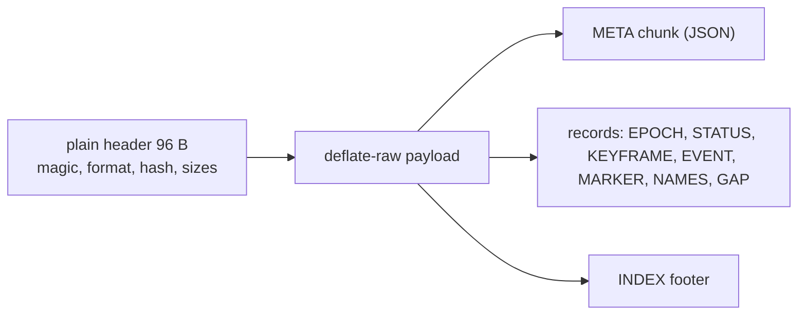
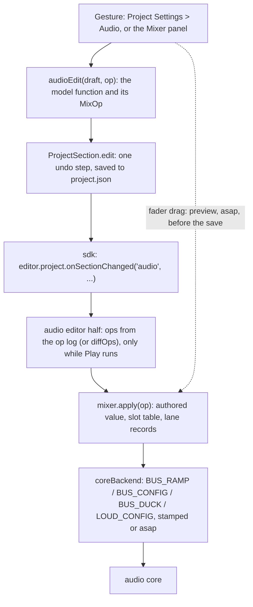
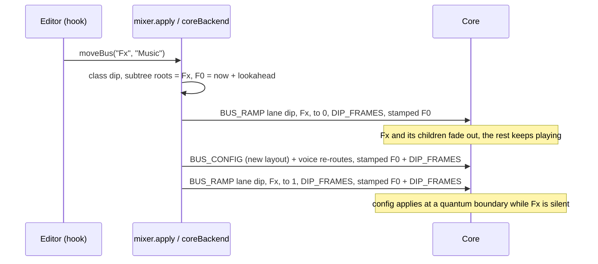

# 0171 audio mix (M5): API, data models, formats and plan, round 1

Senior engineer's design for ADR 0171 (Accepted; "RFC round (revision 2)" and "Owner decisions (accepted)" win over the text above them). Companion to `architecture.md` (cited **[ARCH §n]**: constants, timing, memory, failure behaviour), to M4's `../0166-audio-music/api-and-models.md` (whose shape this follows) and to [goal.md](goal.md). It owns the public API, the `audio` settings changes, every byte layout (STATUS, commands, ABI, the capture file), the mix-operation encoding and slot table as data, the SDK hook, the editor models, the module layout, the test plan and the task table. What I need from the architect is numbered **S1-S14** in [contracts-senior.md](contracts-senior.md) (written "contract S4" below, and the spikes "spike S4", wherever a bare number could be either); every constant, timing or failure rule that is the architect's appears as a named placeholder (`NAME`) listed there.

Units: seconds on the heard clock (`Audio.time`'s base) unless a field says otherwise; audio frames at the context rate; `perfMs` is `performance.now()`; gain is linear; levels are dBFS, LUFS or dBTP as named; little-endian; offsets are from a record's first byte, head included. Line numbers cite this worktree at 2026-11-12. Owner rules applied: follow Wwise, FMOD, Unity and Unreal (inline); no feature flags and no migration (the samples change, §1.4); no run that cannot change a decision (§10). Settled text is cited, never reopened; where it is wrong or under-specified, §12 says so with evidence.

## 1. Public API

Everything public is exported from `src/myco.ts` through `src/plugins/audio/runtime/index.ts`; the types live in the engine (`src/engine/audio/`) so the engine core imports no plugin. Nothing names Babylon, three.js, Rapier or Howler (ADR 0010).

### 1.1 `Bus`: two volumes, loudness, duck gain

Today `Bus.volume` reads and writes the one number the project authors (`src/engine/audio/mixer.ts:49-50`; `configure` initialises it to the authored value, `:87`, so the doc comment "1 = as authored" at `:48` is already wrong). M5 separates them (record changes 15, 16).

```ts
// src/engine/audio/mixer.ts
export class Bus {
  readonly name: string;
  readonly exists: boolean;
  /** Runtime multiplier, linear 0..2, default 1, set by scripts. Acts on top of `authoredVolume`; never written to project.json. Authored 2 x runtime 2 = 4 is legal; the master limiter catches it. A fade in progress reads its current value on the heard clock. */
  volume: number;
  /** The project's value (`audio.buses[i].volume`), read-only to scripts; the editor changes it through `mixer.apply`. */
  readonly authoredVolume: number;
  /** Runtime switches set by scripts, default false; effective mute = authored mute OR this OR a monitor control. */
  mute: boolean;
  solo: boolean;
  readonly authoredMute: boolean;
  readonly activeVoices: number;
  readonly peak: number;                 // unchanged (A2.3): newest peak, decayed for display
  /** Product of every gain up the tree, all factors (authored, runtime, snapshot, monitor, dip, duck, automation); as before, plus duck and monitor. */
  readonly effectiveGain: number;
  /** The duck lane's gain for this bus, 1 = not ducked, 0..1; from STATUS, so a block old; always 1 on the Babylon fallback, which ducks on main. */
  readonly duckGain: number;
  /** Ease `volume` to `v` over `seconds` (0 jumps, over `BUS_MIN_RAMP_MS`, contract S1). One stamped ramp, not one per display frame. */
  fadeTo(v: number, seconds: number): void;
  /** Loudness readings and controls; a stable object allocated once per bus, like `peak`. */
  readonly loudness: BusLoudness;
}
```

`fadeTo` keeps today's meaning (linear in volume, `mixer.ts:176-182`) but acts on the multiplier: authored 0.8 with `fadeTo(0.5, 1)` plays at 0.4 and the editor's fader still shows 0.8. A `Bus.volume` read during a fade returns main's own evaluation of the stamped ramp at the heard clock; nothing is read back from the core. `mixer.configure(settings)` (project load) still clears every script value (`mixer.ts:79-91`); the new `mixer.apply(op)` (§6) does not.

```ts
// src/engine/audio/loudnessTypes.ts (pure; no plugin import)
export type LoudnessResetWhat = "integrated" | "maxPeak" | "all";
export type LoudnessTargetState = "waiting" | "ok" | "high" | "low" | "suspended";
export interface LoudnessTargetReading {
  readonly name: string;           // an entry of audio.loudnessTargets
  readonly integrated: number;     // LUFS goal
  readonly tolerance: number;      // LU, +/-
  readonly truePeak: number;       // dBTP ceiling
  readonly deviation: number;      // integrated - goal, LU; -Infinity until integrated has a value
  readonly state: LoudnessTargetState;
  readonly peakOver: boolean;      // maxTruePeak > truePeak
}
export interface BusLoudness {
  // readings: LUFS, LU, dBTP; -Infinity while gated, empty or unmetered; never NaN
  readonly momentary: number;      // last 0.4 s
  readonly shortTerm: number;      // last 3 s
  readonly integrated: number;     // gated, since the last reset
  readonly lra: number;            // LU; -Infinity until two short-term blocks pass the gates
  readonly maxTruePeak: number;    // dBTP: max(true peak, sample peak), see S8
  readonly maxMomentary: number;
  readonly elapsed: number;        // seconds of metered audio since the last reset, paused time excluded
  // state
  readonly metered: boolean;       // false: not chosen in the project (or the Babylon fallback); readings -Infinity
  readonly paused: boolean;        // by pause() or by the shedding ladder (`pausedBy`)
  readonly pausedBy: "script" | "ladder" | null;
  readonly incomplete: boolean;    // sub-blocks were lost (ring overflow, rebuild gap) since the last reset
  readonly tainted: boolean;       // a monitor control, MASTER != 1 or a mute was active since the last reset
  readonly target: LoudnessTargetReading | null;   // null when the project has no targets
  // controls
  reset(what?: LoudnessResetWhat): void;           // default "all"
  pause(): void;
  resume(): void;
}
```

Empty states (the mid-level review's debugging table, closed): `momentary` is `-Infinity` for 0.4 s after a reset, `shortTerm` for 3 s, `integrated` until a 400 ms block passes the -70 LUFS gate, and digital silence keeps it where it was; an unmetered bus has `metered === false`, every reading `-Infinity` and every control a no-op, never a throw (`Audio.bus("nope").loudness` is the inert object a missing bus already returns, `mixer.ts:41`); `tainted` and `incomplete` stay set until `reset("all")` or `reset("integrated")`; `target.state` is `suspended` while MASTER is not 1 or the output is muted (change 11) and `waiting` while `integrated` is `-Infinity`. A script reads and resets as with FMOD's meter:

```ts
const m = Audio.bus("Master").loudness;   // the root bus reads the final output, after the reverb return and the limiter
m.reset("all");
// ... play a level ...
console.log(m.integrated, m.maxTruePeak, m.target?.state);
```

`Audio.loudnessTarget: string | null` (read/write) names the entry of `audio.loudnessTargets` in force; default the first entry; setting an unknown name is ignored with one warning. Play in the editor picks one in the Mixer panel (record change 23) through this property.

### 1.2 `Audio.capture`

```ts
// src/plugins/audio/runtime/Audio.ts: Audio.capture
export interface AudioCapture {
  /** "idle" -> "loading" (recorder module fetching) -> "recording" -> "stopped" (a take exists to save). */
  readonly state: "idle" | "loading" | "recording" | "stopped";
  /** Seconds and bytes the ring holds; 0 while idle. */
  readonly seconds: number;
  readonly bytes: number;
  /** True when the ring wrapped over the take's start: the saved file begins at a keyframe after it and is marked truncated. */
  readonly truncated: boolean;
  /** Load the recorder (a lazy chunk, absent from a game that never calls this) and begin a take. Resolves once recording; rejects with a message if the chunk or the core is unavailable. A second call while recording resolves at once. */
  start(): Promise<void>;
  /** End the take. The ring keeps recording while the editor's Profiler panel is open (one ring, shared). */
  stop(): void;
  /** A timeline marker at the current audio frame; `text` is cut to `CAPTURE_MARK_BYTES` (120) UTF-8 bytes. No-op (no throw) while no ring runs. */
  mark(text: string): void;
  /** Compress and save the take; resolves with the web file name or the app-data path. Rejects with "nothing recorded: call Audio.capture.start() first" when there is no take. */
  save(name?: string): Promise<string>;
}
```

`start()` returns a Promise because the recorder is a separate chunk (`import()` on first call) and events before it loads would be lost (record change 33). A **take** is a (start, end) pair over the one shared ring: `start()` marks the nearest keyframe at or before now and `save()` writes from it to the newest record (or to `stop()`), so a take always decodes and the editor's panel and a game capture never run two rings. `save(name)` is sanitised to `[A-Za-z0-9._-]` (64 characters, `.mycap` appended); absent, `capture-YYYYMMDD-HHMMSS`. Platform paths are §5.7. On the Babylon fallback `Audio.capture` records main-side events and keyframes only (§9) and the header says so.

### 1.3 `Audio.debug()` additions and capability flags

`AudioDebugInfo` (`src/plugins/audio/runtime/backend.ts:137-162`) gains, for every backend (record change 32):

```ts
mixCaps: { loudness: boolean; levelDucking: boolean; cpu: boolean; stampedBusRamps: boolean; capture: "full" | "mainSideOnly" };
cpu: { loadPermille: number | null; windowMs: number; sections: { voices: number; buses: number; spatial: number; music: number; loudness: number } | null; hidden: string | null };
mix: { slotsUsed: number; tombstones: number; monitorActive: boolean; metersPaused: number; ducking: { target: string; trigger: string; mode: "level" | "presence"; gain: number }[] };
```

`cpu.loadPermille` is `null` before the first window fills ("CPU not yet measured"), never `0` for unknown, and `hidden` carries the reason when the clock is too coarse (change 7); `sections` are permille shares of the measured figure ("estimated share"). The core backend reports all flags true and `capture: "full"`; the Babylon fallback reports `loudness`, `levelDucking`, `cpu`, `stampedBusRamps` false and `capture: "mainSideOnly"`. `AudioBackend` (`backend.ts:585,587`) gains `applyOp(op: MixOp): ApplyResult`, `flushNow()` and `mixCaps`.

### 1.4 Compatibility against today

| Member | Today | M5 |
|---|---|---|
| `Bus.volume` | the authored number, `mixer.ts:49-50` | runtime multiplier, default 1; `authoredVolume` added |
| `Bus.mute`, `Bus.solo` | one runtime field, mute initialised from the authored value (`:87`) | runtime switches, default false; authored mute separate; the Mixer panel's mute and solo are a third layer (monitor), never written to `project.json` |
| `Bus.fadeTo` | per-frame main-side ramp (`:183-215`) | one stamped ramp on the runtime lane; same shape, exact start |
| `Bus.effectiveGain`, `peak` | unchanged meaning | includes duck and monitor factors |
| `Bus.loudness`, `duckGain`, `authoredVolume`, `authoredMute` | absent | added |
| `audio.ducking[i]` | `{ target, trigger, amount, attack, release }`, presence only (`settings.ts:66-75`, `:364-368`) | `mode` required (§2.2); the two samples with rules are rewritten |
| `Audio.debug()` | no capability record | `mixCaps`, `cpu`, `mix` |
| `Audio.capture`, `Audio.loudnessTarget` | absent | added |
| `mixer.configure` | clears script state | unchanged, for project load; `mixer.apply(op)` is new and keeps it |
| `BUS_MIX` (opcode 0x11) | per-frame bus gain and cut-off | retired; replaced by `BUS_RAMP` (§4.2); ABI 4.0 |
| Samples | `fadeTo` at `samples/flappy/scripts/behaviors/GameManager.ts:17,22`, `samples/sound-lab/scripts/behaviors/Buses.ts:17`, `samples/stress/scripts/behaviors/Stress.ts:208`; `mute` toggles at `Buses.ts:14`, `Stress.ts:212,219` | `fadeTo` and `mute` keep working on the new layers (the flappy duck reads `bus.volume` as 1 and multiplies; stress's random volumes now multiply the authored value, so its range is rescaled); ducking rules rewritten in `samples/sound-lab/project.json:91` and `samples/stress/project.json:908`; a sample test asserts every `ducking` entry has a `mode` |

**Proof that no migration is needed.** The engine is unpublished and only the samples read `audio`; `parseAudioSettings` is lenient and reports what it drops (`settings.ts:364-368`); the one old input that changes meaning is a ducking rule without `mode`, in two sample projects, edited in Sa1 under a test that fails on any `audio` problem in `samples/*/project.json`. No flag, no shim, no old-format reader.

## 2. Settings: the `audio` section

### 2.1 Keys

| Key | Type, range | Default | Parse rule (lenient with `problems[]`, as `settings.ts` does) |
|---|---|---|---|
| `buses[i].meter` | `"loudness"` | absent (off) | any other value: dropped with a problem; never written when absent (as `bed`, `settings.ts:42-43`). On the root bus: dropped with "Master is always metered". More than `MAX_LOUDNESS_BUSES` (8) non-root buses carry it: the first 8 in list order keep it, the rest are dropped with a problem naming each |
| `loudnessTargets` | list, 1..8 entries `{ name, integrated, tolerance, truePeak }` | the two owner entries below | `name` unique non-empty string up to 32 characters; `integrated` -70..0 LUFS; `tolerance` 0..12 LU, default 2; `truePeak` -20..0 dBTP, default -1. Bad entries dropped with a problem; an empty or all-bad list gives the defaults. The first entry is the default target. Written only when it differs from the default list |
| `loudnessResetOnPlay` | boolean | `true` | applies to the editor's Play; an exported game's integrated measure always starts at engine start (record change 21) |
| `ducking[i].mode` | `"level"` \| `"presence"` | required | absent or other: the rule is dropped with a problem (the lenient parse's usual remedy) |
| `ducking[i].detector` | `"peak"` \| `"rms"` | `"rms"` (level only) | on a presence rule: ignored with a problem |
| `ducking[i].threshold` | number, -80..0 dBFS | -30 (level only) | clamped with a problem; on a presence rule ignored with a problem |
| `ducking[i].amount` | 0..1 multiplier the target heads for | 0.4 | as today (`:368`) |
| `ducking[i].attack`, `release` | seconds 0..10 | 0.1, 0.5 (today's defaults) | as today; presence and level share the field names and units |

Defaults of `loudnessTargets` (owner decision 4; the figures are published guidance, **unverified** here): `console` -24 LUFS ±2 LU, -1 dBTP and `mobile` -18 LUFS ±2 LU, -1 dBTP. The three meanings of "loudness" stay apart as the senior RFC asked: the bus field is `meter`, the project table `loudnessTargets`, the reader `Bus.loudness`. The detector and threshold defaults are the record's example (change 24); the detector's time law is contract S10.

```jsonc
"audio": {
  "buses": [
    { "name": "Master" },
    { "name": "Music", "parent": "Master", "volume": 0.8 },
    { "name": "Voice", "parent": "Master", "meter": "loudness" }
  ],
  "ducking": [
    { "target": "Music", "trigger": "Voice", "mode": "level", "detector": "rms",
      "threshold": -30, "amount": 0.4, "attack": 0.05, "release": 0.4 },
    { "target": "Music", "trigger": "Voice", "mode": "presence", "amount": 0.4, "attack": 0.1, "release": 0.6 }
  ],
  "loudnessTargets": [{ "name": "console", "integrated": -24, "tolerance": 2, "truePeak": -1 }]
}
```
(The second rule stacks on the first: both modes combine by min in the core, record change 15.)

### 2.2 Validation

Added to the existing checks (`settings.ts:366-367` refuses only `target === trigger`):
1. A rule whose `trigger` is an ancestor of its `target` (or the target of the trigger's own chain) is a cycle: dropped with "audio.ducking[i]: Voice is above Music in the tree, so its level can't be measured before Music is mixed". Evaluated by walking `parent` links over the parsed buses (`Mixer.chain`, `mixer.ts:228-230`, already does the walk). It applies to both modes: presence has no ordering need, but one rule makes the editor and the load log agree, and the error text is shared. *(A presence rule with an ancestor trigger could work; refusing it keeps one validation, a trade-off for the coordinator, not for the owner.)*
2. At most `MAX_DUCK_RULES` (contract S10) rules; the rest dropped with a problem.
3. Bus count: 32 including tombstones during a session (§6.3); the parse cap `MAX_BUSES` stays 32 (`settings.ts:209`, `:345`).
4. Where problems show: the editor's settings section lists them under the field (as `audioProblems`, `audioSettingsModel.ts:51`), the Mixer panel shows a banner for any problem of a live key, and `Engine.create` logs them (`Engine.ts:185`).

The model functions refuse what the parse would drop and return the draft unchanged with a message (the ninth `meter` toggle: "At most 8 buses can be metered").

## 3. Internal models

### 3.1 Authored, runtime and monitor state (main)

`BusState` (`mixer.ts:17-35`) becomes:

```ts
interface BusState {
  settings: BusSettings;            // authored; the editor edits it only through mixer.apply
  slot: number;                     // core index (session slot table, §6.3); === position until a tombstone exists
  runtime: Ramp;                    // volume multiplier ramp: { from, to, startFrame, frames, law }
  runtimeMute: boolean; runtimeSolo: boolean;
  monitorMute: boolean; monitorSolo: boolean;
  snapshot: Ramp; snapshotLp: Ramp;
  presence: number;                 // voices on the bus, as today (`voices`)
  duck: number;                     // last STATUS value (the core computes both modes)
  peak: number; autoGain: number; autoLp: number; viewGain: number;   // as today
  loudness: BusLoudnessState;       // the stable object's backing state
}
```
A `Ramp` is the record main keeps for a stamped lane (start frame, frames, from, to, law); main evaluates it at the heard clock for getters and for `effectiveGain`'s audibility estimate (`coreBackend.ts:690-692`). Lane writes are `BUS_RAMP` records (§4.2); the mixer's `onChange` listener (`coreBackend.ts:523-526`) no longer re-sends a whole mix on every change: each setter emits the lane records for exactly what moved.

### 3.2 Loudness statistics (main half)

Per metered bus, ported from S1's `Feed` / `Gating` / `Hist` (`spikes/audio-mix/loudness/src/loud.rs`, to TypeScript): a ring of the last 30 sub-block energies (momentary = mean of the last 4, short-term = the last 30), the 400 ms-block gate with the two histograms (1,000 bins of 0.1 LU from -70 LUFS: 24 kB per bus, within 0.11 LU of exact, spike S1) for integrated and LRA, running maxima. Zero allocation per STATUS: the histograms are `Uint32Array`s sized at construction for `MAX_LOUDNESS_BUSES + 1` buses; the sub-blocks arrive in the preallocated `loudEnergies` item array (§4.3). `LoudnessHub.feed(block)` is called from the STATUS handler after the mirror and recorder; it writes each bus's `BusLoudness` fields in place. Main cost ≤ `BUDGET_LOUD_MAIN_US_PER_S` (contract S12; the record's estimate is 50 µs per second).

The core's own tables (lanes, sidechain state, 1.5 KB of loudness state per metered bus in spike S1) are [ARCH §n]; the wire gives each bus **seven gain lanes** (§4.2) that the core multiplies per sample. Two of them (monitor, dip) are my addition to the record's five factors; contract S1 asks the architect to accept them.

## 4. Binary formats: wire and ABI

One schema (`audio-wire/src/schema/*.rs`) generated into Rust and TypeScript by `gen_wire` (`npm run build:audio`). A new file `schema/mix.rs` (the opcodes, constants and STATUS sections below) is added to `SCHEMA_SOURCES` (`schema.rs:22-30`); the hash covers it, and `wire.schemaHash.test.ts` recomputes it. The layout lands **once, in M5-0's wire task**; fields of later milestones read 0 until their tasks fill them (M4's rule, `0166 §4.4`).

### 4.1 Versions

| | Today | M5 | Why |
|---|---|---|---|
| ABI (`ABI_MAJOR`, `ABI_MINOR`, `audio-wasm/src/lib.rs:29-30`) | 3.0 (0x300) | **4.0 (0x400)** | STATUS offsets and sections move, `BUS_MIX` is retired and the stamped-config rule changes behaviour: a stale wasm must fail `npm test` (the hash test) and the first STATUS's `abiVersion`. `myco_audio_init` is **unchanged** (no new region is sized by a parameter: the loudness and sidechain state are fixed arrays, [ARCH §n]) |
| Envelope (`VERSION_MAJOR` 1, `VERSION_MINOR` 2, `schema.rs:62-63`) | 1.2 | 1.3 | new opcodes are minor |
| `STATUS_HEADER_BYTES` (`schema.rs:71`) | 176 | **256** | cumulative counters, loudness and duck counts |
| `STATUS_BUFFER_BYTES` (`:73`) | 16,384 | **20,480** (20 KB) | worst case below is 17,732 B |
| `STATUS_WORST_CASE_BYTES` (`:74`) | 16,192 | **17,732** | the sum below |
| Pool (`STATUS_POOL_BUFFERS` 8) | 128 KB | 160 KB | +32 KB, as the record says |

New constants (`gen_wire` emits them; the architect quotes them by name, contract S11): `MAX_LOUDNESS_BUSES` 8, `LOUD_METERS` 9 (8 plus the final-output tap), `LOUD_RING_SUBBLOCKS` 32 (record change 14), `LOUD_OUTPUT_TAP` 0xFFFF, `BUS_TOMBSTONE` 0xFFFE, `BUS_MASTER_OUT` 0xFFFF (BUS_RAMP's bus index for the output gain), `LANE_*` ids, `MAX_DUCK_RULES` (contract S10), `BUS_MIN_RAMP_MS` 5 (today's `RAMP_MIN_MS`, `lookahead.ts:19`).

### 4.2 Commands

Unchanged: every record not named here, including `BUS_CONFIG`'s item layout (`schema/batch.rs:63-72`) and `BUS_AUTOMATE` (0x15). Free opcode ids today are 0x18-0x1F, 0x21+ and 0x31+ (taken: 0x01-0x0A, 0x10-0x17, 0x20, 0x30, from `schema/batch.rs`, `schema/spatial.rs`).

**`BUS_RAMP` (0x18), 32 B, the third stamped class in `due.rs`** (record change 27). Head 12 B with `voiceId` = bus index (`BUS_MASTER_OUT` 0xFFFF = the output gain MASTER sets today) and `frameOffset` = the start frame, or `ASAP` (0xFFFFFFFF) to start at the next quantum:

| Off | Type | Field |
|---|---|---|
| 12 | u16 | `lane`: 0 authored, 1 runtime, 2 snapshot, 3 monitor, 4 dip (main-written); 5 duck and 6 automation are core-owned and refused here (counted) |
| 14 | u16 | `mask`: bit 0 `gain`, bit 1 `lpHz` (lane 2 only; the snapshot low-pass, BUS_MIX's second field) |
| 16 | f32 | `gain` target, finite, clamped to 0..4 (authored and runtime reach 2 each; the product is the limiter's) |
| 20 | f32 | `lpHz` target, 10..24,000 (24,000 = off, `BUS_LP_OFF_HZ`) |
| 24 | u32 | `frames`: ramp length from the start frame; 0 is a jump over `BUS_MIN_RAMP_MS` (contract S1), never an unramped step |
| 28 | u32 | `shape`: law and start phase exactly as FADE's (`schema/batch.rs:25-30`); only linear (0) is used in M5, the word is there so M5 never needs a second ramp format |

A ramp starts from the lane's value at its start frame (so a retarget mid-ramp is continuous) and is exact to the sample (spike S4 measured 5e-8). A snapshot transition of N buses is N records in one BATCH at one `frameOffset`; a fade is one record. A stamped ramp never splits the quantum (`splitQuanta` stays 0, record change 27); the due list's capacity covers them (`DUE_RECORDS` 256, M4).

**`BUS_DUCK` (0x19), variable, replace-all** (as `BUS_AUTOMATE`): `u32 ruleCount` (`<= MAX_DUCK_RULES`), then items of 24 B: `u16 target`, `u16 trigger`, `u32 flags` (bit 0 `level`, bit 1 `rms`), `f32 thresholdDb`, `f32 amount`, `f32 attack`, `f32 release`. A rule naming a tombstone or an ancestor-trigger is accepted and made inert by the core's own check (contract S10); main has already refused it. Recomputes the bus order (§4.4).

**`BUS_PRESENCE` (0x1A), 16 B:** `u32 mask`: bit b set while the bus (slot b, `b < 32`) has a voice, **stamped at the frame of the voice start or stop that changed it**, so a presence duck begins on the sound's own frame (today it begins at the next display frame). Quantum granularity: it applies at the start of the quantum holding its frame. Main counts voices exactly as today (`voiceStarted` / `voiceEnded`, `mixer.ts:150-151`, virtual and locked voices included, `coreBackend.ts:779`); a start and an explicit stop are stamped, a natural end reaches main one STATUS block later, as today. Presence mode moves into the core in M5-0 (this record and `BUS_DUCK`), level mode in M5c.

**`LOUD_CONFIG` (0x1B), variable, replace-all:** `f32 tpGateDbfs` (the true-peak gate: the selected ceiling minus 6 dB, record change 14; a target change re-sends it and is not a reset), `u32 meterCount` (`<= LOUD_METERS`), items 4 B: `u16 bus` (`LOUD_OUTPUT_TAP` 0xFFFF = the final output after the reverb return and the limiter, which is what the root bus's `Bus.loudness` reads), `u16 reserved`. Replacing the list keeps the state of meters that stay (contract S8); a removed meter's state is dropped.

**Stamped configuration.** `BUS_CONFIG`, `BUS_DUCK`, `LOUD_CONFIG` and `BUS_PRESENCE` honour `frameOffset` at **quantum granularity** (contract S2): a stamped record applies at the start of the first quantum whose frame range holds it; `ASAP` applies on arrival, as `bus.rs`'s Timing note says today ("whatever their `frameOffset`", `bus.rs:21-22`). This is what lets a structural edit be sequenced exactly (§6.5). Unstamped sends stay bit-identical.

**Tombstone.** `BUS_CONFIG`'s `parent == BUS_TOMBSTONE` (0xFFFE) marks an emptied bus: it keeps its index, mixes nothing, has no meter, no loudness, no effects, no lanes, is not in the sort and is not a ducking participant; its voices are re-routed by main before the record (as `configureBuses` re-routes today, `coreBackend.ts:787-790`). This reuses the existing item layout, so BUS_CONFIG bytes for an untombstoned tree are identical to today's.

**Retired:** `BUS_MIX` (0x11). Its id stays reserved. `MASTER` (0x12) keeps its layout for the first send and the idle reset (`bus.rs:427-452`) but all runtime changes go through `BUS_RAMP` with `BUS_MASTER_OUT`, whose product target is volume times not-muted, as `coreBackend.ts:808,817` send today. The replay's order (`replay.ts:5,17-18,491`: RESET 0, BUS_CONFIG, BED_CONFIG, BUS_MIX, MASTER, ...) becomes RESET 0, BUS_CONFIG (the slot-table layout), BED_CONFIG, BUS_DUCK, LOUD_CONFIG, then one `BUS_RAMP` per non-unity lane with `frames` set to the remaining ramp, then BUS_PRESENCE, MASTER.

### 4.3 STATUS

Header 176 to **256 B** (absolute offsets, envelope counted). Fields at 16..175 are unchanged; `reserved` (172) stays 0. `loadPermille` (80) **stays 0 on the wire**: the figure is computed on main from the cumulative counters (record change 6, which supersedes the first draft's "filled into the existing field"); `mirror.loadPermille` (`mirror.ts:52,246`) is set by the CPU meter instead.

| Off | Type | Field | Writer |
|---|---|---|---|
| 176 | f64 | `busyMsTotal`: sum of `Date.now()` deltas around `process()`, ms, since the driver started | shell |
| 184 | f64 | `quantaTotal`: quanta rendered since the driver started | shell |
| 192 | f64 | `wuVoices`: cumulative work units, voices | core |
| 200 | f64 | `wuBuses`: buses, effects, sidechain, ramps | core |
| 208 | f64 | `wuSpatial`: beds, zones, HRTF, ambisonic | core |
| 216 | f64 | `wuMusic` | core |
| 224 | f64 | `wuLoudness` | core |
| 232 | u16 | `loudBusCount`: the `loudBuses` section's count (`<= 9`) | core |
| 234 | u16 | `loudEnergyCount`: the `loudEnergies` count (`<= 9 x 32 = 288`) | core |
| 236 | u16 | `duckCount`: the `busDuck` count (`<= 32`) | core |
| 238 | u16 | `clockStepMs`: the smallest non-zero `Date.now` delta seen; 0 = none yet | shell |
| 240 | u32 | `loudSubBlockFrames`: frames per sub-block, `round(sampleRate / 10)` (4,800 at 48 kHz, 4,410 at 44.1) | core |
| 244 | u32 x3 | reserved, 0 | |

Cumulative values are f64 (the model has no u64, `model.rs:10-17`; f64 is exact to 2^53). The shell writes its fields where it writes `dateMs` today (`coreDriver.ts:386,1040`, after `status_take`); a driver restart (context rebuild) restarts all of them at 0, which main reads as an epoch change (§5.4), never as a negative delta. The cadence (6 vs 48 quanta, `coreDriver.ts:976-979`) and a skipped post (`:1020-1024`) leave the counters cumulative, so main's window is by `quantaTotal`, not by block count (S7).

New sections after `groupStarts` (item layouts, caps, counts):

| Section | Item | Max | Bytes at max |
|---|---|---|---|
| `loudBuses` (count `loudBusCount`) | `u16 bus`, `u16 flags`, `u32 firstSeq`, `u16 blockCount`, `u16 pad`, `f32 truePeak` (linear, max since the last successful take), `u32 gatedQuanta` (cumulative quanta whose true peak was gated off) = **20 B** | 9 | 180 |
| `loudEnergies` (count `loudEnergyCount`) | `f32 energy`: K-weighted L+R mean square of one sub-block; **bus-major in `loudBuses` order**, `blockCount` per bus, oldest first | 288 | 1,152 |
| `busDuck` (count `duckCount`) | `f32 gain`, linear 0..1, indexed by slot | 32 | 128 |

`loudBuses.flags`: bit 0 `paused` (shed by the ladder, contract S9), bit 1 `reset` (the core's filter state was reset: RESET or a rebuild), bit 2 `lost` (the ring overflowed since the last successful take: `firstSeq` skips), bit 3 `gated` (true peak was gated off in this take's quanta). The core keeps the 32-entry ring and sends only the sub-blocks since the last **successful** `status_take` (the shell takes only with a pooled buffer, `coreDriver.ts:1020`), so a main stall of up to 3.2 s loses nothing; main detects loss by `firstSeq` against its last (record change 14). Worst case: 16,192 - 176 + 256 + 180 + 1,152 + 128 = **17,732 B** of 20,480, **2,748 B spare** (the record fixed 20 KB; 16 KB would have fallen 1,348 B short, so the number holds). `StatusReader` (`statusReader.ts`) parses every new section into preallocated arrays (`MAX_LOUD_BUSES` items, 288 floats) with the same checks and `WireError` codes; the pool and `bufferPool.ts:73` take the new size from the constants.

### 4.4 Bus order and ducking edges

`bus.rs:388-399` sorts by depth, deepest first, ties by index. M5-0 computes the order by Kahn's algorithm over child-to-parent edges plus a trigger-to-target edge per ducking rule (spike S4's recommendation, which fixed every rule in both samples; its "Ordering" table); an ancestor trigger is a cycle and is read one quantum late (it cannot occur from validated settings, §2.2). The sort runs at `BUS_CONFIG` and at `BUS_DUCK`; `order[]` stays `[u8; 32]`-bounded by `MAX_BUSES` 256 in `params.rs:80`. See §12 item 2 for why this changes no sound until a detector reads a buffer (M5c).

### 4.5 Constants and tests

`vectors/wire.json` gains a golden record for each new opcode, a tombstoned BUS_CONFIG, a STATUS with all three new sections at their caps (the 17,732 B case) and one at zero; the fuzz adds truncated and over-count `BUS_RAMP`/`BUS_DUCK`/`LOUD_CONFIG`, a `loudEnergyCount` over the cap, a `blockCount` sum that disagrees with it, NaN and infinite targets, an unknown lane, and a bus index past the configured count. The generated TypeScript ships `readStatus`/`writeStatus` for the new header; `statusReader.ts` mirrors them without allocation (`StatusReader.block` is reused, `statusReader.ts:54-55`).

## 5. The capture file

A capture is the profile stream saved (record §1): one format for a file and, later, a socket. This section is byte-exact; limits are for **untrusted input** (record change 4).

### 5.1 Layout



The header is **not** compressed, so a wire mismatch or a size bomb is refused before any inflate. Everything after it is one `deflate-raw` stream (`CompressionStream("deflate-raw")`, byte-equal to zlib, spike S3) of: the META chunk, then the records, then the INDEX footer.

| Off | Size | Field |
|---|---|---|
| 0 | 8 | magic `"MYCAP\0"`, `0x01`, `0x1A` |
| 8 | 2 | `format` u16 = 1 |
| 10 | 2 | `flags` u16: bit 0 `truncated` (the ring wrapped; the first KEYFRAME is not the take's start), bit 1 `mainSideOnly` (Babylon: no STATUS records), bit 2 `hasIndex`, bit 3 `lossless` (reserved, 0) |
| 12 | 16 | wire `SCHEMA_HASH` (`wire.generated.ts:7`) |
| 28 | 4 | `abiVersion` u32 (0x400) |
| 32 | 2+2 | envelope major, minor |
| 36 | 4 | `statusBytesMax` u32 = `STATUS_BUFFER_BYTES` at record time |
| 40 | 4 | `sampleRate` u32 (the first epoch's; later ones are in EPOCH) |
| 44 | 2 | `quantumFrames` u16 (128) |
| 46 | 1 | `statusEveryQuanta` u8 (6) |
| 47 | 1 | `preset` u8 (0 low, 1 default, 2 high) |
| 48 | 8 | `startDateMs` f64 (`Date.now()` at the take's first record) |
| 56 | 4 | `keyframeEveryStatus` u32 (S5) |
| 60 | 4 | `metaBytes` u32: length of the META chunk |
| 64 | 4 | `recordBytes` u32: length of the records after inflate, the INDEX record included |
| 68 | 4 | `uncompressedBytes` u32 = `metaBytes + recordBytes` |
| 72 | 4 | `recordCount` u32 |
| 76 | 4 | `indexBytes` u32: length of the INDEX record at the end of the stream (0 when `hasIndex` is clear) |
| 80 | 16 | reserved, 0 |

**Reading, in order, each step refusing with a `CaptureError` and its code before the next:** length at least 96 and magic (`badMagic`); `format` 1 (`newerFormat` / `olderFormat`); `SCHEMA_HASH` equal to this build's (`wireMismatch`, whose message names both ABI versions and says "re-record with this build": the senior RFC's accepted limitation, record change 3); `uncompressedBytes <= CAPTURE_MAX_UNCOMPRESSED_BYTES` (contract S5) (`tooLarge`); inflate with a hard stop at `uncompressedBytes + 1` bytes (`inflateOverrun`); then the META chunk, then records. No count in the header sizes an allocation: arrays grow by the records actually read, up to the caps below.

### 5.2 META chunk

A UTF-8 JSON object, at most `CAPTURE_META_MAX_BYTES` (1 MiB): `{ project: { name, version }, engine: <build id>, device: { preset, sampleRate, deviceMemory?, userAgent: <first 120 bytes> }, audio: <the project's audio section at the take's start, as written>, target: <loudnessTarget name in force>, names: { clips: [], buses: [], events: [], parameters: [], snapshots: [] } }`. It is **data only**: read with `JSON.parse` on a size-checked string, every name coerced to a string and cut to 256 bytes, never evaluated, never used as a key into an object with a prototype (a `Map`). `audio` is what lets the profiler name tombstoned buses and judge loudness against the target as it stood (senior RFC issue 5); it is the project's own section, so exporting a capture exports bus names and clip names (an owner decision, §13).

### 5.3 Record framing

Every record is a **20 B head** then `len` payload bytes:

| Off | Type | Field |
|---|---|---|
| 0 | u8 | `type` |
| 1 | u8 | `flags`: reserved, 0 in format 1 |
| 2 | u16 | `epoch` |
| 4 | u32 | `len` (<= `statusBytesMax` for STATUS; <= `CAPTURE_RECORD_MAX_BYTES` otherwise) |
| 8 | u32 | `seq`: capture-wide, increasing by one per record |
| 12 | f64 | `frame`: audio frame in the epoch's context (a STATUS's `currentFrame`; for a main event the frame of the command it causes, or the frame now) |

Records order by `(epoch, frame, seq)` (record change 1). `perfMs` rides in the payload of every main-side event (f64) so a gap or the heard clock can be reconstructed from `performance.now` without the audio clock. Types:

| `type` | Name | Payload |
|---|---|---|
| 0x01 | EPOCH | `u8 reason` (0 start, 1 contextRebuild, 2 rateChange, 3 deviceChange, 4 hardRebuild, 5 resume), `u8[3]`, `u32 sampleRate`, `u32 limiterLatencyFrames`, `u32 outputLatencyFrames`, `f64 perfMs`. Followed by a KEYFRAME in the same epoch |
| 0x02 | GAP | `u8 reason` (1 trap, 2 stall, 3 hidden, 4 suspended), `u8[3]`, `f64 perfFrom`, `f64 perfTo`: dead time with no STATUS |
| 0x03 | STATUS | the block's raw bytes, copied inside the STATUS callback (the reader reuses one buffer, `statusReader.ts:54-55`), no delta encoder (change 2) |
| 0x04 | KEYFRAME | §5.5 |
| 0x05 | EVENT | `u8 kind`, `u8 reason`, `u16 argc`, `f64 perfMs`, then `argc` x `u32` words and an optional trailing `f32` per kind (§5.6) |
| 0x06 | MARKER | `f64 perfMs`, `u16 n`, `n` UTF-8 bytes (`n <= 120`) |
| 0x07 | NAMES | `u8 table` (0 clip, 1 bus, 2 event asset, 3 parameter, 4 snapshot), `u8[3]`, `u32 id`, `u16 n`, `n` bytes: a name that appeared after the META chunk |
| 0x08 | MIXOP | one `MixOp` (§6.2's byte form), the edit's `perfMs`, its origin (0 editor, 1 script, 2 undo, 3 redo) |
| 0x7F | INDEX | the footer, §5.4 |

An unknown `type` below 0x80 is skipped by `len` (forward-compatible within a format number, as the envelope skips unknown opcodes); at or above 0x80 it is refused (`unknownRequired`).

### 5.4 Epochs, gaps, the index

An **EPOCH** record is written at every context rebuild, rate change, device change and hard rebuild; frames restart at 0 in a new epoch (`clock.ts:116-122`) and the driver's cumulative counters restart (§4.3). The next KEYFRAME in the same epoch carries the whole main state, so a decoder never carries state across an epoch. A **GAP** covers dead time (a trap, a stall, a hidden tab). The *heard* time of a frame is `frame - limiterLatencyFrames` over the epoch's rate (`clock.ts:7-9`: the heard clock trails rendered frames by the limiter's look-ahead); EPOCH carries both latencies so the editor draws what was heard, not what was rendered (S6).

**INDEX** (`type` 0x7F, written at save): `u32 keyframeCount` then per keyframe `u16 epoch`, `u16 pad`, `f64 frame`, `u32 byteOffset` (into the records), `u32 seq`; then `u32 truncatedFromSeq`. Without it (`hasIndex` clear, or an INDEX that fails its bounds) the reader scans record heads for KEYFRAMEs: 0.1-0.9 ms for 30 s (spike S3), so a damaged footer costs time, not the file.

### 5.5 KEYFRAME payload

Main-side state at one instant, keyed on the STATUS count (`keyframeEveryStatus`, contract S5), written straight into the ring with no allocation. Sections in order, each `u16 count` then items:

- **voices** (count <= `CAPTURE_KF_MAX_VOICES` 4,096, the logical cap at the default preset, `settings.ts:196`): 28 B: `u32 id`, `u32 clip`, `u8 slot` (§6.3), `u8 state` (0 playing, 1 virtual, 2 stolen, 3 waitingForData, 4 busMuted, 5 locked; `AudioDebugInfo.voices[].state`), `u8 priority`, `u8 pad`, `f32 gain`, `u16 pitch` (u4.12), `u16 audibility` (u0.16), `u32 playheadFrames`, `u16 reason` (§5.6's reason codes), `u16 event` (instance, 0 = none).
- **buses** (<= 32): 36 B: `u8 slot`, `u8 pad`, `u16 gen`, `u16 flags` (bit 0 authored mute, 1 runtime mute, 2 monitor mute, 3 monitor solo, 4 tombstone, 5 metered), `u16 pad`, `f32 authored`, `f32 runtime`, `f32 snapshot`, `f32 monitor`, `f32 dip`, `f32 automation`, `f32 duck` (the lanes at the keyframe's frame, evaluated on main from its ramp records; duck is the last STATUS's). The product at the cursor is the "gain factors" the mixer review asked for (record change 9).
- **events** (<= 1,024): 16 B per instance: `u32 id`, `u32 asset`, `u16 voices`, `u16 world`, `u32 paramsHash` (parameters themselves ride EVENT records).
- **music** (<= 16): 40 B per instance: `u32 id`, `u32 segment`, `u8 state`, `u8 pass`, `u16 bar`, `u8 beat`, `u8 tick`, `u16 tempo`, `u32 pendingTo`, `f32 pendingTimeSec`, plus 12 reserved.
- **mix** (one record): `u32 slotTableVersion`, `u8 monitorActive`, `u8 loudnessPausedMask`, `u8 targetIndex`, `f32 masterVolume`, `u8 hiddenMute`: what `target.state` needs (record change 11).

A decoder reconstructs the table at time t by the nearest keyframe at or before t, then replays at most `keyframeEveryStatus` STATUS records and the EVENTs between (spike S3: 0.2-0.7 ms p50, independent of capture length). Loudness at the cursor is **not** in a keyframe (24 kB per bus would dwarf it): the decode Worker computes a per-sub-block loudness series once at open from the recorded `loudEnergies`, through the same `LoudnessStats` code main uses (§7.3), so any cursor reads `momentary`, `shortTerm` and `integrated-so-far` in O(1).

### 5.6 Event vocabulary and reason codes

`kind`: 1 voiceStart (`id, clip, busRef, flags, atFrameLo`, `f32 gain`), 2 voiceStop (`id`, reason), 3 voiceSteal (`victim, thief`, reason), 4 voiceVirtual (`id`, reason), 5 voiceReal (`id`, reason), 6 voiceRefused (`clip, busRef`, reason), 7 voiceQueued (`clip, busRef`, reason), 8 eventStart (`instance, asset`), 9 eventStop (`instance`), 10 parameter (`slot`, `f32 value`), 11 snapshot (`name id`, `f32 seconds`), 12 stateChange (`slot, label id`), 13 musicTransition (`instance, from, to, rule`), 14 busRamp (`busRef, lane, frames`, `f32 target`), 15 monitor (`mask`), 16 loudnessControl (`busRef`, reason = reset / pause / resume / target), 17 ladder (`step`, reason = shed / restored), 18 masterChange (`f32 volume`, `muted`), 19 hiddenTab (`on`).

`reason` is one byte; the values extend today's `AudioReason` (`backend.ts:18`: virtual, stolen, busMuted, locked, failed, waitingForData): voiceStop 1 ended, 2 stopped, 3 faded, 4 world-released, 5 failed; voiceSteal 1 busMaxVoices (`voiceTable.ts:655` victim choice), 2 globalLimit, 3 priority; voiceVirtual 1 cap-demoted (STATUS `demoted`), 2 below-audibility, 3 paused, 4 world-inaudible; voiceReal 1 promoted, 2 cap-raised; voiceRefused 1 busFull, 2 poolFull, 3 neverFits, 4 loadFailed, 5 capRefused; voiceQueued 1 clipLoading, 2 streamPriming. The taps are the voice table's allocate path (`voiceTable.ts:584`), `noteStolen` (`:888-889`), `onFree` (`:266-270`), selection's promote and demote (`selection.ts`), `coreBackend`'s refusals and the mixer's setters; each goes through one `ProfileSink` interface (§8) whose null object is a pointer comparison, so a game that never records pays nothing.

### 5.7 Limits, saving, size

| Limit | Value | Note |
|---|---|---|
| Header | 96 B | fixed |
| `CAPTURE_MAX_UNCOMPRESSED_BYTES` | S5 (the largest ring times 2) | refused before inflate |
| `CAPTURE_RECORD_MAX_BYTES` | 262,144 | keyframes cap far below it |
| Record count | `uncompressedBytes / 20` | a head is 20 B |
| META | 1 MiB | JSON, data only |
| Name | 256 B; at most 65,536 names | `Map`, never object keys |
| `MARKER` text | 120 B | `CAPTURE_MARK_BYTES` |
| Records per keyframe interval | `keyframeEveryStatus x 4` | a segment that exceeds it is `corrupt` |
| Saved files per built-in trigger | `CAPTURE_TRIGGER_MAX_FILES` 8 (estimate; a file is a few MB compressed, S3) | record change 4 |

The decoder runs in a Worker with every read bounds-checked through one `Reader` that throws `CaptureError` (`code`, `offset`, `message`) and never reads past `recordBytes`; any error aborts the open with a banner, never a partial profile. Save: **web** a `Blob` and `a[download]` (the picker only on Chromium desktop); **desktop and Android (Tauri)** `Storage.save(key, bytes, "cache")`, which `TauriStorage` writes to `<appDataDir>/cache/<key>.bin` under the existing capability (spike S3 "Saving"; `Storage` namespaces are `saves | settings | cache`, `platform/Storage.ts:5`), so the "file name" `save` resolves is `capture-….mycap` with that path; **getting it off Android**: `adb exec-out run-as` on a debug build, in the guide, **unverified** (owner decision 3; a share-sheet plugin is its own later record). The compressed size is 0.08 / 0.15 / 0.25 MB per minute at 64 / 256 / 1,024 voices from the delta stream (spike S3, synthetic, est.); raw STATUS records are larger (S3: 1.58 / 3.66 / 9.18 MB per minute raw STATUS) and compress by the same deflate. The honest figure for the ring and the saved file is therefore **unverified until spike S3's capture scene is re-run through the real core** (§10), and the numbers the architect sizes the ring with are S5's.

## 6. Live editing: operations, the slot table and the SDK hook

### 6.1 The path



Two paths reach `mixer.apply`: the **preview path** (a fader drag, applied at pointer rate, asap, never saved) and the **commit path** (every saved edit, through the hook). The commit of a drag is one undo step on release (record change 21; `AudioSettingsSection` already commits each field through `onCommit` with a label, `AudioSettingsSection.tsx:93-109,187-188`), and re-applying an absolute `set` the mixer already holds is a no-op, so the preview and the commit never fight.

### 6.2 `MixOp`

```ts
// src/engine/audio/mixOps.ts (pure; no plugin, no DOM)
export type OpClass = "direct" | "smoothed" | "dip" | "config" | "none";
export type MixOp =
  | { op: "setBus"; bus: string; key: "volume" | "mute" | "maxVoices" | "bed" | "bedPriority" | "meter"; value: number | boolean | string | null }
  | { op: "addBus"; name: string; parent: string; index?: number }
  | { op: "removeBus"; bus: string }
  | { op: "renameBus"; from: string; to: string }
  | { op: "moveBus"; bus: string; parent: string }
  | { op: "addEffect"; bus: string; index: number; effect: BusEffect }
  | { op: "removeEffect"; bus: string; index: number }
  | { op: "moveEffect"; bus: string; from: number; to: number }
  | { op: "setEffect"; bus: string; index: number; key: string; value: number }
  | { op: "addSnapshot" | "removeSnapshot" | "renameSnapshot"; index: number; name?: string }
  | { op: "setSnapshot"; index: number; bus: string; key: "volume" | "lowpass"; value: number | null }
  | { op: "setDucking"; index: number; rule: DuckingRule | null; insert?: boolean }
  | { op: "setAutomation"; index: number; rule: BusAutomation | null; insert?: boolean }
  | { op: "setTarget"; index: number; target: LoudnessTarget | null; insert?: boolean }
  | { op: "setOption"; key: "loudnessResetOnPlay"; value: boolean };
export interface MixOpEntry { ops: MixOp[]; inverse: MixOp[] }
export interface ApplyResult { ok: boolean; class: OpClass; refused?: string; restartRequired?: string }
export function applyOpToDraft(d: SettingsDraft, op: MixOp): SettingsDraft;   // uses the model functions of audioSettingsModel.ts
export function opClass(op: MixOp, settings: AudioSettings): OpClass;
export function invert(op: MixOp, before: AudioSettings): MixOp;
export function diffOps(before: AudioSettings, after: AudioSettings): { ops: MixOp[]; restartRequired: string[] };
```

Operations are **not** diffs of two settings objects (record change 17; senior RFC issue 2): a rename is `renameBus`, not remove plus add, so the voices on the bus, its slot and the handles held by scripts survive. `applyOpToDraft` calls the model functions the settings section already uses (`addBus`, `removeBus`, `renameBus`, `setBusParent`, `setBusValue`, `addEffect`, `removeEffect`, `setEffectValue`, the snapshot, ducking and automation set, `audioSettingsModel.ts:81-198,409-466`), so the panel, the settings section and the mixer share one definition of each edit; the section's handlers are rewritten to build an op and call `audioEdit`, which returns the next draft and registers `{ ops, inverse }` for it.

Byte form (the capture's MIXOP record, §5.3; the live wire is the BUS_* records, never this): `u8 op`, `u8 class`, `u16 argc`, then `argc` `u32` words, floats as bit patterns, strings as name-table ids, buses as `busRef` (`gen << 8 | slot`, §6.3).

| Class | Ops | Wire |
|---|---|---|
| direct | `setBus` volume, mute, maxVoices (main-side), `setEffect` on a filter or a send level, `addEffect` at the end, `addBus` (appended), snapshot edits, `setDucking`, `setAutomation`, `setBus` meter, `setTarget` | `BUS_RAMP` (authored lane), `BUS_CONFIG` (append), `BUS_DUCK`, `BUS_AUTOMATE`, `LOUD_CONFIG`; asap |
| smoothed | `setEffect` on a compressor | `BUS_CONFIG` with the new parameters; the core smooths over `COMPRESSOR_SMOOTH_MS` (>= 20, contract S1; spike S4 measured a hard step clicking at -18 dBFS and a 20 ms blend clean) |
| dip | `moveBus`, `removeBus`, `removeEffect`, `moveEffect`, `addEffect` before the end, removing the last send, moving a playing sound to another bus | §6.5 |
| config | `renameBus` (no wire), `setBus` bed and bedPriority (`replanBedsOnSettings`, `coreBackend.ts:759-762`), `setOption` | none, or the bed plan |

A key that no live path serves (voices, backend, clip memory and format, codecs, spatial, limiter look-ahead, music rings, rhythm mode, occlusion, zones) yields `ApplyResult.restartRequired`; the Mixer panel shows "Applies at the next Play: ..." and the edit is still saved.

### 6.3 The session slot table

Data, not behaviour: `src/engine/audio/slotTable.ts` (pure) holds it, `coreBackend` owns one instance for the session.

```ts
interface Slot { state: "free" | "live" | "tombstone"; name: string | null; gen: number /* u16 */; parent: number /* slot, or -1 for the root */; recycleAfterFrame: number /* f64, epoch frames */ }
class SlotTable {
  readonly slots: Slot[];                 // length <= MAX_BUSES (32): tombstones count
  readonly byName: Map<string, number>;
  readonly aliases: Map<string, string>;  // old name -> new name, for held `Bus` handles after a rename
  version: number;                        // bumped by every structural op; the capture's keyframe stores it
  add(name: string, parent: string): number | { refused: string };
  remove(name: string, frame: number): number;
  rename(from: string, to: string): void; // no wire; aliases the old name for the session (one warning on use)
  move(name: string, parent: string): void;
  recycle(frame: number, liveVoicesOn: (slot: number) => number): number[];  // slots freed this call
  configWire(): BusConfigBuses[];         // one item per slot up to the highest used; tombstone and free slots carry parent 0xFFFE
  busRef(slot: number): number;           // gen << 8 | slot
  reset(settings: AudioSettings): void;   // at the next configure: slot = position in project.json, as `coreBackend.ts:766-770` does today
}
```
Rules: the initial slot of a bus is its position in `project.json`, so until the first structural edit the table is today's mapping (`busIndexByName`, `coreBackend.ts:766-770`) and no byte on the wire changes. `add` takes the first `free` slot, else the next index, else is **refused visibly** ("At most 32 buses, counting N removed this session; they free up when their sound has faded out", contract S3). `remove` makes a tombstone: main first re-routes the bus's voices (as `configureBuses` does, `coreBackend.ts:787-790`), the structural dip hides the change (§6.5), and `recycleAfterFrame` is the stamped config frame plus `TOMBSTONE_TAIL_FRAMES` (contract S3: the longest reverb or compressor tail the core still holds for a bus). A tombstone becomes `free` when its frame has passed and `busLive[slot]` is 0 (`coreBackend.ts:779`); `gen` increments at that moment so a capture's `busRef` never names two buses. Undoing a remove while its tombstone is not yet recycled resurrects the same slot (same index and `gen`, effects restored, voices not returned); after recycling it takes a new slot. `removeBus` removes the bus **and its descendants** (`audioSettingsModel.ts:90-99`, the `gone` set), so the op tombstones each descendant in one structural sequence. A rename keeps the slot; a held `Bus` handle resolves through `aliases` for the rest of the session with one warning, instead of going inert as it would from remove plus add. **Replay on a context rebuild or hard rebuild** (`replay.ts:491`, `coreBackend.ts:795-801`'s `busConfigWire`) sends `configWire()` (the tombstoned layout), never `settings.buses` order; an in-flight dip is replayed as its **end state** (new layout, `dip` lane 1), never half. **Compaction at Stop** is `reset(settings)` at the next `configure`: nothing session-only reaches `project.json`.

### 6.4 The SDK hook (amends ADR 0147)

0147's `ProjectSurface` has `changed()`, a no-argument "say that files changed" (`src/editor/sdk/project.ts:42-43,67-68`), so the record's `editor.project.changed(sectionKey, ops)` cannot be added under that name (§12 item 1). The hook is:

```ts
// src/editor/sdk/project.ts
export interface SectionChange {
  readonly key: string;                       // the top-level project.json key: "audio"
  readonly before: unknown;                   // the section's value before and after, as parsed drafts
  readonly after: unknown;
  readonly cause: "edit" | "undo" | "redo" | "external";
}
export interface ProjectSurface {
  /** Call `listener` after a saved edit, an undo or redo, or an outside change (the Code panel, a file watcher) that changes `key`'s value. Returns an unsubscribe function. Not called for a draft the settings panel could not write (its problems keep it unsaved). */
  onSectionChanged(key: string, listener: (change: SectionChange) => void): () => void;
}
```
The shell fires it from the places that already know: `createProjectSettingsSection`'s `saved` (cause `edit`) and `stepped` (`undo`/`redo`) hooks (`projectSettingsSection.ts:20-37`, beside `graphicsSaved` and `pluginsChanged`) and `reconcile`'s restart path (`projectSection.ts`, the `false` return, cause `external`), each only when `JSON(before[key]) !== JSON(after[key])`. The shell knows nothing about ops: it passes the draft values, whose **object identity is preserved by the undo history** (`EditHistory` stores the drafts it was given). The audio editor half keeps its own `WeakMap<audioValue, MixOpEntry>` filled by `audioEdit`; on `edit` and `redo` it applies `entry(after).ops`; on `undo` it applies `entry(before).inverse`; with no entry (an outside edit, an untagged model function such as `applyVoicesPreset`) it applies `diffOps(before, after)`, whose limit is stated in §6.2 (a rename it cannot see becomes remove plus add, and the user sees a "renamed outside the panel" note). The handler does nothing unless `editor.scene.playState === "playing"`. The audio panels import `editor/sdk` only (0147's closed internal tier is untouched; the senior RFC's boundary item).

### 6.5 Structural edits: the dip

Record change 19: re-parenting, reordering or removing effects, removing a send and moving a sound to another bus fade the affected subtree out, apply, and fade back, one code path. Main sequences it with **stamped** records (contracts S2 and S4); the timings are the architect's:


All three go in one BATCH, so the sequence is atomic in transit. The subtree roots are the buses whose signal path changes (`moveBus`: the moved bus; `removeEffect`, `moveEffect`, `addEffect` mid-list, remove-send: the bus owning the chain; `removeBus`: the removed bus, whose slot is tombstoned at the config step; a playing sound moved to another bus: the voice itself, with M4-0's per-voice stamped `FADE` and `SET_PARAMS bus`, `schema/batch.rs:25-30`, so only that voice dips). One structural sequence is in flight at a time: ops arriving in the same display frame coalesce into one dip, later ones queue behind it, and a sequence caught by a context rebuild is replayed as its end state (§6.3). A dip silences the subtree's **reverb sends** too (contract S4); `DIP_FRAMES` is 20 ms (record change 19), the architect's constant. The dip is audible by construction (a 40 ms dip of the edited subtree, the cost the record accepted over crossfading both routings); it is not a click.

### 6.6 Monitor controls, taint, compare, the fader gate

- **Monitor mute and solo** live in the `monitor` lane (0 or 1, stamped asap), set by `mixer.setMonitor({ mute, solo })`, never by `apply`, never saved. Solo follows today's rule (a soloed bus, its ancestors and descendants stay audible, `mixer.ts:233-238`) evaluated on main over the slot tree. While any monitor control is on the Mixer panel shows a banner, and every meter whose audible content changed is marked `tainted`: the output tap and every metered bus under any muted bus, or all of them while a solo is active (record change 20, mixer review 1-2).
- **Compare with Play start** keeps a `structuredClone` of the `audio` section taken when Play begins and, on the toggle, applies `diffOps(current, playStart)` through `mixer.apply` **without** touching `project.json` (not an edit), and the inverse on the way back; faders lock with a banner meanwhile and meters are `tainted`. It is a copy and a diff, as the mixer review priced it.
- **Session controls**: loudness resets at Play start by default (`loudnessResetOnPlay`); the panel has Reset, Pause and an elapsed readout (`Bus.loudness.elapsed`).
- **The fader gate (≤ 50 ms from the input event to the first changed rendered frame; record change 21).** Stamped records wait for the lookahead `L = round(clamp(2 x frame interval, 1,024 frames, 100 ms))` (`lookahead.ts:27-31`): about 33 ms at 60 display frames per second and 67 ms at 30, which alone breaks the gate at 30 fps. So **interactive edits are asap, not stamped**: the preview path writes `BUS_RAMP` with `ASAP` and `frames = BUS_MIN_RAMP_MS` (5 ms), then `backend.flushNow()` posts the batch from the pointer handler instead of waiting for the display frame's `frameCommit`, coalesced to one post per `FADER_COALESCE_MS` (4). Stamped timing is for what main decides (fades, snapshots, ducking, structural edits). The gate is measured on the **audio clock**, never wall-clock tolerance (the M4 retrospective's first rule): the loopback host counts the frame at which the first changed sample renders against the frame of the simulated input event, p95 over 100 drags; the real-worklet number and the device's output latency (`Audio.latency.total`) are reported beside it and stay **unverified on phones**.

## 7. Editor models and thin views

The owner's UI/UX note governs: behaviour is decided here, placement is not; every view is a thin layer over pure tested models; new audio UI registers through the editor SDK in **one** function; the rework comes after audio is feature complete, so M5 builds in today's layout (Project Settings > Audio, the Audio Debug panel, two new panels).

**Registration.** `src/plugins/audio/editor/mix/index.ts` exports `registerMixPanels(context)`, called once from `editor/index.ts` beside `registerMusicPanels` (`music/index.ts:33-52`): panels `audioprofiler` and `audiomixer` through `context.registerPanel`, the new controls inside the existing section, and nothing else (no menu entry, toolbar button or global shortcut). The rework regroups them by editing this file.

**Models** (pure, each with a `.test.ts`, in `src/plugins/audio/editor/mix/`):

| Module | Owns |
|---|---|
| `profilerSource.ts` | `ProfileSource`: duration, `stateAt(t)`, `series(kind, t0, t1, buckets)`, markers, truncation; `LiveSource` over the recorder ring, `CaptureSource` over the decode Worker |
| `timelineModel.ts` | viewport (zoom, pan, clamp, follow-live), the track list, min/max downsampling of typed arrays into pixel buckets |
| `cursorModel.ts` | live, paused, scrubbing; step by one STATUS block; previous and next underrun, late command, ladder step, marker; the name filter |
| `voiceTableModel.ts`, `busFactorsModel.ts` | rows at the cursor with reason text and the thief of a steal, at most 64 rows rendered while counting the rest (as `MAX_VOICE_ROWS`, `AudioDebugPanel.tsx`); each bus's seven lane factors and their product |
| `loudnessTrackModel.ts`, `emptyStates.ts` | series from recorded sub-blocks and target marks (warn, never adjust); the strings: "Not playing", "Recording starts when the panel opens in Play", "CPU not yet measured", "Not metered", "Truncated: the ring wrapped", "Babylon fallback: no CPU line" |
| `mixerModel.ts`, `meterModel.ts` | strips from `AudioSettings` plus `Bus` readings sampled every 50 ms (as `BusMeters.tsx:10`); peak hold and clip latch (until clicked), extending `meterFill` (`BusMeters.tsx:17-21`) |
| `faderModel.ts`, `monitorModel.ts`, `compareModel.ts`, `sessionModel.ts`, `duckModel.ts` | dB taper, drag to preview ops and one undo step on release, effective gain beside the authored value; monitor controls and the taint banner; Compare; reset, pause, elapsed, per-platform target; per-rule gain-reduction meters and the cycle message |

The profiler's **drawing budget in Play is ≤ 2 ms per display frame** (change 10): `drawTimeline.ts` redraws a `<canvas>` from typed arrays on `requestAnimationFrame` only when a model reports dirty, never renders Preact per STATUS block, and table signals update at most every 66 ms.

**Views** (`ProfilerPanel.tsx`, `MixerPanel.tsx`, `MixerStrip.tsx`, `drawTimeline.ts`; layout and events only, theme tokens only):
- **Profiler** (record §3, changes 8, 9): CPU with "estimated share" sections and the "256 ms average" label; voices by state; underruns, late commands and `minSlackFrames` as the click headline; the ladder and cap; bus levels and loudness; event instances; music; a cursor that pauses, scrubs, steps and jumps to underruns; record, stop, save, open, drop a file; a name filter; an empty state per view; a banner when the capture's `audio` section differs from the open project's (warn; refuse only a different wire). Replay against the engine is a non-goal and the panel says "Viewing, not replaying".
- **Mixer** (change 22, owner decision 5): per bus a fader (authored value, effective gain beside it), monitor mute and solo, peak meter with hold and clip latch, momentary and short-term LUFS and integrated on metered buses with the target line and mark, a gain-reduction meter on level-ducked buses; snapshot buttons (one at a time, owner decision 7), the target picker, Reset, Pause, elapsed, Compare. Effect editing stays in Project Settings, which applies live.
- **Project Settings > Audio**: the ducking `mode`, `detector`, `threshold`, the `meter` toggle with its 8-bus message, the targets table, `loudnessResetOnPlay`.

`LoudnessStats` (§3.2) is imported by the runtime hub and by the decode Worker, so the live meter and a reopened capture share one implementation; the round-trip test compares them.

## 8. Layout

**Native** (`native/audio/crates/`):

| Where | New | Changed |
|---|---|---|
| `audio-wire/src/schema/` | `mix.rs` (BUS_RAMP, BUS_DUCK, BUS_PRESENCE, LOUD_CONFIG, constants, STATUS fields and sections), added to `SCHEMA_SOURCES` | `status.rs` (header 256), `batch.rs` (retire BUS_MIX), `envelope.rs`, `schema.rs` (buffer, worst case) |
| `audio-dsp/src/` | `loudness.rs` (K-weighting in f64, sub-block accumulators, 4x true peak, simd128; libebur128's formulas, MIT notice kept), `sidechain.rs` (detector, gain computer) | `biquad.rs`, `ramp.rs` (lane ramp), `compressor.rs` (smoothing) |
| `audio-core/src/` | `lanes.rs` (the seven lanes, stamped `BUS_RAMP`), `bus_order.rs` (Kahn sort with trigger edges), `loudness.rs` (taps, 32-entry ring, STATUS fill, ladder pause), `duck.rs` (rules, presence flags, min combine) | `bus.rs`, `due.rs` (class B), `counters.rs`, `status.rs`, `cap_controller.rs` (ladder step), `core.rs`, `layout.rs` |
| `audio-wasm` | none (init unchanged) | version constants |

**TypeScript:**

```
src/engine/audio/        loudnessTypes.ts mixOps.ts slotTable.ts (new)    mixer.ts settings.ts (changed)
src/plugins/audio/runtime/
  mix/    loudnessStats.ts loudnessHub.ts cpuMeter.ts profileSink.ts            (new)
  capture/ format.ts reader.ts ring.ts recorder.ts capture.ts save.ts events.ts  (new; recorder.ts is the lazy chunk)
  core/   commandWriter.ts statusReader.ts mirror.ts coreBackend.ts replay.ts debug.ts bufferPool.ts (changed)
  worklet/coreDriver.ts (busy and quanta counters, clock step)    Audio.ts backend.ts babylonBackend.ts index.ts
src/plugins/audio/editor/mix/   (§7.2)  index.ts     src/editor/sdk/project.ts projectSettingsSection.ts projectSection.ts (hook)
src/export/   node.ts main.ts format.ts webBuild.ts (audioCapture option)   src/editor/ui/ExportDialog.tsx
```
The plugin boundary test (`plugins.test.ts`) holds: the audio plugin imports nothing from other plugins; the types the engine needs (`BusLoudness`, `MixOp`) live in `src/engine/audio/` as `musicTypes.ts` does.

## 9. Babylon fallback (best effort)

Checked against `babylonBackend.ts` (`configureBuses` at `:930`, `applyMix` at `:946`, the volume ramp at `:875`).

| Feature | On the fallback |
|---|---|
| Live mixing | `mixer.apply` direct ops set Babylon `AudioBus` volumes, mutes and filters; structural ops rebuild the bus graph (`configureBuses`) with the volume ramp over its existing short ramp; no dip, an audible click is accepted (best effort, stated in the panel) |
| Authored / runtime / monitor lanes | multiplied on main into one volume per bus (the pre-M5 behaviour), through `AudioParam` automation where Babylon exposes it [U] |
| Ramps | main-side per-frame steps as today (`stampedBusRamps` false) |
| Ducking | presence mode as today on main; level mode unavailable: the rule is shown with "Needs the audio core" and does nothing |
| Loudness | `Bus.loudness.metered` false, readings `-Infinity`, controls no-ops; the Mixer panel says so; no targets check |
| CPU | `cpu.loadPermille` null with the reason "Babylon fallback has no audio core" |
| Profiler and capture | main-side events and keyframes only (`mainSideOnly`); no STATUS records; the CPU, underrun and loudness tracks are absent with the reason shown |

## 10. Test plan

Cadence (owner rule): **per task** `npm run typecheck`, the unit tests of the files touched, `cargo test -p <crate>`. **Wave end:** full `npm test`, `npm run build`, Chromium e2e, `check:audio-metered`, short benches. **Milestone end:** `@slow` e2e, WebKit and Firefox, long benches and soaks; the lab-VM and phone runs are the owner's. M4's retrospective adds standing rules: **timing assertions use the audio clock or the frames that ran, never a wall-clock tolerance**; every milestone adds an **exported-game smoke** and a **discontinuity check** (a sample-to-sample step threshold on the loopback host, as F-40's test does) on its new scenes; e2e specs exercise **every option a control offers**; at most two agents run Playwright at once.

| Layer | What |
|---|---|
| Unit (cargo) | `BUS_RAMP` laws, exactness (5e-8, spike S4), start offset inside a quantum, lane product, retarget mid-ramp, the jump over `BUS_MIN_RAMP_MS`; tombstones; stamped config at quantum granularity; the Kahn order with edges and the ancestor cycle; the detector and gain computer (spike S4's checks: 63% at the attack time, RMS = A/sqrt2, within 0.024 dB of per-sample); loudness: **the 189 checks of spike S1** as the unit gate (1 kHz stereo at -23 dBFS reads -22.99 LUFS; gates; LRA 10/5/20 LU), the 32-entry ring and loss flags at both cadences; wire round trips and the §4.5 fuzz |
| Golden (Node, real wasm) | M1-M4 digests unchanged (every voice, spatial and music golden bit-identical with no lane moving); `bus-gains`, `bus-mute`, `snapshot`, `automation-bus` re-recorded for stamped ramps (`src/plugins/audio/runtime/golden/`); a stamped ramp against an offline reference; **sidechain null tests** (a threshold above the level is bit-identical to no rule; a duck against an offline reference to 1e-5); **EBU Tech 3341/3342**: the synthesised members as goldens at ±0.1 LU and a harness for the **real files** behind `EBU_FILES` (hosts blocked here: unverified until a run with network); true peak against BS.1770 Annex 2's table when obtained, else the known +0.10 dB stays documented; the `ebur128` crate cross-check on 60 s of music (within 1e-3 LU) as a dev-only test |
| **Click tests** | spike S4's live-edit method on the real core as a test: apply each edit class at 8 phases against an unedited twin and assert the abrupt metric (smooth <= 0.23, a jump about 1) for **every class including rename, remove, move, mid-list insert and last-send removal**; the discontinuity check on the Mixer scenes |
| Pure TypeScript | `mixOps` (every op against the draft, `invert` round trip, `diffOps(a,b)` applied to `a` gives `b`); `slotTable` property tests (`configWire()` consistent with live voices, replay equals the live layout, recycle never frees a referenced slot); the settings parse (every limit and message of §2, the sample test of §1.4); `LoudnessStats` against the Rust implementation on one sub-block series; `CpuMeter` with a **fake `Date.now`** (1 ms steps): the 96-quantum window, a 6 to 48 cadence switch, a skipped post, a backwards step (clamped), the coarse-clock hide, the refit, the epoch restart |
| Capture | **round trip**: record a scripted scene through the real core, `save`, open, compare the reconstructed table and bus lanes with the live STATUS and voice table at **five cursor positions**, and the loudness readings; a truncated ring opens from a keyframe; **decode fuzz and bombs**: a corrupted byte in every header field and record type, a lying `len`, a count past its cap, `uncompressedBytes` of 4 GB, a deflate bomb, a 10 MB name, invalid UTF-8, an unknown required type: each ends in a `CaptureError` with its code and **no allocation past the caps**; the recorder **allocation test** (heap delta over 10,000 STATUS records inside a stated bound) |
| Loopback | live edits through `mixer.apply` and the hook: preview then commit (a no-op re-apply), undo and redo, a rename keeping its voices, remove then undo, the 33rd bus refused, a rebuild mid-dip replaying the end state, a hidden tab and its GAP, monitor mute tainting a meter, Compare; **the 50 ms gate on the audio clock** |
| Babylon | each §9 row against the mocks |
| Bench, metered | 8 buses ramping; 32 buses with 8 metered (master + 3 gated, master + 7 full, a **hot** signal: spike S1's 13.8 / 36.3 µs); 2 and 8 rules; STATUS parse at 17,732 B; the recorder at 1,024 voices (main <= 1 ms per second, zero allocation); all through `check:audio-metered` at 10%; **the real core with M5 added end to end** and spike S3's scene re-run idle (the record's methodology gaps, change 31) |
| Playwright (wave end) | Profiler: record in Play, pause, scrub, step, jump to an underrun, save, reopen, drop a file; Mixer: faders heard, mute and solo with the taint banner, snapshots, targets and the off-target mark; edits kept after Stop and undone; level ducking audible; an **exported game smoke** and a **capture recorded in an export and opened in the editor**; a release export without the option contains no recorder chunk (the bundle is searched) |
| Listening pass (owner) | structural dips, level against presence ducking, fader zipper, fade and snapshot timing with the lag removed, loudness against a reference file; per milestone, headphones |

**Exit checks.** **M5-0:** a stamped `BUS_RAMP` leaves every voice and every other bus bit-identical; `splitQuanta` reads 0 in the ramp scenes; a presence duck starts on its stamped frame; re-recorded goldens null against their references; M1-M4 digests unchanged; mixer size recorded. **M5a:** the recorder allocates nothing per block over a 10-minute scene; a capture round-trips at five positions; `loadPermille` reads a real number in Chromium and a hidden reason where the clock is coarse. **M5b:** spike S1's checks and the synthesised EBU goldens pass on native and wasm; a -23 dBFS tone reads -22.99 LUFS in Play; the scenes are inside the allowances. **M5c:** every edit class passes the click test; the gate passes on the audio clock; an edit made in Play is on disk after Stop and undoable; every trigger is ordered first. **M5d:** a game exported with the option records and saves a capture the editor opens; the samples play warning-free on the new format; every owner listening item has a key or scene.

## 11. Task breakdown

Level S (senior), M (mid), J (junior). Days are focused human effort, not agent days. **Bold is the longest chain inside each milestone** (milestones ship in order, so cross-milestone dependencies are satisfied by the order, as in M4's table). Every task is at most 5 days. A task's acceptance is the **per-task cadence** of §10 (typecheck, the unit tests of the files touched, `cargo test` of the touched crate, the committed wasm matching its hash); a row that names a golden, bench or spec is satisfied by the wave-end or milestone-end run. Pure-TypeScript tasks with no dependency (Mx1, Sa1, Rc1, Ld1, Ld3, Ld5, Sm1, Mo1) may start with M5-0. The table is summed and its chains computed by script from the rows.

### M5-0 the core's mix timing: stamped bus ramps, index-stable configuration, trigger-first order, smoothing, presence ducking (48 days, 9.6 person-weeks)

| ID | Task | Files | Depends | Lvl | d | Acceptance |
|---|---|---|---|---|---|---|
| **Wa1** | **Wire, the whole M5 layout once: `schema/mix.rs` (BUS_RAMP, BUS_DUCK, BUS_PRESENCE, LOUD_CONFIG, tombstone and lane constants), STATUS header 256 B and the `loudBuses`, `loudEnergies`, `busDuck` sections, buffer 20,480, worst case 17,732 B, ABI 4.0, envelope 1.3, BUS_MIX retired, hash, vectors, fuzz** | `audio-wire` schema, `wire.generated.ts`, `vectors/wire.json`, `audio-wasm` version | - | M | 4 | round trip and fuzz of every new record and section; worst case 17,732 B parses; a stale wasm fails `npm test`; later fields read 0 |
| Wa2 | Main wire: `commandWriter` writers for the new records, `StatusReader` sections into preallocated arrays, `bufferPool` at the new size, `mirror` fields, replay order without BUS_MIX | `core/commandWriter.ts`, `statusReader.ts`, `mirror.ts`, `bufferPool.ts`, `replay.ts` | Wa1 | M | 3.5 | reader allocates nothing per block; every `WireError` code of the old reader still fires; replay order test |
| B1 | Core lanes and stamped `BUS_RAMP`: the seven-lane product per sample, ramp from the lane's current value, class B in the due list, the output gain through `BUS_MASTER_OUT`, BUS_MIX removed | `audio-core` `lanes.rs`, `bus.rs`, `due.rs`; `audio-dsp` `ramp.rs` | Wa1 | S | 5 | a stamped ramp moves only its bus; exact to 1e-7 against an offline ramp; `splitQuanta` reads 0; unstamped work bit-identical |
| **B2** | **Core index-stable `BUS_CONFIG`: tombstone parent, kept state per index, `BUS_CONFIG`, `BUS_DUCK`, `LOUD_CONFIG` and `BUS_PRESENCE` stamped at quantum granularity, dropped-count reporting** | `audio-core` `bus.rs`, `scheduler.rs`, `due.rs`, `core.rs` | Wa1 | S | 4 | a tombstoned bus mixes nothing and keeps its index; a stamped config applies at the first quantum holding its frame; asap config unchanged |
| **B3** | **Core bus order with trigger edges (Kahn at `BUS_CONFIG` and `BUS_DUCK`), the rule table stored and validated, ancestor-trigger read a quantum late; no detector yet** | `audio-core` `bus_order.rs`, `duck.rs`, `bus.rs` | B2 | S | 3 | every rule of the two samples puts its trigger first (spike S4's 36 of 90 and 438 of 992 pairs); cycle test |
| B4 | Core parameter smoothing: compressor parameters blended per quantum over `COMPRESSOR_SMOOTH_MS`; snapshot filter coefficients blended per quantum (spike S4: +370 instructions per filter) | `audio-dsp` `compressor.rs`, `biquad.rs`; `audio-core` `fx.rs` | B1 | S | 4 | a compressor threshold step reads abrupt <= 0.23 (spike S4's smooth bound); the unsmoothed control still clicks |
| **Dp1** | **Core duck lane with presence mode: `BUS_DUCK` presence rules, `BUS_PRESENCE` flags stamped at the voice frame, exponential attack and release per quantum, the `busDuck` STATUS section; main stops computing presence ducks** | `audio-core` `duck.rs`, `bus.rs`, `status.rs`; `mixer.ts`, `coreBackend.ts` | B3, Wa2 | S | 3 | a presence duck starts on its stamped frame and releases with `release`; `Bus.duckGain` reads it |
| **G1** | **Goldens: M1-M4 digests unchanged, bus goldens re-recorded for stamped ramps, stamped ramp against an offline reference, tombstone and stamped-config cases, a presence duck against an offline reference, native equals wasm** | `audio-core/tests`, `golden/` | B1, B2, B4, Dp1 | S | 5 | parity digests identical; new goldens null against their references |
| Mx1 | Mixer model on main: authored, runtime, snapshot, monitor and dip lane state with `Ramp` evaluation on the heard clock; `Bus.volume` (multiplier), `authoredVolume`, `mute`, `solo`, `fadeTo`, `duckGain`; snapshots as lane ramps; `duckGain` read from STATUS | `engine/audio/mixer.ts`, `loudnessTypes.ts` | - | S | 5 | fade, snapshot and presence-duck curves equal today's at the heard clock to the ramp's exactness; `configure` still clears script state |
| Mx2 | Core backend lane writer: replaces `applyMix`, replay and rebuild order, master through `BUS_RAMP`, hidden-tab mute, selection's audibility from the lane product, `effectiveGain` | `core/coreBackend.ts`, `replay.ts`, `recovery.ts` | Wa2, B1, Mx1 | S | 5 | a loopback fade lands on its stamp; a rebuild restores every lane's remaining ramp; the bus effective-gain loopback tests pass |
| Sa1 | Format break done once: `mode`, `detector`, `threshold` in the parse with the ancestor and rule-count validation, samples rewritten (`sound-lab`, `stress`), the sample-parse test, `fadeTo` and `mute` sample checks | `engine/audio/settings.ts`, `samples/*`, tests | - | M | 3 | every sample parses with no `audio` problem; each limit and message of section 2 tested |
| Bn1 | Metered scenes: 8 buses ramping, 32 buses, baselines, mixer size check against 320 KB (a recorded tripwire move) | `audio-bench`, `tools/audio-bench` | B1, B2 | M | 2 | `check:audio-metered` within 10%; size recorded in the build log |
| **Dc1** | **Docs: amendment text for 0097 (bus section), 0157 section 4.7 (`loadPermille`), 0158 (automation lane), status rows, a guide note on fades** | `docs/*` | G1 | J | 1.5 | `check:links` clean |

### M5a the stream, the CPU figure and the Profiler (94 days, 18.8 person-weeks)

| ID | Task | Files | Depends | Lvl | d | Acceptance |
|---|---|---|---|---|---|---|
| Cp1 | CPU counters: the shell writes `busyMsTotal`, `quantaTotal`, `clockStepMs` beside `dateMs`; the core writes the five cumulative work-unit totals and fixes which work falls in which section | `worklet/coreDriver.ts`; `audio-core` `counters.rs`, `status.rs`, `cap.rs` | Wa1 | S | 3.5 | cumulative and monotonic across cadence switches and skipped posts; a restart resets to 0 |
| Cp2 | `CpuMeter` on main: 96-quantum window by `quantaTotal`, clamped deltas, live work-unit refit, coarse-clock hide with its reason, epoch restart, `mirror.loadPermille`, `Audio.debug().cpu` | `runtime/mix/cpuMeter.ts`, `mirror.ts`, `debug.ts` | Wa2, Cp1 | M | 4 | fake-`Date.now` tests of section 10 pass; 7-15 permille p50 on S2's traces |
| **Rc1** | **Capture format: header, META, record framing, every record codec, `CaptureError`, limits, INDEX, vectors, fuzz and bomb tests (pure TypeScript)** | `runtime/capture/format.ts`, `reader.ts` | Wa1 | S | 5 | round trip of every record; every corrupted field ends in a `CaptureError`; no allocation past the caps |
| Rc2 | Recorder ring: preallocated `Uint8Array`, STATUS raw copy inside the callback, keyframe built straight into the ring, eviction by keyframe segment on preallocated offsets, truncation flag, sizing from preset and `deviceMemory` | `runtime/capture/ring.ts`, `recorder.ts` | Rc1, Wa2 | S | 5 | zero allocation over 10,000 blocks; eviction leaves a decodable ring; 1,024 voices within the main-thread budget |
| Rc3 | Event taps behind `ProfileSink`: voice start, stop, steal, virtual, real, refused, queued with reasons; event instances, parameters, snapshots, music transitions, mixer setters, EPOCH on rebuild, GAP on trap, stall and hidden tab, markers; the null object | `voiceTable.ts`, `selection.ts`, `coreBackend.ts`, `events/eventRuntime.ts`, `music/*`, `mixer.ts`, `capture/events.ts` | Rc2 | M | 5 | every 5.6 kind recorded in a loopback scene; a build with no recorder pays a pointer compare |
| Rc4 | `Audio.capture`: the lazy chunk, takes over the shared ring, `start`, `stop`, `mark`, `save` (deflate-raw, name sanitising, web Blob, Tauri `Storage`), the empty-save rejection | `Audio.ts`, `capture/capture.ts`, `save.ts` | Rc2, Rc3 | M | 4.5 | a game that never calls `start` loads no recorder; web and Storage paths against the fakes |
| **Rc5** | **Decode Worker and `CaptureSource`: bounds-checked open, index, `stateAt(t)`, per-track series, progress and cancel** | `capture/reader.ts`, `editor/mix/profilerSource.ts`, a Worker entry | Rc1 | S | 5 | jump to any moment under 16 ms on a 10-minute capture; open under 2 s; a bomb is refused |
| **Pf1** | **Profiler models I: `profilerSource` (live and capture), `timelineModel` (viewport, min/max downsampling), CPU, voices, counters and ladder series** | `editor/mix/profilerSource.ts`, `timelineModel.ts`, `cpuTrack.ts` | Rc5, Cp2 | M | 5 | downsampling keeps every underrun tick; pure tests |
| **Pf2** | **Profiler models II: `cursorModel` (live, paused, scrubbing, step, previous and next underrun, late command, ladder step, marker), `voiceTableModel`, `busFactorsModel`, `emptyStates`, the name filter** | `editor/mix/cursorModel.ts`, `voiceTableModel.ts`, `busFactorsModel.ts`, `emptyStates.ts` | Pf1 | M | 5 | the cursor reconstructs the table of a recorded scene at five positions; empty-state strings per view |
| Pf3a | Timeline canvas engine: viewport interaction (zoom, pan, drag the cursor, selection), dirty-flag redraw on `requestAnimationFrame`, theme tokens | `editor/mix/drawTimeline.ts` | Pf1 | M | 5 | redraw under 2 ms at 1,024 voices on a 10-minute capture |
| Pf3b | Track renderers I: CPU with the estimated-share sections and the 256 ms label, underruns, late commands, `minSlackFrames`, ladder and cap | `editor/mix/tracks/cpu.ts`, `counters.ts` | Pf3a | M | 4.5 | a recorded underrun is visible at every zoom |
| Pf3c | Track renderers II: voice counts by state, bus levels, bus gain factors | `editor/mix/tracks/voices.ts`, `buses.ts` | Pf3a | M | 4.5 | counts equal the keyframe table |
| Pf3d | Track renderers III: event instances, music state and transitions, markers, hover tooltips | `editor/mix/tracks/events.ts`, `music.ts`, `markers.ts` | Pf3a | M | 4.5 | tooltip text is the model's string; markers jump the cursor |
| **Pf4** | **Profiler panel chrome: record, stop, save, open, drop a file, banners (truncated, project mismatch, wire mismatch, Babylon), registration in `registerMixPanels`** | `editor/mix/ProfilerPanel.tsx`, `index.ts` | Pf2, Pf3a, Rc4 | M | 5 | all banners shown on fixtures; one registration point |
| **Pf5** | **Tables: the windowed voice table at the cursor (reasons, the thief), the bus table with factors, the event and music rows, the filter UI** | `editor/mix/VoiceTable.tsx`, `BusTable.tsx` | Pf2, Pf4 | M | 5 | 1,024 voices scroll with at most 64 rows rendered |
| Pf7 | Live follow: `LiveSource` over the ring, model updates at most every 66 ms, stop recording when the panel closes and no take runs | `editor/mix/liveSource.ts` | Pf1, Rc2 | M | 4 | no Preact render per STATUS block; the ring is released with no take |
| Pf8 | Open and save experience: progress, cancel, error banners with the `CaptureError` code and both versions, keyboard stepping, accessibility labels | `editor/mix/*` | Pf4 | M | 4 | each error code has a message test |
| Bb1 | Babylon M5a: main-side events and keyframes, `mainSideOnly`, `cpu` null with its reason | `babylonBackend.ts` | Rc3 | M | 2.5 | section 9 rows against the mocks |
| Dbg1 | `Audio.debug()` additions (`mixCaps`, `cpu`, `mix`) and the debug panel rows | `backend.ts`, `debug.ts`, `AudioDebugPanel.tsx`, `audioDebugRows.ts` | Cp2 | M | 3 | flags per backend tested; panel rows |
| Bn2 | Benches: recorder at 1,024 voices (main <= 1 ms per second, zero allocation), STATUS parse at 17,732 B, spike S3's capture scene re-run idle through the real core | `audio-bench`, `tools/audio-bench`, `capture/*.bench` | Rc2, Rc3 | M | 3.5 | within the allowances of contract S12; real-core sizes recorded |
| **E1** | **Playwright: record in Play, pause, scrub, step, jump to underrun, save, reopen, drop a file, every empty state, every filter option** | `tests/e2e/audio-mix-a.spec.ts` | Pf4, Pf5 | M | 4.5 | 3 of 3 repeats at wave end |
| Dc2 | Docs: guide chapter on the profiler and capture files | `docs/guide` | Pf4 | J | 2 | `check:links` clean |

### M5b loudness (43.5 days, 8.7 person-weeks)

| ID | Task | Files | Depends | Lvl | d | Acceptance |
|---|---|---|---|---|---|---|
| **Ld1** | **`audio-dsp/loudness.rs`: K-weighting in f64, sub-block accumulators, 4x true peak with simd128, libebur128's formulas, MIT notice; spike S1's 189 checks as cargo tests** | `audio-dsp` `loudness.rs`, `third_party` notice | - | S | 5 | 189 of 189 on native and wasm at 48 and 44.1 kHz |
| **Ld2** | **Core loudness: taps at bus outputs and the final output after the limiter, `LOUD_CONFIG` apply, the 32-entry ring and take semantics, flags, true-peak gate and gated count, `wuLoudness`, STATUS fill** | `audio-core` `loudness.rs`, `bus.rs`, `status.rs` | Ld1, B2, Wa1 | S | 5 | zero lost sub-blocks at both cadences; a stalled take loses nothing up to 3.2 s |
| **Ld7** | **The new first ladder step: pause non-master metering, flag it, restore it last under 0170; sidechain never shed** | `audio-core` `cap_controller.rs`, `loudness.rs` | Ld2 | S | 4 | step order test; `pausedBy` reads `ladder`; recovery gives it back last |
| Ld3 | `LoudnessStats` on main in TypeScript: ring, gates, two histograms, M, S, I, LRA, maxima, reset, pause, `incomplete`, `tainted`, rebuild continuity with a marked gap; zero allocation | `runtime/mix/loudnessStats.ts` | - | M | 5 | bit-close to the Rust `Feed` on the same sub-blocks |
| Ld4 | `LoudnessHub` and the stable `Bus.loudness`: empty values, targets and `Audio.loudnessTarget`, taint rules, Babylon shape | `runtime/mix/loudnessHub.ts`, `mixer.ts`, `Audio.ts` | Ld3, Mx1 | M | 4 | every row of the empty-state text of 1.1 tested |
| Ld5 | Settings for metering: `meter`, `loudnessTargets`, `loudnessResetOnPlay`: parse, limits, messages, model functions, the section's toggle with its 8-bus message and targets table | `settings.ts`, `audioSettingsModel.ts`, `AudioSettingsSection.tsx` | - | M | 4 | the ninth meter is refused with its message; defaults not written |
| Ld6 | Goldens: spike S1's synthesised EBU Tech 3341/3342 set at +/- 0.1 LU, the real-file harness behind `EBU_FILES`, the crate cross-check as a dev test, the Annex 2 table harness | `audio-dsp/tests`, `golden/loudness/` | Ld1 | S | 4 | synthesised set passes; the harness runs when files are present |
| Bn3 | Metered scenes: master + 3 gated, master + 7 full, a hot signal, instruction conversion with 0169's floor profile, the ladder step; mixer size recorded | `audio-bench`, `tools/audio-bench` | Ld2 | M | 3 | inside the allowances of contract S12; size recorded |
| Pf6 | Profiler loudness: the series from recorded sub-blocks in the Worker (the shared `LoudnessStats`), M, S and I at the cursor, target marks | `editor/mix/loudnessTrackModel.ts`, `tracks/loudness.ts` | Ld3, Rc5, Pf3a | M | 4 | a reopened capture reads the live meter's values |
| Bb2 | Babylon M5b rows: the inert shape and the panel text | `babylonBackend.ts` | Ld4 | J | 1 | section 9 rows |
| E2 | Playwright: a tone reads -22.99 LUFS in Play, target warning, reset, pause, taint on mute, the ladder flag | `tests/e2e/audio-mix-b.spec.ts` | Ld4, Ld5, Pf6 | M | 3 | 3 of 3 repeats at wave end |
| Dc3 | Docs: guide chapter on loudness, targets and `Bus.loudness` | `docs/guide` | Ld4 | J | 1.5 | `check:links` clean |

### M5c live mixing and sidechain ducking (69 days, 13.8 person-weeks)

| ID | Task | Files | Depends | Lvl | d | Acceptance |
|---|---|---|---|---|---|---|
| Sc1 | Core level mode: peak and RMS detector per sample, gain computer once per quantum, the pre-fader tap, the duck lane as the min of level and presence | `audio-core` `duck.rs`, `bus.rs`; `audio-dsp` `sidechain.rs` | Dp1 | S | 4 | spike S4's checks; a rule over threshold ducks to `amount`; a bus ducked by both modes takes the min |
| Gs1 | Sidechain goldens: a rule with threshold above the level is bit-identical to none, a duck against an offline reference to 1e-5, presence and level combine by min | `audio-core/tests`, `golden/` | Sc1 | S | 3 | digests recorded; native equals wasm |
| Sm1 | `slotTable.ts`: slots, tombstones, recycle, aliases, `configWire`, replay, `reset`; property tests | `engine/audio/slotTable.ts` | - | M | 4.5 | any op sequence keeps `configWire()` consistent with live voices; recycle never frees a referenced slot |
| **Mo1** | **`mixOps.ts`: ops, `applyOpToDraft` over the model functions, `opClass`, `invert`, `diffOps`, byte form** | `engine/audio/mixOps.ts`, `audioSettingsModel.ts` | - | S | 5 | `diffOps(a,b)` applied to `a` gives `b`; `invert` round trip for every op |
| **Ma1** | **`mixer.apply` and `coreBackend.applyOp`: direct and smoothed classes, append and diff of `BUS_CONFIG`, `BUS_DUCK`, `LOUD_CONFIG`, automation rebind, bed replan, `restartRequired`, the asap preview path and `flushNow`** | `mixer.ts`, `core/coreBackend.ts`, `coreAutomation.ts`, `backend.ts` | Mo1, Sm1, Mx2, B2 | S | 5 | each direct op reaches the core in the same batch; a script's `volume` survives an edit |
| Ma2 | Structural dip: the stamped sequence, coalescing and queueing, the per-voice dip, rebuild replay of the end state, tombstone recycling, the 33rd-bus refusal | `core/coreBackend.ts`, `slotTable.ts` | Ma1 | S | 5 | a move, remove and mid-list insert pass the click test; a rebuild mid-dip lands on the end state |
| Hk1 | The SDK hook `onSectionChanged`, the shell wiring (saved, stepped, external), the audio op log and play-state guard, the 0147 amendment text | `editor/sdk/project.ts`, `projectSettingsSection.ts`, `projectSection.ts`, `editor/mix/opLog.ts` | Mo1 | M | 4 | undo and redo reach the mixer; an invalid draft never does; the plugin boundary test holds |
| Ck1 | Click tests: spike S4's live-edit harness on the real core for every class, plus rename, remove, move, mid-list insert, last-send removal; the discontinuity check on the Mixer scene | `audio-core/tests`, `runtime/mix/clickTests.test.ts` | Ma2, B4 | S | 4.5 | abrupt <= 0.23 for smooth classes; each dip below the click threshold |
| Dk1 | Ducking UI and format: `mode`, `detector`, `threshold` fields, new rules default to `level`, the cycle message, gain-reduction model | `AudioSettingsSection.tsx`, `audioSettingsModel.ts`, `editor/mix/duckModel.ts` | Sa1, Sc1 | M | 4 | every control exercised, not only the default |
| **Mp1a** | **Mixer models I: strips from the settings and `Bus` readings, meters with hold and clip latch, fader taper, drag to preview ops and one undo step on release** | `editor/mix/mixerModel.ts`, `meterModel.ts`, `faderModel.ts` | Ma1, Hk1 | M | 3.5 | a drag is one undo step; the heard value follows the drag; pure tests |
| Mp1b | Mixer models II: monitor mute and solo with the taint rules of 6.6, Compare with Play start, session controls (reset, pause, elapsed, reset on Play), the per-platform target picker | `editor/mix/monitorModel.ts`, `compareModel.ts`, `sessionModel.ts` | Mp1a, Ld4 | M | 3 | taint marks exactly the meters of 6.6; Compare restores the edited mix |
| **Mp2a** | **Mixer strip view: fader with effective gain beside it, mute, solo, peak meter, LUFS readouts, the target line, gain-reduction meter** | `editor/mix/MixerStrip.tsx` | Mp1a | M | 5 | reuses `BusMeters` drawing; theme tokens only |
| **Mp2b** | **Mixer panel: snapshot buttons, target picker, banners (monitor active, applies at next Play, problems), Reset, Pause, elapsed, Compare, registration** | `editor/mix/MixerPanel.tsx`, `index.ts` | Mp2a, Mp1b | M | 4 | every banner shown on fixtures |
| Fg1 | Fader gate harness on the audio clock and the coalesced `flushNow` path | `runtime/mix/faderGate.test.ts` | Ma1 | M | 2.5 | p95 <= 50 ms over 100 drags on the loopback host |
| Bb3 | Babylon M5c: direct ops, presence ducking, level rules shown as needing the core, structural rebuild, panel rows | `babylonBackend.ts` | Ma1 | M | 3 | section 9 rows against the mocks |
| Bn4 | Metered scenes: 2 and 8 sidechain rules, the lane product, the gate | `audio-bench`, `tools/audio-bench` | Sc1 | M | 2 | inside the allowances of contract S12 |
| **E3** | **Playwright: a live edit heard in Play, kept after Stop, undone; Mixer strips; level ducking audible; every edit class and every option** | `tests/e2e/audio-mix-c.spec.ts` | Mp2b, Dk1, Ck1 | M | 5 | 3 of 3 repeats at wave end |
| Dc4 | Docs: guide chapters on live mixing and ducking; the 0147 and 0097 amendments | `docs/guide`, `docs/decisions` | Mp2b | J | 2 | `check:links` clean |

### M5d captures in exports, samples, guides and the listening pass (29.5 days, 5.9 person-weeks)

| ID | Task | Files | Depends | Lvl | d | Acceptance |
|---|---|---|---|---|---|---|
| **X1** | **Export option: `audioCapture` in `ExportOptions`, `--audio-capture`, the manifest field, the Export dialog checkbox, the player's trigger (key combination, touch gesture), the saved-file cap, a toast** | `export/node.ts`, `main.ts`, `format.ts`, `webBuild.ts`, `ExportDialog.tsx`, player | Rc4 | M | 4.5 | the trigger starts, stops and saves; the cap holds; no option, no trigger |
| X2 | Open a capture: File > Open and the drop path into the Profiler, the wire-mismatch message naming both versions, the project-mismatch warning | `editor/mix/openCapture.ts`, `ProfilerPanel.tsx` | Pf4 | M | 2.5 | each message tested on a fixture |
| **X3** | **Exported-game smoke and the round trip: record in an export, open in the editor, five cursor positions; a release export has no recorder chunk** | `tests/e2e/audio-mix-d.spec.ts` | X1, X2 | M | 4 | 3 of 3 repeats at milestone end |
| Sa2 | Samples: the sound-lab Mixer scene (level ducking, targets, meters, a loudness reference), the stress and flappy rescales, READMEs | `samples/sound-lab`, `samples/stress`, `samples/flappy` | Dk1, Ld5 | M | 4 | warning-free; every rule audible |
| **So1** | **Soak and long benches: a ring wrap over 10 minutes, open timing at 1,024 voices, loudness drift against the crate over 20 minutes, S3 on real scenes** | `tools/audio-bench`, `capture/*.bench` | X3 | S | 3 | numbers in the build log |
| Ls1 | Listening-pass document, scenes, lab-VM and phone instructions | `listening-pass.md` | Sa2 | J | 2.5 | every owner item has a key or scene |
| Ls2 | Listening-pass rework: dips, ducking feel, fade and snapshot timing, loudness against a reference | as the items say | Ls1 | S | 5 | owner sign-off block filled |
| Dc5 | Docs final: guide (profiler, loudness, mixing, ducking, captures, Android adb), API reference, ADR amendments 0097, 0147, 0157, 0158, 0162, 0170 and `implementation-status.md` | `docs/*` | Ls1 | J | 4 | `check:links` clean |


### 11.1 Total, reserve and the critical path

| | Tasks (d) | Person-weeks | Longest chain (d) |
|---|---|---|---|
| M5-0 | 48 | 9.6 | 20.5 |
| M5a | 94 | 18.8 | 34.5 |
| M5b | 43.5 | 8.7 | 14 |
| M5c | 69 | 13.8 | 27.5 |
| M5d | 29.5 | 5.9 | 11.5 |
| **Tasks** | **284** | **56.8** | **108** |


By level: S 105 d, M 164.5 d, J 14.5 d. The chains sum to **108 days (about 22 weeks) if nothing waits**; three streams run in parallel inside a milestone (the native core, the TypeScript mixer and recorder, the editor), so **two seniors and one mid-level are the floor**, and the core and the editor chains must not share a person.

**The reserve is 20% (the reserve M4 chose).** Named items, 57 days:

| ID | What it is for | d |
|---|---|---|
| RS1 | The CPU figure and the worklet clock on real WebKit, Firefox and Android (the owner's runs): fixes and the coarse-clock rule | 8 |
| RS2 | The real EBU files and BS.1770 Annex 2's table: reconcile if the +0.10 dB true-peak error or a gating case is off | 5 |
| RS3 | Capture sizes on real scenes through the real core: ring sizing, and a delta encoder if raw STATUS is too large | 8 |
| RS4 | Editor rework after a sound-designer trial: timeline interaction, the strip, drawing speed at 1,024 voices | 9 |
| RS5 | Click-test surprises: the compressor's click cause (inferred in spike S4, `compressor.rs` unread), reverb tails in a dip, voices in flight | 7 |
| RS6 | Wave-end integration: flakes, merges in `coreBackend.ts`, `mixer.ts`, `bus.rs`, `voices.rs`, e2e repeats | 9 |
| RS7 | Babylon surprises: `AudioParam` ramps [U], the bus graph rebuild on structural edits | 3 |
| RS8 | WebKit and Firefox at milestone ends: `CompressionStream`, Workers, the key combination and the touch gesture | 4 |
| RS9 | Wasm size and speed over the gates (about +21 KB planned): `wasm-opt`, metered baseline moves | 2 |
| RS10 | Listening-pass rework beyond Ls2 | 2 |
| | **Total** | **57** |

| | Tasks | Reserve | Total days | Person-weeks |
|---|---|---|---|---|
| **With 20%** | 284 | 57 | **341** | **68.2** |
| With a third (not taken) | 284 | 95 | 379 | 75.8 |

### 11.2 Line by line against the record

The record (revision 2) gives the senior engineer's bottom-up as 57 person-weeks of tasks plus 5 added by the round and minus 4.5 cut, so **≈ 58 of tasks, ≈ 70 total, range 62-75**. My rows mapped onto the lines of that bottom-up (the record's 57):

| Record line | Record pw | My rows | d | pw | Delta |
|---|---|---|---|---|---|
| M5-0 | 7 | B1-B4, Dp1, Mx1, Mx2, Sa1 | 32 | 6.4 | -0.6 |
| Stream | 5 | Rc1-Rc5 | 24.5 | 4.9 | -0.1 |
| CPU figure | 1.5 | Cp1, Cp2 | 7.5 | 1.5 | 0 |
| Profiler panel | 11 | Pf1-Pf8, Dbg1 | 53.5 | 10.7 | -0.3 |
| Loudness | 5 | Ld1-Ld5, Ld7 | 27 | 5.4 | +0.4 |
| Live apply | 7 | Sm1, Mo1, Ma1, Ma2, Hk1, Fg1 | 26 | 5.2 | -1.8 |
| Mixer panel | 4 | Mp1a-Mp2b | 15.5 | 3.1 | -0.9 |
| Sidechain | 2.5 | Sc1, Dk1 | 8 | 1.6 | -0.9 |
| Captures in exports | 2.5 | X1, X2 | 7 | 1.4 | -1.1 |
| Babylon, samples | 2.5 | Bb1-Bb3, Sa2 | 10.5 | 2.1 | -0.4 |
| Wire, goldens, benches, e2e, soak, docs, listening (unpriced 9) | 9 | Wa1, Wa2, G1, Ld6, Gs1, Ck1, Bn1-Bn4, E1-E3, X3, So1, Dc1-Dc5, Ls1, Ls2 | 72.5 | 14.5 | +5.5 |
| **Tasks** | **57 (≈ 58 after the round's net)** | | **284** | **56.8** | **-0.2 to -1.2** |

**The honest reading.** The tasks land within 2% of the record's ≈ 58 and, with the reserve, at 68.2, inside its range and 1.8 under its central 70. Three differences: the **wire, test and tooling tail is 14.5 person-weeks against 9** (a 17,732 B STATUS with five opcodes, stamped goldens, five metered scene sets, four e2e specs, the soak, five doc tasks, the listening pass; M4's matching tail was 11.9 for a smaller wire); the **live-apply and Mixer lines are 2.7 under** because the record's own cuts (the dip instead of crossfades, the strip without effect editing, -3 together) are taken; and the **profiler is 10.7 against 11**, the largest and least certain item (M4's editor rows Ed1-Ed11 were 9.9 against the record's 8.0), so RS4 holds 9 days for it. The riskiest numbers are the profiler's UI and the recorder on real scenes (spike S3's were synthetic): RS3 and RS4 are 17 of the 57 reserve days.

**Calibration.** The record's features sum to 31; M3 grew ×1.67 into a table and M4 ×2.37 (24.5 to 58.1); M5 is ×1.82, though the record's 58 was already a bottom-up, so the multiple only checks that I did not under-price. Unit rows come from M4's table (its build log records agent time, not human days, so there are no per-task actuals): wire Z1 3 d and Z4 3.5 d against Wa1 4 and Wa2 3.5 (a larger STATUS, five records), goldens Z3 5 against G1 5, metered scenes Z5 2 against Bn1 2, Bench1 3 against Bn2 3.5 and Bn3 3, e2e 3-4.5 against 3-5, docs 1.5-3 against 1.5-4, listening L1 2.5 and L3 5 against Ls1 and Ls2. M4's retrospective is priced in: the exported-game smoke (X3), the discontinuity check (Ck1, the Bn rows), "3 of 3 repeats" on every e2e row, the audio-clock gate (Fg1), every option exercised (Dk1, E3). The 57 merges and 180 commits after M4a (18 follow-ups or owner bugs; about a third of the follow-up work flaky tests) are what RS6 and RS8 hold. No scope cut is taken; the owner's schedule options are in §13.

## 12. Where the record is wrong or under-specified

Each item names the evidence; none reopens a settled decision, and each is designed around openly.

1. **The hook cannot be called `editor.project.changed(sectionKey, ops)`.** `ProjectSurface.changed()` already exists with no arguments and another meaning (`src/editor/sdk/project.ts:42-43,67-68`; ADR 0147). §6.4 names the new hook `onSectionChanged`; the 0147 amendment says so.
2. **The trigger-first sort fixes nothing in M5-0.** Record change 26 says it "fixes presence mode's one-quantum delay". Presence is computed on main from voice counts (`mixer.ts:203-208`) and reads no bus buffer, so bus order cannot matter to it; spike S4's ordering results are about a *detector reading the trigger bus's mixed buffer* (spike S4, "Ordering": 36 of 90 pairs in sound-lab, 438 of 992 in stress). The sort and its tests land in M5-0 (it is a core and wire change worth checking early) but is observable only when level mode lands in M5c. Presence does gain something real in M5: its flag is stamped at the voice's own frame (`BUS_PRESENCE`, §4.2), so the duck starts on the sound, not on the next display frame.
3. **`max_buses` is not preset-dependent, and the 32-bus cap counts everything.** The record says an addition "past the preset's `max_buses`" is refused. `max_buses` is `MAX_BUSES` 32 on every preset (`src/plugins/audio/runtime/core/context.ts:92`, `settings.ts:209`), and the peaks cap is also 32 (`counters.rs:23`), so there is no "buses past the first 32 show not metered" case (record change 22): every slot is metered. Tombstones count toward the 32 (senior RFC issue 3); §6.3 defines recycling and the visible refusal.
4. **The ≤ 50 ms fader gate is unreachable with stamped records at 30 display frames per second.** Stamped records wait for `L = clamp(2 x frame interval, 1,024 frames, 100 ms)` (`lookahead.ts:27-31`), 67 ms at 30 fps, before any ramp or output latency. §6.6 makes interactive edits asap with a 5 ms ramp and a direct flush, and defines the gate on the audio clock.
5. **Script `mute` and `solo` are a third layer the record does not name.** `Bus.mute` is initialised from the authored value (`mixer.ts:87`) and `solo` is runtime-only (`mixer.ts:54`; the mixer review, issue 1). §1.1 and §3.1 give three layers: authored (project), runtime (script), monitor (panel); two extra gain lanes (monitor, dip) follow, beyond the record's five factors (change 15); contract S1 asks the architect to accept them.
6. **The dip does not silence a reverb send unless the core scales it.** The send is taken inside the effect chain (`bus.rs:540`), before the gain stage (`:548-562`), so a gain-lane dip leaves a send running into the shared convolver; "removing the last send" is exactly the click spike S4 measured. Contract S4 asks the architect to scale the send by the dip lane.
7. **Edits cannot be "operations from the model functions" without tagging them.** The model functions are whole-draft transforms (`audioSettingsModel.ts:81-198`: `(draft, …) => draft`), and the shell's undo history replays drafts, not edits. §6.4 tags each draft with its ops at edit time (a `WeakMap`, the history preserving object identity) and uses `diffOps` only for outside edits. Also `removeBus` removes the bus's descendants (`audioSettingsModel.ts:90-99`), so one op can tombstone several slots.
8. **Superseded text in §2 of the record.** "`loadPermille` ... filled into the existing STATUS field" is replaced by change 6 (main forms the window from cumulative counters); the wire field stays 0 (§4.3). And "the core detects the clock's step" (change 7): the core is wasm with no clock; the shell calls `myco_audio_process` (`coreDriver.ts:961`) and already writes `dateMs` (`:386,1040`), so the shell owns `busyMsTotal`, `quantaTotal` and `clockStepMs`.
9. **Numbers.** The mixer wasm is 319,799 B in this tree (`src/plugins/audio/runtime/wasm/myco_audio.wasm`), not 318,306 B, against the 327,680 B gate; the planned +21 KB passes the tripwire, as the record says, and Bn1 records it.

### 12.1 Unverified, and the run that would settle each

| Item | What settles it | Cost |
|---|---|---|
| The real EBU Tech 3341/3342 files and BS.1770 Annex 2's true-peak table (hosts blocked here) | Ld6's harness with `EBU_FILES`, outside the proxy | ½ day with network |
| Capture sizes and the recorder's allocation on **real** scenes (spike S3's were synthetic and its timings ran at load ≈ 2.0) | spike S3's scenes re-run idle through the real core (Bn2) | ≈ 4 min per scene set |
| Main-to-worklet latency of a live edit (§6.6's figure is the loopback's; the real worklet and a device's output latency are not) | Fg1 in Chromium, then a phone | 1 hour; the owner's phone |
| `CompressionStream("deflate-raw")`, Workers and `Storage.save` of a multi-MB file in the Tauri webviews and Android WebView; the built-in key and touch gesture there; Babylon `AudioParam` ramps | X3 and Bb3 on WebKit and an emulator | 1 day |
| `Date.now` resolution in the worklet on Firefox and WebKit (the CPU line); `navigator.deviceMemory` absent on Safari | RS1; Cp2 reports `clockStepMs`; an Rc2 test | the owner's runs |
| Getting a capture off Android (`adb exec-out run-as`); the game loudness targets | the owner's emulator once; the owner's documents | 15 minutes; n/a |
| `compressor.rs`'s click cause (spike S4 inferred it from the step shape) | read in B4 | in B4 |

## 13. For the owner

Only decisions that change product behaviour, scope or schedule; design trade-offs go to the coordinator's rulings. Everything in the record's "Owner decisions (accepted)" stands.

**1. The estimate and the reserve.** The table is **284 days of tasks (56.8 person-weeks)** against the record's ≈ 58; with the 20% reserve (M4's) **341 days, 68.2 person-weeks**, inside 62-75.
- *A (recommended):* 20%, 68.2; the reserve names its items (§11.1).
- *B:* a third, 379 days, 75.8, just above the range's top: my M4 argument (listening, phone and editor untested), which M4 did not take; the same unknowns apply to M5's profiler and real-scene captures.
- *C:* cut scope to a smaller target. Candidates and days released, each a loss against settled scope: Babylon live-apply (Bb3, 3 d), "Compare with Play start" (about 2 d of Mp1b), the profiler's music and event tracks (Pf3d, 4.5 d), the soak (So1, 3 d). Not recommended.
- *Net effect:* A and B change only the days held back; C changes what ships.

**2. What a capture file reveals.** A capture embeds the project's `audio` section, its name and version, the clip, bus, event and parameter names and the first 120 bytes of the user-agent; a tester who posts one shares them.
- *A (recommended):* include them and say so beside the Export checkbox: the file opens fully labelled with no project, which QA needs from a phone build.
- *B:* hash the names and resolve them from the open project (about +1.5 days): safe to post, but unreadable without the matching project.

**3. The built-in trigger.** Inputs and cap are mine to propose: **F9 toggles start, then stop and save** (desktop and web); **a three-finger hold of one second** (touch); **8 saved files** per session (a few MB each compressed, est.).
- *A (recommended):* those, fixed. *B:* the project names its key (`audio.captureKey`, about +0.5 day) for a game that already uses F9.
- *Net effect:* A needs no setup and may collide with a game's own F9, seen only in a test build with the option.

**4. How a fresh level-ducking rule starts.** New rules default to `level` (owner decision 6); the detector and threshold decide how it feels before anyone tunes it.
- *A (recommended):* `rms`, -30 dBFS (the record's example; RMS follows speech better).
- *B:* `peak`, -20 dBFS (Godot's detector: faster, ducks on one loud sample).
- *Net effect:* the first listen of a new rule; Ls2 tunes either, and the project can set both fields.
