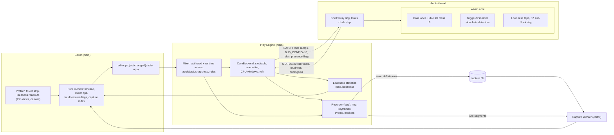
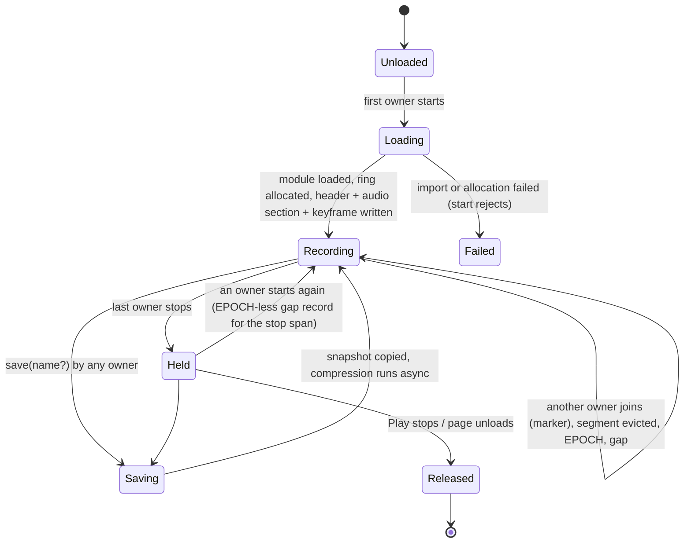
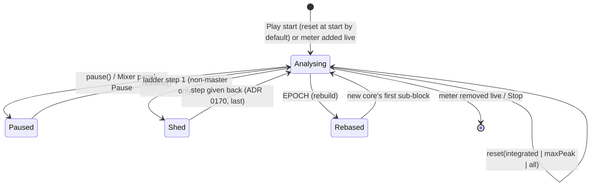
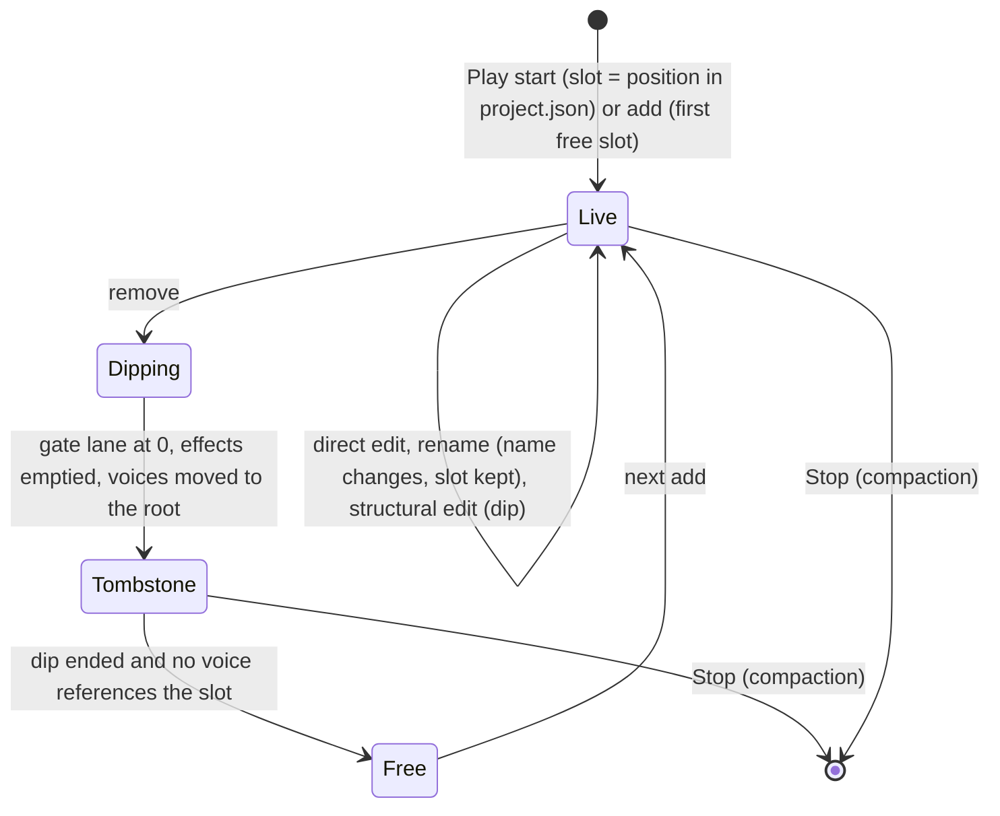
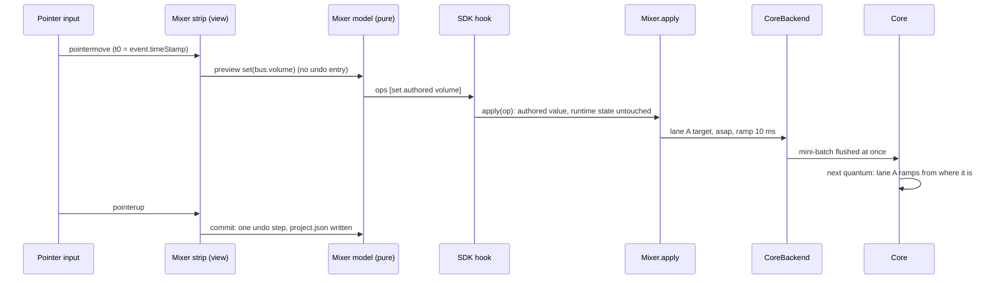
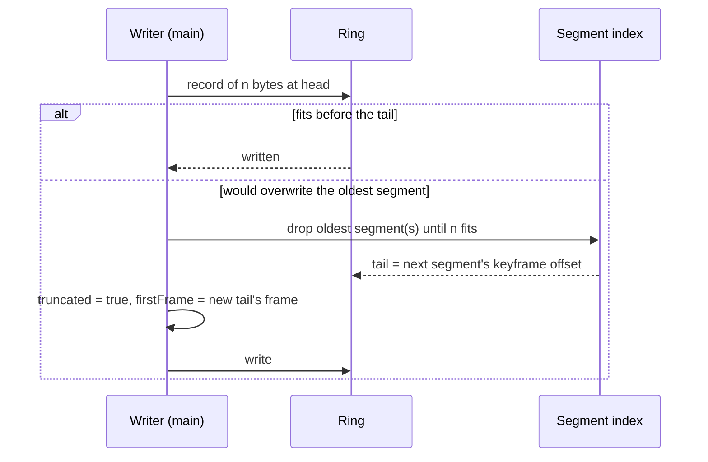

# 0171 audio mix: system architecture (M5)

The architect's design for ADR 0171 (Accepted 2026-11-12; its "RFC round (revision 2)", changes 1–35, and "Owner decisions (accepted)" win over the text above them). **Revision 1 (round 1).** It extends [0157's architecture](../0157-audio-core/architecture.md) (**[A157 §n]**), [0162's](../0162-audio-spatial/architecture.md) (**[A162 §n]**) and [0166's](../0166-audio-music/architecture.md) (**[A166 §n]**) and doesn't repeat them: the host, the batch, STATUS, the clock map, the hard rebuild, the adaptive cap, the shedding ladder and the due list work as there unless a section here says otherwise.

Its companion, `api-and-models.md` (**[API]**), owns every byte, name and format: the public API, the `audio` settings and their parse rules, the wire and ABI, the capture file format, the mix-operation encoding, the SDK hook, the editor models, the test plan and the task table. This file owns components, threads and channels, lifecycles, timing, constants, memory, performance, failure handling, observability and platforms. What it needs from [API] is listed in [contracts-architect.md](contracts-architect.md) as **C1–C26**.

**Evidence.** **[S]** is `spikes/audio-mix/README.md`; **[S0]** `research/`, **[S1]** `loudness/`, **[S2]** `cpu-clock/`, **[S3]** `capture/`, **[S4]** `mix-core/`. They ran on the shared 4-vCPU container, where **p50 and p99 are usable and p99.9 and max are not** [S "How the numbers were taken"]. S3's main-thread timings ran at load ≈ 2.0 after S2 (record change 31) and are pessimistic. **(est.)** marks an unmeasured number; **[U]** an unverified fact. A quantum is 128 frames, 2,667 µs at 48 kHz. Times are at 48 kHz and a 60 Hz display unless stated.

**The floor conversion (record change 30).** ADR 0169 fixes the floor (Android 14, Chrome 113, an emulated Pixel 8 with 2 GB and 4 cores) but gives **no** instruction-to-time factor, and no earlier design measured one. This design uses **0.6 ns per metered wasm instruction on the floor (est., unverified)**: M4's container calibration of 0.075 µs per 1k instructions ([A166 §7.1]) times the 8× phone slowdown M4's spike assumed (`spikes/audio-music/README.md:89`). The run that settles it: the metered bench's `mus-worst` and one M5 scene timed in the worklet on the owner's Pixel 8 profile, about 15 minutes; until then every floor µs here is an estimate. Instruction counts are the gate; container µs are the evidence.

**Code facts this design rests on (read, 2026-11-12).**
- STATUS is 176 B of header with no spare word (`reserved` at 172, `audio-wire/src/schema/status.rs:72`) and a worst case of 16,192 of 16,384 B (`audio-wire/src/schema.rs:73-74`).
- The shell reads `Date.now()` once per `process()` (`worklet/processor.ts:48`) and writes the shell's own STATUS fields (`dateMs`, `underruns`, `traps`…) after `myco_audio_status_take` (`worklet/coreDriver.ts:1040-1046`, `SHELL_FIELD` at `:386-394`). A post with no pooled buffer is skipped **before** the take, so the core keeps its queues (`coreDriver.ts:1017-1024`). The cadence switches 6 ↔ 48 quanta on `dateNow − lastBatchDate` without resetting `sinceStatus` (`:976-979`).
- `workUnits` is the last quantum's and `workUnitsMax` resets per block (`counters.rs:392-395, 520-533`).
- Main copies nothing today: `CoreLink.handleMessage` decodes into one reused block, then posts the buffer back as RECYCLE at once (`core/context.ts:229-249`; the reader's reuse at `core/statusReader.ts:54`). It allocates one `DataView` per STATUS (`context.ts:233`).
- Frames restart at 0 on a rebuild into a new context and the rate may change (`core/clock.ts:117-129`); a stall or trap rebuild keeps the context but replaces the core and the shell, whose counters restart (`core/recovery.ts:32-38`).
- The bus mix order is "deepest first, ties by index" (`audio-core/src/bus.rs:386-399`). Each bus runs pre-effects hook, effects, snapshot low-pass, gain ramp, automation gain, peak meter, sum into the parent (`bus.rs:529-584`); then the shared reverb return, MASTER and the limiter (`bus.rs:585-620`). So the root's meter misses the reverb return and the limiter.
- BUS_CONFIG is already applied in place: a kept index keeps its gain, effect state and meter; removed buses go silent; new ones start at unity (`bus.rs:277-331`, S4 "What today's code does"). Indices are positions in `project.json` (`core/coreBackend.ts:765-801`).
- The core keeps `max_buses` = 32 on every preset (`core/context.ts:92`), equal to the project's limit (`engine/audio/settings.ts:209`), and at most 4 effects per bus (`bus.rs` module doc, S4).
- Today's ducking is decided on main from voice counts (`engine/audio/mixer.ts:200-213`), which include virtual and locked voices (`coreBackend.ts:778-780`). Fades are linear in volume (`mixer.ts:186-188`), snapshot transitions linear (`:192-198`), the duck an exponential approach (`:208-211`).
- `mixer.configure` clears script volumes, fades and the snapshot (`mixer.ts:80-90`); `Engine.create` calls it once (`engine/core/Engine.ts:185-186`).
- The ladder's steps live in `bed.rs` (bed idle) and `zones.rs` (tail cut, one zone fewer), triggered after 1 s of underruns with the cap at its floor (`zones.rs:50-58, 109`), and come back under `cap_controller.rs`'s `LadderRecovery` (ADR 0170).
- The macOS desktop editor defaults to the Babylon backend (`settings.ts:224, 244-246`).

**Industry practice.** The owner's rule is to follow Wwise, FMOD, Unity and Unreal unless a measurement says otherwise; §12 says where M5 differs.

## 1. Overview

M5 adds one optional Worker (capture decoding, editor only) and no audio-thread work outside the core. Each thread's share:
- **Audio thread (shell):** a second `Date.now()` per quantum, a 96-entry busy-time ring, cumulative CPU totals and the clock-step detector (§4.3).
- **Audio thread (core):** per-bus gain lanes with stamped ramps through the due list (§4.5); the trigger-first bus order and sidechain detectors (§4.6); loudness taps with a 32-entry sub-block ring (§4.4); per-section work-unit totals (§4.3); parameter glides and the convolver run-out (§4.7); the ladder's new first step (§4.8).
- **Main (engine):** the recorder (lazily loaded) writing the profile stream into a preallocated ring (§4.1, §4.2); loudness statistics behind `Bus.loudness`; the CPU windows and the live refit; the mixer's `apply(op)` path and the session slot table in `coreBackend` (§4.7).
- **Main (editor):** the Profiler, the Mixer strip and the loudness readouts as thin views over pure models, drawn on canvas within 2 ms a frame (§7.3).
- **Capture Worker (editor):** inflate, bounds-checked decode, segment index, reconstruction at a cursor (§3.7).



The editor's live view and a saved capture go through the same Worker and the same decoder, so what the panel shows while recording is what a file shows later.

## 2. Lifecycles

### 2.1 The recorder

The recorder is a module loaded by `import()` on the first start (record §7; owner decision 2). It has **owners**: the Profiler panel (while open in Play), `Audio.capture` (a script), and the export's built-in trigger. One ring serves all of them (record change 33).



- **Held** keeps the ring's content so `save()` after `stop()` works (record change 33); nothing is written while held.
- A start in Held appends to the same ring with a gap record, so one file can hold several takes; `Audio.capture.start({ fresh: true })`-style clearing is [API]'s choice (C24).
- **Released** frees the ring when the play Engine is disposed. The editor's Profiler keeps the last decoded copy in its Worker so the timeline stays inspectable after Stop.

### 2.2 A metered bus

Master is always metered; up to 8 other buses carry `meter: "loudness"` (record change 12). Per metered bus, the core runs the tap and main runs the statistics.



Flags that persist across states until a reset: **`incomplete`** (sub-blocks lost or a shed span), **`tainted`** (a monitor control affected this meter, record change 20). `elapsed` counts only Analysing time.

### 2.3 A bus slot

The session slot table (record change 17) maps a bus name to a core slot for the length of a Play session.



The table is replayed as it stands on any rebuild (§3.4) and discarded at Stop, when the next configure uses project order again (today's remap path, `core/context.ts:875-891`).

## 3. Interactions

### 3.1 Capture start, stop and save

```mermaid
sequenceDiagram
  participant G as Game script / panel / trigger
  participant R as Recorder (main)
  participant L as CoreLink.handleMessage
  participant M as Mixer + backend events
  participant S as Storage / download
  G->>R: start() (Promise)
  R->>R: import(), allocate ring (§4.2)
  R->>R: header, name table, audio section, MASTER state, keyframe
  R-->>G: resolved
  loop every STATUS (16 ms, 128 ms idle)
    L->>R: raw bytes (before RECYCLE)
    R->>R: copy words into ring; keyframe if 1 s of frames passed
  end
  M->>R: voice / event / music / mix-op / marker records
  G->>R: stop()
  G->>R: save(name?)
  R->>R: copy live span (one allocation, not per block)
  R->>S: deflate-raw in 256 KB chunks, async
  S-->>G: path or file name (Promise<string>)
```

- **The tap** sits in `CoreLink.handleMessage` between the decode and the RECYCLE (`core/context.ts:239-247`), the only place where the raw bytes exist; after the transfer the buffer is gone. The copy goes through the `DataView` the handler already has, in 32-bit words, so it adds no allocation (a typed-array view per block would); NaN payloads survive because nothing is read as a float.
- **Save** copies the live span once (≤ the ring size) so recording can continue during compression. Compression runs through `CompressionStream("deflate-raw")` in 256 KB chunks with an `await` between them, never inside a frame's work. `save()` with nothing recorded rejects (record change 33).
- **Per platform:** web downloads a Blob; Tauri desktop and Android write through `Storage.save(key, bytes, "cache")` ([S3] "Saving"). The built-in trigger rotates its files: at most **16** in the cache namespace, the oldest deleted first (record change 4's cap; this design picks rotation so a test build never stops recording).

### 3.2 A direct live edit: a fader drag



- **The ≤ 50 ms gate** (record change 21) is measured from `event.timeStamp` to the first core output sample that differs, at the core's output (after the limiter's look-ahead, 72 frames = 1.5 ms at 48 kHz, `bus.rs:38-40`), excluding the device's output latency, which the engine doesn't control. Budget: handler ≤ 2 ms (est.) + `postMessage` to the worklet [U, S4 didn't measure it] + up to one quantum (2.7 ms) + 1.5 ms ≈ **≤ 10 ms plus the post (est.)**; the value is reached 10 ms later.
- **Why flush at once:** waiting for the frame's batch adds up to one display frame (33 ms at 30 Hz), which would spend most of the gate. The background mute already flushes this way (`core/background.ts:5`).
- **Why asap, not stamped:** a stamp lands one lookahead later (≥ 1,024 frames, `lookahead.ts:13-31`) for no benefit; a drag has nothing to align with.
- **The heard value follows the drag** (record change 21) because every move is applied; only the release writes the project.

### 3.3 A structural edit: the 20 ms subtree dip

Re-parenting a bus, reordering or removing effects, removing a send, moving a sound to another bus, inserting a bus between a parent and its children, and removing a bus all take one path (record change 19).

```mermaid
sequenceDiagram
  participant X as Mixer.apply (main)
  participant T as Slot table (coreBackend)
  participant K as Core
  X->>T: op (e.g. move "SFX" under "World")
  T->>T: affected subtree roots, new slots, F0 = asap frame estimate
  T->>K: one batch: gate lanes of roots to 0 over 20 ms from F0
  T->>K: BUS_CONFIG diff stamped at F0 + 960 (structural, quantum-aligned)
  T->>K: gate lanes back to 1 over 20 ms from the apply quantum
  K->>K: ramps run; at the first quantum boundary at or after F0 + 960 the diff applies
  K->>K: no split, no rebuild; only the edited subtree dips
  K-->>T: STATUS (duck gains, peaks by slot)
```

- **Affected roots:** the moved bus for a re-parent; the edited bus for effect edits and send removal; the children being re-parented for a mid-tree insert; the removed bus for a removal. A **voice** moved to another bus (an AudioSource's `bus` edited) dips alone with its own FADE records (class G, [A166 §4.4]): out 20 ms, SET_PARAMS bus at the end, in 20 ms.
- **Effects need no stable slots.** Under the dip the edited bus's chain is rewritten whole and its filter and compressor state may reset: S4's slot-shift clicks (-19 dBFS) came from a reset at full gain, and here the reset happens at gain 0. Only buses need stable indices. The click test in M5c checks it (C25).
- **Apply at a quantum boundary.** The core applies the stamped structural record at the start of the first quantum at or after its frame, while the gate lanes hold 0; nothing splits and `splitQuanta` stays 0 (C16). The dip therefore lasts 40 ms plus at most one quantum.
- **Removing the last reverb send** no longer cuts the tail: the shared convolver keeps running until its input has been silent for the IR's length plus a margin, as zones do (`zones.rs:111-115`), and is reset when it stops, so a later send doesn't replay a stale tail (S4 live table, "remove last send").

### 3.4 Rebuild with slot-table replay

```mermaid
sequenceDiagram
  participant Rc as Recovery (main)
  participant T as Slot table
  participant R as Recorder
  participant K as New core
  Rc->>R: rebuild(reason) began: gap record opens (performance.now)
  Rc->>K: RESET, preset, clips (as today)
  T->>K: BUS_CONFIG of every slot in slot order (tombstones as silent roots)
  T->>K: lane values settled at their end state (an in-flight dip: edit applied, gate 1)
  T->>K: rules, presence flags, loudness config, voices with slot indices
  K-->>Rc: first STATUS (counters from 0, frames from 0 on a new context)
  Rc->>R: EPOCH (epoch+1, reason, rate, latency, timeOffset), gap closes, keyframe
  Rc->>Rc: CPU window and loudness feeds restart; integrated continues
```

- **End state, never half** (record change 17): a lane mid-ramp is replayed at its target; a dip in flight is replayed as applied with the gate at 1. A rebuild is already an audible gap ([A157 §3.6]), so a fade-in isn't owed.
- **Cumulative counters restart at 0** in the new shell and core. Main never subtracts across an epoch: the first block of an epoch starts a fresh window (§4.3).
- **Loudness:** the new core's sub-block `seq` restarts, which S1's `Feed` would read as ~4e9 lost (`spikes/audio-mix/loudness/src/loud.rs:283-286`). Main resets each feed at the EPOCH and keeps the histograms, so integrated loudness continues; the dead time contributes nothing and is a gap in the stream.

### 3.5 Hidden tab and gaps

| Mode (`audio.background`) | Audio thread | STATUS | Stream | Loudness |
|---|---|---|---|---|
| `play` | runs | flows (128 ms idle cadence) | continues; keyframes keyed on STATUS frames, not rAF | continues |
| `mute` | runs, MASTER at 0 over 50 ms (`background.ts:5`) | flows | MASTER record; continues | taps continue; target check suspended (MASTER ≠ 1) |
| `pause` | suspended after a 30 ms fade (`background.ts:7`) | none | **gap** record from hide to show (reason: paused) | elapsed stops; no sub-blocks; not `incomplete` (no audio played) |

A **gap** record is written whenever the recorder knows nothing was rendered or received: a `pause` suspend, a rebuild (from the failure to the new core's first STATUS), and a restart from Held. Skipped posts are not gaps: the core keeps its queues and the cumulative totals bridge them.

### 3.6 Keyframe eviction



Eviction is whole segments only, so the ring's tail is always a keyframe and any span left can be decoded alone ([S3] "an evicted 1 MiB ring decodes cleanly"). A record that doesn't fit before the buffer's end is preceded by a wrap marker and written at offset 0; records never straddle the end.

### 3.7 Opening a capture in the editor

```mermaid
sequenceDiagram
  participant U as File > Open / drop
  participant E as Editor (main)
  participant W as Capture Worker
  U->>E: File (untrusted)
  E->>W: transfer bytes
  W->>W: header: magic, format, wire hash; mismatch -> refuse with both versions
  W->>W: inflate streaming, stop at 64 MB decompressed
  W->>W: walk records with bounds checks; build segment index; names as data
  W-->>E: summary, overview tracks (downsampled), audio section, warnings
  E->>E: warn if the open project's audio section differs (never refuse on that)
  E->>W: seek(t)
  W->>W: nearest keyframe <= t, replay records to t
  W-->>E: snapshot at t (voice table with reasons, bus gain factors, loudness)
```

- **Refusal** names both wire versions and says "re-record with this build" (record change 3). The editor carries only the current decoder.
- **Live view:** while recording in the editor, the recorder hands sealed segments to the same Worker every second (a copy of one segment, est. ≤ 1 MB at 1,024 voices), so the panel scrubs a live recording exactly as a file.
- **Targets:** open ≤ 2 s for the largest ring (32 MB), seek < 16 ms; S3 measured 0.24–0.83 s and 0.2–0.7 ms p50 for 10-minute delta captures (raw decode, est. no slower per byte).

### 3.8 Stop and "Compare with Play start"

- **Stop:** edits already sit in `project.json` as undo steps; the play Engine is disposed; the slot table is dropped; the editor Engine's next configure remaps by name from project order. Monitor mute and solo are cleared (never saved, record change 20).
- **Compare** (record change 21) diffs the current `audio` section against the Play-start copy, turns the diff into ops, and applies them through `apply` (structural parts dip), with no undo entry and no project write; pressing it again applies the reverse ops. Each swap writes a marker. Readings aren't tainted: the compared mix is a real authored mix, and the markers show where the swap happened.

## 4. Mechanisms

### 4.1 The stream and its clock

**Records.** The stream is a sequence of self-delimiting binary records (C1) of these classes:
- **STATUS:** the raw block as the shell posted it.
- **Main events** with reason codes: voice start, stop, steal (with the thief), virtualise and realise (with why), refusal, queueing; event instance start and stop; parameter, snapshot and state changes; music transitions; mix operations; markers.
- **Keyframes:** main-side state (§4.2).
- **Stream control:** EPOCH, gap, name, wrap, MASTER and hidden-mute state.

**Clock fields.** Every record carries **(epoch, frame, seq)** (record change 1):
- **epoch** counts rebuilds since the recording began; frames of different epochs are never compared.
- **frame** is in the current context's frames at its sample rate. STATUS uses its own `currentFrame`, the frame after the last rendered quantum (`audio-core/src/status.rs:152-158`). A main event uses the frame its command takes effect at: its stamp, or the clock map's F_now for asap work. A main event also carries `performance.now()`, so input (a fader drag) and wall time line up.
- **seq** is a u32 per recording, incremented per record in write order; it breaks ties and lets a reader (or a later link) see drops.

**Order.** The canonical order is (epoch, frame, seq). The ring is in seq order (write order), which differs from frame order in a bounded way: STATUS frames trail now by at most one block plus a main stall, and stamps lead now by at most the lead (≤ 100 ms lookahead, `lookahead.ts:15`, plus music's prime lead, ≤ 330 ms healthy, [A166 §9]). The reader therefore sorts within a window of one keyframe segment (1 s). A command stamped more than 1 s ahead of the newest STATUS frame (a far-future `at`) is recorded at F_now with its stamp in the payload and a `deferred` bit, so the bound holds (C1).

**The heard clock.** A frame rendered at f leaves the core at f + D, D = the limiter's look-ahead (`clock.ts:6-10`), and reaches the listener after the device's output latency. The profiler's axis is **rendered frames** (what STATUS and stamps share); the cursor's readout states "heard ≈ D + output latency later". Across epochs the axis is continuous seconds, t = frame / rate + timeOffset(epoch), with timeOffset from the EPOCH record (the same continuity `ClockMap.rebase` gives `Audio.time`, `clock.ts:124-130`).

**EPOCH** (C2) is written at the first STATUS of a new core, after any rebuild (trap, stall, device, rate, latency, mode): reason, new rate, the limiter latency in frames, timeOffset. A keyframe follows at once.

**The live link on paper** (record change 1; the challenger's framing check). A link sends the same records; it adds transport only:
1. **HELLO** = the capture header (magic, format, wire hash, rates, preset) and the name table known so far.
2. **Frames** = one binary WebSocket message per sealed chunk of records (one STATUS block and the events before it, ≤ 64 KB).
3. **Loss detection** = a jump in `seq`.
4. **Resync** = the next keyframe; a receiver that joins late or saw a jump discards until one arrives.
5. **Back-pressure** = the sender drops whole keyframe segments, never parts, and sends a gap record (reason: dropped, with the seq range).
6. **Names** introduced mid-session (a clip loaded after the start) travel as in-stream name records before first use.

The file needs the same fields: `seq`, gap reasons, keyframes as resync points and in-stream names (clips load after a capture starts). **So the link needs nothing the file lacks**, provided C1, C3 and C5 hold; "the link is a transport" survives the check.

### 4.2 The recorder ring

**Layout.** One `ArrayBuffer` of R bytes, allocated at start, plus a preallocated segment index (4,096 entries of offset, epoch, frame: 68 minutes at one keyframe a second). Records are contiguous; a wrap marker sends the writer to offset 0.

**Keyframes** are written in the STATUS handler when the block's frame has moved at least one second (rate frames) past the last keyframe, or at the first block of an epoch. They key on STATUS frames, not rAF, which stops in a hidden tab (record change 2), and not on a STATUS count, which would stretch to 8 s at the idle cadence. Content (C4):
- the voice table: id, clip, bus slot, state, priority, gain, pitch, audibility, playhead, reason ([S3]'s row is about 19 B);
- event instances and music state;
- per bus: the slot table row, each gain lane's value and target, the duck gain;
- per metered bus: the readings (M, S, I, LRA, max true peak, flags). The 24 kB histograms aren't copied; between keyframes the reader recomputes momentary and short-term exactly from the raw sub-blocks and holds integrated and LRA at the last keyframe's value (≤ 1 s stale).

**Sizing** (record change 2, architect RFC "Memory"):

R = min(preset size, 8 MB × `navigator.deviceMemory` GB), never below 4 MB; `deviceMemory` absent (WebKit, Firefox) gives the preset size.

| | low | default | high | editor |
|---|---|---|---|---|
| Preset size (record §8, est.) | 4 MB | 16 MB | 32 MB | 32 MB |
| On the floor (2 GB) | 4 MB | 16 MB | 16 MB | 16 MB |

Duration at S3's raw rates (1.70 / 4.08 / 10.85 MB per minute at 64 / 256 / 1,024 live voices, synthetic scenes) plus M5's STATUS additions (+0.4–0.7 MB per minute, est. from §4.4's and C10's sizes):

| R | 64 voices | 256 | 1,024 |
|---|---|---|---|
| 4 MB | 1.8 min | 0.9 | 0.35 |
| 16 MB | 7 min | 3.4 | 1.4 |
| 32 MB | 14 min | 7 | 2.8 |

These are smaller than the record's "about 18 minutes at 64 voices on 32 MB", which predates the STATUS growth (§13, item 2). They are estimates until change 31's real-scene re-run.

**Truncation.** The first eviction sets `truncated` and moves `firstFrame`; both go into the saved header (record change 3, C7).

**One writer per recording.** Owners share the ring; a second owner's start is a marker, not a second recorder (§2.1).

**Allocation.** The STATUS copy and every event write go through preallocated views; names (first use only), saves and segment hand-offs are the only allocations, none per block.

### 4.3 The CPU counters

**What the shell measures.** In `process()`, t0 is the `Date.now()` already read (`processor.ts:48`) and t1 a second read after `driver.process` returns, so the figure includes the shell's own work (clip copies, stream credits, the STATUS post). Per quantum:
- d = t1 − t0, clamped: d < 0 or d > 1,000 ms counts 0 and increments `clockSteps` (a wall-clock step, record change 6);
- `busyMsTotal += d`, `quantaTotal += 1` (both cumulative, wrapping, C8);
- a 96-entry ring of d (u16) keeps a sliding sum, so the shell fills `loadPermille` with exactly the last 96 quanta (256 ms) ending at the posted block, whatever the cadence and however many posts were skipped;
- the smallest non-zero difference between consecutive t0s is the **clock step** (1 ms on Chromium, [S2]).

**What the core adds.** Cumulative work units per section (C9): voices; buses and effects (sidechain and lanes included); spatial (beds, zones); music; loudness. Each is a running sum of the per-quantum figure the core already computes, wrapping no sooner than once an hour.

**What main forms.** Main keeps a 32-entry ring of (quantaTotal, busyMsTotal, section totals) from each STATUS of the current epoch. A window is chosen **by quantum count**: from the newest sample back to the newest sample at least W quanta older. The figure is 1,000 × Δbusy / (Δquanta × quantum ms). Cadence switches (6 ↔ 48) and skipped posts change only how many samples a window spans, never its bias (record change 6). A window never crosses an EPOCH.

| Clock step | Window W | Expected error (p50) | Profiler |
|---|---|---|---|
| ≤ 1 ms | 96 quanta (256 ms) | 7–15 permille [S2] | line drawn, "256 ms average" |
| 2 ms (Firefox resistFingerprinting [U]) | 384 quanta (1 s) | ≈ 3–12 permille (est.: S2's 384-quantum error × 2) | line drawn, "1 s average" |
| > 2 ms, or no step seen after 1 s | — | — | line hidden, "clock too coarse (n ms)" |

**Section shares** (record change 6): main fits per-section ms-per-unit coefficients by non-negative least squares over the last 64 windows (16 s), pulled toward the build constants (`cap.rs:99-108`) so a quiet section doesn't swing; where the fit is ill-conditioned it falls back to one scalar (shares = work-unit proportions). Shares are drawn as "estimated share" of the measured figure. S2 found the live fit within 1–20 permille p50 on a JS proxy kernel [U on the real core]. The fit stays on main and never feeds the voice cap.

**The headline for clicks** is underruns, late commands and `minSlackFrames` (record change 8): a click inside one quantum shows in those counters and not in a 256 ms average.

### 4.4 Loudness data flow

**Taps.**
- **Master** is metered on the final output after the shared reverb return, MASTER and the limiter (`bus.rs:585-620`; record change 11), with full true peak every quantum. The target check is suspended while MASTER ≠ 1, while muted (including the hidden-tab mute), and while any monitor control is active.
- **Other metered buses** tap where the peak meter does (`bus.rs:569`): after effects, snapshot low-pass and every gain lane, so the reading is what the bus sends to its parent (post-fader, as FMOD's meter effect at the end of a bus [S0]).

**Audio thread** (per metered bus, [S1]): K-weighting (two f64 biquads per channel, coefficients from the core's rate), mean square of L + R accumulated per 100 ms sub-block (`round(0.1 × rate)` frames: 4,800 at 48 kHz, 4,410 at 44.1 kHz, so boundaries fall inside quanta), into a **32-entry ring** with a sequence number. True peak (4×, 48 taps) runs every quantum on master and, on other buses, only in quanta whose sample peak reaches **the active target's ceiling − 6 dB** (−7 dBFS for the default −1 dBTP); those skipped are counted (record change 14). The reported peak is max(true peak, sample peak).

**The take.** `myco_audio_status_take` runs only with a pooled buffer in hand (`coreDriver.ts:1017-1028`). Each take carries, per metered bus, the sub-blocks since the last take and the peak maximum since the last take, then advances the bus's sent cursor (C10). A skipped post leaves the cursor, so **a main stall of up to 3.2 s loses nothing** (32 × 100 ms); past that the oldest are overwritten and main sets `incomplete`.

**Main** (per metered bus): a feed checks `seq` continuity, then momentary (last 4 sub-blocks), short-term (last 30), gated integrated (every 400 ms block, −70 LUFS absolute gate, −10 LU relative), LRA (3 s blocks at a 1 s hop, −20 LU relative gate, 10th–95th percentile), from two fixed 1,000-bin histograms (24 kB, within 0.11 LU of exact [S1]). Readings are `-Infinity` until momentary has 4 sub-blocks and short-term 30 (EBU Tech 3341's definitions). Cost: ≤ 10 sub-blocks per second per bus plus one LRA pass of 1,000 bins per second, ≤ 50 µs per second for 9 buses (est.; record §8).

**Integrity flags.**
- **`incomplete`:** sub-blocks lost (a stall over 3.2 s) or a shed span (§4.8). Integrated then under-counts audio that played.
- **`tainted`:** a monitor control was active while this meter ran since its last reset: monitor solo taints every meter; monitor mute of bus X taints X's meter, its ancestors' and master's.
- **Lower bound:** `maxTruePeak` below the ceiling, on a bus with gated quanta, is a lower bound (a natural signal's inter-sample overshoot stays well under the 6 dB margin; a crafted one may not, S1 [U]); at or above the ceiling it is exact. A ceiling breach is never missed for natural signals.

**Rebuilds** reset the feeds and keep the histograms (§3.4). A rate rebuild changes nothing on main: sub-block energies are mean squares, independent of rate.

**How readings reach the editor.** `Bus.loudness` is updated in the STATUS handler. The Mixer strip draws from it on its canvas frame; the Profiler draws from the Worker's own decode of the recorded STATUS blocks, so a timeline from a file and a live one agree.

### 4.5 Gain lanes and stamped bus ramps

**Composition** (record change 15). Each bus's gain is the product, per sample, of six lanes:

| Lane | Written by | Law | Notes |
|---|---|---|---|
| **A** authored | editor ops (`Bus.authoredVolume`) | linear ramp, 10 ms for drags, asap | the project's value |
| **R** runtime | `Bus.volume`, `fadeTo` | linear in volume (`mixer.ts:186-188`), stamped at the batch's first frame for the fade's exact length; a plain set ramps over today's frame interval (5–50 ms, `lookahead.ts:33-37`) | default 1, 0..2 (record change 16) |
| **S** snapshot | `snapshot()`, `clearSnapshot()` | linear, stamped, the transition's length | one snapshot at a time (owner decision 7) |
| **G** gate | authored mute, script mute and solo, monitor mute and solo, the dip | linear 10 ms; the dip 20 ms | **this design adds it**: the record's five lanes leave mute and solo nowhere. Folding them into A would write monitor state into the authored lane; into R would let a fade unmute |
| **D** duck | the core (§4.6) | per-quantum gain computer, interpolated per sample | min over the rules on this target |
| **U** automation | the core (0158, `bus.rs:561-568`) | as today | already in the core; "becomes ramps" applies to Babylon only |

Authored 2 × runtime 2 = 4 is legal; the limiter catches it (record change 16). MASTER stays one ramp, as today.

**Third class in the due list** (record change 27). A stamped lane ramp (C14) is popped like any stamped record and routed into the per-quantum due list (`due.rs`) as **class B**, keyed by bus slot and lane, instead of `Class::Quantum`'s whole-quantum split (`due.rs:85-93`). In `mixdown`, each bus builds its gain for the quantum:
1. if every lane is settled, one scalar (the product), multiplied in a vectorised loop;
2. otherwise a 128-sample curve: start from the settled lanes' product; each lane with a due record or a running ramp multiplies in its own hold, ramp, hold segment by a start-sample compare (S4's stamped ramp: 1,692–1,796 instructions, exact to 5e-8);
3. one apply.

A ramp starts **from the lane's value at its start frame**, so a retarget mid-ramp never jumps. Two records for one lane in one quantum apply in frame order. When the due list is full (256, shared with voices), a bus record applies at the quantum's start (≤ 2.7 ms early) and counts `busRecordsEarly`, rather than splitting. `splitQuanta` stays 0 (record change 27).

**Bit-identity for unstamped work** (record §10). An asap BUS_MIX or MASTER with lanes B–U at identity must render the same samples as today: the asap path keeps `Ramp::next`'s per-sample stepping, identity lanes are skipped (not multiplied by 1.0), and the settled scalar is the same product. M5-0's goldens prove it (C16).

**Main's mirror.** The mixer computes each lane's curve itself (it wrote the ramps), so `Bus.effectiveGain`, selection's audibility (`coreBackend.ts:690-692`) and the cursor's "gain factors" (record change 9) need only the duck gain from STATUS (C12).

### 4.6 Sidechain taps and the bus order

**The tap is pre-fader** (record change 25): after the trigger bus's effects and snapshot low-pass, before every gain lane. Monitoring the trigger (mute, solo) and its fader don't change the duck. A chain (Voice ducks Music, Music ducks Ambience) therefore ducks Ambience on Music's un-ducked level; that is how a pre-fader send behaves in Wwise and FMOD [S0, U].

**Detector and computer** (record §6, S4):
- detector per sample on the tapped L + R: **peak** (instant attack, 10 ms release) or **RMS** (10 ms one-pole mean square);
- gain computer once per quantum: depth = clamp((level dB − threshold) / 6 dB, 0, 1), goal = 1 − depth × (1 − amount). The 6 dB knee keeps a level hovering at the threshold from chattering;
- the duck gain moves toward the goal with the rule's attack (falling) and release (rising) as one-pole time constants, per quantum, interpolated linearly per sample. S4 found the per-quantum computer within 0.024 dB of per-sample.

**Presence mode** in the core: main sends one flag per trigger bus, "has voices" (virtual and locked included, as today), whenever it changes; it is a level, so a replay repairs it. The gain moves toward `amount` or 1 with the same one-pole law. Rules are combined **by min** per target (record change 15). Today the target follows one goal (the lowest amount, with that rule's attack and the longest release, `mixer.ts:200-207`); per-rule followers combined by min differ only while two rules on one target release at different speeds.

**The order** (record change 24). At BUS_CONFIG the core computes the mix order by Kahn's algorithm over child → parent edges plus trigger → target edges of **level-mode** rules, picking among ready buses the deepest first, then the lowest index. With no level rules this gives exactly today's order (every bus of depth d is ready before any of depth d − 1, by induction from the leaves), so unstamped goldens stay identical. Presence rules add no edge: their input is a flag from main, not a signal.

**Cycles.** An ancestor trigger is one cycle (the target must finish before its ancestor starts). Several level rules can form others with the tree: A ducks B and B ducks A; A → B, B → C, C → A. Validation must refuse **any** set of level rules whose edges close a cycle, not only the ancestor case (C17; §13 item 4). Defence in depth: a cycle that reaches the core has its last edge (in rule order) dropped, that rule reads the previous quantum, and `sidechainLate` counts it.

**Staging** (record change 26). M5-0 ships the order, the duck lane with presence mode and the gain lanes; M5c adds level mode (the detector, its rule fields and the gain-reduction meter). §13 item 1 corrects what the record says M5-0's sort fixes.

### 4.7 The slot table and the live-edit path

**End to end:**
1. The editor model applies an op (set, add, remove, rename, move) from the functions the settings section already uses (`plugins/audio/editor/audioSettingsModel.ts:81-197`), records the undo step, and calls `editor.project.changed("audio", ops)` (record change 18).
2. The play Engine's audio plugin calls `mixer.apply(op)`, which updates authored values, rules and snapshots and **keeps runtime state** (unlike `configure`, `mixer.ts:80-90`).
3. `coreBackend` classifies and emits:

| Edit | Class | Core path |
|---|---|---|
| bus volume, mute (authored) | direct | lane A or G ramp |
| filter frequency and Q, compressor parameters, send level | direct, glided | BUS_CONFIG diff of the slot; the core glides the parameter over **20 ms** in per-quantum steps (S4: +370 instructions per filter per quantum while gliding; a compressor threshold step clicks unless blended over ≥ 20 ms) |
| append an effect (≤ 4) or a send | direct | diff; the new slot starts zeroed (S4: clean) |
| add a bus | direct | first free slot; parent set; lanes at their values; dips nothing |
| rename a bus | direct | the table's name changes; the slot and its state stay |
| snapshot or rule definition edited | direct | an active snapshot's lane S retargets over 20 ms; rules re-sent (C17) |
| re-parent, mid-tree insert, effect reorder or removal, send removal, bus removal, a sound's bus | structural | the dip (§3.3) |

4. **The slot table** (in `coreBackend`, record change 17) maps name → slot with states Live, Tombstone, Free (§2.3). Every consumer that indexed buses by project position (the remap, the bed plan, automation bindings, selection arrays, the replay, `coreBackend.ts:741-801`) reads the slot instead. A tombstone is recycled once its dip has ended and no voice references it (the remap moved its voices to the root, `core/context.ts:358-365`), normally ≤ 40 ms after the removal.
5. **Refusal.** With 32 slots and a 32-bus project limit, a slot is missing only while tombstones wait (a bus removed and two added within one dip). Such an addition, or a fifth effect, is **kept in `project.json`** and not applied live; the strip marks the bus "applies at next Play" (record change 17 says "refused visibly"; §13 item 5).
6. **Replay and compaction:** §3.4 and §3.8.

### 4.8 The ladder's new first step

Record change 29 (amending 0162 and 0170). The ladder gains a step **before** the bed-idle step: **pause non-master loudness metering**. While it is in force the core skips K-weighting, sub-blocks and true peak on every metered bus except master; sidechain detectors and the duck lane are never shed.

- **Trigger and spacing:** the ladder's own (cap at its floor, underruns for 1 s, `zones.rs:109`); the next step follows after another second as today.
- **Skipped when it saves nothing:** with only master metered, the step isn't taken and the ladder starts at the bed step as today. Otherwise it would delay the audible steps by 1 s for no saving.
- **Given back last** under ADR 0170 (zone 2, zone 1, bed, then loudness), so all four are back 80 s after the last underrun.
- **What it saves:** up to 8 buses' taps, ≈ 10–25 µs container p50–p99 gated, 45 µs p99 full ([S1]), 0.2 ms on the floor (§7.1). Small, but inaudible, which is the point (architect RFC 8).
- **Reported:** a STATUS count of the loudness step in force (C13), `Bus.loudness.paused` with reason "shed", a stream record; the span sets `incomplete`.

## 5. Threading, state and constants

### 5.1 State ownership

| State | Owner (writes) | Copy elsewhere |
|---|---|---|
| Authored values, rules, snapshots | editor ops → `project.json`; the mixer via `apply` | slot table, keyframes, mix-op records |
| Runtime values, fades, active snapshot | scripts via the mixer | lanes R and S in the core |
| Monitor mute and solo | Mixer strip (editor) | lane G; taint flags |
| Slot table | `coreBackend` | keyframes; debug |
| Lane values and ramps | core | main mirror (computed); keyframes |
| Duck gain | core | STATUS (C12) |
| Sub-block ring, sent cursor | core | STATUS (C10) |
| Loudness statistics | main | `Bus.loudness`; keyframes |
| Busy time, clock step | shell | STATUS (C8) |
| Section work units | core | STATUS (C9) |
| CPU windows, refit | main | profiler only; never the cap |
| Ring, segment index | recorder | capture file; Worker copy |

### 5.2 Staleness bounds

| Value | Normal | Under a main stall of s |
|---|---|---|
| Fader drag heard | ≤ 10 ms + post (est.); gate 50 ms | s |
| Duck gain seen on main | ≤ 16 ms (128 ms idle) | s |
| Loudness readings | ≤ 16 ms after a sub-block closes | s; nothing lost up to 3.2 s |
| `loadPermille` (shell) | the last 256 ms at each block | exact for the block when it arrives |
| Keyframe | 1 s of frames | written at the next STATUS handled |
| Live Profiler view | ≤ 1 s (a sealed segment) | s + 1 s |
| Structural edit applied | 20 ms + ≤ 1 quantum after arrival | s |

### 5.3 Constants

**S** is a setting [API]. Values marked "this design" are new and are estimates until M5's tests confirm them.

| Area | Constant | Value | Source |
|---|---|---|---|
| Stream | keyframe interval | 1 s of STATUS frames | record change 2; this design |
| | reorder window; deferred stamp | one segment (1 s); stamp > 1 s past the newest STATUS frame | this design (§4.1) |
| | record order | (epoch, frame, seq), seq u32 per recording | record change 1 |
| Ring | preset size low / default / high / editor | 4 / 16 / 32 / 32 MB | record §8 (est.) |
| | device cap; floor | 8 MB per GB of `deviceMemory`; 4 MB | this design (est.) |
| | segment index | 4,096 entries (68 min) | this design |
| | largest record | 256 KB (a keyframe at 8,192 logical voices × ≈ 19 B ≈ 156 KB, `audioSettingsModel.ts:207`, [S3]) | this design (est.) |
| Capture | decompressed cap | 64 MB (twice the largest ring) | record change 4; this design |
| | open; seek | ≤ 2 s; < 16 ms | [S] targets |
| | trigger file rotation | 16 files | record change 4; this design |
| | save chunk | 256 KB | this design (est.) |
| CPU | window | 96 quanta (256 ms); 384 at a 2 ms step; hidden above 2 ms | record change 6, 7; [S2] |
| | per-quantum clamp | 0..1,000 ms, else `clockSteps` | this design |
| | shell ring; main ring | 96 × u16; 32 samples | this design |
| | refit window | 64 windows (16 s) | this design (est.) |
| Loudness | metered buses | master + up to 8 | record change 12 |
| | sub-block; core ring | round(0.1 × rate) frames; 32 (3.2 s) | [S1]; record change 14 |
| | momentary; short-term | 4; 30 sub-blocks | BS.1770 / Tech 3341 |
| | gates | −70 LUFS absolute, −10 LU relative; LRA −20 LU, 3 s blocks, 1 s hop, 10–95 % | [S1] |
| | histograms | 2 × 1,000 bins, 24 kB per bus | [S1] |
| | true peak | 4×, 48 taps; gate at ceiling − 6 dB | [S]; record change 14 |
| | core state | 1,512 B per bus + 128 B ring | [S1]; this design |
| | defaults **S** | console −24 ±2 LU, −1 dBTP; mobile −18 ±2 LU, −1 dBTP | owner decision 4 |
| Lanes | count | 6 (A, R, S, G, D, U) | record change 15; G this design |
| | drag ramp; gate ramp | 10 ms; 10 ms | this design (est.) |
| | script set ramp | frame interval, 5–50 ms | `lookahead.ts:19-20, 33-37` |
| | dip | 20 ms out, apply at the next quantum boundary, 20 ms in | record change 19 |
| | parameter glide | 20 ms, per quantum, log-free (linear Hz as today) | [S4] |
| | fader gate | ≤ 50 ms, event to core output | record change 21 |
| Sidechain | detector | peak: instant attack, 10 ms release; RMS: 10 ms | this design (est.) |
| | knee | 6 dB | this design (est.) |
| | level rules | ≤ 8 (budget bound) | [S4] worst; C17 |
| Slots | core slots | 32 on every preset | `context.ts:92`; `settings.ts:209` |
| | effects per bus | 4 | `bus.rs` module doc |
| Reverb | run-out | IR length + `IDLE_MARGIN_QUANTA` of silent input | `zones.rs:111-115` |
| Ladder | new step | first; skipped with master only; given back last | record change 29 |
| | trigger; hold | 1 s; 20 s (40–160 s on re-trip) | `zones.rs:109`; ADR 0170 |
| STATUS | buffer | 20 KB × 8 (+32 KB) | record change 28 |
| Main | recorder; loudness stats; editor drawing | ≤ 1 ms/s at 1,024 voices; ≤ 50 µs/s; ≤ 2 ms per frame | record §3, §8, change 10 |
