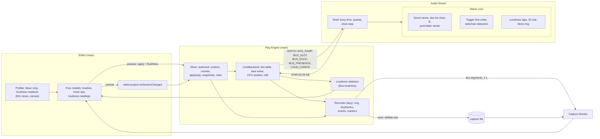
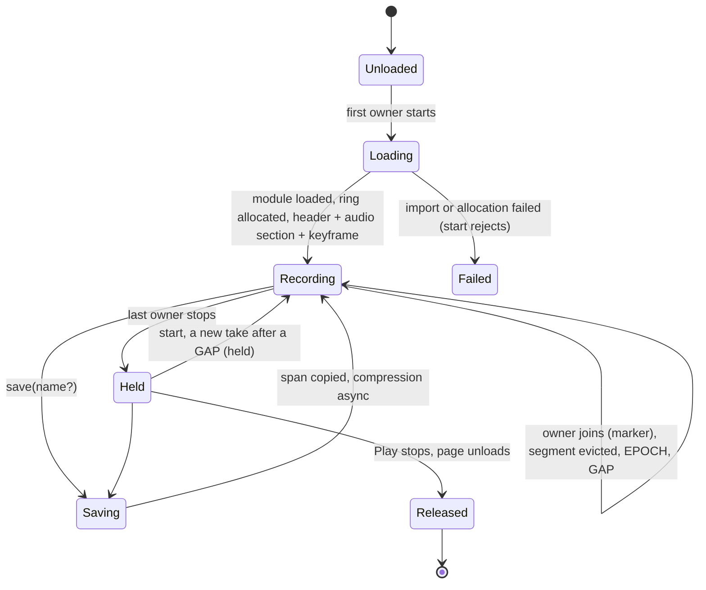
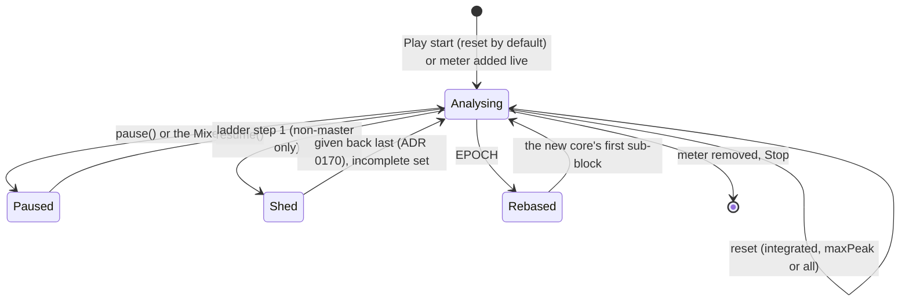
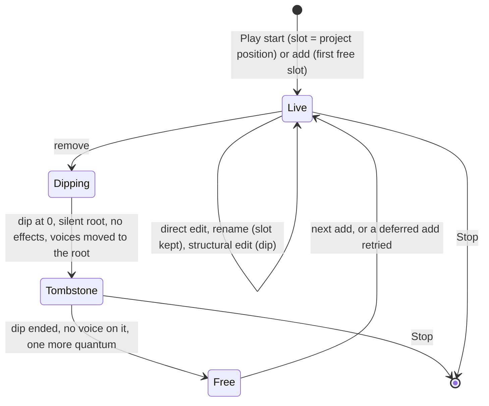
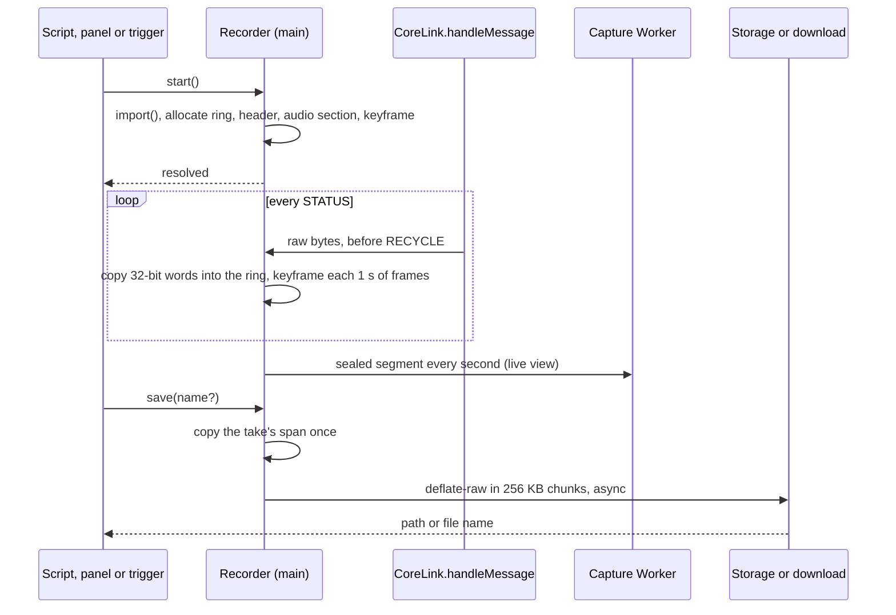
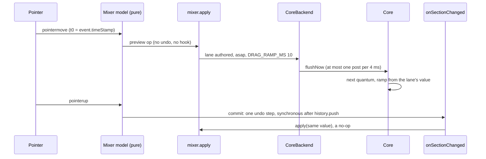
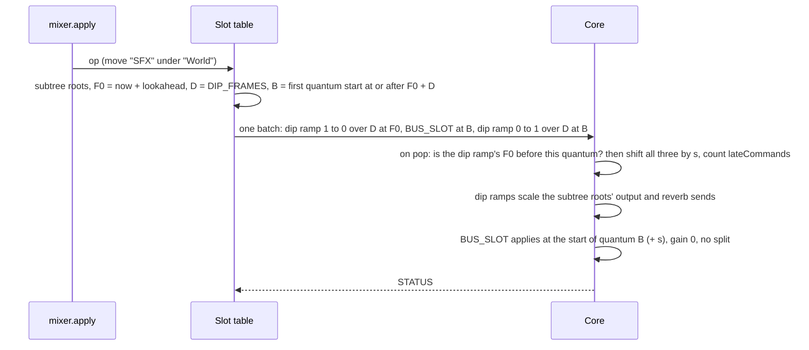
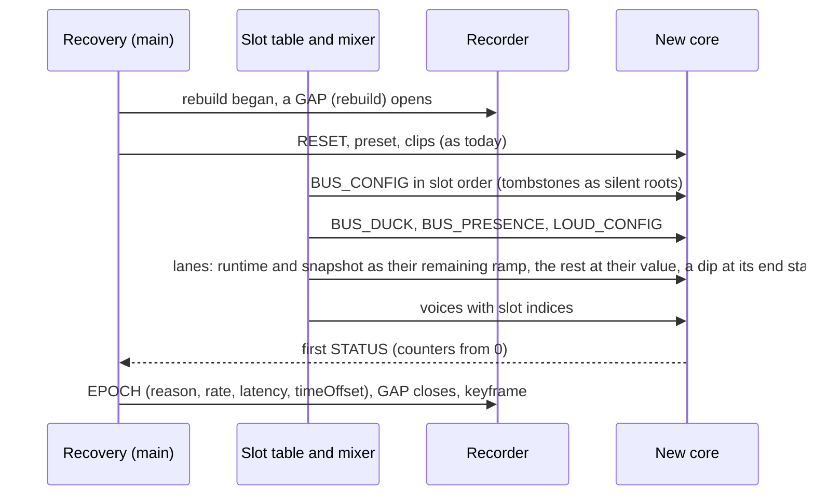
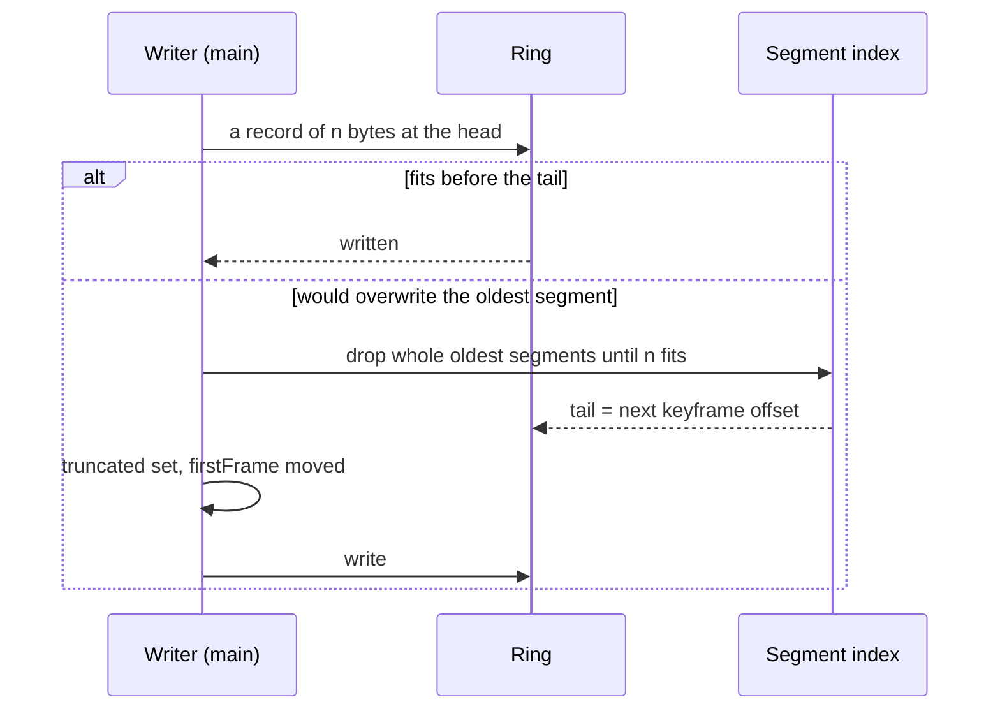
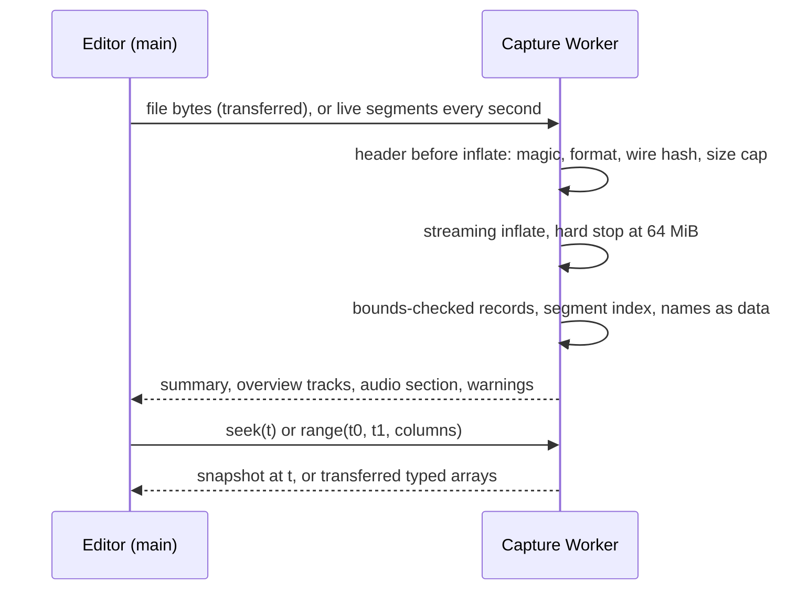

# 0171 audio mix: system architecture (M5)

The architect's design for ADR 0171 (Accepted 2026-11-12; its "RFC round (revision 2)", changes 1–35, and "Owner decisions (accepted)" win over the text above them). **Revision 2 (round 2B):** the coordinator's rulings R1–R25 ([rulings.md](rulings.md)) are applied, and §14 resolves every item of the senior engineer's review ([review-round2-senior.md](review-round2-senior.md)). It extends [0157's architecture](../0157-audio-core/architecture.md) (**[A157 §n]**), [0162's](../0162-audio-spatial/architecture.md) and [0166's](../0166-audio-music/architecture.md) (**[A166 §n]**) and doesn't repeat them. The host, the batch, STATUS, the clock map, the hard rebuild, the adaptive cap, the shedding ladder and the due list work as there unless a section here says otherwise.

Its companion, `api-and-models.md` (**[API §n]**, round-1 numbering), owns every byte, name and format:
- the public API and the `audio` settings;
- the wire and ABI (§4) and the capture file (§5);
- mix operations, the slot table as data and the SDK hook (§6);
- the editor models (§7), the test plan (§10) and the task table (§11).

This file owns components, channels, lifecycles, timing, constants, memory, performance, failure handling, observability and platforms. Field lists are the API's; this file names fields only where a behaviour depends on them. What it still needs from [API] is in [contracts-architect.md](contracts-architect.md).

**Evidence.** **[S]** is `spikes/audio-mix/README.md`; **[S1]** `loudness/`, **[S2]** `cpu-clock/`, **[S3]** `capture/`, **[S4]** `mix-core/`. They ran on the shared 4-vCPU container: p50 and p99 are usable, p99.9 and max are not. S3's main-thread timings ran at load ≈ 2.0 (record change 31). **(est.)** marks an unmeasured number and **[U]** an unverified fact. A quantum is 128 frames, 2,667 µs at 48 kHz.

**The floor conversion (record change 30; owner item O3).** ADR 0169 fixes the floor (Android 14, Chrome 113, an emulated Pixel 8 with 2 GB and 4 cores) but gives no instruction-to-time factor. This design uses **0.6 ns per metered wasm instruction on the floor (est., unverified)**: M4's container calibration of 0.075 µs per 1k instructions ([A166 §7.1]) times the 8× phone slowdown M4's spike assumed (`spikes/audio-music/README.md:89`). A ≈ 15-minute timed run on the owner's Pixel 8 profile settles it. Instruction counts are the gate.

**Code facts this design rests on (read 2026-11-12).**
- **STATUS today** is a 176 B header with no spare word (`audio-wire/src/schema/status.rs:72`) and a worst case of 16,192 of 16,384 B (`schema.rs:73-74`).
- **The shell** reads `Date.now()` once per `process()` (`worklet/processor.ts:48`) and writes its own STATUS fields after `myco_audio_status_take` (`worklet/coreDriver.ts:1040-1046`). A post with no pooled buffer is skipped before the take, so the core keeps its queues (`:1017-1024`). The cadence switches 6 ↔ 48 quanta without a reset (`:976-979`).
- **Work units:** `workUnits` is the last quantum's (`counters.rs:392-395`); `loadPermille` is written as 0 (`:424-425`).
- **STATUS on main:** `CoreLink.handleMessage` decodes into one reused block, then returns the buffer as RECYCLE (`core/context.ts:229-249`).
- **Rebuilds:** frames restart at 0 in a new context, whose rate may differ (`core/clock.ts:117-129`). A stall or trap rebuild replaces the core and the shell, whose counters restart (`core/recovery.ts:32-38`).
- **The bus mix** runs deepest first, ties by index (`audio-core/src/bus.rs:386-399`). Per bus: pre-effects hook, `fx.process` (which takes the **reverb send inside the chain**, `:540`), snapshot low-pass, gain ramp, automation gain, peak meter, sum into the parent (`:529-584`). Then the reverb return, MASTER and the limiter (`:585-620`).
- **BUS_CONFIG** applies in place: kept indices keep their state (`bus.rs:277-331`). Bus indices are `project.json` positions (`core/coreBackend.ts:765-801`).
- **Bus limits:** `max_buses` is 32 on every preset (`core/context.ts:92`), equal to the project limit (`engine/audio/settings.ts:209`); at most 4 effects per bus.
- **Ducking and fades today:** ducking is decided on main from voice counts, virtual and locked included (`engine/audio/mixer.ts:200-213`, `coreBackend.ts:777-780`). Fades are linear in volume (`mixer.ts:186-188`). `mixer.configure` clears script state (`:80-90`).
- **The ladder's steps** live in `bed.rs` and `zones.rs`, after 1 s of underruns at the cap's floor (`zones.rs:50-58, 110`). They are given back by `LadderRecovery` (ADR 0170).
- **macOS:** the desktop editor defaults to the Babylon backend (`settings.ts:224`).

## 1. Overview

M5 adds one Worker (capture decoding, editor only). Each thread's share:
- **Audio thread (shell):** a second `Date.now()` per quantum, cumulative busy time and quanta, the clock step and clock-step count (§4.3).
- **Audio thread (core):**
  - seven gain lanes with stamped ramps in the due list, and post-fader send scaling (§4.5);
  - the trigger-first order and sidechain detectors (§4.6);
  - loudness taps with a 32-entry sub-block ring (§4.4);
  - section work-unit totals;
  - the structural sequence and the convolver run-out (§4.7);
  - the ladder's new first step (§4.8).
- **Main (engine):**
  - the lazily loaded recorder writing the profile stream into a preallocated ring (§4.1, §4.2);
  - loudness statistics behind `Bus.loudness`;
  - the CPU window and refit;
  - `mixer.apply` and the session slot table (§4.7).
- **Main (editor):** thin views over pure models, drawn on canvas within 2 ms a frame.
- **Capture Worker:** inflate, bounds-checked decode, segment index, reconstruction, for files **and** the live ring (R17).

## 2. Lifecycles

### 2.1 The recorder

The recorder module is loaded by `import()` on the first start (record §7; owner decision 2). Its **owners** are the Profiler panel (while open in Play), `Audio.capture` and the export's built-in trigger; one ring serves them all (record change 33).

- **Held** keeps the ring so `save()` after `stop()` works.
- **A start from Held** begins a new take after a GAP; `save()` writes from the latest take's start keyframe (R16).
- **Released** frees the ring when the play Engine is disposed; the Worker keeps its decoded copy, so the timeline stays inspectable after Stop.

### 2.2 A metered bus

Master (the final output) is always metered; up to 8 other buses carry `meter: "loudness"`.

Two flags persist until a reset:
- **`incomplete`:** sub-blocks were lost, or a span was shed.
- **`tainted`:** a monitor control or Compare touched this meter (R20).

`elapsed` counts Analysing time only.

### 2.3 A bus slot

- **A tombstone** is a silent root: lanes held at 0, no effects, no sentinel on the wire (R9).
- **Replay and Stop:** the table is replayed as it stands on a rebuild (§3.4) and discarded at Stop; the next configure remaps by name from project order (`core/context.ts:875-891`).

## 3. Interactions

### 3.1 Capture start, stop and save

- **The tap** sits between the decode and the RECYCLE (`core/context.ts:239-247`), the only place the raw bytes exist. The copy goes through the handler's existing `DataView` in 32-bit words: no per-block allocation, and NaN payloads survive.
- **Save** copies the span once, so recording continues during compression.
- **Rotation:** Tauri desktop and Android write through `Storage.save(…, "cache")` and rotate the built-in trigger's files at **16**, oldest deleted first. The web downloads a Blob and stops at 16 per session with a message, since a download can't be deleted (R16).

### 3.2 A direct live edit: a fader drag

- **One law (R2):** interactive edits are **asap, never stamped**. A stamp waits for the lookahead, 67 ms at 30 fps (`lookahead.ts:27-31`).
  - Drags ramp over **`DRAG_RAMP_MS` = 10**; a 5 ms ramp leaves plateaus between 16.7 ms pointer steps.
  - Toggles (mute, solo, monitor) ramp over **`BUS_MIN_RAMP_MS` = 5**.
  - `frames = 0` is a literal step, used only by replay and RESET.
- **The gate** (≤ 50 ms, record change 21) is measured on the audio clock, from `event.timeStamp` to the first changed rendered sample, p95 over 100 drags. Device output latency is reported beside it, not inside it.
  - Budget: handler ≤ 2 ms (est.), the post [U], ≤ one quantum (2.7 ms), and the limiter's 72 frames: ≈ 10 ms plus the post (est.). The value arrives 10 ms after the first changed sample.
- **Previews bypass the hook** (R22): the hook fires for drafts entering the undo history. Only the commit goes through it, and re-applying a value the mixer holds is a no-op.

### 3.3 A structural edit: one stamped sequence (R8)

These edits take one path (record change 19): re-parenting, a mid-tree insert, effect reorder or removal, removing a send, removing a bus.

- **Timing:** heard within lookahead + 2 × `DIP_FRAMES` + ≤ one quantum (≈ 73–110 ms at 60–30 fps). A structural edit isn't under the fader gate.
- **Affected roots:**
  - the moved bus for a re-parent;
  - the edited bus for effect and send edits;
  - the children being re-parented for a mid-tree insert;
  - the removed bus (and each removed descendant) for a removal.
  - A **voice** moved to another bus dips alone with M4-0's per-voice FADE and `SET_PARAMS bus` records, from the same F0.
- **Effects need no stable slots.** Under the dip the edited bus's chain is rewritten whole and its filter and compressor state may reset. S4's slot-shift clicks came from a reset at full gain; here it happens at gain 0 with the send also at 0 (§4.5). Only buses need stable indices.
- **The late-batch rule.** The three records travel as one **linked sequence** (a sequence tag the API encodes, C27), and main never splits it across batches.
  - **Detection:** when the scheduler pops the sequence's dip-down record, the core compares its start frame with the first frame q of the quantum being rendered. The sequence is late if F0 < q.
  - **Shift:** it adds s = ⌈(q − F0) / 128⌉ × 128 to all three records' frames. The dip still starts from 1, `BUS_SLOT` still applies at a quantum start with the lane at 0, and the dip-up still follows. This mirrors M4's group rebase of pending records (`due.rs` module doc, "Parked records").
  - **Counting:** `lateCommands` + 1 and `maxLatenessFrames` = max(·, s), once per sequence, not per record.
  - **No new STATUS field:** main learns the shift from `maxLatenessFrames` only when it needs to (debug).
- **Serialisation.** One sequence is in flight; structural ops of one display frame coalesce into one sequence. A later sequence is stamped at or after the planned end (B + D) of the one before. If the earlier one was shifted, the core shifts the later one to its end, so two dips never overlap.
- **Removing the last reverb send** no longer cuts the tail. The shared convolver runs until its input has been silent for the IR's length plus `IDLE_MARGIN_QUANTA` (`zones.rs:116`), then resets, so a later send never replays a stale tail (R11, task Rv1).

### 3.4 Rebuild with slot-table replay (R12)

- **Lanes:** a 5 s fade continues as its remaining ramp. The `authored` and `monitor` lanes and a drag replay at their value. A dip in flight replays as applied (new layout, lane 1). RESET settles lanes on their targets, as `bus.rs:437-452` does today.
- **Counters** restart at 0; main never subtracts across an epoch.
- **Loudness:** each core `seq` restarts and the first take sets `reset`. Main reseeds each feed and keeps its histograms, so integrated continues; the dead time contributes nothing.

### 3.5 Hidden tab and gaps

| `audio.background` | Audio thread | STATUS | Stream | Loudness |
|---|---|---|---|---|
| `play` | runs | flows (128 ms idle) | continues; keyframes keyed on STATUS frames | continues |
| `mute` | runs, MASTER to 0 over 50 ms (`core/background.ts:5`) | flows | masterChange record | taps continue; target check suspended |
| `pause` | suspended after 30 ms (`background.ts:7`) | none | **GAP (paused)**; frames don't restart, so no EPOCH | elapsed stops; not `incomplete` |

A GAP is written only from known events (R14):
- `paused`, under `audio.background: "pause"`;
- `rebuild`, from the failure to the new core's first STATUS;
- `held`, a restart from Held;
- `dropped`, a later link's back-pressure, with a seq range;
- `recordTooLarge`.

Skipped posts aren't gaps: the core keeps its queues and the totals bridge them. A reader may draw an implicit gap where consecutive STATUS frames jump by more than **`GAP_STALL_MS` = 1,000 ms** of frames (`deviceChange.ts:21`).

### 3.6 Keyframe eviction

The tail is always a keyframe, so any kept span decodes alone ([S3]). A record that doesn't fit before the buffer's end follows a ring-only WRAP marker at offset 0. The saver strips WRAP markers.

### 3.7 Opening a capture, and the live view

- **Refusal** of another wire names both versions and says "re-record with this build". A differing `audio` section only warns.
- **Live (R17):** the recorder hands a copy of each sealed segment (≤ 1 MB at 1,024 voices, est.) to the same Worker. Live and file views share one decoder, off the UI thread.
- **Targets:** open ≤ 2 s for a 32 MiB ring; seek < 16 ms. S3 measured 0.24–0.83 s and 0.2–0.7 ms p50. Pf3a's "redraw under 2 ms" covers scrubbing a live recording.

### 3.8 Stop and "Compare with Play start"

- **Stop:** edits are already in `project.json` as undo steps. The slot table is dropped, and monitor mute and solo are cleared (never saved).
- **Compare** applies `diffOps(current, playStart)` through `apply`, with no undo entry and no save; structural parts take §3.3's path. Pressing it again reverses the swap. Each swap writes a marker. Meters are **tainted** and the target check is suspended while Compare is active (R20).

## 4. Mechanisms

### 4.1 The stream and its clock

**Records** (byte forms [API §5.3]):
- raw STATUS blocks;
- main events with reason codes;
- keyframes;
- EPOCH and GAP;
- names, markers and mix operations.

**Clock fields.** Every record carries **(epoch, frame, seq)** (record change 1):
- `epoch` counts new cores since the recording began.
- `frame` is in the current context's frames. For STATUS it is `currentFrame`, the frame after the last rendered quantum (`audio-core/src/status.rs:152-158`). For a main event it is the frame its command takes effect, or F_now for asap work; main events also carry `performance.now()`.
- `seq` is one counter on main, +1 per record.

**Order** is (epoch, frame, seq) and the ring is in seq order. Disorder is bounded:
- STATUS frames trail now by one block plus a main stall;
- stamps lead by the lookahead (≤ 100 ms) plus music's prime lead (≤ 330 ms healthy, [A166 §9]);
- a stamp more than 1 s past the newest STATUS frame is recorded at F_now with the **`deferred`** flag, its stamp in the payload.

So a reader sorts within one segment (R14).

**The heard clock** (R14):
- A record at core frame f is heard when `Audio.time` = f / rate + timeOffset. `Audio.time` is already the heard clock in core frames (`clock.ts:6-10`).
- When a STATUS with `currentFrame` f is posted, the listener hears ≈ f − limiter latency − output latency.
- The profiler's axis is continuous seconds across epochs, from each EPOCH's `timeOffset`.

**EPOCH** is written at the first STATUS of every new core: start, trap, stall, device, rate, latency, mode (one per `RebuildReason`). It carries the rate, the limiter latency and `timeOffset`, and a keyframe follows. A resumed context is a GAP, not an epoch.

**The live link on paper** (record change 1):
- HELLO is the capture header plus the names so far.
- Frames are one WebSocket message per sealed chunk (≤ 64 KB).
- A jump in `seq` is a loss; resync waits for the next keyframe.
- Back-pressure drops whole segments and sends a GAP (`dropped`, seq range).
- Names that appear mid-session travel as NAMES records.

The file already has every one of these fields, so the link adds transport only.

### 4.2 The recorder ring

- **Layout:** one `ArrayBuffer` of R bytes plus a preallocated segment index (**`KEYFRAME_INDEX_SLOTS` = 4,096**, 68 minutes). Records are contiguous.
- **Keyframes** are written in the STATUS handler when the block's frame has moved **1,000 ms of frames** (`keyframeIntervalMs`, R13) past the last keyframe, and at each epoch's first block. They key on rendered frames: neither rAF (stops when hidden) nor a block count (stretches to 8 s at the idle cadence).
- **Keyframe content** (byte form [API §5.5]):
  - voice rows ≤ 24 B, capped at **8,192** (the logical maximum, `audioSettingsModel.ts:207`), so the largest keyframe stays < 200 KB, under the 256 KB record cap;
  - each lane's value and target;
  - each metered bus's readings (M, S, I, LRA, max true peak, max momentary, elapsed, flags);
  - the active snapshot, event and music state.
- **The reader** recomputes M and S exactly from raw sub-blocks and holds I and LRA from the last keyframe (≤ 1 s stale). A truncated capture therefore shows the live integrated value.

**Sizing:** R = min(preset size, 8 MiB × `navigator.deviceMemory`), never below 4 MiB. Without `deviceMemory` (WebKit, Firefox), R is the preset size. Browsers report 0.25–8 in powers of two, and tests must not assume other values.

| | low | default | high | editor |
|---|---|---|---|---|
| Preset size (record §8, est.) | 4 MiB | 16 MiB | 32 MiB | 32 MiB |
| On the floor (2 GB) | 4 MiB | 16 MiB | 16 MiB | 16 MiB |

Raw rates are S3's 1.70 / 4.08 / 10.85 MB per minute at 64 / 256 / 1,024 voices (synthetic), plus ≈ 0.7 MB per minute of M5 STATUS. The 0.7 assumes R19's layout: a 256 B header, 16 B per metered bus, duck items for rule targets only (est.).

| R | 64 voices | 256 | 1,024 |
|---|---|---|---|
| 4 MiB | 1.7 min | 0.9 | 0.35 |
| 16 MiB | 7 min | 3.5 | 1.5 |
| 32 MiB | 14 min | 7 | 2.9 |

- **Saved size** is S3's **raw** compressed column: 0.27 / 0.84 / 2.45 MB per minute (R15). A full 32 MiB ring saves to ≈ 7 MB at 1,024 voices.
- **Truncation:** the first eviction past a take's start sets `truncated`.
- **Owners** share the ring; a second owner's start writes a marker.
- **Allocation:** the STATUS copy and event writes use preallocated views. Names (first use), saves and segment hand-offs are the only allocations.

### 4.3 The CPU figure (R18)

**Shell.**
- t0 is the `Date.now()` already read (`processor.ts:48`); t1 is a second read after `driver.process`, so shell work counts.
- Per quantum, d = t1 − t0. A d below 0 or above **1,000 ms** counts 0 and increments `clockSteps` (u16, saturating), since the wall clock can step.
- `busyMsTotal += d`, `quantaTotal += 1`, both cumulative **f64**.
- `clockStepMs` is the smallest non-zero difference between consecutive t0s.

**Core:** five cumulative f64 work-unit totals: voices; buses and effects (lanes and sidechain included); spatial; music; loudness. The wire's `loadPermille` stays 0, reserved and superseded by change 6.

**Main** keeps a 32-sample ring of the totals from each STATUS of the current epoch. The window is chosen **by quantum count**: newest sample back to the newest sample at least W quanta older. The figure is 1,000 × Δbusy / (Δquanta × quantum ms), so cadence switches and skipped posts change only how many samples a window spans, not its bias. A window never crosses an EPOCH. One TypeScript implementation is tested with a fake clock.

| Clock step | Window W | p50 error | Profiler |
|---|---|---|---|
| ≤ 1 ms | **`CPU_WINDOW_QUANTA` = 96** (256 ms) | 7–15 permille [S2] | "256 ms average" |
| 2 ms (Firefox resistFingerprinting [U]) | 384 (1 s) | ≈ 3–12 permille (est.) | "1 s average" |
| **> 2 ms (`CPU_COARSE_STEP_MS`)**, or no step after 1 s | — | — | hidden: "clock too coarse (n ms)" |

**Section shares:**
- Main fits per-section coefficients by non-negative least squares over 64 windows (16 s), pulled toward the build constants (`cap.rs:99-108`). It falls back to one scalar when the fit is ill-conditioned.
- Shares are drawn as "estimated share". S2 found 1–20 permille p50 on a JS kernel [U on the real core].
- The fit never feeds the voice cap.

**The click headline** is underruns, late commands and `minSlackFrames` (record change 8).

### 4.4 Loudness data flow

**Taps.**
- **Master:** the final output after the reverb return, MASTER and the limiter (record change 11), with full true peak.
- **Other metered buses:** where the peak meter is (`bus.rs:569`): after effects, snapshot low-pass and all seven lanes (post-fader).

**Audio thread** (per metered bus, [S1]):
- **K-weighting:** f64 biquads, coefficients from the core's rate.
- **Sub-blocks:** the L + R mean square per sub-block of round(0.1 × rate) frames, into a **32-entry ring** with a sequence number.
- **True peak:** 4×, 48 taps, every quantum on master. On other buses it runs only when the sample peak reaches the active target's ceiling − 6 dB; skipped quanta are counted. The reported peak is max(true peak, sample peak).

**The take.** `myco_audio_status_take` runs only with a pooled buffer in hand. Each take carries, per metered bus, the sub-blocks since the last take and the peak since then, then advances the sent cursor. A main stall of up to **3.2 s loses nothing**; past that the oldest are overwritten and main sets `incomplete`. The STATUS item layout is [API §4.3] as revised under R19.

**Main** (per metered bus):
- momentary from 4 sub-blocks and short-term from 30, `-Infinity` until filled;
- gated integrated (−70 LUFS absolute, −10 LU relative);
- LRA (3 s blocks, 1 s hop, −20 LU, 10–95 %), from two 1,000-bin histograms (24 kB, within 0.11 LU [S1]).

Cost ≤ 50 µs per second for 9 buses (est.).

**Flags (R20).**
- **`tainted`** comes from monitor controls and Compare only: monitor mute of X taints X, its ancestors and master; a solo taints every meter.
- **Target check suspended:** while MASTER ≠ 1, under any mute (script, authored, hidden tab), and under monitor controls (`target.state = "suspended"`).
- **`maxTruePeak` lower bound:** marked when quanta were gated and the reading is below the ceiling. A ceiling breach by a natural signal is never missed; crafted signals are [U].
- **`incomplete`:** lost sub-blocks or a shed span.

**Rebuilds** reseed feeds and keep histograms. Sub-block energies are rate-independent, so a rate rebuild changes nothing on main.

**Readings to the editor:** `Bus.loudness` is updated in the STATUS handler. The Profiler reads the Worker's decode of recorded STATUS through the same `LoudnessStats` code, so live and file readings agree.

### 4.5 Gain lanes, stamped bus ramps and post-fader sends

**Composition (R1).** A bus's gain is the per-sample product of seven lanes:

| Lane | Value | Writer | Law |
|---|---|---|---|
| `authored` | `authoredVolume` × (authored mute ? 0 : 1) | editor ops | asap; drags 10 ms, toggles 5 ms |
| `runtime` | script `volume`, its fade, (script `mute` ? 0 : 1) | scripts | `fadeTo` stamped linear at the batch's first frame for its exact length; sets and toggles ≥ 5 ms |
| `snapshot` | the active snapshot's multiplier | `snapshot()` | stamped linear, the transition's length |
| `monitor` | (monitor mute ? 0 : 1) × the solo gate (script or monitor solo, `mixer.ts:233-238`'s rule over the slot tree) | main | asap, 5 ms |
| `dip` | the structural dip | slot table | stamped, `DIP_FRAMES` (§3.3) |
| `duck` | min over rules (§4.6) | core | per-quantum computer, per-sample interpolation |
| `automation` | 0158's bus automation | core (`bus.rs:561-568`) | as today |

Authored 2 × runtime 2 = 4 is legal; the limiter catches it.

**Due-list class B (R6, record change 27).**
- **Routing:** a stamped `BUS_RAMP` goes into the due list (`due.rs`) as class B, instead of `Class::Quantum`'s split (`due.rs:85-93`).
- **Per quantum, each bus:**
  1. if every lane is settled, it applies one scalar, the product, in a vectorised loop;
  2. otherwise it builds a 128-sample curve from the settled product, and each ramping lane multiplies in its hold, ramp and hold segments by a start-sample compare (S4: 1,692–1,796 instructions, exact to 5e-8).
- **Ramp start:** from the lane's value at its start frame, so a retarget never jumps. Two records for one lane apply in frame order.
- **Overflow:** a record that finds the due list full applies at the quantum's start and counts `busRecordsEarly`. It never splits; `splitQuanta` stays 0.

**Bit-identity (R3).** An asap `BUS_RAMP` on a lone lane uses `Ramp::next`'s per-sample arithmetic, and lanes at identity are skipped, not multiplied by 1.0. Every existing bus golden keeps its digest with a harness sending `BUS_RAMP` where it sent `BUS_MIX`. Only stamped ramps and R11's named change get new goldens.

**Post-fader sends (R11; recommendation for owner item O1).**
- **Today:** the reverb send is taken inside `fx.process` (`bus.rs:540`) at the reverb slot's position in the chain, before the snapshot low-pass and every gain stage (`:541-568`). So no lane can silence it, and a muted bus still feeds the reverb.
- **Design:**
  - **Capture:** `fx.process` writes the reverb slot's contribution (send × the signal at that slot) into a per-bus **scratch** (planar stereo, 2 × 128 f32 = 1 KB, one buffer shared by all buses since they mix one at a time), not into the convolver's input.
  - **Scale:** once the bus's gain curve or scalar for the quantum exists (above), the core multiplies the scratch by it and adds it to the convolver input.
  - **What stays as today:** the tap's position inside the chain and the snapshot low-pass, which the send still bypasses.
  - **Skip:** a bus whose gain is a settled 1 skips the multiply (bit-identical).
- **Cost:** one multiply-add pass over 256 samples per bus with a send and a non-unity gain, ≈ 0.6–1k instructions (est., vectorised). The gain curve already exists, so no lane work is added. Worst case 32 buses with sends ≈ 32k instructions; typically 2–4 sends ≈ 2–4k.
- **Which lanes:** all seven. The send follows the level the bus is heard at, so a ducked or faded music bus ducks or fades its reverb too (FMOD's post-fader send default).
- **Alternative (O1 "dip and monitor only"):**
  - the scratch is scaled only by `monitor` × `dip`;
  - a muted, faded, ducked or snapshot-lowered bus keeps feeding the reverb at its full send, as today;
  - cost and days are the same (inside Rv1);
  - no existing golden changes, so R3 holds with no exception.
- **Either way** the dip and monitor scale the send. That is what makes a structural dip safe and a monitor solo faithful (R11).

### 4.6 Sidechain and the bus order

**The tap** is pre-fader: after the trigger's effects and snapshot low-pass, before every lane (record change 25). Monitoring never changes a duck. A chain therefore ducks on the trigger's un-ducked level, as a pre-fader send does.

**Detector and gain computer:**
- **Detector, per sample:** peak (instant attack, 10 ms release) or RMS (10 ms one-pole).
- **Gain computer, per quantum:** depth = clamp((level dB − threshold) / 6 dB, 0, 1), and goal = 1 − depth × (1 − amount).
- **Smoothing:** the duck gain approaches the goal with the rule's attack (falling) and release (rising) as 63 % one-pole time constants, interpolated per sample. S4 found it within 0.024 dB of a per-sample computer.

**Presence mode (R4)** is in the core in M5-0. `BUS_PRESENCE` carries one bit per trigger slot (virtual and locked voices count, as today), stamped at the voice start or stop that changed it, so a presence duck begins on the sound's own frame. The gain approaches `amount` or 1 with the same law. Rules combine **by min** per target, in both modes.

**The order (R5).** At `BUS_CONFIG`, `BUS_SLOT` and `BUS_DUCK`, the core runs Kahn's algorithm over child → parent edges plus **level-rule** trigger → target edges, choosing deepest first, then the lowest index.
- With no level rules this is exactly today's order, so unstamped goldens stay identical.
- Presence rules add no edge: their input is a flag, not a buffer.

**Cycles.**
- **Validation** refuses any set of level rules whose edges close a cycle with the tree, naming the rules. Presence rules keep only the ancestor and self check.
- **Limits:** `MAX_DUCK_RULES` = 32, at most 8 of them level rules.
- **In the core:** a cycle that reaches it drops its last edge in rule order. That rule reads the previous quantum, and `sidechainLate` counts it.

**Staging:** M5-0 ships the order, the lanes and presence mode. M5c adds level mode (detector, rule fields, the gain-reduction meter). The order changes no sound until a detector reads a buffer.

### 4.7 The slot table and the live-edit path

**End to end:**
1. A gesture produces a model op ([API §6.2]).
2. The commit path records an undo step, and `onSectionChanged` fires synchronously after `history.push`, valid drafts only (R22). A preview calls `mixer.apply` and `flushNow()` directly.
3. `mixer.apply(op)` changes authored values, rules and snapshots and **keeps runtime state**.
4. `coreBackend` emits, by class:

| Edit | Class | Core path |
|---|---|---|
| bus volume and mute (authored) | direct | `authored` lane, asap (10 ms drag, 5 ms toggle) |
| filter frequency and Q, send level | direct | `BUS_SLOT` asap; applied in place (S4: abrupt 0.15 and 0.10) |
| compressor parameters | smoothed | `BUS_SLOT` asap; the core blends over **`COMPRESSOR_SMOOTH_MS` = 20** per quantum (R7) |
| append an effect (≤ 4) or a send, add a bus | direct | `BUS_SLOT`; new state zeroed |
| rename | none on the wire | the table's name changes; slot and state stay |
| snapshot or rule definition | direct | the active snapshot's lane retargets over 20 ms; `BUS_DUCK` asap |
| meter on or off, target change | direct | `LOUD_CONFIG` asap |
| re-parent, mid-tree insert, effect reorder or removal, send removal, bus removal, a sound's bus | structural | §3.3's stamped sequence |

**Frames:** `BUS_DUCK` and `LOUD_CONFIG` are asap only. `BUS_SLOT` (one slot, the BUS_CONFIG item layout, R7) and `BUS_PRESENCE` carry a frame, at quantum granularity for `BUS_SLOT`. `BUS_CONFIG` stays the full-tree record for init and replay. At one quantum boundary, configuration records apply in (frame, batch order). They wait in the scheduler's pending queue, not the due list, so they can't overflow it.

**The slot table** (in `coreBackend`, data [API §6.3]) maps name → slot. Every consumer that indexed buses by project position reads the slot instead: the remap, the bed plan, automation bindings, selection arrays and the replay (`coreBackend.ts:741-801`).

**Recycling (R9):** a tombstone frees when its dip has ended, no voice references it (the remap moved its voices to the root) and **`TOMBSTONE_TAIL_FRAMES` = 128** more frames have passed. Bus-local tails are at gain 0, and the reverb tail lives in the shared convolver.

**Deferred adds (R10).** An add that finds no free slot (tombstones still waiting) returns `deferred` and is retried at each recycle, normally within ≈ 40 ms. A fifth effect applies at the next Play. The edit is always kept in `project.json`, and the message says when it applies. The `liveDeferred` count is debug-only.

### 4.8 The ladder's new first step (R21)

Before the bed-idle step, the ladder pauses **non-master loudness metering**: K-weighting, sub-blocks and true peak stop on every metered bus except master. Sidechain detectors, the `duck` lane and `BUS_RAMP` are never shed.
- **Trigger:** the ladder's own (cap at its floor, 1 s of underruns, `zones.rs:110`); later steps follow a second apart, as today.
- **Skip:** with only master metered, the step isn't taken, so the audible steps aren't delayed for nothing.
- **Give-back:** last under ADR 0170 (zone 2, zone 1, bed, then loudness), so all four are back 80 s after the last underrun.
- **Saving:** up to 8 taps: 10–25 µs container p50–p99 gated, 45 µs p99 full, ≈ 0.2 ms on the floor (est.).
- **Reporting:** a new header field **`loudShed`**. `m3Shed` keeps meaning bed and zone steps, which main's zone manager reads. `Bus.loudness.pausedBy` reads "ladder" and a stream record is written; the span sets `incomplete`.

## 5. State, staleness and constants

### 5.1 State ownership

| State | Owner (writes) | Copy elsewhere |
|---|---|---|
| Authored values, rules, snapshots | editor ops → `project.json`; mixer via `apply` | slot table, keyframes, MIXOP records |
| Runtime values, fades, active snapshot | scripts via the mixer | lanes `runtime`, `snapshot` |
| Monitor mute and solo | Mixer panel | lane `monitor`; taint |
| Slot table, structural queue | `coreBackend` | keyframes; debug |
| Lane values and ramps | core | main's mirror (main wrote them); keyframes |
| Duck gain | core | STATUS duck section |
| Sub-block ring, sent cursor | core | STATUS loudness section |
| Loudness statistics | main | `Bus.loudness`; keyframes |
| Busy time, quanta, clock step | shell | STATUS header |
| Section work units | core | STATUS header |
| CPU window, refit | main | profiler; never the cap |
| Ring, segment index | recorder | file; Worker copy |

### 5.2 Staleness bounds

| Value | Normal | Under a main stall of s |
|---|---|---|
| Fader drag heard | ≤ 10 ms + post (est.); gate 50 ms | s |
| Structural edit heard | lookahead + 40 ms + ≤ 1 quantum | s; a late batch shifts the sequence |
| Duck gain on main | ≤ 16 ms (128 ms idle) | s |
| Loudness readings | ≤ 16 ms after a sub-block closes | s; nothing lost up to 3.2 s |
| CPU figure | ≤ 256 ms window + one block | s |
| Keyframe | 1 s of frames | at the next STATUS handled |
| Live Profiler | ≤ 1 s (a sealed segment) | s + 1 s |

### 5.3 Constants

Values marked "design" are estimates until M5's tests confirm them. Names the API publishes are in `code`.

| Area | Constant | Value | Source |
|---|---|---|---|
| Stream | `keyframeIntervalMs` | 1,000 ms of rendered frames | R13 |
| | reorder window; `deferred` | one segment; a stamp > 1 s past the newest STATUS frame | R14 |
| | `GAP_STALL_MS` | 1,000 | `deviceChange.ts:21` |
| Ring | `RING_BYTES` low / default / high / editor | 4 / 16 / 32 / 32 MiB | record §8 (est.) |
| | device cap; floor | 8 MiB per GB of `deviceMemory`; 4 MiB | design |
| | `KEYFRAME_INDEX_SLOTS` | 4,096 | R13 |
| | keyframe voices; row | 8,192; ≤ 24 B | R13 |
| Capture | `CAPTURE_MAX_UNCOMPRESSED_BYTES` | 64 MiB | R16 |
| | largest record | 256 KB | R16 |
| | `CAPTURE_TRIGGER_MAX_FILES` | 16 (rotation; the web stops) | R16 |
| | open; seek | ≤ 2 s; < 16 ms | [S] targets |
| CPU | `CPU_WINDOW_QUANTA` | 96; 384 at a 2 ms step | R18; [S2] |
| | `CPU_COARSE_STEP_MS` | 2 (coarser hides) | R18 |
| | per-quantum clamp | 0..1,000 ms, else `clockSteps` | design |
| | refit window | 64 windows (16 s) | design |
| Loudness | meters | master + up to 8 | record change 12 |
| | sub-block; core ring | round(0.1 × rate); 32 (3.2 s) | [S1]; change 14 |
| | gates; histograms | −70 / −10 LU, LRA −20 LU; 2 × 1,000 bins | [S1] |
| | true peak | 4×, 48 taps; gate at ceiling − 6 dB | [S]; change 14 |
| | core state | 1,512 B per meter + 128 B ring | [S1] |
| Lanes | count | 7 | R1 |
| | `DRAG_RAMP_MS`; `BUS_MIN_RAMP_MS` | 10; 5 | R2 |
| | `FADER_COALESCE_MS` | 4 | R2 |
| | `DIP_FRAMES` | round(0.020 × rate) (960 at 48 kHz) | R8 |
| | `COMPRESSOR_SMOOTH_MS` | 20 | R7; [S4] |
| | fader gate | ≤ 50 ms, audio clock, p95 | R2 |
| Sidechain | detector | peak: instant, 10 ms release; RMS: 10 ms | design |
| | knee | 6 dB | design |
| | `MAX_DUCK_RULES` | 32, at most 8 level | R5 |
| Slots | core slots; effects | 32 incl. tombstones; 4 per bus | `context.ts:92`; `bus.rs` |
| | `TOMBSTONE_TAIL_FRAMES` | 128 | R9 |
| Reverb | run-out | IR length + `IDLE_MARGIN_QUANTA` of silence, then reset | `zones.rs:116`; R11 |
| | send scratch | 1 KB, shared | design |
| Ladder | loudness step | first; skipped with master only; back last | R21 |
| STATUS | buffer; header | 20,480 B × 8; 256 B; worst ≈ 17,824 B ([API §4.3]) | R19 |
| Main | recorder; loudness stats; drawing | ≤ 1 ms/s at 1,024 voices; ≤ 50 µs/s; ≤ 2 ms per frame | record §3, §8, change 10 |

## 6. Memory

| Item | Size |
|---|---|
| Recorder ring (while recording or held) | 4 / 16 / 32 MiB; ≤ 16 MiB on a 2 GB device |
| Save, transient | one copy of the take's span + the compressed output (0.27 / 0.84 / 2.45 MB per minute recorded) |
| Capture Worker | ≤ 64 MiB decompressed + index and overview (≈ 2–5 MB, est.) |
| STATUS pool | +32 KB (8 × 4 KB) |
| Core: loudness | 9 × (1,512 + 128) B = 14.8 KB on every preset |
| Core: lanes, duck followers, detectors, send scratch | ≈ 9 KB (est.) |
| Main: loudness histograms | 9 × 24 kB = 216 kB |
| Main: CPU ring, refit, slot table | < 8 KB |
| Recorder module (JS) | ≈ 15–30 KB minified (est.); **0** in a game that never captures |

**Wasm (R25).** From the committed 319,799 B, loudness (≈ 21 KB, [S]) plus lanes, sidechain, order, sends and the run-out (est. 6–10 KB, [U]) project ≈ 347–351 KB. That passes the 327,680 B gate in `native/audio/build.mjs`: a tripwire move to raise and record in the build log, not a reason to cut.

## 7. Performance

### 7.1 The model

Floor µs = instructions × 0.6 ns (est.).

| Term (per quantum) | Instructions | Container p50 / p99 µs | Floor µs (est.) | Source |
|---|---|---|---|---|
| Loudness, master, full true peak | 42.6k | 2.2 / 3.1 | 25.6 | [S1] |
| Loudness, a gated bus, ordinary content | 23.9k | ≈ 1.3 / 3.1 | 14.3 | [S1] (8-bus ÷ 8) |
| Loudness, a bus at full true peak (hot) | 42.6k | ≈ 2.6 / 5.6 | 25.6 | [S1] |
| Sidechain, one level rule | 8.1k | 0.79 | 4.9 | [S4] |
| Duck gain applied | 1.0k | 0.13 | 0.6 | [S4] |
| 8 level rules on one target | 90.9k | 5.0 / 11.4 | 54.5 | [S4] |
| Presence rule | ≈ 0.2k | < 0.05 | 0.1 | est. |
| A ramping lane | 1.7–1.8k | 0.11–0.23 | 1.1 | [S4] |
| Today's ramping bus, for comparison | 5.4k | 0.22 | 3.2 | [S4] |
| Post-fader send scaling, per bus with a send | ≈ 0.6–1k | < 0.1 | 0.5 | est. |
| Compressor blend, per gliding quantum | ≈ 0 | — | — | [S4] |

### 7.2 Scenes (every preset)

Every preset may meter master plus 8 (record change 29); the ladder sheds the non-master part first.

| Scene | Contents | Instructions | Floor (est.) | Container p50 / p99 | Allowance |
|---|---|---|---|---|---|
| Typical | master + 3 gated; 2 level rules; 2 lanes ramping; 2 sends | ≈ 127k | 76 µs (2.9 %) | ≈ 8 / 15 µs (est.) | **0.015 ms** |
| Worst | master + 8 full; 8 level rules; a snapshot over 32 buses + 8 fades; 32 sends | ≈ 407k (lanes −101k against today's 32 × 5.4k) | 244 µs (9.2 %) | ≈ 32 / 65 µs | **0.10 ms** |

The record's worst case (§8, "master + 7") predates change 12's "plus 8". Nine full taps at p99 are ≈ 50.6 µs. With 50 % headroom the loudness line is 0.08 ms, and M5's total 0.10 ms, a tripwire move for the build log. The record's "default / low" row assumed low meters master only, which change 29 superseded.

### 7.3 Main thread, editor and Worker

| Item | Basis | Per second at 64 / 256 / 1,024 voices |
|---|---|---|
| STATUS word copy | S3's memcpy 0.6 / 1.4 / 3.2 µs p50, word copy est. 1.5× [U] | 0.06 / 0.13 / 0.30 ms |
| Keyframe | 5.5 / 18 / 63 µs p50 [S3] | 0.01 / 0.02 / 0.06 ms |
| Events | 0.1–0.2 µs × 92 / 269 / 1,175 per s [S3] | 0.01 / 0.05 / 0.24 ms |
| Loudness stats, CPU window and refit | est. | ≤ 0.08 ms |
| Segment hand-off to the Worker | one copy ≤ 1 MB per s (est.) | ≈ 0.05–0.2 ms |
| **Recorder total** (target ≤ 1 ms/s at 1,024, zero allocation per block) | est.; S3 ran at load ≈ 2 | **≈ 0.2 / 0.35 / 0.9 ms** |

- **On the floor (×8, est.):** ≈ 1.6 / 2.8 / 7 ms per second; not gated (unverified).
- **Editor drawing ≤ 2 ms a frame:** canvas only, the timeline appends columns and blits, and Preact never renders per STATUS block.
- **Save:** one span copy (≈ 5–10 ms for 32 MiB, est.) and chunked compression; browser `CompressionStream` speed is [U].

### 7.4 Re-measurements owed (record change 31)

| Run | Settles | Cost |
|---|---|---|
| M5 metered scenes on the real core (typical, worst, ladder step) | §7.2 | Bn1, Bn3, Bn4; minutes |
| S3 re-run idle, with the word copy | §7.3's recorder line | ≈ 4 min |
| Real-scene capture rates through the loopback host | §4.2, §6 | ≈ 5 min |
| Main-to-worklet post under a busy frame | the gate's last term | one spec, ≈ 1 min |
| The floor conversion | every floor µs | ≈ 15 min, owner (O3) |

## 8. Failure modes

| Failure | Detection | Handling | User-visible | Counter |
|---|---|---|---|---|
| Ring full | writer | evict whole oldest segments | timeline starts later; truncated | `segmentsEvicted` |
| Record over 256 KB | writer | not written; GAP (`recordTooLarge`) | a hole | `recordsDropped` |
| Recorder fails to load or allocate | `import()` | `start()` rejects with the reason | empty state says why | — |
| STATUS undecodable | decoder | raw bytes still recorded | Worker reports it | `statusDecodeErrors` |
| Posts skipped | shell | core keeps queues and loudness cursors | none | shell `skipped` |
| Main stall > 3.2 s | loudness `seq` jump | oldest sub-blocks lost | `incomplete` | — |
| Oversized STATUS (unreachable by the worst case) | shell (`coreDriver.ts:1032`) | block dropped, buffer returned; that take's sub-blocks lost | `incomplete` | shell stats |
| Wall-clock step | clamp | that quantum counts 0 | none | `clockSteps` |
| Coarse clock | clock step | widen to 1 s or hide | "clock too coarse (n ms)" | — |
| Rebuild | recovery | EPOCH + keyframe; R12 replay | the rebuild's gap; integrated continues | recovery counters |
| Structural batch late | dip-down's F0 before the quantum | the whole sequence shifts by s | the dip lands later | `lateCommands`, `maxLatenessFrames` |
| Two structural edits close together | slot table; core | serialised, never overlapping | the second dip waits | — |
| Edit during a rebuild | slot table | queued; the replay applies its end state | applied when the core is back | — |
| `pause` while hidden | visibility | GAP (`paused`) | elapsed pauses | — |
| MASTER ≠ 1, mutes, hidden mute | backend | target check suspended | "target check paused" | — |
| Monitor control or Compare | Mixer panel | tainted; target suspended | banner | — |
| Add with no free slot; fifth effect | slot table | deferred, retried at recycle; fifth effect at next Play | "applies when …" | `liveDeferred` (debug) |
| Due list full of bus records | core | applied at the quantum's start | none (≤ 2.7 ms early) | `busRecordsEarly` |
| Level-rule cycle reaching the core | sort | last edge dropped, previous-quantum read | none | `sidechainLate` |
| Last reverb send removed | core | convolver runs out, then resets | the tail rings out | — |
| Ladder under pressure | ladder | non-master loudness pauses first | `pausedBy: "ladder"`, then `incomplete` | `loudShed` |
| Capture from another wire | header | refused naming both versions | "re-record with this build" | — |
| Corrupt capture or deflate bomb | Worker bounds; 64 MiB | refused with the reason | message | — |
| Save fails | Storage, download | `save()` rejects; ring kept | message | — |
| `CompressionStream` missing | feature test | saved with `compressed` clear | larger file | — |
| Web trigger at 16 files | trigger | stops with a message | toast | — |
| Android release build | — | saved to app data; not pullable (owner decision 3) | guide | — |
| Babylon backend | backend kind | no STATUS; `metered = false`; presence on main | "no audio core" | capability flags |

## 9. Observability

- **Capability flags** (record change 32): `loudness`, `levelDucking`, `cpu` with a reason, `stampedBusRamps` ([API §1.3]).
- **`Audio.debug()` additions:** recorder state and sizes; the CPU window, clock step and `clockSteps`; per-meter readings and flags; the slot table (name, slot, state); `busRecordsEarly`, `sidechainLate`, `liveDeferred`; `loudShed`.
- **Profiler tracks:** underruns, late commands and `minSlackFrames` first; the CPU figure with its window label and estimated shares; voices with reasons; ladder and cap; bus levels, the seven lane factors and loudness; events, music, mix ops and markers; gaps and epochs drawn as breaks.

| Signal | Green | Amber | Red |
|---|---|---|---|
| underruns, late commands | 0 | — | any |
| CPU (256 ms) | < 500 ‰ | 500–800 ‰ | > 800 ‰ (est.) |
| `minSlackFrames` | > 64 | 1–64 | ≤ 0 |
| loudness `incomplete`, `tainted` | no | yes | — |
| integrated vs target | within tolerance | < 2× tolerance | ≥ 2× tolerance |
| max true peak vs ceiling | below | — | above |
| `liveDeferred`, `segmentsEvicted` | 0 | non-zero | — |
| `sidechainLate`, `busRecordsEarly`, `recordsDropped` | 0 | — | any |

## 10. Platform matrix

| | Chromium desktop (Chrome, Edge, WebView2) | Android WebView | WebKit (Safari, WKWebView, WebKitGTK) | Firefox | Babylon fallback |
|---|---|---|---|---|---|
| Stream, keyframes, events | full | full | full | full | main events and keyframes |
| CPU line | 1 ms clock [S2] | [U] | [U]; hidden if coarse | 1 ms [U]; 2 ms with resistFingerprinting → 1 s | absent |
| Loudness | full | full; floor cost §7.2 | full | full | `metered = false` |
| Level ducking | full | full | full | full | unavailable; presence on main |
| Lanes, stamped ramps, post-fader sends | full | full | full | full | lanes multiplied on main; `AudioParam` automation [U] |
| Structural edits | stamped dip | n/a | stamped dip | stamped dip | graph rebuilt; may click |
| Ring sizing | `deviceMemory` | `deviceMemory` | preset | preset | as the core |
| Saving | download; app data (Tauri) | app data; adb on debug builds [U] | download; app data (Tauri) | download | same |
| Evidence | S1–S4 headless | none | not run | not run | — |

The macOS desktop editor runs WebKit and defaults to Babylon (`settings.ts:224`). Profiling the core there needs `audio.backend: "core"`, and its CPU line is unverified.

## 11. Extension points

| Extension | M5 provides |
|---|---|
| Live editor↔device link | the framing on paper (§4.1) |
| Snapshot stacking (owner decision 7) | the `snapshot` lane becomes a product of per-snapshot lanes |
| Cross-origin isolation | a SharedArrayBuffer timer can replace the busy-time sum; the totals keep their meaning |
| Effect editing in the strip (owner decision 5) | the same ops and the same structural path |
| Pre-fader send option per bus | the send scratch can take a lane mask instead of the full product |

## 12. Where M5 follows or differs from industry practice

| Area | Follows | Differs, and why |
|---|---|---|
| Profiler data | a timestamped stream, a cursor, a file (Wwise, FMOD Studio, Unreal `.utrace`) [U] | raw STATUS for zero allocation (record change 2) |
| CPU | FMOD Core's per-category CPU | shares are estimates of one measured figure; the worklet has no fine timer [S2] |
| Loudness | FMOD's Loudness Meter on chosen buses: reset, pause, M, S, I, LRA, max true peak | master always, after the limiter; non-master true peak gated, with a lower-bound mark |
| Live mixing | Unity "Edit in Play Mode", Wwise and FMOD project data | always on; structural edits dip their subtree for 20 ms |
| Sends | FMOD's post-fader default (recommended, O1) | the tap stays at the reverb slot's place in the chain |
| Sidechain | Godot's same-pass read, FMOD's envelope follower | level triggers ordered first; presence kept, as Wwise's auto-ducking |
| Ramps | sample-accurate scheduled automation | one due list for voices and buses (M4-0) |

## 13. For the owner

Behaviour, scope and schedule only.

**O1. Reverb sends follow the bus's fader and mutes (post-fader)?**
- **Options:**
  - (a) post-fader, all seven lanes (§4.5);
  - (b) only the dip and monitor controls scale the send; the fader, mutes, ducking and snapshots keep today's pre-fader send.
- **Recommendation:** (a). A muted or faded bus stops feeding the reverb, which is what a designer expects and FMOD's default.
- **Net effect:**
  - Both cost the same (inside Rv1).
  - (a) changes today's sound for a bus with a send whose gain isn't 1 or which is muted, and one new golden records it.
  - (b) changes no existing sound.

**O2. The task-table total and reserve.** This is in `api-and-models.md` §13. The architecture adds nothing beyond R23's rows (Rv1 carries the send scaling and the run-out).

**O3. The floor-conversion run** (≈ 15 minutes on the Pixel 8 profile).
- **Options:** (a) run it before M5-0's metered gates are set; (b) keep 0.6 ns per instruction as an estimate until a real device exists.
- **Recommendation:** (a). It can't change the design, only the tripwire numbers.

**O4. The ladder's audible steps arrive 1 s later when buses are metered.**
- **Options:** (a) the loudness step goes first and is skipped with master only (§4.8); (b) take it together with the bed step.
- **Recommendation:** (a): a struggling device stops metering before anything is heard.
- **Net effect:** under sustained overload with buses metered, bed and zone shedding start a second later.

**O5. The target check is suspended under monitor controls and Compare**, beyond the record's MASTER ≠ 1 and mute (change 11; R20).
- **Options:** (a) suspend; (b) keep judging.
- **Recommendation:** (a): a soloed or compared reading must not pass or fail a target.
- **Net effect:** the target mark shows "paused" while a monitor control is on.

## 14. Resolutions of the senior engineer's round-2A review

| Item | Resolution | Where |
|---|---|---|
| Issue 1: `BUS_MIX` bit-identity | **Taken** (R3): asap lone lane on `Ramp::next`, identity lanes skipped, digests unchanged | §4.5 |
| Issue 2: the dip's F0 race | **Taken** (R8): one batch from one F0 = now + lookahead; the late-batch shift rule | §3.3 |
| Issue 3: STATUS growth shortens the ring | **Taken with changes:** durations at +0.7 MB per minute under R19's layout | §4.2 |
| Issue 4: previews can't use the hook | **Taken** (R22) | §3.2, §4.7 |
| Issue 5: sends before the gain stage | **Taken** (R11): post-fader scratch as the recommendation; dip and monitor scale the send either way | §4.5, O1 |
| Issue 6: convolver run-out is real work | **Taken:** task Rv1 | §3.3 |
| Issue 7: `BUS_SLOT` changes the wire | **Taken** (R7) | §4.7 |
| Issue 8: target check suspended under monitor controls | **Taken**, raised as O5 | §4.4 |
| Issue 9: the hook's name | **Taken:** `onSectionChanged` | §1, §4.7 |
| Issue 10: wasm baseline | **Taken** (R25): 319,799 B | §6 |
| Issue 11: the tap is in `CoreLink.handleMessage` | **Taken** (already so) | §3.1 |
| Issue 12: f64 counters | **Taken** (R18) | §4.3 |
| Issue 13: `deviceMemory` values | **Taken** | §4.2 |
| Issue 14: the web can't rotate | **Taken** (R16): stops at 16 with a message | §3.1 |
| Issue 15: the live-refusal counter | **Taken with changes:** debug-only `liveDeferred` (R10) | §4.7, §9 |
| S1 lanes | **Rejected** (their six-lane concession) in favour of **R1's seven**; Mx3 dropped; the rest of S1 (frame order, `busRecordsEarly`, non-finite leaves the target) taken | §4.5 |
| S2 stamped config | **Taken:** `BUS_DUCK` and `LOUD_CONFIG` asap; `BUS_SLOT` and `BUS_PRESENCE` framed | §4.7 |
| S3 tombstones | **Taken with changes:** silent root (theirs accepted mine); `TOMBSTONE_TAIL_FRAMES` = 128 kept (R9), not dropped | §4.7 |
| S4 dip, glides, sends | **Taken** (R7, R8, R11) | §3.3, §4.5, §4.7 |
| S5 ring and limits | **Taken:** `keyframeIntervalMs` = 1,000 | §4.2 |
| S6 clock | **Taken** (R14) | §4.1 |
| S7 CPU | **Taken with changes:** `loadPermille` stays 0 and main computes the window (R18), not their adoption of my shell ring | §4.3 |
| S8 loudness | **Taken** | §4.4 |
| S9 ladder | **Taken:** `loudShed` | §4.8 |
| S10 sidechain | **Taken:** 32 rules, 8 level | §4.6 |
| S11 constants | **Taken:** `DRAG_RAMP_MS` 10, `BUS_MIN_RAMP_MS` 5, `DIP_FRAMES`, `TOMBSTONE_TAIL_FRAMES` | §5.3 |
| S12 budgets | **Taken:** worst ≈ 407k instructions with sends, allowance 0.10 ms | §7.2 |
| S13 replay | **Taken with changes** (R12): runtime and snapshot as their remaining ramp; authored, monitor and drags at value; dip at end state; RESET on targets | §3.4 |
| S14 pool | **Taken** | §5.3 |
| §9.1 six lanes, parity | Seven lanes (R1); parity confirmed (R3) | §4.5 |
| §9.2 one F0, send scaling | **Yes** to both (R8, R11) | §3.3, §4.5 |
| §9.3 f64 counters | **Accepted** | §4.3 |
| §9.4 `BUS_SLOT` shape | **Confirmed:** one slot, the BUS_CONFIG item layout, a frame; `BUS_CONFIG` stays the full tree for init and replay | §4.7 |
| §9.5 overlap rule | One sequence in flight, same-frame coalescing, the core serialises a shifted predecessor | §3.3 |
