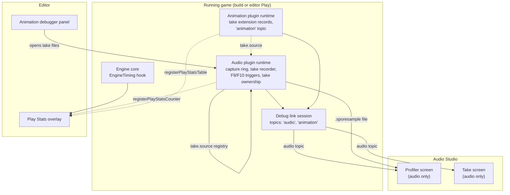
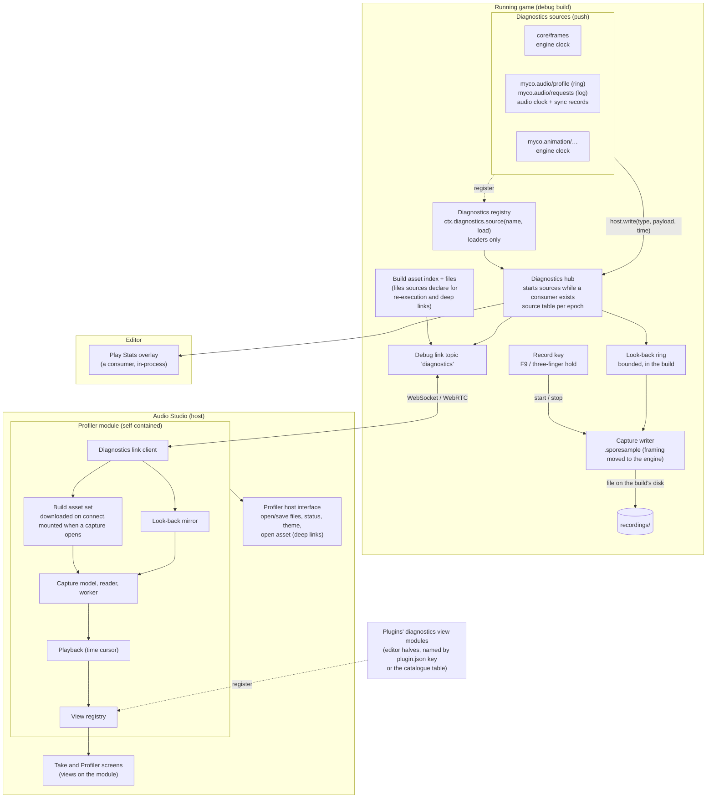
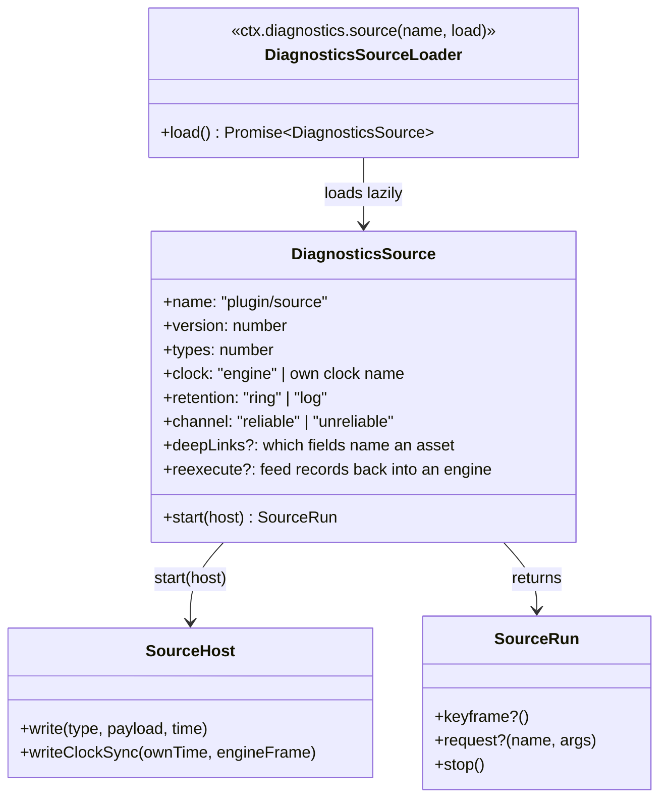
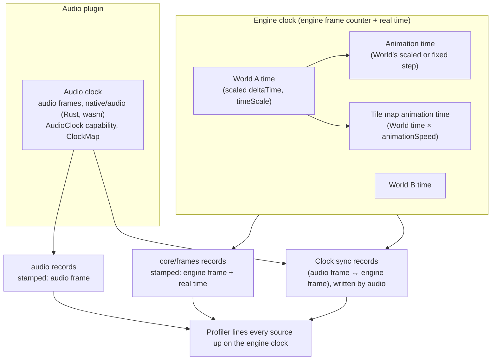
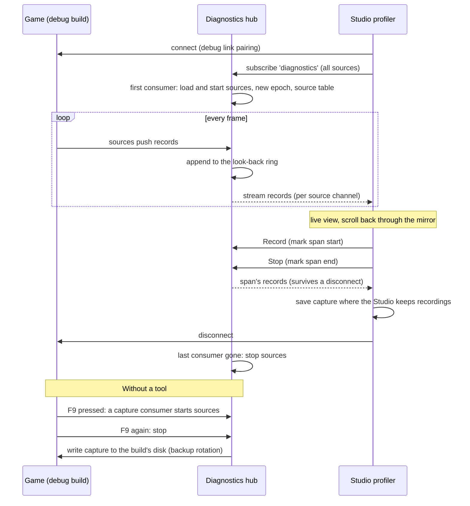
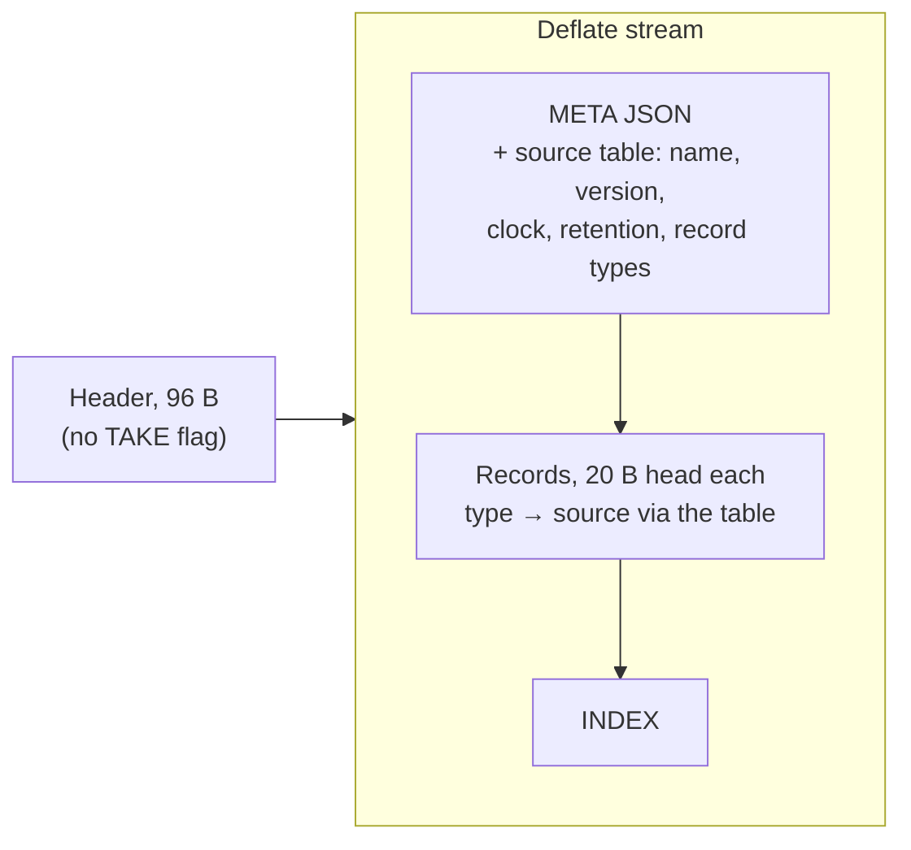
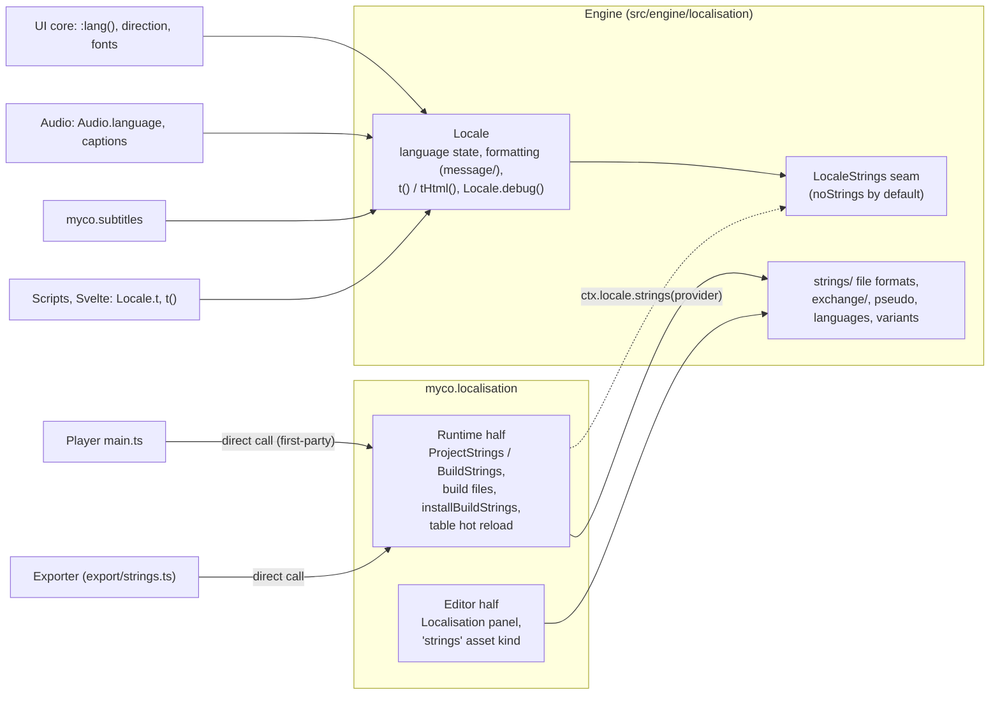
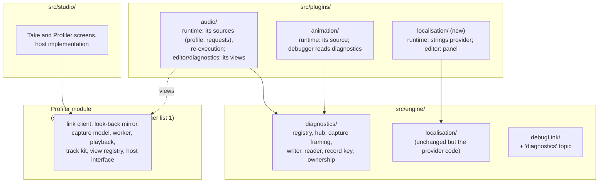

# Architecture sketch: plugin diagnostics, the profiler, localisation

A sketch of ADRs [0452](../../decisions/0452-plugins-contribute-diagnostics-every-recording-is-a-capture-and-the-profiler-is-a-self-contained-module.md)
and [0451](../../decisions/0451-localisation-becomes-a-plugin-that-provides-the-engines-strings-seam.md) (revision 2) for
the owner to refine before accepting the direction. Names are provisional; the technical design (step 6) settles
them. Solid arrows are calls or data; dotted arrows are "provides" or "registers".

## 1. Today

Each kind of profiled data has its own route.

## 2. Proposed: the pieces

One contribution point; consumers start sources; one transport; one profiler.

## 3. A diagnostics source

What a plugin's runtime half provides, and what it's given.

## 4. Clocks

Two independent clocks; derived times are fields, not clocks. The engine never reads a plugin's clock.

## 5. A live session, Record, and the record key

## 6. A capture file

## 7. Localisation (0451)

The plugin provides `Locale`'s existing strings seam; formatting and language state stay in the engine.

With the plugin off, `Locale` keeps `noStrings`: `t(key)` shows the key and warns once; language, direction, fonts,
`Audio.language` and message formatting keep working.

## 8. Where the code goes

