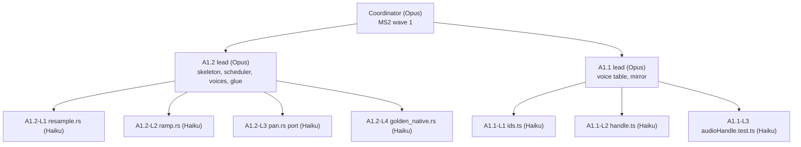

# Audio core M1: the task tree (models by depth)

This is a companion to [2026-11-audio-core-m1.md](2026-11-audio-core-m1.md), which has the milestones, waves, single-writer files and contracts K1–K13. This file breaks each task one level further. A **lead** writes the task's skeleton and keeps the hard part, and **Haiku leaves** fill in the well-defined pieces. The deeper the level, the smaller the work and the cheaper the model.

## Tiers

| Tier | Model | Owns |
|---|---|---|
| Coordinator | Opus (main session) | milestones and waves, contracts, single-writer files, merging task branches, wave reviews, global checks |
| Task lead | Opus for S tasks, Sonnet for M tasks | the task's skeleton (every file, type and signature it creates), its hard core, the glue (`mod.rs`, `index.ts`, wiring), merging its leaves, the task's acceptance check |
| Leaf | Haiku | one or two files from the skeleton, filled to a spec quoted in the brief, with the file's own tests |

Some J tasks have no lead. Their leaves report straight to the coordinator (A0.5, A0.10, A1.5, A2.5, B7).



## Collision audit (done before splitting)

Checking the waves found eleven places where two parallel tasks would edit the same file, or where a later task would redo an earlier one's work. The milestone plan is now fixed for each of them:

| # | Problem | Fix (in the milestone plan) |
|---|---|---|
| F1 | A0.3 needed STATUS before A0.2's generated reader existed, so a throwaway reader would have been replaced | A0.2 moves to MS1 wave 1. It's its own crate dir, so K1 is ready before A0.3 starts |
| F2 | A0.6 (fallback trigger) and A0.8 (lifecycle) both edited `service.ts` in one wave | K8: A0.3's `service.ts` already calls a `probe.ts` stub, and A0.6 fills only `probe.ts` |
| F3 | A1.5 and A1.7 both edited `spatialAudio.test.ts` | A1.5 writes a new `spatialDistance.test.ts` |
| F4 | A1.4's `coreBackend` called `clipRegistry` while A1.3a was writing it | K9: the registry interface is stubbed before the wave |
| F5 | A1.2 needs stored clips before A1.3b's arena exists | K11: `clips.rs` has a `ClipStore` API with a `Vec` behind it, and A1.3b replaces only the body. This is the one planned stub replacement |
| F6 | A2.5 (`Audio.debug()`) and A2.3 (`Bus.peak`) would each add to `Audio.ts` and `coreBackend.ts` | K10: A1.6 declares the whole §1 surface, and the two fill `debug.ts` and the peak |
| F7 | A2.7's golden runner would have replaced A1.2's goldens | A1.2 uses native `cargo` goldens; A2.7 adds the Vitest wasm layer on the loopback host |
| F8 | H3, A3.1 and A3.3 all touched `voices.rs` and the status writer | K11 `panner.rs` holds the panner switch; K12 `counters.rs` holds every STATUS field |
| F9 | H3 had to edit `settings.ts` and the editor section after others had | K13: A0.4 parses every §2 key and A2.4 builds every §7 control |
| F10 | H2's "re-send on rebuild" would have edited A3.4a's `recovery.ts` | The HRIR goes through `clipRegistry` under its reserved ids, so the rebuild re-sends it for free |
| F11 | H4 added a block to A2.2c's parity spec | H4 gets its own `audio-parity-hrtf.spec.ts` |

These were already disjoint and stay as they were: A0.5 after A0.4 (sequential waves), A1.6's queue (a new file, `unlockQueue.ts`), BB1/BB2 against MS4 (only one line in `backend.ts`, and nobody else in those waves edits it), and MS7's B3b → B4 order on `streams.ts`.

## How a task runs

1. **Skeleton (lead, about a quarter of a day).** The lead commits, on the task branch, every file the task creates:
   - full types and signatures, with a doc comment naming the spec rule each function implements (e.g. "§4.7: offset EMA 0.1, reject 5 ms");
   - stub bodies: `todo!("A1.2-L1")` in Rust, `throw new Error("not implemented: A1.2-L1")` in TypeScript;
   - module declarations, so the crate and the typecheck pass with stubs in place;
   - test files with named, skipped cases (`#[ignore]`, `it.todo`) for the leaves to fill.
2. **Leaves (Haiku, in parallel).** Each leaf starts in its own worktree, branched from the skeleton commit (`isolation: "worktree"`). It replaces the stub bodies in the files it owns and writes their tests. It runs only its own checks: `cargo test -p <crate> <module>`, or `npx vitest run <its test file>` plus `npm run typecheck`. It makes one commit on its own branch. Because the skeleton compiles, the other leaves' stubs never break its build.
3. **The lead's core, at the same time.** While the leaves run, the lead writes the parts that need judgement: the scheduler, lifecycle, threading and the arena.
4. **Merge (lead).** Leaves own disjoint files, so their branches merge without conflicts. **A conflict means a boundary bug, so the lead stops and fixes the boundary** rather than hand-merging. The lead then writes the glue, un-skips the tests, runs the task's acceptance check and hands the branch to the coordinator for the wave review.

The leaf rules (every brief repeats them):
- **Fill, don't reshape.** A leaf never changes a signature, a type, a module declaration or any file it doesn't own. If the skeleton looks wrong, it stops and reports. The lead decides and, if needed, re-issues the leaf.
- **No leaf edits another leaf's file, ever.** A fix goes back to the owning leaf (continued with `SendMessage`, so it keeps its context) or to the lead's glue. That's what keeps leaves from redoing each other's work.
- **Tests as leaves.** Where a test leaf and an implementation leaf share a module, both work from the same quoted spec, in separate files, at the same time. If they disagree at merge, the lead checks the spec and re-runs the leaf that got it wrong.

### Running the tree with this tool

Subagents can't spawn their own subagents, so the coordinator runs every node and the tree stays logical:

1. The coordinator starts the lead (a fresh agent on its model, in a worktree). The lead commits the skeleton and returns **the leaf briefs** in its report, using the template below.
2. The coordinator starts each leaf on Haiku from its brief, in a worktree branched from the skeleton commit, all in one message.
3. The coordinator continues the lead with `SendMessage`, passing the leaves' branch names. The lead merges, writes the glue and reports.

For a long task, the coordinator can instead start the lead as **its own session**, which can spawn its own leaves. That costs a session per lead, so use it only for tasks of 4 days or more (BB1, H1) or when the owner wants to steer a task directly.

## What makes a Haiku leaf

**A Haiku leaf must have all of these:**
- one or two files it owns outright;
- a spec it can be handed verbatim: a table row, a formula, constants, a type to satisfy, or an upstream file to port;
- pure or nearly pure code: no lifecycle, threads, timing or message ordering;
- its own test that proves it;
- about a day of work or less;
- no design choice left to make.

**It stays with the lead (or a Sonnet leaf) when:** it defines an interface; it involves concurrency, lifecycle or recovery; it's the worklet shell, the scheduler, the arena or streaming; it moves files across modules (a missed import breaks the build); it's prose readers will see; or it's too small to be worth a brief (under about a quarter of a day).

### The Haiku brief

```
Leaf <ID> — <one line>
Read first: CLAUDE.md; <the skeleton file(s)>; <the spec excerpt, pasted in full below>; <upstream file to port, if any, with its path and commit>.
You own: <files>. Fill only the stub bodies marked <ID> and the skipped tests in <test file>.
Do not touch: any other file, any signature, type, or mod/index declaration. If one looks wrong, stop and report.
Rules: <the relevant CLAUDE.md rules: libm for transcendentals, no Babylon/Howler types public, theme tokens…>; ported files keep the Chromium BSD notice and SPDX header.
Check: <exact command>. Don't run the full suite, e2e, or the build.
Done: every <ID> stub filled, tests un-skipped and passing, one commit on your branch.
Report (≤150 words): what you did, files touched, anything in the spec you had to interpret, what you couldn't verify.
Spec:
<the pasted excerpt>
```

## The tree

Days are §9's focused days. "Leaf days" are an estimate of the work moved to Haiku; the lead keeps the rest. **No task gains a dependency.** The skeleton is a step inside the task, and the leaves run alongside the lead's core.

### MS1: Foundations

| Task (days) | Lead | Lead keeps | Haiku leaves | Leaf days |
|---|---|---|---|---|
| H0 (2) | Sonnet | all: licence reading and decision, the draft letter for the owner | – | 0 |
| **A0.1** (3) | Opus | workspace, toolchain, `audio-core` skeleton, the whole ABI with stubs (K2), imported memory, deterministic init | **L1** `native/audio/build.mjs` from `native/nav/build.mjs` minus wasm-bindgen, steps and gates per §5 · **L2** `crates/audio-wasm/build.rs` source hash + `sourceHash.test.ts`, the hash rule in §5 | 1 |
| A0.2 (3) | Sonnet | the schema description types, the generator for Rust and TS (K1) | **L1** `schema/envelope.rs`, transcribing §4.1 kinds and bodies · **L2** `schema/batch.rs`, transcribing §4.2 opcodes · **L3** `schema/status.rs`, transcribing §4.3 · **L4** `vectors/` byte vectors per record plus their `cargo` test (after the generator) · **L5** `wire.roundtrip.test.ts` | 1.5 |
| **A0.3** (3) | Opus | worklet shell, `coreDriver`, loader, context, status writer, `service.load()`, the `probe.ts` stub (K8) | **L1** `bufferPool.ts` (pools of 8 × 16 KB and 4 × 64 KB, §4.7) + test · **L2** `counters.rs`, one field per STATUS field in K1 (K12) · **L3** `unlock.ts` gesture listener per architecture §3.1 + tests | 1 |
| A0.4 (3) | Sonnet | moves, manifest, activation, plugin lists, `myco.ts`, K3 selector, `service.ts` stub | **L1** `src/engine/audio/settings.ts`: every §2 key with its parse rule and problems, plus tests (K13) | 0.75 |
| A0.5 (1) | – | – | **whole task**: remove FMOD per the file list; check `git grep -i fmod src/` is empty and run typecheck | 1 |
| A0.10 (1) | – | – | **L1** stage the Blink files listed in §5 under `native/audio/third_party/` with provenance · **L2** `PORTS.md`, `THIRD_PARTY_NOTICES.md` entries, `portsNotices.test.ts` (header check) | 1 |
| A0.6 (2) | Sonnet | fallback trigger in `backend.ts`, the WebKit/Firefox `addModule` checks, the Android WebView check, the minimum-versions doc | **L1** `probe.ts`: the feature checks in ADR 0157 Platforms · **L2** `probe.test.ts`: a stubbed old engine gives one warning, then fallback | 0.75 |
| **A0.7** (3) | Sonnet + owner | all (real machines) | – | 0 |
| A0.8 (3) | Opus | host and World-service lifecycle, `Engine.ts` | **L1** `audioLifecycle.test.ts`: play, stop and replay cycles across two Engines, per architecture §3.9 and the acceptance criteria | 0.5 |
| A0.9 (1) | Sonnet | all (state logic, too small to brief) | – | 0 |

### MS2: Voices on the core

| Task (days) | Lead | Lead keeps | Haiku leaves | Leaf days |
|---|---|---|---|---|
| A1.1 (3) | Opus | the struct-of-arrays voice table, free list, stealing, mirror apply | **L1** `ids.ts` handle encoding (§3) + tests · **L2** `handle.ts`, `AudioHandle` per §1's doc comments, against the table's interface · **L3** `audioHandle.test.ts` from §1 | 1.25 |
| **A1.2** (3) | Opus | voices, scheduler (asap and stamped), `panner.rs` and `clips.rs` seams (K11), command apply | **L1** `audio-dsp/src/resample.rs` linear + tests · **L2** `ramp.rs` + tests · **L3** `pan.rs`, a port of Blink's `equal_power_panner` checked against Blink's values · **L4** `audio-core/tests/golden_native.rs`: one-shot, pitch, loop and moving-source scenarios | 1.5 |
| A1.3a (3) | Sonnet | registry state machine, `decodeAudioData` path, refcounts | **L1** `pcm.ts` (f32 → int16) and `chunker.ts` (256 KB per quantum pacing, §4.7) + tests · **L2** `encodedCache.ts` (32 MB cap, §3) + tests | 1 |
| **A1.3b** (3) | Opus | the arena, `chunk_ptr/commit`, clip events, the ceiling | **L1** `size_class.rs`: 4 classes per power of two from 4 KB (§5), + tests | 0.25 |
| A1.4 (3) | Sonnet | command writer (carry-over, 64 KB cap), status reader, `coreBackend` | **L1** `clock.ts` v1: offset EMA 0.1, reject 5 ms, re-anchor after 10 (§4.7) + tests | 0.5 |
| A1.5 (1) | – | – | **whole task**: port `distance_effect` and `cone_effect` to `spatial.ts`; `spatialDistance.test.ts` with Blink's values | 1 |
| A1.6 (3) | Sonnet | the whole §1 surface (K10), warnings, `Bus.peak` declaration | **L1** `unlockQueue.ts` (32 one-shots for 1 s; owned and looping voices wait, D5) + tests · **L2** `audioApi.test.ts`: one case per §1 row | 1.25 |
| A1.7 (3) | Sonnet | `testing.ts` (`makeFakeBackend`), `hostClock.ts`, the loopback host (K4) | **L1** rewrite `audioBackend.test.ts` onto the fake · **L2** rewrite `spatialAudio.test.ts` onto the fake · **L3** `audioLoopback.test.ts`, the cases in §8's loopback row | 1.5 |

### MS3: Babylon replaces Howler

| Task (days) | Lead | Lead keeps | Haiku leaves | Leaf days |
|---|---|---|---|---|
| BB1 (4) | Sonnet | `BabylonBackend` class, lazy engine on the host's context, unlock ownership | **L1** `testing/babylonMocks.ts`: mocks of the `@babylonjs/core/AudioV2` modules from their `.d.ts` · **L2** `babylonMapping.ts`: pure mappings (bus tree to `AudioBus` options; distance model, min/max and rolloff) + tests · **L3** `babylonBackend.test.ts`: the backend and spatial cases against the mocks | 1.5 |
| BB2 (3) | Sonnet | `applyMix` gains, counters, default selection | **L1** move `busGraph.ts` to `testing/webAudioReference.ts` and fix its imports · **L2** delete `howlerBackend.ts` and its references (the coordinator edits `package.json` and `vite.engine.config.ts`) · **L3** guide text on the fallback's limits | 0.75 |

### MS4: Buses and effects

| Task (days) | Lead | Lead keeps | Haiku leaves | Leaf days |
|---|---|---|---|---|
| **A2.1** (3) | Opus | bus tree, ramps, BUS_CONFIG/MIX apply, `fx.rs` slots (K5) | **L1** `meters.rs` (peak with decay) + tests · **L2** `tests/bus.rs`: config and mix apply cases from §4.2 | 1 |
| A2.2a (2) | Opus | the compressor port (stateful: adaptive release, pre-delay) | **L1** `biquad/coeffs.rs`: port Blink's lowpass and highpass coefficient setters (Q in dB) · **L2** `biquad/kernel.rs`: direct-form processing · **L3** `tests/ports_biquad.rs`: Blink's reference values | 1 |
| **A2.2b** (3) | Opus | the staged convolver on `microfft`, stagger, shared return, the size gate | **L1** `ir.rs`: seeded generated IR · **L2** `tests/convolver_direct.rs`: a direct-convolution reference and the 1e-6 check | 0.75 |
| A2.2c (2) | Sonnet | the parity harness (`OfflineAudioContext` driver, tolerance compare) | **L1** `tests/e2e/audio-parity/scenes/*.ts`: filter sweeps, compressor, reverb send, pan law | 0.5 |
| A2.3 (2) | Sonnet | all (touches mirror counts and the mixer: small and cross-cutting) | – | 0 |
| A2.4 (3) | Sonnet | moves out of `src/editor/`, section layout, `editor/index.ts` | **L1** `audioSettingsModel.ts`: every §7 setter + tests · **L2** `BusMeters.tsx` (reads `Bus.peak`, theme tokens only) | 1.25 |
| A2.5 (2) | – | – | **L1** `debug.ts`: builds `AudioDebugInfo` from the mirror and table · **L2** `AudioDebugPanel.tsx` (theme tokens); its registration line goes to the coordinator | 2 |
| A2.6 (3) | Sonnet | the sound-lab project and the `@slow` spec | **L1** sound-lab scripts, one per feature (one-shots, buses, snapshots, effects, spatial) · **L2** `samples/sound-lab/tools/makeTones.mjs`, generated test WAVs | 1.25 |
| A2.7 (3) | Sonnet | the Vitest wasm golden runner and digests | **L1** `audio-dsp/tests/quality_thdn.rs` (resampler THD+N and alias) · **L2** `quality_null_pan_limiter.rs` (unity null, pan power, limiter ceiling) | 1 |

### MS5: Selection, clock and recovery

| Task (days) | Lead | Lead keeps | Haiku leaves | Leaf days |
|---|---|---|---|---|
| **A3.1** (3) | Opus | selection: audibility, hysteresis, dwell, stealing, inaudible Worlds, the demote path | **L1** `quickselect.ts` (O(L), no allocation) + tests · **L2** `selectionBench.test.ts` (4,096 voices, p99 ≤ 0.25 ms) | 0.75 |
| A3.2 (3) | Opus | clock map, `getOutputTimestamp`, late counting, core scheduler | **L1** `lookahead.ts`: pure L and ramp clamps (§4.7) + tests | 0.25 |
| A3.3 (3) | Opus | the signals, the work-unit model, demote wiring | **L1** `cap_controller.rs`: the pure controller in architecture §6.3's table · **L2** its tests from the same table (a test leaf, in parallel) | 1.25 |
| **A3.4a** (3) | Opus | trap catch, rebuild, chunked REPLAY, clip re-send | **L1** `rateLimit.ts` (3 per 60 s) + tests | 0.25 |
| A3.4b (3) | Sonnet | background modes, hidden tab, rebuild calls (K6) | **L1** `deviceChange.ts`: a pure classifier per architecture §3.7 + tests | 0.5 |

### MS6: HRTF

| Task (days) | Lead | Lead keeps | Haiku leaves | Leaf days |
|---|---|---|---|---|
| H1 (5) | Opus | partitioned convolution on the 256-point FFT, two-kernel crossfade, interaural delay, the size gate | **L1** `hrtf/elevation_index.rs`: port of the azimuth/elevation index and interpolation weights, checked against Chromium's values · **L2** `hrtf/database.rs`: the HRIR table layout from the `format = 2` header · **L3** `tests/ports_hrtf.rs`: fixed-direction sweep references | 2 |
| H2 (3) | Sonnet | `hrir.ts` loader through the clip registry, `hrtfReady`, resampling at load | **L1** `tools/hrir/convert.mjs`: the dataset to an int16 blob with the §4.1 HRIR header (`format = 2` CLIP_CHUNK) · **L2** attribution text for the guide and notices (to the coordinator) | 1.25 |
| H3 (3) | Opus | the panner switch and 45 ms crossfade in `panner.rs`, counters | **L1** `hrtfPick.ts`: top N by audibility with 1.2× hysteresis + tests | 0.5 |
| H4 (3) | Sonnet | the HRTF spec on A2.2c's harness, the moving-source golden | **L1** fixed-direction null-test scenes · **L2** ITD and level check helpers + tests | 1 |

If H0 decides on equal-power, H1, H2 and H4 and their leaves are dropped (MS6 in the milestone plan).

### MS7: Decoder, streaming, default to core

| Task (days) | Lead | Lead keeps | Haiku leaves | Leaf days |
|---|---|---|---|---|
| **B1** (3) | Opus | the `audio-decode` ABI, symphonia setup, size gates | **L1** `crates/audio-decode/tests/fixtures/` and a script that generates them (WAV and FLAC by script; MP3 and Vorbis with ffmpeg if installed, otherwise from the owner) · **L2** `tests/decode.rs`: one case per fixture | 1 |
| B2 (3) | Sonnet | the worker, decode off main, the K7 dispatch | **L1** `decoderClient.ts`: request map and transfer lists + tests | 0.75 |
| **B3** (3) | Opus | stream ring, waiting state, starvation, main-side stream open | **L1** `decoder/credit.ts`: credit-window accounting (4 × 256 KB, credit every 4,096 frames) + tests | 0.5 |
| B3b (2) | Sonnet | all (epoch ordering across three threads) | – | 0 |
| B4 (3) | Sonnet | gapless loop wrap, the `isomp4` reopen | **L1** AAC feature flag plumbing and the unknown-codec warning · **L2** loop-seam golden test | 1 |
| B5 (2) | Sonnet | all (worker-sourced clips and the registry, closely tied) | – | 0 |
| B6 (2) | Sonnet | removing `decodeAudioData`, sidecar `stream` semantics | **L1** guide section on streaming | 0.5 |
| B7 (1) | – | – | **whole task**: flip the default to `"core"` (macOS desktop keeps `"babylon"`), update the tests that assumed the old default | 1 |

### MS8: Budgets, soak, release gate

| Task (days) | Lead | Lead keeps | Haiku leaves | Leaf days |
|---|---|---|---|---|
| A3.5 (2) | Opus | measurement and the frozen table | **L1** `audio-bench` scenarios (4-point resampler, 64 MB of clips, pitch up to 16×, HRTF) | 0.5 |
| C1 (3) | Sonnet | the stress sample project, benches | **L1** stress scripts (voice storms, streams, bus churn) | 1 |
| C1b (3) | Opus | all (the metered build and the CI gate) | – | 0 |
| C2 (2) | Sonnet (upgraded from J: readers see this prose) | the guide pages, contributor note | **L1** link check and a notices review against `PORTS.md` | 0.5 |
| **C3** (3) | Sonnet + owner | all (real machines) | – | 0 |
| C4 (3) | Opus + owner | the checklist; the owner signs | **L1** the objective-thresholds table gathered from A2.7's and H4's outputs | 0.5 |

## What it changes

| Model | Days before (by level) | Days after (estimate) |
|---|---|---|
| Opus | 60 (S) | **44** |
| Sonnet | 74 (M) | **55** (gains C2) |
| Haiku | 7 (J) | **42**, about 30% of the 141 task days |

- **About 80 Haiku leaves in all.** Every one owns its files outright, and none edits another's output.
- **No task gains a dependency.** The skeleton adds about a quarter of a day inside each split task, and the leaves then run in parallel with the lead's core.
- **The critical-path tasks get shorter:** A0.1, A0.3, A1.2, A2.1, A2.2b, A3.1 and B1 hand off 0.75–1.5 days each. That takes the 36-day critical path to **about 30 days** (estimate). A1.3b, A3.4a, A0.7 and C3 barely change, because their work is the hard core or real hardware.
- **Not split, on purpose:** H0, A0.7, A0.9, A2.3, B3b, B5, C1b and C3. They involve judgement, cross-thread ordering or real machines, or they're too small to be worth a brief.
- **The cost of the tree:** a lead writes each skeleton and leaf brief, and the coordinator starts more agents. If a leaf has to be re-run more than once, its piece goes back to its lead, and the leaf criteria above get tightened for that kind of work.
