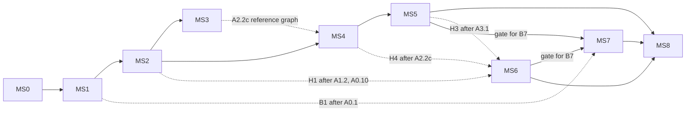

# Audio core M1: milestones and waves (ADR 0157)

This plan breaks the approved M1 task table into milestones you can ship, and splits each milestone into waves of parallel tasks. The table is [api-and-models §9](../design/0157-audio-core/api-and-models.md#9-m1-task-breakdown). This plan doesn't change the IDs, days, dependencies or acceptance criteria. Where the two differ on a task, the table wins. Where they differ on order, file ownership or gates, this plan wins.

Sources: [ADR 0157](../decisions/0157-audio-runs-on-an-engine-owned-rust-core-in-an-audioworklet.md) (Accepted, revision 3), the [design index](../design/0157-audio-core/README.md), [architecture.md](../design/0157-audio-core/architecture.md) (timing §4.7, budgets §6, failures §7, platforms §9), and [`spikes/audio-worklet/README.md`](../../spikes/audio-worklet/README.md). This plan replaces the [handoff](2026-11-audio-core-handoff.md).

## State at planning (2026-11-09)

- **Renumbering is done.** On this branch the records are now **0156** (the withdrawn FMOD backend) and **0157** (the audio core), with `docs/design/0157-audio-core/` and `docs/rfc/0157/` (commit `919ac1d`). The handoff's "renumber on merge" step is finished.
- **ADR 0155 (Android export) is Accepted on master** (`7c113b6`), and it already refers to the audio core as 0157. M1 doesn't depend on it, because the Android soak (C3) plays the *web* build in Chrome and the Android System WebView, not a Tauri Android build.
- **This branch isn't merged.** It's seven commits ahead of where it branched from master. Master has moved since, and merging conflicts only in `docs/README.md` (both sides added records to the index). Merging is wave MS0.
- **The code:** `src/engine/audio/` still has `howlerBackend.ts`, `fmodBackend.ts`, `busGraph.ts`, `backend.ts`, `mixer.ts`, `settings.ts`, `AudioSource.ts` and `AudioListener.ts`. Neither `native/audio/` nor `src/plugins/audio/` exists yet.

## What "shippable" means here

Every milestone merges to master with all of these true:

1. `npm run typecheck`, `npm test`, `npm run build` and the default Chromium e2e suite (`npm run test:e2e`) are green. `cargo test` in `native/audio/` is green, and the committed wasm matches its source hash.
2. **The default backend doesn't change before B7.** Until BB2 lands, the setting value `"babylon"` resolves to the existing Howler backend, so master keeps playing sound. After BB2 it resolves to the real Babylon backend. `"core"` is opt-in (`audio.backend: "core"` in `project.json`) until B7 makes it the default.
3. With `"core"` selected, the core does what the milestone promises, shown by its exit check, and does no less than the previous milestone.
4. The 0157 row in `implementation-status.md` says what landed. Behaviour that's opt-in isn't documented as default.

## Milestones

| # | Milestone | Tasks (critical path in **bold**) | Exit check (with `backend: "core"`) | Days | Calendar (est.) |
|---|---|---|---|---|---|
| MS0 | Merge and kick-off | branch merge, start **H0** | master has 0156/0157 and the design; H0 under way | – | week 1 |
| MS1 | **Foundations: a tone through the core** (M1a.0) | **A0.1, A0.3, A0.7**, A0.2, A0.4, A0.5, A0.6, A0.8, A0.9, A0.10 | a tone after a click in Chromium, WebView2 and WebKitGTK; status flows with frames stopped; FMOD gone; an old engine gets one warning | 25 | weeks 1–3 |
| MS2 | **Voices on the core** (M1a.1 minus Babylon) | A1.1, **A1.2, A1.3b**, A1.3a, A1.4, A1.5, A1.6, A1.7 | one-shots and `AudioSource`s play with pitch, pan, distance and loops from `decodeAudioData` clips; loopback tests green | 22 | weeks 3–6 |
| MS3 | Babylon replaces Howler (parallel track) | BB1, BB2 | default `"babylon"` is Babylon's AudioEngineV2; no Howler in the build; flappy and pirates play | 7 | weeks 6–7 |
| MS4 | **Buses and effects** (M1a.2) | **A2.1, A2.2b**, A2.2a, A2.2c, A2.3, A2.4, A2.5, A2.6, A2.7 | buses, snapshots, ducking, filters, compressor and reverb match Web Audio; meters and `Audio.debug()` in the editor; sound-lab spec passes | 23 | weeks 6–9 |
| MS5 | **Selection, clock and recovery** (M1a.3 minus A3.5) | **A3.1, A3.4a**, A3.2, A3.3, A3.4b | 4,096 logical voices; `at` lands within a quantum; the cap adapts; a trap rebuilds, and the 4th in 60 s goes silent; background modes work | 15 | weeks 9–11 |
| MS6 | HRTF for the nearest voices (gated on H0) | H1, H2, H3, H4 | ≤ 16 HRTF voices, no clicks across a change, parity with `PannerNode` HRTF | 14 | weeks 8–12 |
| MS7 | **Decoder, streaming, default to core** (M1b) | **B1, B3**, B2, B3b, B4, B5, B6, B7 | music streams with no underruns under a 300 ms main stall; gapless loops; no `decodeAudioData` in the core path; `"core"` becomes the default | 19 | weeks 10–14 |
| MS8 | **Budgets, soak, release gate** (A3.5 and M1c) | A3.5, C1, C1b, C2, **C3**, C4 | budgets frozen; metered CI gate on; 30 min soak with 0 underruns on every gate machine; the owner signs the listening pass | 16 | weeks 13–16 |

The days are the table's, before the 14-day reserve (141 in all; H0 is counted in MS1). The calendar assumes the table's staffing: one senior, two mid-level engineers and one junior. **The senior is the constraint** (60 task days). MS3, MS6 and the start of MS7 overlap their neighbours so the mid-level and junior work keeps moving while the senior works the critical path.

### The critical path

The requested order is A0.1 → A0.3 → A0.7 → A1.2 → A1.3b → A2.1 → A2.2b → A3.1 → A3.4a → B1 → B3 → C3. It's the senior's queue, and it's 36 task days. In each wave below, its tasks are listed first and get the senior (or an Opus worker) first. Three notes:

- **§9's own path also includes H3** between A3.1 and A3.4a. H3 isn't a dependency of A3.4a. It sits there only because one senior does both. With an extra strong worker, H3 leaves the path. But **A3.5 waits for H3**, and C1 and C3 wait for A3.5, so HRTF still gates the soak.
- **The longest pure dependency chain runs through HRTF:** A0.1 → A0.3 → A0.7 (the gate into M1a.1) → A1.2 → H1 (5 days) → H2 → H3 → A3.5 → C1 → C3, about 31 days. So start **H1 the moment A1.2 and A0.10 land.** If only one senior is available, run A3.1 first (it's on the requested path), then H1, and accept the slip. Otherwise give H1 its own Opus worker during MS4.
- **B1 depends only on A0.1.** It's on the path only because of the senior's queue. If a second senior-level worker is free, B1 can start in MS4 and MS7 shortens by about a week.

## Who does what

- **Coordinator** (Opus, this role): writes the shared contracts before each wave, reviews and merges every worker branch, runs the wave's checks, owns the single-writer files below, and updates `implementation-status.md` at each milestone.
- **Levels to workers.** Each task has a lead: S tasks get an Opus lead, M tasks a Sonnet lead. A lead writes the task's skeleton and hands its well-defined pieces to **Haiku leaves**. [2026-11-audio-core-m1-tree.md](2026-11-audio-core-m1-tree.md) has the tree: who leads each task, which leaves it gets, and the rules that stop leaves from colliding or redoing each other's work. With human staff, read S/M/J as the table does. S tasks in the same wave then run back to back, critical path first.
- **Isolation.** Each worker gets its own worktree, cut from master after the previous wave merged (check the merge-base). Workers touch only the files their task lists. Concurrent e2e runs each get their own `E2E_PORT`.
- **The owner** (needs people, hardware or sign-off):
  - **H0:** sends any letter to the rights holders. Claude drafts it but doesn't send it.
  - **A0.7:** a Linux machine or VM with WebKitGTK and audio output (Linux containers have no audio device).
  - **C3:** the low-end Android phone and the Linux soak machine.
  - **C4:** the listening pass.
  - **Before MS2 wave 3 (A1.6):** the one-shot completion question below.

### Single-writer files

Workers never edit these. A worker that needs a change asks the coordinator, who makes it between waves.

| File | Writer |
|---|---|
| `package.json`, `package-lock.json` | coordinator (A0.1 adds `build:audio`; BB2 removes `howler` through the coordinator) |
| `native/audio/Cargo.toml` (workspace), `rust-toolchain.toml`, `build.mjs` | A0.1, then the coordinator |
| `native/audio/crates/audio-wire/src/schema.rs` and `src/plugins/audio/runtime/wire.generated.ts` | A0.2, then the coordinator (any change bumps the schema hash and needs a review) |
| `native/audio/crates/audio-wasm/src/lib.rs` (the C ABI) | A0.1 stubs **every** export in §5; after that only S tasks fill a body, one per wave, and the coordinator names who |
| `src/plugins/manifests.ts`, `runtime.ts`, `editorPlugins.ts` | A0.4, then the coordinator |
| `src/plugins/audio/editor/index.ts` | A2.4, then the coordinator (A2.5 and H3 hand over their registration lines) |
| `src/engine/Engine.ts` | A0.8 |
| `THIRD_PARTY_NOTICES.md`, `native/audio/PORTS.md` | A0.10, then the coordinator (H2 hands over the HRIR acknowledgement) |
| `docs/architecture/implementation-status.md`, `docs/README.md` | coordinator |
| `docs/design/0157-audio-core/architecture.md` §6 (the frozen budget table) | A3.5 |

### Contracts written before the waves

These keep the files disjoint. Each one is committed before the wave that needs it, so workers branch from it.

| # | Contract | When | Lets |
|---|---|---|---|
| K1 | **The whole M1 wire.** A0.2 generates every kind, opcode and STATUS field in §4, including M1b's stream kinds, `mixedCap`, `hrtfVoices`, `hrtfLoadFailure` and the reserved `group`. Fields not yet produced stay zero | MS1 wave 1 | no later task edits the schema, so A3.3, H3 and B3 can run in parallel |
| K2 | **The whole C ABI stubbed.** Every export in §5 exists in A0.1 and returns `NOT_IMPLEMENTED` | MS1 wave 1 | A0.3's TypeScript side, and later the decode and stream tasks, can build against stable symbols |
| K3 | **Backend selection.** `"babylon"` resolves to `HowlerBackend` until BB2, and `"howler"` maps to `"babylon"` with a problem. `"core"` loads the core lazily through the `myco.audio` World service | MS1 wave 1 (A0.4) | master keeps sound through MS1–MS2 |
| K4 | **`HostClock` and the loopback host.** The interface (`hostClock.ts`) and the `createLoopbackHost({clock}).renderQuanta(n)` signature | MS2, start of wave 2 | A1.4 and A1.7 in one wave; A1.4's loopback check runs at the wave review |
| K5 | **Effect slots.** A2.1 leaves `audio-core`'s per-bus effect dispatch with `lowpass`, `highpass`, `compressor` and `reverbSend` wired to passthrough stubs in `audio-dsp` | end of MS4 wave 1 | A2.2a and A2.2b fill only their own `audio-dsp` modules |
| K6 | **The rebuild entry point.** `recovery.ts` exports `rebuild(reason)` as a stub | MS5, start of wave 2 | A3.4a and A3.4b (`devicechange` close or stall calls the rebuild) in one wave |
| K7 | **Decoder worker dispatch.** B2's `decoder.worker.ts` routes messages to `decoder/clips.ts` and `decoder/streams.ts` (stubs) | end of MS7 wave 2 | B3 and B5 in one wave |
| K8 | **Probe hook.** A0.3's `service.ts` calls `probe.ts`, a stub returning "supported" | MS1 wave 2 | A0.6 and A0.8 in one wave |
| K9 | **Clip registry interface.** `clipRegistry.ts` exports as stubs | MS2, start of wave 2 | A1.3a and A1.4 in one wave |
| K10 | **The whole public surface.** A1.6 declares all of §1, including `Audio.debug()` and `Bus.peak`; `coreBackend.debug()` calls a `debug.ts` stub | MS2 wave 3 | A2.3 and A2.5 never touch `Audio.ts` or `coreBackend.ts` |
| K11 | **Voice seams.** A1.2's `panner.rs` (per-voice panner state) and `clips.rs` (`ClipStore` API) | MS2 wave 1 | H3 edits only `panner.rs`; A1.3b replaces only the `ClipStore` body |
| K12 | **Counters.** A0.3's `counters.rs` holds every K1 STATUS field, and the writer serialises all of them | MS1 wave 2 | A3.3, H3 and B3 report through counters without editing `status.rs` |
| K13 | **Settings and controls complete early.** A0.4 parses every §2 key; A2.4 builds every §7 control | MS1 wave 1, MS4 wave 2 | H3, B4 and B7 never edit `settings.ts` or the editor section |

## Wave reviews

After every wave, before the next one branches, the coordinator:

1. Reviews each worker's diff for scope (only its files), the CLAUDE.md rules (Babylon imported module by module, no Babylon, Howler or wasm types in the public API, theme tokens in editor CSS) and the task's acceptance criteria.
2. Merges the branches one at a time and runs `npm run typecheck`, `npm test`, `cargo test` (in `native/audio/`) and `npm run build:audio`. That last one checks the size gates (mixer ≤ 150 KB, decoder ≤ 900 KB) and the source hash. It runs the wave's own spec where the table names one.
3. Runs `npm run test:e2e` (Chromium) at the end of every milestone, and on any wave that touches the editor or the player. `@slow` audio specs run at their milestone's end. WebKit and Firefox parity runs go in the Playwright Docker image.
4. Records findings in a review log at `docs/design/0157-audio-core/build-log.md`: what landed, measured numbers, deviations from the design, and reserve days used.
5. Takes from the 14-day reserve deliberately: an overrun on a Chromium port is the first claim, as §9 says. When more than half of it is used, the coordinator tells the owner.

## MS0: Merge and kick-off (coordinator)

- Merge `claude/fmod-integration-d19dbb` (this plan included) into master and resolve `docs/README.md`: keep master's rows and add 0156 and 0157. Check that `implementation-status.md` still lists both and that no `0148`/`0149` reference to these records survives (`git grep -n "0149-audio\|0148-fmod"`).
- Start **H0** on day 1 (MS1 wave 1). It gates only MS6.

## MS1: Foundations (M1a.0)

**Wave 1** (contracts K2 and K3 come out of it)

| Task | Who | Files |
|---|---|---|
| **A0.1** workspace, toolchain, `audio-core` skeleton, ABI with imported memory and deterministic init, `build.rs` hash, `build.mjs`, `microfft` | S | `native/audio/**` except `crates/audio-wire/**`; `src/plugins/audio/runtime/wasm/`; `sourceHash.test.ts`; `build:audio` through the coordinator |
| A0.4 plugin shell: manifest, activation, file moves, `mixer` singleton, `myco.ts` exports, plugin lists, `audio.backend` selector (K3), a `service.ts` whose `load()` is a stub | M | `src/plugins/audio/{manifest.ts,runtime/index.ts,runtime/Audio*.ts,runtime/audioSystem.ts,runtime/backend.ts,runtime/core/service.ts}`, `src/engine/audio/{mixer.ts,settings.ts}`, `src/engine/index.ts`, `src/myco.ts`, `src/plugins/{manifests,runtime,editorPlugins,testSetup}.ts`, the two test imports |
| A0.2 `audio-wire`: the whole schema (K1), generator, vectors, REPLAY, HRIR format, round-trip and hash tests | M | `native/audio/crates/audio-wire/**` (a crate dir A0.1's workspace lists as a member but never writes), `wire.generated.ts`, `wire.roundtrip.test.ts` |
| H0 HRIR licence decision | M | `docs/design/0157-audio-core/hrir-licence.md` (new) |

A0.4 and A0.2 depend on A0.1 in the table, but only nominally. The shell needs no wasm, because `"core"` loads lazily. And `audio-wire` is a crate dir of its own: A0.1 lists it in the workspace `members` and never writes inside it. Running both in wave 1 puts the generated wire (K1) in place before A0.3 needs STATUS, so A0.3 never writes a throwaway reader. A0.4 also parses **every** §2 setting, including `voices.hrtf`, `spatial`, `clipMemoryMB`, `clipFormat` and `codecs`, with the keys that aren't used yet left inert. That way no later task edits `settings.ts` (contract K13).

**Wave 2** (K1 comes out of it)

| Task | Who | Files |
|---|---|---|
| **A0.3** loader, worklet shell and `coreDriver`, context, unlock, STATUS with immediate RECYCLE and a pool of 8, `bufferPool` | S | `src/plugins/audio/runtime/core/{loader,context,unlock,bufferPool,probe}.ts`, the `load()` body in `service.ts`, `runtime/worklet/*`, `audio-core/src/{status,counters}.rs`, `audio-wasm` bodies of `status_take`/`status_ptr`/`process` |
| A0.10 ports intake: Blink files staged with provenance, `PORTS.md`, SPDX headers, notices, the header check | J | `native/audio/third_party/**`, `PORTS.md`, `THIRD_PARTY_NOTICES.md`, `portsNotices.test.ts` |
| A0.5 remove FMOD | J (Sonnet) | `src/engine/audio/fmodBackend.ts`, `tests/fmodBackend.test.ts`, `docs/guide/fmod.md`, the fmod lines of `Engine.ts`, settings and editor model |

A0.3 sets up two seams for later tasks:
- **`counters.rs`** holds every STATUS field in K1. The status writer serialises all of them from day one, so later tasks set a counter in their own module and never edit `status.rs` (K12).
- **`probe.ts`** is a stub returning "supported", already called from `service.ts`. A0.6 fills it in without touching `service.ts`, which A0.8 owns in wave 3 (K8).

A0.5 and A0.4 both touch settings, so A0.5 branches after A0.4's merge.

**Wave 3**

| Task | Who | Files |
|---|---|---|
| **A0.7** WebView2 and WebKitGTK smoke: tone, autoplay policy per webview, second Engine shares the host | M + owner (Linux) | `src-tauri/` autoplay flags only if needed; findings in `build-log.md` |
| A0.8 host and World-service lifecycle across two Engines, `releaseWorld`, reconfigure with live voices | S | `runtime/core/service.ts` (lifecycle part), `src/engine/Engine.ts` |
| A0.6 feature probes, refusal message, Babylon fallback trigger, minimum versions doc, suspended `addModule` in WebKit and Firefox; check Android's WebView for AudioWorklet and `simd128` | M | `runtime/core/probe.ts` (fills A0.3's stub), the trigger in `backend.ts`, `docs/guide/` minimum versions |
| A0.9 unlock re-arm after `interrupted` and resume failure | M | `runtime/core/unlock.ts` |

Until BB1, A0.6's fallback lands on the Howler-backed `"babylon"` value.

**Exit (gate for MS2):** A0.7 passes, meaning a tone in WebView2 and WebKitGTK and the autoplay findings logged. If WebKitGTK can't play the tone, stop and bring it to the owner before M1a.1, as §9 requires.

## MS2: Voices on the core (M1a.1)

**Wave 1**

| Task | Who | Files |
|---|---|---|
| **A1.2** core voices: PLAY/STOP/SET_PARAMS/FADE, slots, linear resampler, ramps, loop, port of `equal_power_panner`, asap vs stamped | S | `audio-core/src/{voices,scheduler,panner,clips}.rs`, `audio-dsp/src/{pan,resample,ramp}.rs`, `audio-core/tests/golden_native.rs` |
| A1.1 voice table, ids, `AudioHandle`, mirror | S (Opus worker 2, or after A1.2) | `runtime/core/{voiceTable,ids,handle,mirror}.ts`, `audioHandle.test.ts` |

A1.2 sets up three seams (K11):
- **`panner.rs`:** every voice pans through a per-voice panner state there, with equal-power only to start. H3 adds HRTF and the crossfade inside that file.
- **`clips.rs`:** a `ClipStore` API (`reserve`, `frames(id)`, `free`) with a plain `Vec` behind it. A1.3b replaces only the body, with the slab arena. This is the plan's one deliberate stub replacement, and A1.2's brief says so.
- **Native goldens:** A1.2 proves its renders with native `cargo` goldens. A2.7 later adds the Vitest wasm runner on A1.7's loopback host and doesn't replace A1.2's tests.

**Wave 2** (K4 and K9 first)

| Task | Who | Files |
|---|---|---|
| **A1.3b** slab arena, `chunk_ptr/commit`, clip events, ceiling refusal | S | `audio-core/src/arena.rs`, the `ClipStore` body in `clips.rs` (K11), the `clip_*` ABI bodies |
| A1.3a clip registry, `decodeAudioData` loader, int16, paced chunks, encoded-bytes cache | M | `runtime/core/clipRegistry.ts`, the decode path in `loader.ts` |
| A1.4 command writer, status reader, `coreBackend` (with `voiceStarted/Ended`), clock map v1 | M | `runtime/core/{commandWriter,statusReader,coreBackend,clock}.ts` |
| A1.5 distance and cone ports | M | `runtime/core/spatial.ts`, `spatialDistance.test.ts` (new: Blink's values) |
| A1.7 fakes, `HostClock`, loopback host, rewrite of the backend and spatial tests | M | `runtime/testing.ts`, `runtime/core/hostClock.ts`, `audioBackend.test.ts`, `spatialAudio.test.ts`, `audioLoopback.test.ts` |

A1.5 writes its value checks in a new test file, so it never touches the `spatialAudio.test.ts` that A1.7 rewrites. Two contracts come first:
- **K9:** `clipRegistry.ts` exports its interface (`acquire(path)`, `release(id)`, `state(id)`, `onResident`) as stubs, so A1.3a fills it while A1.4's `coreBackend` codes against it.
- **K4:** the `HostClock` and loopback host interfaces.

Five tasks are too many for two mid-level engineers at once. With human staff, run A1.4 and A1.7 first (A1.6 waits on A1.4), and leave A1.3a and A1.5 for wave 3.

**Wave 3**

| Task | Who | Files |
|---|---|---|
| A1.6 API surface, locked queue, warnings | M | `runtime/Audio.ts`, `src/engine/audio/mixer.ts` (`Bus.peak` declared), `runtime/core/unlockQueue.ts` (new), tests per §1 row |

A1.6 declares the **whole** §1 surface (K10), including `Audio.debug()`, which delegates to `backend.debug()`, and `Bus.peak`, which returns 0 until A2.3. A1.4's `coreBackend.debug()` calls a `debug.ts` stub. MS4 then fills `debug.ts` (A2.5) and the peak (A2.3) without touching `Audio.ts` or `coreBackend.ts`.

**Decide before A1.6:** whether one-shots get a completion `Promise`. Recommendation: **not in M1.** `handle.playing` and `handle.reason` already answer "has it ended?", and are polled once per frame like everything else in the engine. A `Promise` is an event channel the engine otherwise avoids, and it can be added later without breaking anything. Record the answer in ADR 0157's open questions.

**Exit:** loopback plays a WAV through the real wasm. `audioBackend`, `spatialAudio` and `audioHandle` run green on the fake and loopback hosts. Sound-lab isn't built yet, so check by hand that flappy plays with `backend: "core"` in Chromium.

## MS3: Babylon replaces Howler (parallel with MS4)

Starts once A1.6 merges. Mid-level, one writer at a time on `backend.ts`.

| Wave | Task | Files |
|---|---|---|
| 1 | BB1 `BabylonBackend`: lazy `AudioEngineV2` on the host's context, buses, sounds, spatial, `maxInstances`, Babylon's own unlock UI off | `runtime/babylonBackend.ts`, `babylonBackend.test.ts`; K3's `"babylon"` now resolves here (one line in `backend.ts`) |
| 2 | BB2 mix gains through `applyMix`, counters, move `busGraph.ts` to `src/plugins/audio/testing/webAudioReference.ts`, **delete `howlerBackend.ts` and the `howler` dependency** (coordinator edits `package.json` and `vite.engine.config.ts`), default `babylon`, guide text | as listed; `audio-babylon.spec.ts` (`@slow`) |

**Exit:** `npm run build` green with no Howler, `audioMixer.test.ts` ducking passes, flappy and pirates play on the default backend, and A0.6's fallback now lands on Babylon. **Merge BB2 before MS4 wave 3**, because A2.2c's parity harness uses `webAudioReference.ts`. If BB2 runs late, A2.2c imports `busGraph.ts` where it is and BB2 updates the import.

## MS4: Buses and effects (M1a.2)

**Wave 1:** **A2.1** core buses: tree, ramps, BUS_CONFIG/MIX, meters, K5 (S; `audio-core/src/{bus,fx}.rs`). In parallel, off the senior's path: **H1** if a second Opus worker is available (see MS6), and MS3's BB1.

**Wave 2**

| Task | Who | Files |
|---|---|---|
| **A2.2b** port of the staged convolver on `microfft`, seeded IR, shared return; **size gate** | S | `audio-dsp/src/convolver.rs`, the reverb-send stub from K5 |
| A2.2a ports of `biquad.cc` and `dynamics_compressor.cc` | S (after A2.2b, or a second Opus worker) | `audio-dsp/src/{biquad,compressor}.rs` |
| A2.3 ducking from mirror counts, `Bus.peak` | M | `src/engine/audio/mixer.ts`, `runtime/core/mirror.ts` (counts only) |
| A2.4 editor settings section and meters: **every** §7 control, including `spatial` and `voices.hrtf` (K13) | M | `src/plugins/audio/editor/{index.ts,AudioSettingsSection.tsx,audioSettingsModel.ts,BusMeters.tsx,audioSettings.css}`, the moves out of `src/editor/` |
| A2.5 `Audio.debug()` and panel | J | `runtime/core/debug.ts` (new), `editor/AudioDebugPanel.tsx`; registration line handed to the coordinator |

**Wave 3**

| Task | Who | Files |
|---|---|---|
| A2.2c Web Audio parity harness | M | `tests/e2e/audio-parity.spec.ts` (`@slow`), committed reference renders |
| A2.6 `samples/sound-lab` and its `@slow` spec | M | `samples/sound-lab/**`, `tests/e2e/audio-core.spec.ts` |
| A2.7 quality harness and the Vitest wasm golden runner (on A1.7's loopback host; A1.2's native goldens stay) | M | `audio-dsp/tests/quality_*.rs`, `audioGolden.test.ts`, `golden/` |

**Exit:** the parity spec passes within the ADR's dB tolerance in Chromium, with WebKit and Firefox in Docker; the sound-lab spec passes; the mixer wasm is ≤ 150 KB; the editor shows meters and the debug panel during play with `backend: "core"`.

## MS5: Selection, clock and recovery (M1a.3)

**Wave 1**

| Task | Who | Files |
|---|---|---|
| **A3.1** selection: audibility, quickselect, hysteresis, dwell, priority steal, `maxVoices`, inaudible Worlds | S | `runtime/core/selection.ts`, demote handling in `audio-core/src/voices.rs` |
| A3.2 clock and `at`: map, lookahead (stamped only), `getOutputTimestamp`, late counting | S (after A3.1, or a second Opus worker) | `runtime/core/clock.ts`, `audio-core/src/scheduler.rs` |

**Wave 2** (K6 first)

| Task | Who | Files |
|---|---|---|
| **A3.4a** hard rebuild: trap catch, new node, chunked REPLAY, clips re-sent, 3 per 60 s, then silent `"failed"` | S | `runtime/core/recovery.ts`, the trap path in `worklet/processor.ts` |
| A3.3 adaptive cap | S (after A3.4a, or a second Opus worker) | `audio-core/src/cap.rs`, its STATUS field (already in K1) |
| A3.4b background modes, `devicechange`, hidden tab | M | `runtime/core/background.ts` (new), the visibility hooks in `context.ts` |

H3 (MS6) also lands here if H2 is ready. It touches `selection.ts` (the HRTF flag, after A3.1 merges) and `panner.rs` (K11), and sets its counters in `counters.rs` (K12). None of those belong to A3.3, A3.4a or A3.4b.

**Exit:** 4,096 voices select in ≤ 0.25 ms p99 in Node; `at` lands within one quantum in the loopback; the cap drops and recovers under load; a simulated trap restores voices, and the 4th in 60 s goes silent with one warning; mute, pause and play background modes are checked.

## MS6: HRTF for the nearest voices (gated on H0)

| Task | Who | Starts after | Files |
|---|---|---|---|
| H1 port of the HRTF panner on `microfft`'s 256-point FFT; size gate (a lazy `myco_audio_spatial.wasm` if it's over) | S | A1.2, A0.10 | `audio-dsp/src/hrtf/**` |
| H2 HRIR asset (≈ 0.75 MB int16), lazy fetch, `format = 2` load, `hrtfReady`, re-send on rebuild, attribution | M | H0, H1 | `tools/hrir/` converter, the HRIR asset beside the wasm, `runtime/core/hrir.ts`; the acknowledgement handed to the coordinator. The HRIR goes through `clipRegistry` under its reserved ids (`0xFFFF0000…`), so A3.4a's rebuild re-sends it with no edit to `recovery.ts` |
| H3 integration: top `voices.hrtf` by audibility, 1.2× hysteresis, 45 ms crossfade, counters | S | A3.1, H2 | `selection.ts` (HRTF flag), `audio-core/src/panner.rs` (K11), its counters (K12). Settings and editor controls already exist (K13) |
| H4 parity and quality: null tests against `PannerNode` HRTF, ITD and level, moving-source golden | M | H3, A2.2c | `tests/e2e/audio-parity-hrtf.spec.ts` (its own spec, reusing A2.2c's harness), `golden/hrtf-*` |

**If H0 says Composite:** run as above. **If it says SADIE II:** same code, and H2 converts SADIE II instead; H4's null test compares against the SADIE render and the Chromium comparison drops to a listening note. **If it says equal-power:** H1, H2 and H4 are dropped (−11 days, back to the reserve). H3 shrinks to parsing `audio.spatial` and `voices.hrtf` with no effect, and ADR 0157's D4 row becomes a recorded regression.

**Exit:** at most `voices.hrtf` HRTF voices, no clicks across a panner change, parity within tolerance, and the HRIR not counted in `clipMemoryMB`.

## MS7: Decoder, streaming, default to core (M1b)

**Wave 1:** **B1** `audio-decode` crate and ABI, size gate (S; `native/audio/crates/audio-decode/**`, the decoder lines in `build.mjs` through the coordinator). It can start during MS5.

**Wave 2:** B2 decoder worker and client, clip decode off main, K7 (M; `runtime/decoder/**`).

**Wave 3**

| Task | Who | Files |
|---|---|---|
| **B3** streaming: STREAM_OPEN/CHUNK/CREDIT, ring, waiting state, starvation | S | `decoder/streams.ts`, `audio-core/src/stream.rs`, the `stream_*` ABI bodies |
| B5 worker-sourced clips, including unknown-length MP3s | M | `decoder/clips.ts`, `clipRegistry.ts` (worker source) |

**Wave 4**

| Task | Who | Files |
|---|---|---|
| B3b seek epochs | M | `decoder/streams.ts` (seek), `audio-core/src/stream.rs` (flush) |
| B6 remove `decodeAudioData` from the core path; sidecar `stream` semantics; guide | M | `runtime/core/loader.ts`, `docs/guide/` |

**Wave 5:** B4 gapless loops, AAC opt-in, unknown-codec warning (M; `decoder/streams.ts` (loops), the `aac` feature in `audio-decode`). It follows B3b because both edit `streams.ts`.

**Wave 6: B7 default to `"core"`** (J). **Gated** on MS5 (recovery and background have landed), MS6 (or H0's equal-power decision), and A0.6's fallback checked on a stubbed old engine. Flipping the default without recovery would ship a core that can't come back from a trap. macOS desktop builds keep `"babylon"` until macOS passes its gate (ADR 0157 Gates).

**Exit:** zero underruns under a 300 ms main stall; no old audio after a seek; the loop golden is bit-exact across the seam; a VBR MP3 without a header loads; samples run on the default backend.

## MS8: Budgets, soak, release gate (A3.5 and M1c)

| Wave | Task | Who | Files |
|---|---|---|---|
| 1 | A3.5 re-measure (4-point resampler, 64 MB of clips, pitch up to 16×, HRTF cost) and freeze the budget table | S | `architecture.md` §6, `audio-bench` |
| 1 | C4 listening checklist and objective thresholds | S | `docs/design/0157-audio-core/listening-pass.md` |
| 1 | C2 docs ("Playing sound", "Why is there no sound?", contributor note), notices review | J | `docs/guide/**`, `implementation-status.md` through the coordinator |
| 2 | C1 stress sample and informational benches | M | `samples/stress/**`, `audio-bench` |
| 3 | C1b metered wasm build and the 10% CI gate | S | the metered target in `build.mjs` (coordinator), the CI gate script |
| 3 | **C3** soak on Windows (WebView2, Chromium), Linux (WebKitGTK) and the low-end Android phone; size the "low" preset | M + owner | results in `build-log.md`; preset numbers in `architecture.md` §5.3 |
| 3 | The owner runs the listening pass and signs C4 | owner | `listening-pass.md` |

**The low end moves if it must.** If the Android phone shows significant gaps at the low preset, the owner raises the low end to a more capable device class rather than squeezing the design. Look up the minimum Android version Google Play accepts at C3, since it changes. If A0.6 found the phone's WebView lacks AudioWorklet or `simd128`, the soak measures the Babylon fallback there.

**Exit = M1 done:** budgets frozen within 1.3 ms p99.9 at the high preset; the metered gate fails a +10% change; 30 minutes with 0 underruns on every gate machine; the listening pass signed; the 0157 row moved to Partial (M1 done) with M2–M4 left.

## Risks

| Risk | Where it shows | Response |
|---|---|---|
| Porting Chromium's C++ drags in its `AudioBus`/`VectorMath` helpers | A1.2, A2.2a, A2.2b, H1 | First claim on the reserve; port only the helpers each module calls |
| HRTF breaks the 150 KB gate | H1 | `myco_audio_spatial.wasm` as a lazy second module on the shared imported memory (designed in) |
| WebKitGTK lacks `simd128` or AudioWorklet, or has autoplay trouble | A0.7 | Stop at the MS1 gate; Linux desktop falls back to Babylon until fixed |
| Android WebView too old or too slow | A0.6, C3 | Babylon fallback there, or raise the low end (owner) |
| The high preset's reserve (0.11 ms) is gone after A3.5 | A3.5 | Fewer HRTF voices at high, or a lower high preset; recorded for M3's budget |
| Docker isn't available for WebKit/Firefox runs on the build machine | A2.2c, H4, BB2 | Chromium parity gates merges; WebKit and Firefox runs become a milestone-end job |
| One senior is the bottleneck | everywhere | Opus workers in parallel for the off-path S tasks (A1.1, A2.2a, A3.2, A3.3, H1, B1) |
