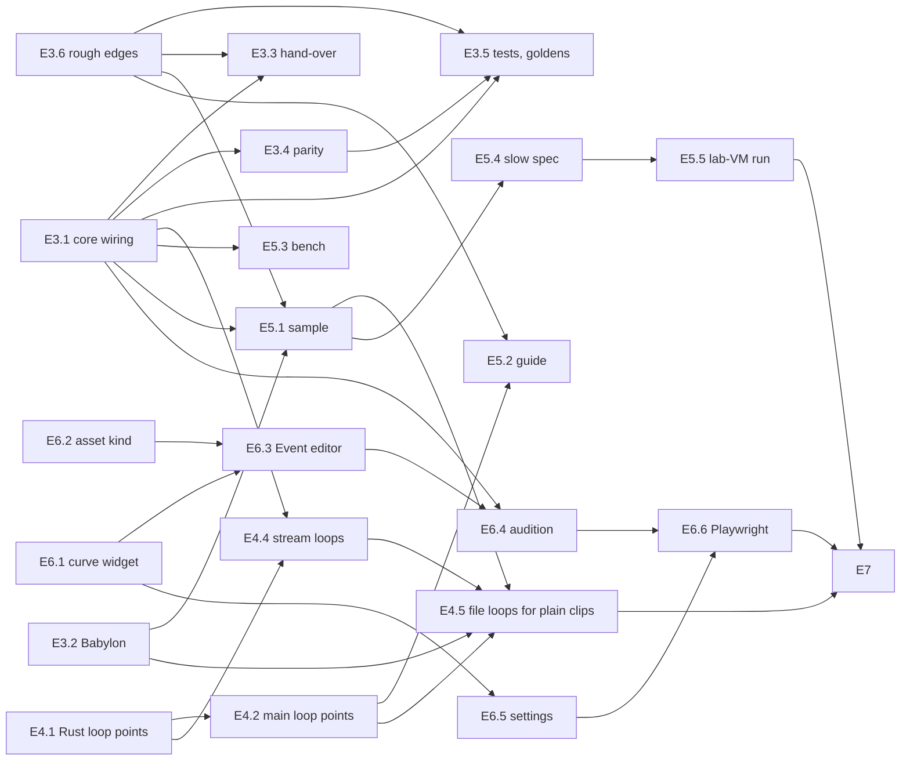

# Audio events M2: the rest of the build in waves (ADR 0158)

This plan takes the M2 milestone table, [2026-11-audio-events-m2.md](2026-11-audio-events-m2.md) (E1–E7), from where the [handoff](2026-11-audio-events-m2-handoff.md) left it and splits what's left into tasks, waves and gates. The milestone table and [ADR 0158](../decisions/0158-audio-events-and-parameters.md) own **what** gets built and each milestone's exit check: where this plan and either of them differ on content, they win. This plan owns **order, file ownership, contracts and gates**. The table names milestones, not tasks, so this plan gives each content item a task id under its milestone (E3.1, E4.2…); every item of E3–E7's "Content" column appears below exactly once. The table has no day counts either, so **every day figure here is an estimate** (labelled "est."), checked against the record's own estimate (M2a ≈ 6 person-weeks, M2b ≈ 5).

The task tree (leads, leaves, models) is [2026-11-audio-events-m2-tree.md](2026-11-audio-events-m2-tree.md). Progress, numbers and deviations go in `docs/design/0157-audio-core/build-log.md` under "M2", as for E1 and E2.

## State at planning (2026-11-10)

Checked in the repository, not taken from the handoff:

- **The M2 work wasn't on this branch or on master.** It is on `origin/claude/vigilant-albattani-bm8i47` (tip `afd26f1`), ten commits on top of `origin/master`'s `b3cdc70` (the local `master` ref in this container is a stale, unrelated `ea19930`; use `origin/master`). This branch (`claude/sweet-ritchie-miy6jm`) was at `b3cdc70` and was fast-forwarded to `afd26f1`; no history was rewritten. **None of M2 is on master yet.**
- **E1** is commit `1df03fd`: `src/engine/core/curve.ts`, `src/engine/audio/eventFormat.ts`, the `audio.parameters` / `automation` / `seed` keys, `MIXER_LIMIT = 256 * 1024` in `native/audio/build.mjs`.
- **E2** is commit `782bb8f`, merged in `178b506`: `audio-core/src/automation.rs`, ABI 1.4, the command-writer methods `setLoop`, `automate`, `param`, `curves`, `busAutomate` (`core/commandWriter.ts:346–434`), goldens `golden/automation-voice.json`, `sustain-release.json` and a bus one.
- **E3 so far** is `7b47cc2` and `098e9da` (`9d714f9` removed a worktree committed by mistake): `runtime/events/automation.ts` (197 lines), `eventRuntime.ts` (891), `events.test.ts` (8 cases); `backend.ts` declares `PlayRequest.group`, `AudioVoice.setLoop?`, `AudioBackend.automation?`, `clipDuration?`, `horizon?`, `AudioDebugInfo.events?`. `CoreBackend` (`core/coreBackend.ts`, 1,167 lines) **implements none of them yet**, so on the core today events run on main through `TsAutomation`. `PendingCoreBackend` is in `backend.ts:377`.
- **Checks re-run here:** after `npm ci`, `npm run typecheck` is green and `npx vitest run src/plugins/audio src/engine/tests/audio src/engine/tests/curve.test.ts` passes 76 files, 1,019 tests, 7 skipped. The full `npm test` gave 378 of 379 files green (3,965 passed, 7 skipped, 1 todo); the one failure, `src/engine/tests/navSample.test.ts` (navigation, not audio), passes when run alone, so it's flaky under load. Treat it as known, not as a gate regression, unless it fails alone. `cargo` 1.97 is present; `wasm-opt` and `wasm-bindgen` are not on the PATH (the audio build has its own pinned tools; see `native/audio/README.md`).
- **The record number 0158 is used twice.** `origin/claude/ecstatic-heisenberg-xg0fvc` (not merged) has `0158-one-field-row-edits-a-component-field-in-the-document-or-a-live-world.md`. Resolved by the owner: audio events keep 0158 (the next number after master's 0157); the other branch renumbers when it merges.
- **Things the table assumes that don't exist yet:** the `audioEvent` asset kind isn't registered (only `AudioSource.clip`'s field metadata names it, `AudioSource.ts:49`); the asset browser doesn't know `*.audioevent.json`. The curve widget is still in the particles plugin (`plugins/particles/editor/ui/particles/CurveEditor.tsx`, `editor/particles/curveEdit.ts`). No loop-point code exists in `audio-decode` or `importSettings.ts`. The guide index is `docs/README.md`.

## What "shippable" means here

Every wave merges to the M2 branch, and every milestone to master, with all of these true:

1. `npm run typecheck`, `npm test`, `npm run build`, `npm run test:e2e` (Chromium) and `cargo test` in `native/audio/` are green; the committed wasm matches its source hash (`wasm/sourceHash.test.ts`); `npm run check:audio-metered` passes, and any baseline change says why in the build log.
2. **Projects without events behave as in M1.** No event path runs unless a script calls `Audio.play` with an event, or an `AudioSource.clip` names one. Voices without automation bindings render bit-identically (E2's rule; the existing goldens and parity digests don't change).
3. **One behaviour change for existing projects is its own task: E4.5.** Honouring loop points written in WAV and Ogg files changes how a plain looping `AudioSource` sounds when its file has them. Until E4.5, file loop points are read and reported but only an event's `loopRegion` or a sidecar's `loopStart`/`loopEnd` uses them. E4.5 is gated on both backends and streams having region loops (E3.1, E3.2, E4.4) and on a check of every sample's clips.
4. The 0158 row in `implementation-status.md` says what landed; nothing editor-side is documented as working before E6 merges.

**When M2 reaches master.** The table doesn't say. Recommendation: merge the M2 branch to master at the end of each milestone (E3+E4 together after wave 2, E5 after wave 3, E6 after wave 4) with the owner's approval, as M1 did. Owner item O2.

## Milestones

| # | Milestone | Tasks (critical path in **bold**) | Exit check | Days (est.) | Waves |
|---|---|---|---|---|---|
| E1 | Foundations | done (`1df03fd`) | as the table | – | – |
| E2 | Core automation and sustain | done (`782bb8f`) | as the table | – | – |
| E3 | Event runtime | E3a (done), E3.1, E3.2, E3.3, E3.4, E3.5, E3.6 | Vitest on the fake backend (seeded) for every container and transition; loopback tests of the core path; the parity test; four wasm event goldens; `Audio.debug()` rows and the panel grouping | 11 | W1, W2 |
| E4 | Loop points from files | E4.1, E4.2, E4.4, E4.5 (E4.3 folded into E4.2, see below) | `cargo test` in `audio-decode` with WAV `smpl` and Ogg/Opus comment fixtures; a stream region-loop and release test; the Babylon voice loops a region; the sample clips check of E4.5 | 7.5 | W1, W2, W3 |
| E5 | M2a exit | E5.1, E5.2, E5.3, E5.4, E5.5 (owner) | 0158 §6 budgets met in the M2 bench; `npm test`, build, Chromium e2e and the `@slow` audio specs green | 4.5 + owner | W2, W3 |
| E6 | Editor (M2b) | **E6.1**, E6.2, **E6.3**, **E6.4**, E6.5, **E6.6** | Playwright specs for authoring and audition | 13.5 | W1–W4 |
| E7 | M2 done | E7.1 (owner), E7.2 | the owner's listening pass; 0157/0158 rows updated | 0.5 + owner | W4 |

Remaining total ≈ 37.5 days of task work (est.), against the record's ≈ 55 for all of M2, of which E1, E2 and E3a took a share. M2b being the larger half matches the record.

### The tasks

| Id | Milestone item it delivers | Days (est.) | Depends on |
|---|---|---|---|
| E3a | (done) event runtime, picks, continuous scheduling, limits, cooldown, release, `Audio.play`, `AudioSource` events, the fallback evaluator | – | – |
| E3.1 | "core backend sends the new commands": `CoreBackend` implements `automation` over the command-writer methods, `clipDuration`, `horizon()`, carries `group` in PLAY; mirrors curves, params, bindings and loops and replays them in a rebuild's REPLAY, spread over several batches (a full curve table is past the 256 KB staging area, `commandWriter.ts:385`); sinks resolve voices by `voice.id`, never `instanceof`, so the runtime's re-send of `PendingVoice`s works (C6); main updates audibility of bound voices on a parameter change; `voices[].event` in core debug rows; a region-aware wrap helper in `coreAutomation.ts` that E4.4 calls | 3 | C3 |
| E3.2 | "the Babylon fallback evaluator" (backend half): `setLoop` on Babylon voices (`loopStart`/`loopEnd`, release clears `loop`), `clipDuration` from the buffer, `voices[].event` in its debug rows, a call to `loopPointsFor` for looping plays (inert until E4.5) | 1 | C1, C3 |
| E3.3 | `PendingCoreBackend` keeps a voice's loop and group across the hand-over (`PendingVoice.setLoop`, so `TsAutomation` doesn't warn while the core loads); the runtime's re-send restores bindings on the core; acceptance: no loop lost, no automation applied twice, voices resolved by id; owns the backend-switch re-send test | 0.5 | E3.1, E3.6 |
| E3.4 | "Rust–TS parity test" | 1.5 | E3.1 |
| E3.5 | the remaining E3 tests (fake backend, seeded) and the four wasm event goldens (captured after E3.4's branch, or recaptured by the coordinator if E3.4 changed Rust) | 3 | E3.1, E3.6, E3.4 for the goldens |
| E3.6 | "`Audio.debug().events` and the debug panel grouping", the panel's count of continuous clips started a frame late (0158 §6), plus the handoff's rough edges: `playing` stops retiring from a getter, per-World seeding (0158 §6) with a hook when a World goes away, step-sequence positions kept per event asset per World (0158 §1; today a `WeakMap` per node), `AudioSource` pitch reaches a playing event, `TsAutomation` stops baking the automated gain into `req.volume` (the core would apply it twice after a hand-over), the inspector says `AudioSource.clip` takes clips or events (0158 Consequences), the curve-id cap documented. **First** it adds tests pinning today's behaviour, since it changes pick sequences | 2 | C3 |
| E4.1 | "Decoder reads WAV `smpl` and Ogg/Opus `LOOPSTART`/`LOOPLENGTH`": the Rust reader, the wasm's clip-info record widened, and the worker's decode reply (`decoder/clips.ts`) carrying the points; decides where a streamed WAV's trailing `smpl` is read | 1.5 | C2 |
| E4.2 | "sidecar `loopStart`/`loopEnd` (0040) override": the keys in `importSettings.ts`; main's clip registry keeps the decoder's points and fires `onLoopPoints`; `loopPoints.ts` resolves sidecar over file; and **E4.3** "Babylon `loopStart`/`loopEnd`" (the TypeScript reader the fallback needs, since Babylon doesn't use the decoder) | 1.5 | E4.1, C1 |
| E4.4 | "streams loop a region through the worker", and release of a stream's loop (E2 left stream voices ignoring SET_LOOP); region-aware wrapping in seek, `reopenStreams` after a rebuild and `PlayheadTracker`. **First** its lead picks the release mechanism: the ring holds up to ≈ 0.68 s the worker has already wrapped, so a worker-only release lands late unless the ring is flushed (an epoch seek) or `audio-core`'s stream path learns SET_LOOP; a Rust change here is allowed (it owns `stream.rs`/`voices.rs` in W2) and is logged | 2.5 | E4.1, E3.1 |
| E4.5 | **the behaviour flip:** a plain looping clip uses its file's or sidecar's loop points on both backends (late-arriving points through `onLoopPoints`; on Babylon, which plays by URL, the bytes are fetched for the reader); an event `clip` without `loopRegion` defaults to the clip's own loop points (0158 §1; today `eventRuntime.ts:688` sends the whole clip); Babylon warns once that streamed clips loop whole (0158 §4); the guide gains the file-loop paragraph | 1 | E3.2, E4.2, E4.4, E5.1 (the survey covers its clips) |
| E5.1 | "`samples/sound-lab` events page" (footsteps by surface, RPM-blended engine with sustain and tail, music intensity bus automation) | 2 | E3.1, E3.2, E3.6 |
| E5.2 | "'Sound events' guide page" (sidecar loop points included; E4.5 adds the file-loop paragraph) | 1 | E3.6, E4.2 |
| E5.3 | "M2 bench (main per play and per `setParameter`, core automation p99.9)" | 1 | E3.1 |
| E5.4 | "a `@slow` spec playing the events" | 0.5 | E5.1 |
| E5.5 | the lab-VM run of E5.3's native numbers (E2 measured 25–45 µs p99.9 on the shared container against the 30 µs budget) | owner | E5.3 |
| E6.1 | "`CurveEditor.tsx`/`curveEdit.ts` moved to `src/editor/ui/` with an x range and per-segment interpolation (particles keep using it)" | 2 | – |
| E6.2 | "Asset kind `audioEvent` and its format" and "New Event and 'Create event from clips'"; registers the Event editor's open hook and panel as stubs (C4) | 1.5 | – |
| E6.3 | "the Event editor (tree, properties, parameters)" | 5 | E6.1, E6.2 |
| E6.4 | "audition" | 2 | E6.3, E3.1 |
| E6.5 | "Project Settings > Audio: Parameters and bus Automation" | 2 | E6.1 |
| E6.6 | "Playwright specs for authoring and audition" | 1 | E6.3, E6.4, E6.5 |
| E5.3b | (bench follow-up, m2-decisions entry 11) cut `Audio.play`'s main-thread cost; also the event `loopRegion` default and `releaseFade` in the runtime (both in `eventRuntime.ts`) | 1.5 | E3.5 |
| E6.3b | (E6.3 follow-up) an asset drop-target hook in `src/editor/assetDrag.ts` for plugin panels, replacing the Event editor's workaround | 1 | E6.3 |
| E3.7 | (owner-approved addition) `@field` `description` (ADR 0159), shown as the Inspector tooltip; `AudioSource.clip`'s first use | 0.5 | – |
| E3.8 | (owner-approved addition) optional `releaseFade` on `sustain` (m2-decisions entry 10): parser, runtime, editor field, guide | 0.5 | E3.5, E6.3 |
| E7.1 | the owner's listening pass of the sample events | owner | E5, E6 |
| E7.2 | "0157/0158 rows updated", build-log close, handoff | 0.5 | all |

## The critical path

**The pure dependency chain** is the editor: E6.1 (2) → E6.3 (5) → E6.4 (2) → E6.6 (1) → E7 = **10 days** (est.). The runtime chains are shorter: E3.1 (3) → E5.1 (2) → E5.4 (0.5) → E5.5 = 5.5 days plus the owner's lab-VM run; E4.1 (1.5) → E4.4 (2.5) → E4.5 (1) = 5 days. **Start E6.1 and E6.2 in wave 1**, alongside the runtime work, even though the table lists the editor after M2a: nothing in E6.1/E6.2 needs E3 to finish.

**The staffing queue** (the strongest model's lead work, in order) is E3.1 (3) → E4.4 (2.5) → E6.3 (5) = **10.5 days** (est.) if one strongest-model lead did them back to back, half a day longer than the pure chain. Run as separate agents they overlap: E3.1 and E4.4 are in different waves anyway, and E6.3 needs only E6.1/E6.2. No task sits on a path only because of staffing, provided the coordinator starts E6.3's lead in wave 2 alongside E4.4's.

**The coordinator** is the real bottleneck: four wave reviews, the merges (including every wasm rebuild, below), the milestone merges and the owner reports.

## Who does what

- **Coordinator** (main session, strongest model): commits the contracts in wave 0; runs the waves; merges task branches; rebuilds and commits the wasm after each merge that touched Rust; owns the single-writer files; runs the wave reviews and the global checks; writes the build log and the owner reports.
- **Leads and leaves:** see the tree. Strongest model for E3.1, E4.4, E6.3; the mid model for the rest; the cheapest model for leaves only where the leaf criteria hold.
- **Isolation:** every lead and leaf works in its own git worktree, branched from the wave's base (leaves from their lead's skeleton commit). Worktrees stay out of commits (`.claude/worktrees/` is excluded since `9d714f9`; check `git status` before every commit).
- **Owner-only items:** O1 the 0158 numbering clash (resolved: audio keeps 0158); O2 when M2 reaches master (resolved: the plan merges now, then each milestone end); O3 the lab-VM run (E5.5) and whether E2's 25–45 µs native automation cost on the shared container meets the 30 µs budget there; O4 the listening pass (E7.1); O5 the E2 deviations listed in the handoff (accept, or ask for changes); O6 the decisions listed under "Open" in the handoff.

### Single-writer files

| File | Writer |
|---|---|
| `src/plugins/audio/runtime/wasm/*.wasm`, `wasm/hash.json` | coordinator, after merging (`npm run build:audio`); task branches commit Rust source and may commit a local rebuild, which the coordinator's rebuild replaces |
| the metered baseline (`npm run check:audio-metered`'s file) | coordinator, with a build-log line |
| `docs/architecture/implementation-status.md`, `docs/design/0157-audio-core/build-log.md`, `docs/README.md` (record and guide index) | coordinator |
| `docs/decisions/*` | coordinator (no task rewrites 0158; deviations go in the build log) |
| `src/myco.ts`, `src/plugins/audio/runtime/index.ts` (public exports) | coordinator; M2's public surface is already exported, so no task should need them |
| `package.json`, `vite*.ts`, `playwright.config.ts` | coordinator |
| `src/plugins/audio/runtime/backend.ts` | coordinator for interface changes (C3); E3.3 owns `PendingCoreBackend`/`PendingVoice` bodies in wave 2 |
| `src/plugins/audio/runtime/testing.ts` (fake backend) | E3.6 in wave 1, E3.5 in wave 2 |

### Contracts

| Id | Contract | Lands | Lets run in parallel |
|---|---|---|---|
| C0 | E2's command-writer methods and `AutomationSink` (`events/automation.ts`), the event-format types (`eventFormat.ts`) and `Curve` | done | everything |
| C1 | `src/plugins/audio/runtime/loopPoints.ts`: `interface LoopPoints { start: number; end: number }` (seconds), `loopPointsFor(path): LoopPoints \| null` and `setFileLoopPoints(path, points)` and `onLoopPoints(path, cb)` (points come from the decoder asynchronously, so they are usually unknown at PLAY), stub bodies returning `null` / never calling back; a doc comment stating the precedence rule (sidecar over file, 0158 §4) and that plain clips ignore it until E4.5 | wave 0 (coordinator) | E3.1 and E3.2 call it in W1 while E4.2 fills it in W2 and E4.4 reads it |
| C2 | `decoder/protocol.ts`: optional `loopStartFrame`/`loopEndFrame` on the clip-decode reply (and `ClipInfo`); a `streamLoop` message (`looping: false` = release). The wire's `StreamOpen` already has `loopStart`/`loopEnd`. If `decoderClient.ts` doesn't pass the reply's fields through as they are, the coordinator adds the pass-through here | wave 0 (coordinator) | E4.1 (worker side) in W1; E4.2 (main side, reading `ClipInfo`) and E4.4 (owner of `decoderClient.ts` in W2) without editing the protocol |
| C3 | `backend.ts`: `AudioDebugInfo.voices[].event?: number \| null` | wave 0 (coordinator) | E3.1 (core rows), E3.2 (Babylon rows) and E3.6 (panel) in W1 |
| C4 | `plugins/audio/editor/event/openEventEditor.ts` (stub), the Event editor's panel id registered with a placeholder component, and `event/Audition.tsx` exporting `AuditionProps` with a stub body | W1, E6.2's skeleton (committed first in its task) | E6.3 in W2 and E6.4 in W3 without touching `editor/index.ts` |
| C5 | `src/editor/ui/CurveEditor.tsx` props: `{ curve: Curve; onChange; xRange: [number, number]; yRange; interpolation: boolean }` | W1, E6.1's skeleton (committed first in its task) | E6.3 and E6.5 in W2 |
| C6 | `core/coreAutomation.ts`: an `onPlay(voice, req)` hook, a `setLoop` route that E4.4 extends to streams, a region-aware wrap helper; voices resolved by `voice.id` (a re-sent `PendingVoice` must work) | W1, E3.1 | E4.5 in W3 without editing `coreBackend.ts`; E4.4 still edits `coreBackend.ts` (seek, `reopenStreams`) and `replay.ts` (`PlayheadTracker`), alone in W2 |

## Wave reviews

After every wave, before the next one starts, the coordinator:

1. Merges the task branches in dependency order; rebuilds the wasm if any Rust changed; runs the shippable checks above (the `@slow` audio specs at the end of W2 and W3).
2. Diffs each task against its file list in this plan; anything outside it is either justified in the task report or reverted.
3. Checks the deviation list: any departure from 0158 or the E2 contract goes in the build log under "M2", with the owner flagged if it needs a decision.
4. Records the pilot measures (wave 1) and the tree's leaf success in the build log.
5. Updates the 0158 row in `implementation-status.md` and the handoff.

## Wave 0: contracts and baseline (coordinator, ≈ 0.5 day est.)

- Commit C1, C2, C3 (types and stubs only; typecheck green).
- Log in the build log, as deviations from 0158: STATUS carries no `group` (§6's line; main knows each voice's group), and the E2 list from the handoff (owner item O5).
- Open the tickets if the owner wants them tracked as M1 was (GitHub epic per milestone, sub-issue per task; leaves as checklist lines). Not done in planning.

## Wave 1 (pilot): finish the runtime's backends, start E4 and the editor

| Task | Level | Files (all new unless marked) |
|---|---|---|
| E3.1 | strongest | `core/coreAutomation.ts`, `core/coreAutomation.test.ts`, `core/automationLoopback.test.ts`; edits: `core/coreBackend.ts`, `core/replay.ts`, `core/recovery.ts`, `core/voiceTable.ts`, `core/selection.ts`, `core/debug.ts`, `core/clipRegistry.ts` (a duration getter, if needed) |
| E3.2 | mid | `babylonLoop.test.ts`; edits: `babylonBackend.ts` |
| E3.6 | mid | edits: `events/eventRuntime.ts`, `events/automation.ts`, `AudioSource.ts`, `Audio.ts`, `audioSystem.ts` (World-gone hook), `testing.ts`, `editor/AudioDebugPanel.tsx`, `editor/audioDebugPanel.css`, `editor/audioDebugPanel.test.ts`; new `events/pinned.test.ts` (today's behaviour, written first), `events/rough.test.ts` |
| E4.1 | mid | `native/audio/crates/audio-decode/src/loop_points.rs`, `audio-decode/tests/loop_points.rs`, fixtures under `audio-decode/tests/fixtures/loop/`; edits: `audio-decode/src/lib.rs`, `decoder.rs`, `audio-decode/tests/abi.rs`, `decoder/clips.ts` (the worker's reply), `decoder/handler.ts`, `decoder/wasm.ts` |
| E6.1 | mid | `src/editor/ui/CurveEditor.tsx`, `src/editor/ui/curveEdit.ts`, `src/editor/ui/curveEdit.test.ts` (moved and extended); edits: `plugins/particles/editor/ui/ParticleInspector.tsx`, `ui/particles/GradientEditor.tsx`, `ui/particles/valueInputs.tsx`, `ui/particleGraph/valueFields.tsx`, the curve rules in `particles.css` (moved to `src/editor/ui/`); deletes the old two files and their test |
| E6.2 | mid | `plugins/audio/editor/eventAsset.ts`, `eventAsset.test.ts`, `createEventFromClips.ts`, `createEventFromClips.test.ts`, `event/openEventEditor.ts`, `event/EventEditorPanel.tsx` (placeholder), `event/Audition.tsx` (stub); edits: `plugins/audio/editor/index.ts` |

**Seams set up:** C4 (E6.2), C5 (E6.1), C6 (E3.1). The debug field (C3) lets E3.1, E3.2 and E3.6 share the debug rows without sharing a file.

**Exit:** the shippable checks; on the core, an event's automation runs in the core (no `TsAutomation` instance on `CoreBackend`), a rebuild restores a playing automated, looping event (loopback); on Babylon, a sustain region loops and releases; the particle inspector's curves still edit (its existing tests and e2e); New Event creates a parseable `*.audioevent.json`.

## Wave 2: E3's tests and parity, E4's main side and streams, the Event editor

| Task | Level | Files |
|---|---|---|
| E3.3 + E3.5 (one lead) | mid | `events/handover.test.ts` (including the backend-switch re-send), `events/containers.test.ts`, `events/instances.test.ts`, `events/sourceAndDebug.test.ts`, `events/eventGolden.test.ts`, `golden/event-layered.json`, `event-blend.json`, `event-continuous.json`, `event-sustain-release.json`; edits: `backend.ts` (`PendingCoreBackend`/`PendingVoice` bodies only), `testing.ts`, `events/eventRuntime.ts` (fixes the tests find); **not** `events/automation.ts` (E3.4's in W2) |
| E3.4 | mid | `events/automationParity.test.ts`; sole owner in W2 of `events/automation.ts`; edits if parity finds a bug: `native/audio/crates/audio-core/src/automation.rs` (and its tests) |
| E4.2 (with E4.3) | mid | `runtime/loopPointsReader.ts`, `loopPointsReader.test.ts`, `loopPoints.test.ts`; edits: `loopPoints.ts` (fills C1), `core/clipRegistry.ts`, `src/engine/scene/importSettings.ts` (+ its test) |
| E4.4 | strongest | `decoder/streamRegion.test.ts`, `core/streamRegionLoopback.test.ts`; edits: `audio-decode/src/decoder.rs`, `decoder/handler.ts`, `decoder/streams.ts`, `decoder/decoderClient.ts`, `core/streams.ts`, `core/coreAutomation.ts`, `core/coreBackend.ts` (seek, `reopenStreams`), `core/replay.ts` (`PlayheadTracker`); if its release mechanism needs it, `audio-core/src/stream.rs` and `voices.rs` |
| E5.1 | mid | `samples/sound-lab/scenes/events.scene.json`, `samples/sound-lab/audio/events/*.audioevent.json`, `audio/events/*.wav` (generated), `scripts/behaviors/*Events*.ts`; edits: `samples/sound-lab/project.json` (global parameters, bus automation), `tools/makeTones.mjs`, `tools/README.md`, `sample.json` (if it lists scenes) |
| E5.2 | mid | `docs/guide/sound-events.md` (the coordinator adds it to `docs/README.md`) |
| E5.3 | mid | `events/eventBench.test.ts` (main per play and per `setParameter`); a build-log entry with the native `audio-bench` automation numbers |
| E6.3 | strongest | `plugins/audio/editor/event/EventEditorPanel.tsx` (fills the placeholder), `eventTree.ts`, `eventTree.test.ts`, `NodeProperties.tsx`, `nodeFields.ts`, `nodeFields.test.ts`, `ParametersPane.tsx`, `eventEditor.css`; edits: `event/openEventEditor.ts` (fills C4) |
| E6.5 | mid | edits: `plugins/audio/editor/AudioSettingsSection.tsx`, `audioSettingsModel.ts`, `audioSettingsModel.test.ts`, `audioSettings.css` |

**Exit (E3 and E4 milestones, merge to master if O2 says so):** E3's and E4's exit checks from the milestone table; the `@slow` audio specs green.

## Wave 3: audition, the slow spec, the flip, the bench run

| Task | Level | Files |
|---|---|---|
| E6.4 | mid | `plugins/audio/editor/event/Audition.tsx` (fills C4), `event/auditionHost.ts`, `event/auditionHost.test.ts` |
| E5.4 | mid | `tests/e2e/audio-events.spec.ts` (tagged `@slow`) |
| E4.5 | mid | edits: `loopPoints.ts` (plain-clip use), `core/coreAutomation.ts` (`onPlay` and `onLoopPoints` send SET_LOOP for plain loops), `babylonBackend.ts` (the C1 call becomes live, bytes fetched for the reader, the streamed-loop warning), `events/eventRuntime.ts` (the `loopRegion` default), `docs/guide/sound-events.md` (one paragraph); `loopFlip.test.ts`; a list in the build log of every sample clip with loop points and how it now sounds |
| E5.5 | owner | the lab-VM run of E5.3's native numbers |

**Exit (E5):** 0158 §6's budgets in the build log (main ≤ 5 µs per typical `Audio.play` and per `setParameter`; ≈ 0 per frame for steady instances; core automation ≤ 0.03 ms p99.9 at 256 voices × 3 bindings, from the lab VM); the `@slow` spec green.

**Wave 3 as run (base `28b134f`):** E4.5 (plain-clip loop points on both backends, and selection lets an automated voice fade before demoting it, m2-decisions entry 14), E5.3b, E3.7 (ADR 0159), E3.8 (`releaseFade` editor field, one Haiku leaf; the coordinator added the parser and `sustainReleaseFade` as contract C7), E6.4, E6.3b, E5.4. File owners this wave: `eventRuntime.ts` E5.3b; `coreAutomation.ts`, `babylonBackend.ts`, `loopPoints.ts` E4.5; `nodeFields.ts` E3.8; `registry.ts`, `AudioSource.ts` E3.7; `assetDrag.ts`, `EventTree.tsx` E6.3b; `Audition.tsx`, `auditionHost.ts` E6.4; `src/editor/sdk/index.ts` additive lines by E6.4 and E6.3b; the guide is the coordinator's (from reports).

## Wave 4: editor specs and close

| Task | Level | Files |
|---|---|---|
| E6.6 | mid | `tests/e2e/audio-event-editor.spec.ts` |
| E7.2 | coordinator | `implementation-status.md`, build log, the handoff, the 0157 row |
| E7.1 | owner | listening pass of `samples/sound-lab`'s events page |

**Exit (E6, E7):** the Playwright specs; the owner's sign-off.

## Independent review (2026-11-10)

A fresh agent that didn't write the plan reviewed it against ADR 0158, the milestone table, the old handoff and the code. Its findings, all applied above: `decoderClient.ts` was claimed by E4.2 and E4.4 in W2 (now E4.4's; E4.2 reads `ClipInfo`), and `decoder/clips.ts` is worker code that belongs to E4.1; C6 couldn't keep E4.4 out of `coreBackend.ts` and `replay.ts` (stream seek, reopen and the playhead wrap at the whole stream), so E4.4 owns them in W2; a stream's release may need a ring flush or a core change (E4.4 decides first); E3.5's goldens depend on E3.4; the hand-over needs voices resolved by id, `PendingVoice.setLoop` and no double-applied gain (C6, E3.3, E3.6); E3.1 replays curves over several batches and lists `recovery.ts` and `selection.ts`; C1 gained `onLoopPoints`; uncovered 0158 items were placed (the `loopRegion` default and the Babylon streamed-loop warning in E4.5; the frame-late counter, per-asset-per-World step positions and the inspector wording in E3.6); E3.6 pins today's behaviour before changing it; E5.2 depends on E4.2; `events/automation.ts` has one W2 owner (E3.4); the stale local `master` ref is noted. It confirmed that every content item of E3–E7 and every item of the old handoff's "what's left" maps to a task, and that W1 has no collisions.

## Risks

| Risk | Where it shows | Response |
|---|---|---|
| Native automation cost over budget on the lab VM (25–45 µs p99.9 on the shared container vs 30 µs) | E5.5 | the per-voice low-pass (≈ 195 µs in the full scene) is the first suspect; options are a cheaper one-pole filter for automated low-pass or a lower control rate, each needing an owner decision; E5 doesn't exit until O3 |
| Parity test finds Rust and TypeScript evaluators disagree | E3.4 | fix the side that departs from `curve.ts` (the reference); a Rust fix changes the mixer wasm, maybe the metered baseline, and E3.5's event goldens, all re-done by the coordinator at the merge |
| A stream's release lands up to a ring-length (≈ 0.68 s) late | E4.4 | the lead picks the mechanism first (epoch seek or core stream change) and logs it; if neither is sample-accurate, it's an owner decision whether 0158 §4's "exact frame" applies to streams |
| Rebuild replay loses automation state | E3.1 | the loopback test of a rebuild mid-automation is part of E3.1's acceptance, not deferred to E3.5 |
| WAV `smpl` chunks after the data chunk can't be seen by a reader that has only the head of a streamed file | E4.1, E4.4 | the Rust reader scans the whole file for clips; for streams the worker reports the points when it reaches them or reads the chunk list first; E4.1's lead confirms which before E4.4 starts |
| File loop points change how existing loops sound | E4.5 | it's its own task, with the sample-clip list; the owner can ask for an opt-out key |
| The editor half is larger than estimated (the record says so) | E6.3, E6.4 | E6.3 is the pure chain's longest task; its lead reports at the halfway point; cut "Create event from clips" to a follow-up before cutting audition |
| Two records numbered 0158 | merge of the field-row branch | resolved: audio keeps 0158; that branch renumbers |
| The old in-progress handoff conflicts with this plan | session start | this plan replaces its "What's left" section; the handoff is rewritten to point here |
