# Audio mix M5: milestones, waves and gates (ADR 0171 + 0172)

This plan breaks the M5 task table, [api-and-models.md §11](../design/0171-audio-mix/api-and-models.md#11-task-breakdown) (Wa1–Dc5, 79 rows, 300.5 days), into milestones, waves, contracts and gates. **The task table owns each task's ID, days, dependencies and acceptance:** where this plan and the table differ on those, the table wins, except for the changes listed under "Changed from the table", each with its reason. The records ([ADR 0171](../decisions/0171-audio-profiler-loudness-metering-and-live-mixing.md), amended by [ADR 0172](../decisions/0172-audio-mix-design-corrections-and-owner-decisions.md), which wins where they disagree) and the design ([docs/design/0171-audio-mix/](../design/0171-audio-mix/README.md)) own *what* gets built. This plan owns **order, file ownership, contracts and gates**.

The task tree (leads, leaves, models) is [2026-11-audio-mix-m5-tree.md](2026-11-audio-mix-m5-tree.md). The rules every brief repeats are in [2026-11-audio-mix-m5-ground-rules.md](2026-11-audio-mix-m5-ground-rules.md). The handoff that starts the build is [2026-11-audio-mix-m5-build-handoff.md](2026-11-audio-mix-m5-build-handoff.md). Progress, numbers and deviations go in a new `docs/design/0171-audio-mix/build-log.md` (coordinator), as `0166-audio-music/build-log.md` held M4.

**Every day figure is the table's human-effort estimate** unless labelled "plan est.". Every figure this plan derives (chains, staffing queues, wave lengths, contract days, leaf days) is an estimate until the pilot wave reports. Chains, the staffing simulation and the wave check were computed by script from the table's rows (re-sum: 79 rows, 300.5 d; S 113.5, M 172.5, J 14.5; every dependency names an existing row), not by hand. Days are **table-days**, a relative measure of work: M4's 290.5 table-days ran in about two days of wall-clock agent time.

## State at planning (2026-11-13)

Checked in the repository rather than taken from the handoff ([2026-11-audio-mix-m5-plan-handoff.md](2026-11-audio-mix-m5-plan-handoff.md)):

- **The design is on master.** The handoff says the design branch wasn't merged; it since was. `origin/master` is `a35a80b` ("M5 handoff: coreDriver path"). This branch, `claude/loving-fermi-g98916`, was at `3cdb2bd`, an ancestor of master, and was fast-forwarded to `a35a80b` (no merge commit, nothing lost).
- **Record numbers:** master's newest record is **0172** (Accepted, amends 0171). The next free number is **0173**; check master again before allocating it. ADR 0147 is **Proposed** (`docs/decisions/0147-*.md:3`), so Hk1 appends a section to it rather than writing a record.
- **Handoff facts confirmed:**
  - The mixer is **319,799 B** (`src/plugins/audio/runtime/wasm/myco_audio.wasm`); `MIXER_LIMIT = 320 * 1024` = 327,680 B and `MIXER_WARN = 300 * 1024` (`native/audio/build.mjs:27–29`). The mixer already builds past the warning.
  - The engine's audio code is in `src/plugins/audio/` (`runtime/core/coreBackend.ts`, `runtime/core/context.ts`, `runtime/worklet/coreDriver.ts`); the mixer model is `src/engine/audio/mixer.ts`.
  - `CoreLink.handleMessage` decodes STATUS, then posts RECYCLE, then calls `receive` (`runtime/core/context.ts:239–248`): the recorder's copy goes between the decode and the RECYCLE.
  - STATUS size hard-coded in tests: `core/mirror.test.ts:133,141` and `core/bufferPool.test.ts:96,98` (16,384); `runtime/wire.m4.test.ts:200` asserts `STATUS_WORST_CASE_BYTES` 16,192. `bufferPool.ts:73` already reads the generated `STATUS_BUFFER_BYTES`. The core's writer has its own `HEADER_BYTES = 176` and `BUFFER_BYTES = 16 * 1024` (`audio-core/src/status.rs`), so the header growth needs a core edit in the same merge as the wire.
  - `ProjectSurface.changed()` already exists with another meaning (`src/editor/sdk/project.ts:42–43`).
  - The samples call `fadeTo`: `samples/flappy/scripts/behaviors/GameManager.ts:17,22`, `samples/sound-lab/scripts/behaviors/Buses.ts:17`, `samples/stress/scripts/behaviors/Stress.ts:208`.
- **Facts the handoff doesn't state, which this plan relies on:**
  - Sizes of the hot files: `bus.rs` 689 lines, `voices.rs` 2,491, `scheduler.rs` 822, `due.rs` 371, `counters.rs` 720, `status.rs` 620, `fx.rs` 355, `sends.rs` 189, `core.rs` 259, `layout.rs` 306, `compressor.rs` 525; `coreBackend.ts` 2,140, `eventRuntime.ts` 1,599, `babylonBackend.ts` 1,448, `context.ts` 1,157, `coreDriver.ts` 1,050, `backend.ts` 964, `voiceTable.ts` 950, `coreAutomation.ts` 932, `commandWriter.ts` 863, `AudioSettingsSection.tsx` 798, `audioSettingsModel.ts` 745, `replay.ts` 682, `settings.ts` 596, `mixer.ts` 268.
  - **`BUS_MIX` carries the snapshot low-pass as well as the gain** (`bus.rs:88–90`, `coreBackend.ts:678–698`), and main writes it from `coreBackend.ts`, `commandWriter.ts:461–465` and `replay.ts:491–505`. Its retirement can't land in Wa1 alone without breaking typecheck and every bus test; see the lanes flip below.
  - **The shared reverb (convolver) lives in `bus.rs`** (`bus.rs:63, 441, 587–591`), not in `zones.rs` or `sends.rs`; `IDLE_MARGIN_QUANTA` is `zones.rs:116`.
  - **`audio-core/src/layout.rs` and `core.rs` have no owner in the table**, though the design's layout lists both as changed and the core gains ≈ 24 KB of state (loudness 14.8 KB, lanes, duck followers, detectors and the send scratch ≈ 9 KB, [ARCH §6]). Contract K1 owns them.
  - `projectSettingsSection.ts` and `projectSection.ts` are in `src/editor/`, not `src/editor/sdk/` (Hk1's row lists them beside `sdk/project.ts`).
  - The exported-game smoke already exists: `tests/e2e/export.spec.ts` (tagged `@slow`) has a Sound Lab web build with an audio case (F-35). Each milestone adds a case there. The discontinuity detector is `maxStep` in `runtime/audioGolden.test.ts:644` (F-40); `runtime/core/passByLoopback.test.ts` is its loopback use.
  - The machine is **4 cores** (`nproc`), with 30 GB free disk. rustc here is **1.97.0** against the pinned 1.99.1 (`native/audio/rust-toolchain*`): metered counts read +1–4% over `baseline.json` here, as in M4.
- **Things the design names that don't exist yet:** `audio-wire/src/schema/mix.rs`; `audio-core/src/{lanes,bus_order,loudness,duck}.rs`; `audio-dsp/src/{loudness,sidechain}.rs`; `src/engine/audio/{loudnessTypes,mixOps,slotTable}.ts`; `src/plugins/audio/runtime/mix/` and `runtime/capture/` (all of them); `src/plugins/audio/editor/mix/` (all of it); `tests/e2e/audio-mix-{a,b,c,d}.spec.ts`; `docs/design/0171-audio-mix/build-log.md` and `listening-pass.md`.
- **Not run in planning:** `node_modules` is absent in this container, so no baseline `npm test` or typecheck was run. Wave 0 does it once (the owner's rule: no run that can't change a decision; the baseline can).

## What "shippable" means here

Every wave merges to the M5 integration branch, and every milestone to master, with all of these true:

1. **Wave end** (the owner's cadence, [0162 working-notes](../design/0162-audio-spatial/working-notes.md)): `npm run typecheck`, the full `npm test`, `npm run build`, `npm run test:e2e` (Chromium), `cargo test` in `native/audio/`, `npm run check:audio-metered`, and the short benches the wave's tasks touch. The committed wasm matches its source hash (`wasm/sourceHash.test.ts`). A baseline change says why in the build log. The coordinator runs these with **no agent running a browser suite, bench or build** (M4's retrospective).
2. **Milestone end, before master:** also `npm run test:e2e:slow` (which holds `export.spec.ts`, the **shipped-form smoke**), WebKit and Firefox when the milestone touches the browser layer (all five do), the long benches, the **discontinuity check** on the milestone's new scenes, and the coordinator's run of the milestone's listening walker in listen mode before the owner gets it. After any merge that follows the milestone checks, the specs covering the changed code run again before the master merge (M4's retrospective, item 3).
3. **M1–M4 goldens and parity digests stay bit-identical** at every wave end. M5 has **exactly one named exception**: the muted-bus-with-a-send golden that post-fader sends change (Rv1, R11). Any other digest change is a failure, not a re-record.
4. **No feature flags, no compatibility defaults** (owner). What changes for every project is a **flip**: its own merge, gated on its safety net. A task's table dependencies are kept; the plan only holds merges back.

   | Flip | What changes for every project | Tasks | Gated on (safety net) |
   |---|---|---|---|
   | **Seven gain lanes** | every bus's gain goes through `lanes.rs` instead of the single ramp | B1a | every existing bus golden keeps its digest through the `BUS_RAMP` harness (B1a's own acceptance); checked again in G1 |
   | **`BUS_MIX` retired** | main writes `BUS_RAMP` (the `runtime` lane and the snapshot low-pass) where it wrote `BUS_MIX`; the opcode leaves the schema | R0 (coordinator, plan est. 0.5 d) after **B1a and Wa2** have both merged (W2's end) | the bus goldens and `busEffectiveGainLoopback.test.ts` unchanged on the integration head with both merged; until R0 the core accepts both opcodes |
   | **Mixer authored/runtime split** | `Bus.volume` becomes the script multiplier; `authoredVolume` is new; `fadeTo` in the samples behaves differently | **Mx1 + Sa1, merged together** (W1's end) | Mx1's "fade, snapshot and presence-duck curves equal today's at the heard clock" and Sa1's sample parse and `fadeTo`/`mute` checks |
   | **Post-fader sends** | a muted, faded, ducked or snapshot-lowered bus stops feeding the reverb (owner decision 1) | Rv1 (W3) | Rv1's named new golden, every other bus golden unchanged, a settled gain of 1 bit-identical; owner listening section M5-0 |
   | **Presence ducking in the core** | main stops computing presence ducks; `BUS_PRESENCE` stamps them at the voice frame | **Dp1 + G1, merged together** (W4) | G1's presence duck against the offline reference. Dp1 waits on its branch until G1's presence case passes; Dp1 is on G1's path anyway, so this costs no days |
   | **Stamped bus ramps** | script fades and snapshots start on their stamp (class B in the due list) | B1b (W3), then Mx2 (W3) | B1b's exactness (1e-7) and `splitQuanta` 0; Mx2's loopback fade landing on its stamp; G1's stamped cases |
   | **The loudness ladder step** | with buses metered, bed and zone shedding start 1 s later | Ld7 (W7) | Ld7's step-order test through the 0170 recovery (`ladderRecoveryLoopback.test.ts`); skipped with master only, so no project without extra meters changes |
   | **Edits in Play reach the mixer** | an edit, undo or redo in Play applies live | Hk1 (W2) and Ma1 (W5), then **Ma2 + Ck1 merged together** (W6–W7) | until Ma2 merges, Ma1 answers every structural op with `restartRequired` ("applies at the next Play"), so no structural edit can click; Ma2 waits on its branch until Ck1's structural cases pass |

   Level ducking (Sc1) and the meters (Ld2) are opt-in by data (a rule with `mode: "level"`, a bus with `meter`), so they aren't flips.

5. A milestone reaches master at the end of the wave that completes it, in order. Tasks of later milestones merged by then go with it: each passed its own acceptance and none is an ungated flip, so they don't change behaviour, though some are reachable through data. Nothing editor-side is documented as working before its milestone, and no guide chapter ships before its milestone's Dc task.

## Milestones

The table's milestone groups, unchanged. **The table's bold (each milestone's longest chain)** is in bold. The exit checks are §10's plus the shipped-form smoke, the discontinuity check and the owner's listening section. "Ends" is the wave that completes the milestone (plan est.).

| Id | Name | Tasks (+ plan tasks) | Exit check | Days | Ends |
|---|---|---|---|---|---|
| **M5-0** | the core's mix timing | **Wa1**, Wa2, B1a, B1b, Rv1, **B2, B3**, B4, **Dp1, G1**, Mx1, Mx2, Sa1, Bn1, **Dc1** (+ K0, K1, S0, R0, DS0, SX0, LS0) | every existing digest unchanged and `splitQuanta` 0 in the ramp scenes; a presence duck starts on its stamped frame; a late batch's sequence shifts whole; the named golden exception recorded; mixer size recorded. **Shipped form:** the Sound Lab export plays a scripted fade and a presence duck after the first tap (SX0). **Discontinuity:** `maxStep` on the stamped fade, snapshot, presence duck and post-fader mute scenes (DS0). **Owner:** listening section M5-0 | 57 | W4 |
| **M5a** | the stream, the CPU figure and the Profiler | Cp1, Cp2, **Rc1**, Rc1b, Rc2, Rc3, Rc4, **Rc5**, Rc6, **Pf1, Pf2**, Pf3a–Pf3d, **Pf4, Pf5**, Pf7, Pf8, Bb1, Dbg1, Bn2, **E1**, Dc2 | zero allocation per block over 10 minutes; a capture round-trips at five positions; `loadPermille` reads a real number in Chromium and a reason where the clock is coarse. **Shipped form:** a Sound Lab export that never calls `Audio.capture.start` loads no recorder chunk (Rc4's case). No sound changes, so no discontinuity check or listening section | 97.5 | W9 |
| **M5b** | loudness | **Ld1, Ld2, Ld7**, Ld3, Ld4, Ld5, Ld6, Ld8, Bn3, Pf6, Bb2, E2, Dc3 (+ SXb, LSb) | spike S1's checks and the synthesised EBU goldens on native and wasm; a −23 dBFS tone reads −22.99 LUFS in Play; the scenes inside the allowances. **Shipped form:** the export reads a loudness value on master (SXb). **Owner:** listening section M5b (loudness against a reference file) | 45.5 | W9 (after M5a) |
| **M5c** | live mixing and sidechain ducking | Sc1, Gs1, Sm1, **Mo1, Ma1**, Ma2, Ma3, Hk1, Ck1, Dk1, **Mp1a**, Mp1b, **Mp2a, Mp2b**, Fg1, Bb3, Bn4, **E3**, Dc4 (+ SXc, LSc) | every edit class passes the click test; the gate passes on the audio clock; an edit made in Play is on disk after Stop and undoable. **Shipped form:** a level-ducking rule ducks in the export (SXc). **Discontinuity:** Ck1 is the check. **Owner:** listening section M5c (dips, level against presence ducking, fader zipper) | 71 | W9 (after M5b) |
| **M5d** | captures in exports, samples, guides, the listening pass | **X1**, X2, **X3**, Sa2, **So1**, Ls1, Ls2, Dc5 (+ DSd) | a game exported with the option records and saves a capture the editor opens (X3 is the shipped-form smoke); the samples play warning-free; every owner listening item has a key or scene; `maxStep` on the Mixer scene (DSd); the owner's full pass signed off (Ls2) | 29.5 | W10 |

Tasks 300.5 d + named reserve 60 d (RS1–RS10, API §11.1) = 360.5 d ≈ 72.1 person-weeks, unchanged. This plan adds **≈ 13 d of plan-only work (plan est.)**: the coordinator's W0 (1) and R0 (0.5); K0 2.5 and K1 2.5 (strongest); S0 1, the three export cases SX0, SXb, SXc (0.5 each), the three listening sections with their walker cases LS0, LSb, LSc (1 each), DS0 and DSd (0.5 each). Some of it is work the rows would otherwise do (see "Contract days"); as in M3 and M4, the rows keep their days until the pilot measures the shift, so the 13 d count as added (owner item O3).

```mermaid
graph LR
  W0[W0 baseline] --> W1[W1 pilot: K0 K1 Wa1 Mx1+Sa1 Mo1 Sm1 Ld3 S0]
  W1 --> W2[W2 B1a B2 Wa2 → R0 · Rc1 Cp1 · Ld4 Ld5 Hk1 Bb2]
  W2 --> W3[W3 B1b→Mx2 B3 B4 Rv1 · Cp2 Bn1]
  W3 --> W4[W4 Dp1+G1 · Rc5 Rc2 · Dbg1 Dc1 — M5-0 exits]
  W4 --> W5[W5 Ma1 Ld1 Rc1b Rc6 Pf1]
  W5 --> W6[W6 Ma2 Sc1 Ld2 · Rc3 Pf2 Pf3a Pf7 Mp1a Bb3 Fg1]
  W6 --> W7[W7 Ck1 Gs1 Ld7 Ld6 · Rc4 Pf4 Pf3b-d Pf6 Mp2a Mp1b Bn2 Bb1]
  W7 --> W8[W8 Pf5 Pf8 Dk1 Mp2b Ma3 Ld8 E2 Bn3 X2 Dc2]
  W8 --> W9[W9 E1 E3 Bn4 X1 Sa2 Dc3 Dc4 — M5a, M5b, M5c exit]
  W9 --> W10[W10 X3→So1 · Ls1→Ls2 Dc5 — M5d exits]
```

## The critical path

Computed by script (plan est.):

- **The pure dependency chain is 47.5 days** with the plan's added dependencies ("Changed from the table"): Wa1 (first merge, ≈ 3) → K1 2.5 → B1a 4 → B1b 3 → Mx2 5 → Ma1 5 → Mp1a 3.5 → Mp2a 5 → Mp2b 4 → E3 5 → Ls1 2.5 → Ls2 5. It runs through **the lanes and the live-mixing UI**, not through the profiler. With the table's dependencies alone the chain is 39.5 d, through the profiler (Wa1 → Rc1 → Rc5 → Pf1 → Pf2 → Pf4 → Pf5 → E1); the difference is K1 (no row owns the core skeleton), B1b waiting for B2's files, and Ls1 waiting for the features it documents. The table's 110 d is the sum of each milestone's own chain, which assumes nothing of a later milestone starts early; this plan starts it early (shippable item 5), so 110 isn't the floor.
- **The staffing queue.** Strongest-model work is 113.5 d of S rows + 5 d of K0 and K1 + 0.5 d of DS0 = **119 d**; mid work is 192.5 d (M and J rows and the mid plan tasks). A list-scheduling simulation with the table's dependencies, the plan's file handovers (two tasks never hold one file at once), at most two load-heavy tasks at once, and priority to the pure chain and M5-0's gate:

  | Strongest leads at once | Mid leads at once | Last task ends (plan est.) | M5-0 ends |
  |---|---|---|---|
  | 2 | 6 | ≈ 75 d | ≈ 38 d |
  | **3** | **6** | **≈ 60–64 d** | **≈ 26–32 d** |
  | 3 | 8 | ≈ 60–64 d | ≈ 26–32 d |
  | 4 | 6 | ≈ 58–61 d | ≈ 25 d |

  The ranges are the spread over priority rules (the pure chain first, M5-0's gate first, or the capture head first). **More than three strongest leads moves M5-0 earlier but barely moves the end:** after M5-0 the bound is the mid-level profiler chain (Rc1 → Rc2 → Rc3 → Rc4 and Rc5 → Pf1 → Pf2 → Pf4 → Pf5 → E1) and the serial tail of M5d (X3 → So1, Ls1 → Ls2). Eight mid leads instead of six gains nothing, because the profiler's tasks are a chain, not a crowd. The wave plan below is cut for **three strongest and six mid** (owner item O1) and runs ≈ 64–66 table-days (plan est.).
- **Tasks on a path only because one person does both:** in M5-0, the strongest work wanted in the first ≈ 20 days (K0, K1, Mx1, Mo1, B1a, B1b, B2, B3, B4, Rv1, Dp1, G1, Mx2, plus Rc1, Rc5, Rc2 and Cp1 for M5a's head) is ≈ 3.3 slots' worth. With three, **Rc5 and Rc2 wait** until W4 behind M5-0's chain, and **Cp1** fills a gap in W2; **Ld1** (no dependencies, 5 d) waits until W5 because Ld2 isn't needed before W6. With four strongest leads Rc5 and Rc2 would start in W3 and M5-0 would end ≈ 25 d, at no gain to the end date.
- **Start early because of the pure chain:** **K1 on day 0** (its stage A needs nothing from the wire), **Mo1 in W1** (Ma1 needs it), **Sm1 in W1**, **Mx2 in W3** straight after B1b (an in-wave chain), and **Ma1 in W5**, ahead of M5a's last tasks, though Ma1 belongs to M5c.
- **The pure chain doesn't need the profiler,** but the end date does: M5a must reach master before M5b and M5c (milestones ship in order), and E1 is M5a's last task (W9). So **Rc1 in W2** and the capture head (Rc5, Rc2) at the first free strongest slot after M5-0's chain.

## Who does what

- **Coordinator** (main session, strongest model): wave 0 (baseline, integration branch, the build log); R0 (the `BUS_MIX` retirement merge); starting leads and leaves, merges and wasm rebuilds; the single-writer files; the wave reviews and global checks; the milestone merges; the build log and owner reports.
- **Leads and leaves:** see the tree. The strongest model leads every S row, K0, K1 and DS0; the mid model leads the M and J rows and the mid plan tasks. The cheapest model takes leaves where the leaf criteria hold.
- **Isolation:** every lead and leaf works in its own git worktree under `.claude/worktrees/`. Leads branch from the integration branch at the wave's base (named in the brief: agent worktrees start at master unless told otherwise), leaves from their lead's skeleton commit. Branches held back for a flip (Dp1 for G1, Ma2 for Ck1) stay on their task branch; the coordinator merges the integration branch into them at each wave end so they don't drift.
- **Dispatch is flat** (subagents can't start subagents in this tool): the lead commits its skeleton and returns leaf briefs, the coordinator starts the leaves, then continues the lead with their branch names.
- **Concurrency:** up to **three strongest leads** and **six mid leads** at once (O1), leaves on top. **At most two load-heavy tasks at once** on this 4-core machine: a Playwright run, a bench, `npm run build`, a golden run over every scene. The heavy tasks are named per wave below; a third waits in the queue. Wave-end and milestone-end checks run with none of them running.
- **Owner-only items:** listed in the handoff ("Open").

### Single-writer files

| File | Writer |
|---|---|
| `src/plugins/audio/runtime/wasm/*.wasm`, `wasm/hash.json` | coordinator, after merging (`npm run build:audio`); task branches commit Rust source and may commit a local rebuild, which the coordinator's replaces |
| `native/audio/Cargo.lock`, any `Cargo.toml` dependency change (the `ebur128` dev-dependency for Ld6) | coordinator (the task asks in its report) |
| `native/audio/build.mjs` | coordinator (a size move is logged, never traded, CLAUDE.md) |
| the metered baselines (`tools/audio-bench/metered/`) | coordinator, with a build-log line |
| `audio-wire/src/schema/*`, `schema.rs`, `generated.rs`, `runtime/wire.generated.ts`, `vectors/wire.json`, `audio-wasm/src/lib.rs` | Wa1 in W1 (two merges); then the coordinator (R0 removes `BUS_MIX` at W2's end). Nobody else touches the schema |
| `audio-core/src/{lib,layout,core,counters,status,bus}.rs`, `audio-dsp/src/lib.rs` | K1 in W1; then the coordinator. Tasks reach `bus.rs` through K1's stage hooks and set counters in their own modules |
| `audio-core/src/fx.rs` | K1 (W1: the reverb slot writes the send scratch), B4 (W3). Rv1 works in `sends.rs` |
| `audio-core/src/sends.rs` | K1 (W1: the `feed` and `convolver_should_run` hooks), Rv1 (W3) |
| `audio-core/src/{due,scheduler}.rs` | B2 (W2), B1b (W3, after B2's merge) |
| `audio-core/src/lanes.rs` | K1 (W1: today's ramp moved in verbatim), B1a (W2), B1b (W3) |
| `audio-core/src/bus_slots.rs` (plan seam) | K1 (stub), B2 (W2) |
| `audio-core/src/bus_order.rs` | K1 (today's order moved in), B3 (W3) |
| `audio-core/src/duck.rs` | K1 (stub), B3 (W3: the rule table), Dp1 (W4: presence), Sc1 (W6: level mode) |
| `audio-core/src/loudness.rs` | K1 (stub), Ld2 (W6), Ld7 (W7) |
| `audio-core/src/{cap_controller,zones,bed}.rs`, `runtime/core/zones.ts` | Ld7 (W7) only |
| `audio-core/src/cap.rs`, `runtime/worklet/coreDriver.ts` | Cp1 (W2) only |
| `audio-dsp/src/{ramp}.rs` | B1a (W2) · `compressor.rs`, `biquad.rs`: B4 (W3) · `loudness.rs`: Ld1 (W5) · `sidechain.rs`: Sc1 (W6) |
| existing `golden/*.json` digests and the bus golden harness | B1a (W2: the harness sends `BUS_RAMP` where it sent `BUS_MIX`; no digest changes); Rv1 adds the one named new golden; afterwards the coordinator. G1, Gs1 and Ld6 add new files only |
| `runtime/backend.ts`, `runtime/Audio.ts`, `src/myco.ts`, `runtime/testing.ts`, `runtime/index.ts` | K0 in W1 (the whole M5 surface, delegating to stubs in each owner's file); then the coordinator |
| `runtime/core/coreBackend.ts`, `core/context.ts`, `core/recovery.ts` | K0 in W1 (hooks into the per-concern modules below); then the coordinator; Mx2 takes `recovery.ts` in W3 |
| `runtime/core/laneWriter.ts` (plan seam) | K0 (today's `applyMix` moved in), Wa2 (W2: the interim `BUS_RAMP` body), Mx2 (W3: the lane writer) |
| `runtime/core/presence.ts` · `liveMix.ts` · `structuralDip.ts` · `deferredAdds.ts` (plan seams) | K0 (stubs); then Dp1 (W4) · Ma1 (W5) · Ma2 (W6) · Ma3 (W8) |
| `runtime/core/{commandWriter,statusReader,bufferPool}.ts` | Wa2 (W2) only |
| `runtime/core/mirror.ts` | Wa2 (W2), Cp2 (W3) · `core/debug.ts`: Cp2 (W3), Dbg1 (W4) · `core/replay.ts`: Wa2 (W2), Mx2 (W3) · `core/selection.ts`: Mx2 (W3), Rc3 (W6) |
| `runtime/core/{voiceTable}.ts`, `events/eventRuntime.ts`, the music files Rc3 taps | Rc3 (W6) only |
| `src/engine/audio/mixer.ts` | Mx1 (W1, the whole `Bus` surface of §1.1), Dp1 (W4), Rc3 (W6), Ma1 (W5), Ma3 (W8); one per wave. Ld4 registers through Mx1's loudness source and doesn't edit it |
| `src/engine/audio/mixOps.ts` · `slotTable.ts` | K0 (types and interface, W1, first commit); then Mo1 (W1) · Sm1 (W1), Ma2 (W6) |
| `src/engine/audio/settings.ts` | Sa1 (W1), Ld5 (W2) |
| `src/plugins/audio/editor/audioSettingsModel.ts` | Mo1 (W1), Ld5 (W2), Dk1 (W8) · `AudioSettingsSection.tsx`: Ld5 (W2), Dk1 (W8) |
| `runtime/babylonBackend.ts` | Bb2 (W2), Bb3 (W6), Bb1 (W7) |
| `runtime/capture/format.ts` | Rc1 (W2), Rc1b (W5) · `capture/reader.ts`: Rc1 (W2), Rc5 (W4), Rc6 (W5) · `capture/worker.ts` (plan seam, the Worker entry): Rc5 (W4), Rc6 (W5), Pf6 (W7) · `capture/recorder.ts`: Rc2 (W4), Rc6 (W5) |
| `editor/mix/profilerSource.ts` | Rc5 (W4), Pf1 (W5). Rc6 reaches it through Rc5's `appendSegment` (H3) |
| `editor/mix/ProfilerPanel.tsx` | Pf4 (W7), X2 (W8). Pf5 and Pf8 fill Pf4's slots in their own files (H5) |
| `editor/mix/index.ts`, the one line in `src/plugins/audio/editor/index.ts` | Pf4 (W7: `registerMixPanels` with the profiler), Mp2b (W8: the mixer panel's line) |
| `src/editor/sdk/project.ts`, `src/editor/projectSettingsSection.ts`, `src/editor/projectSection.ts` | Hk1 (W2) only |
| `tests/e2e/audio-mix-smoke.spec.ts` (plan seam) | S0 (W1, one `fixme` case per milestone), Mx2 (W3, M5-0's case), Dp1 (W4, its presence row), Rc4 (W7), E2 (W8), E3 (W9), X3 (W10); one per wave |
| `tests/e2e/export.spec.ts` (the shipped-form smoke) | SX0 (W4), Rc4 (W7), SXb (W8), SXc (W9); one per wave |
| `tests/e2e/audio-mix-listening.spec.ts` (plan seam, the walker) | LS0 (W4), LSb (W8), LSc (W9) |
| `audio-bench` scene registry, `tools/audio-bench/*` | Bn1 (W3), Bn2 (W7), Bn3 (W8), Bn4 (W9), So1 (W10) |
| `samples/*` | Sa1 (W1), Sa2 (W9) |
| `docs/guide/*` audio chapters | Dc1 (W4), Dc2 (W8), Dc3 and Dc4 (W9, different files), Dc5 (W10) |
| `package.json`, `vite*.ts`, `playwright.config.ts` (the capture Worker's build entry if Vite needs one) | coordinator (Rc5 asks) |
| `docs/architecture/implementation-status.md`, `docs/README.md`, `docs/decisions/*` (0097, 0147, 0157, 0158, 0162, 0170 amendments), `docs/design/0171-audio-mix/build-log.md` | coordinator (Dc1–Dc5 and Hk1 supply text; no task rewrites 0171 or 0172; deviations go in the build log) |
| `docs/design/0171-audio-mix/listening-pass.md` | Ls1 (W10); the listening sections LS0, LSb, LSc write `listening-notes/m5-0.md`, `m5b.md`, `m5c.md` beside it, which Ls1 consolidates |

### Budgets

| Gate | Limit | Today | M5 estimate | Kind |
|---|---|---|---|---|
| Mixer wasm size | 327,680 B gate, 307,200 B warning (`build.mjs:27–29`) | 319,799 B (past the warning) | ≈ 347–351 KB ([ARCH §6], est.): lanes, order, sends and run-out 6–10 KB may cross it in M5-0; loudness ≈ 21 KB in M5b | **project tripwire**: the coordinator raises `MIXER_LIMIT` with a build-log line when a merge crosses it (R25); never traded against CPU or quality |
| `check:audio-metered` | 10% per scene | M4 baselines | Bn1–Bn4 add scenes; gates in **instructions** (owner decision 3) | **project tripwire** (rustc 1.97 here reads +1–4%) |
| Worst-case render allowance | typical 0.015 ms, worst 0.10 ms ([ARCH §7.2]) | M4 figures | floor µs are estimates at 0.6 ns per instruction (owner decision 3) | **project tripwire**, recorded as a move in the build log |
| STATUS worst case | 20,480 B buffer | 16,192 of 16,384 B | 17,824 B | **structural (wire)**: exceeding it is a wire change; tests assert the worst case |
| Recorder on main | ≤ 1 ms per second at 1,024 voices, zero allocation per block | n/a | ≈ 0.9 ms (est., [ARCH §7.3]) | the **zero allocation** is a correctness rule (Rc2, Bn2 acceptance: a GC pause in Play is an audible stall); the **1 ms** is a project tripwire: a miss is logged and raised, not traded |
| Editor drawing and scrubbing | ≤ 2 ms a frame; seek ≤ 16 ms; open ≤ 2 s | n/a | design targets | **design targets** measured on this shared container (noisy tails): a miss is logged with the number and raised; never met by dropping a track or a feature |
| Fader gate | p95 ≤ 50 ms from the input event to the first changed sample | n/a | 10 ms ramps + ≤ 4 ms coalescing + one post | **product requirement** from 0171 (Fg1, E3), measured on the audio clock |
| Capture decode caps | 64 MiB decompressed, 8,192 voices per keyframe, counts per §5.7 | n/a | as the design | **structural (security)**: the caps are what makes a hostile file safe; never raised to fit |
| Recorder ring | 4 / 16 / 32 MiB; ≤ 16 MiB on a 2 GB device | n/a | as the design | the 2 GB device is a **real platform limit** (0169's floor); the preset sizes are design figures |
| Trigger files | 16 per session (web), 16 kept (Tauri, Android) | n/a | owner decision 7 | **owner decision** |

No tripwire is a flip's gate or a task's acceptance. Where a row's acceptance names a tripwire number (Bn1–Bn4 "within 10%", Pf3a "under 2 ms", Rc5 "under 16 ms"), a miss is logged and raised with the owner, not fixed by trading CPU, quality or a feature.

### Branch and merge policy

- **Integration branch:** the build session's designated branch, started from `origin/master` once this plan is merged (`a35a80b` or later). Each wave's task branches merge into it with merge commits; a held-back flip branch (Dp1, Ma2) merges as one merge commit with its gating task.
- **To master, per milestone, as soon as it completes** (M4's standing instruction, to confirm for M5: owner item O2), by **merge commit**, so the integration branch continues from master without a force-push. Owner-only items don't hold the merge.
- **Several milestones in one wave** (M5a, M5b and M5c all complete in W9): the coordinator runs the milestone-end checks **once** on the integration head, checks each milestone's exit items on that run, and merges them to master in order (owner item O5). Running the slow suites three times on near-identical trees can't change a decision.
- The integration branch is never rebased. Task branches are deleted after their merge.

### Owner procedures

| Procedure | Who writes it, when | Headless walker |
|---|---|---|
| Listening section **M5-0** (a scripted fade and a snapshot landing on their stamp; a presence duck on the sound's own frame; a muted bus with a reverb send going silent, post-fader) | LS0's lead, from the running Sound Lab scenes, at W4 (plan est. 1 d with the walker case) | `tests/e2e/audio-mix-listening.spec.ts` case M5-0: loads each scene, presses each key, reads `Audio.debug()` to confirm the lane ramp, the duck gain and the send |
| Listening section **M5b** (master against a reference file at −23 LUFS; a hot bus's true peak; the ladder flag) | LSb's lead (with E2), at W8 | case M5b: each key; the readings within the allowances |
| Listening section **M5c** (a structural dip on move, remove and mid-list insert; level against presence ducking on the same target; a fader drag for zipper; Compare) | LSc's lead (with E3), at W9 | case M5c: each edit made through the Mixer; the debug rows name the class and the dip |
| **The full pass** (headphones, the lab VM, a phone if one exists; reference loudness; the real-device items) | Ls1 (W10) consolidates the three sections into `listening-pass.md`; Ls2 reworks what the owner finds | Ls1 checks every owner item has a key or scene; the walker covers all cases. The coordinator runs the walker once **in listen mode** (human pace, a late key, a repeated key) before handing it over (M4's retrospective) |

**Test material able to show each effect:** broadband material (pink noise, a drum loop) for dips, zipper and post-fader sends, since a sine hides them; a click track for stamp timing; a speech-plus-music pair for ducking (the level detector needs a varying trigger); the EBU reference at −23 LUFS for loudness. Sa2 supplies the Mixer scene; LS0 uses the existing Sound Lab buses with a noise clip added to its scene folder.

**Device items** (ask the owner, item O4): M4's build found **emulators only** ("Android 34, 2 GB, 4 cores" was an emulator), and deferred the real-device items under 0169. An emulator **can't sign**: the CPU figure on real Android and the worklet clock (RS1), the recorder's cost on the floor (est. ×8), true real-time underrun behaviour. It **can** sign: the trigger gesture, rotation of 16 files, `adb pull` of a capture (Dc5's guide), the coarse-clock reason. Fallback: deferral with a ticket, as M4 did; the CPU line shows its reason where the clock is coarse, so nothing is wrong in the meantime.

### Output and shipped-form checks

- **Shipped form, every milestone:** a case in `tests/e2e/export.spec.ts` (Sound Lab web build, cold load, the first tap): M5-0 a fade and a presence duck are heard (`Audio.debug()` lane and duck values after the tap); M5a no recorder chunk loaded; M5b master's momentary loudness reads a number; M5c a level rule ducks; M5d X3's own spec (record in an export, open in the editor).
- **Objective detectors:** `maxStep` (the F-40 sample-to-sample threshold) on M5-0's scenes (DS0) and the Mixer scene (DSd); Ck1's click tests at 8 phases for every edit class; the loudness readings against the EBU synthesised set (Ld6) and the `ebur128` crate (Ld6, So1's drift); the CPU figure against S2's traces (Cp2). Meters measure levels, not artefacts, so the listening sections are not the only check.

## Contracts

| Id | Contract | Lands | Lets run in parallel |
|---|---|---|---|
| **Wa1** | **The whole M5 wire, generated first** (one lead, two merges): **merge 1** (≈ day 3) every new opcode and constant of §4.1–4.2 (`BUS_RAMP`, `BUS_SLOT` with `sequenceId`, `BUS_DUCK`, `BUS_PRESENCE`, `LOUD_CONFIG`, the seven lane ids, `MAX_DUCK_RULES`, …), the 256-B STATUS header and the three sections, the 20,480 B buffer, ABI 4.0, envelope 1.3, **with `BUS_MIX` still generated**; the three hard-coded STATUS sizes in `mirror.test.ts`, `bufferPool.test.ts` and `wire.m4.test.ts` read the constants (moved from Wa2 so merge 1 is green). **Merge 2** (≈ day 5): vectors, fuzz, the stale-wasm check | W1 | K1's stage B after merge 1 (they merge together); Wa2, B1a, B2, Cp1, Rc1 code against final records; nobody touches the schema after W1 except R0 |
| **K1** | **The core skeleton** (strongest, plan est. 2.5 d): module declarations and doc-comment skeletons for `lanes.rs`, `bus_order.rs`, `duck.rs`, `loudness.rs`, **`bus_slots.rs`** (`audio-core`) and `loudness.rs`, `sidechain.rs` (`audio-dsp`). **Stage A (day 0):** `bus.rs` restructured into stage hooks with identity bodies, every digest bit-identical: the gain stage calls `lanes::apply` (today's ramp code moved verbatim into `lanes.rs`), RESET calls `lanes::settle`, the order comes from `bus_order::compute` (today's `order()` moved in), the duck lane from `duck::gain` (1.0), the loudness tap `loudness::tap` (no-op), the pre-fader tap for `duck::detect` (no-op), the reverb slot in `fx.rs` writes the 1 KB send scratch and `sends::feed` adds it unscaled (bit-identical), `sends::convolver_should_run` keeps today's rule, `configure`'s per-slot apply goes through `bus_slots.rs`; dispatch arms in `core.rs` for every new opcode calling stubs; every M5 counter in `counters.rs` (`busRecordsEarly`, `sidechainLate`, `loudShed`, the five work-unit totals, `liveDeferred`, …). **Stage B (after Wa1's merge 1):** regions for lanes, duck followers, detectors, loudness (14.8 KB) and the send scratch in `layout.rs` with their slices in `core.rs`; `status.rs` writes the 256-B header from the counters struct and the three sections from `duck::status` and `loudness::status` stubs | W1 | B1a, B1b, B2, B3, B4, Rv1, Dp1, Ld2, Ld7, Sc1, Cp1 fill their own files; nobody edits `bus.rs`, `layout.rs`, `core.rs`, `lib.rs`, `counters.rs` or `status.rs` again |
| **K0** | **The main-side skeleton** (strongest, plan est. 2.5 d). **First commit (≈ day 0.5):** `src/engine/audio/mixOps.ts` (the §6.2 `MixOp` union, `ApplyResult`, function stubs), `slotTable.ts` (the §6.3 interface, stubs), every M5 member of `backend.ts` (optional: the lane and slot writers, `applyOp`, `flushNow`, `mixCaps` with `cpuReason`, `cpu`, the loudness config, the recorder tap) and the whole M5 shape of `AudioDebugInfo` (Dbg1's fields). **Then:** the public surface in `Audio.ts` and `src/myco.ts` (`Audio.capture` delegating to `capture/capture.ts`, the lazy chunk; `Audio.loudnessTarget` to `mix/loudnessHub.ts`); `mix/profileSink.ts` (the `ProfileSink` interface and the null object); per-concern modules wired from `coreBackend.ts`: **`core/laneWriter.ts`** (today's `applyMix` and `effectiveGain` moved in), **`core/presence.ts`** (calls at configure, voice start and voice stop), **`core/liveMix.ts`**, **`core/structuralDip.ts`**, **`core/deferredAdds.ts`** (stubs answering `restartRequired`); the sink calls at the rebuild, trap, stall and hidden-tab points in `coreBackend.ts` and `recovery.ts`; the recorder hook in `context.ts` between the decode and the RECYCLE (a null check when no recorder); the debug source members in `coreBackend.ts`; fake backend members in `testing.ts` | W1 | Mx1, Sm1, Mo1 base on the first commit; Wa2, Mx2, Dp1, Ma1–Ma3, Rc2–Rc4, Ld4, Cp2, Dbg1 fill stubs without touching `coreBackend.ts`, `context.ts`, `Audio.ts`, `backend.ts`, `myco.ts` or `testing.ts` |
| **H1** | **The interim lane writer** (a planned stub replacement, labelled in both briefs): Wa2 replaces `laneWriter.applyMix`'s body with one asap `BUS_RAMP` per bus on the `runtime` lane (gain) and the `snapshot` lane (low-pass), today's targets, bit-identical by R3; Mx2 replaces it with the per-lane writer | W2 | R0 retires `BUS_MIX` at W2's end without waiting for Mx2 |
| **H2** | **Mx1's `Bus` surface**: every §1.1 member in `mixer.ts`, with `loudness` read from a `LoudnessSource` registered on the mixer (types in `loudnessTypes.ts`, empty values until Ld4) and `apply(op)` delegating to the backend's `applyOp` | W1 | Ld4 registers its hub; Ma1 fills `apply`'s main-side model; neither adds a public member |
| **H3** | **Rc1's skeleton**: `format.ts` declares the keyframe and NAMES codec signatures (Rc1b fills) and the Worker protocol (`open`, `seek`, `range`, progress, cancel, **`appendSegment`**) | W2 | Rc2 builds keyframes into the ring against the declared codecs beside Rc1b (W4–W5); Rc6 appends through `appendSegment` while Pf1 owns `profilerSource.ts` (W5) |
| **H4** | **K0's `Audio.capture` surface** | W1 | Pf4 codes the record, stop and save buttons against it before Rc4 lands (changed dependency, below); E1 tests the real path |
| **H5** | **Pf4's panel slots** in `ProfilerPanel.tsx`: the tables region (Pf5's `VoiceTable.tsx`, `BusTable.tsx`), the open/save bar and banners (Pf8's new `openSaveFlow.ts`, `ProfilerBanners.tsx`, `profilerKeys.ts`), the drop handler calling `openCapture` (X2) | W7 | Pf5 and Pf8 in parallel in W8 without editing `ProfilerPanel.tsx`; X2 edits it in W8 only for the File > Open entry, if the editor SDK offers one (its brief) |
| **H6** | **S0's smoke spec**: the real app (`?sample=sound-lab`), one `test.fixme` case per milestone with the steps named | W1 | each milestone's task un-fixmes its case in its own wave |

**Contract days and the work they move** (all plan est.). The contracts cost ≈ 5 d of strongest lead time on top of the table (K0 2.5, K1 2.5). H1–H6 are inside their tasks' days. Work that moves:
- into K1 from B1a (moving the ramp into `lanes.rs`), B2 (`core.rs` dispatch), B3 (the order's call sites), Dp1, Ld2, Cp1 (their `status.rs` and `counters.rs` edits), Rv1 (the `fx.rs` scratch routing), and the region layout no row owns;
- into K0 from Mx2 (moving `applyMix` into `laneWriter.ts`), Dp1, Ma1–Ma3, Rc2, Rc3, Rc4, Ld4, Dbg1 (their `coreBackend.ts`, `context.ts`, `Audio.ts`, `backend.ts` lines), Mo1 and Sm1 (their types).

### Changed from the table

Every change keeps the row's ID, days and acceptance; each is a file handover or a missing dependency.

| Change | Why |
|---|---|
| **B1b after B2** | both edit `due.rs` and `scheduler.rs` (the late-batch rule spans the due list and the pending queue); B2 first because it's on M5-0's chain. +1 d on the pure chain (plan est.) |
| **Dp1 after Mx1** | both edit `mixer.ts` (Dp1 removes main's presence computation that Mx1 keeps working); no cost, Mx1 ends long before B3 |
| **Ld5 after Mo1 and Sa1**, **Dk1 after Ld5** | `settings.ts`, `audioSettingsModel.ts` and `AudioSettingsSection.tsx` handovers |
| **E2 after Ld2 and Ld7** | E2 reads a tone in Play and the ladder flag; its listed dependencies (Ld4, Ld5, Pf6) don't reach the core meter |
| **Ck1 after Rv1** | Ck1 has send-dip and last-send run-out cases |
| **Dbg1 after Sm1** | Dbg1 shows the slot table |
| **Ls1 after E1, E2, E3 and X3** | the listening document is written from the running product, every feature in |
| **Pf4 no longer waits for Rc4; E1 gains Rc4** | Pf4 codes against K0's `Audio.capture` surface (H4); its acceptance (banners on fixtures, one registration point) doesn't need a real save. Takes Rc4 off the profiler's path |
| **Wa1's merge carries the three hard-coded STATUS sizes** (Wa2's acceptance item) | merge 1 grows the buffer; without them `npm test` fails until Wa2. Wa2's lead verifies them |
| **`BUS_MIX` leaves the schema in R0, not Wa1** | its writers (`coreBackend.ts`, `commandWriter.ts`, `replay.ts`) and the core's handler go only once B1a and Wa2 have merged; until then both opcodes work (B1a maps `BUS_MIX` onto the `runtime` lane) |
| **Rv1 doesn't edit `fx.rs` or `bus.rs`** | K1 routes the reverb slot through the scratch and `sends::feed`; Rv1 fills `sends.rs` (scaling, the run-out) and B4 owns `fx.rs` in the same wave |
| **Plan tasks** K0, K1, S0, R0, SX0, SXb, SXc, LS0, LSb, LSc, DS0, DSd | the contracts, the smoke and the checks M4's retrospective asks for (≈ 13 d, O3) |

## Wave reviews

After every wave, before its files change owner, the coordinator:

1. Merges the task branches in dependency order (a flip last), rebuilds the wasm once if any Rust changed, and runs the wave-end checks of "shippable" item 1 with no load-heavy agent running. A failure goes back to the task that caused it, and only the failing spec or file is rerun. Known flakes are rerun alone once first: navSample, selectionBench, server.test, piratesSample, hrtfLoopback, ambisonicLoopback, streamRebuild, gltf.test, e2e codefiles, audio-core.spec beside other specs. Concurrent vitest runs collide on `node_modules/.vitest-cache` (ENOTEMPTY); rerun.
2. Diffs each task against its file list here. Anything outside the list is justified in the task report or reverted.
3. Checks the M1–M4 goldens and parity digests (item 3; the one named exception only after Rv1), the mixer size against the gate (raising it with a log line when crossed), `splitQuanta` 0 in the smoke spec from W3, STATUS worst case 17,824 B.
4. Checks every timing assertion the wave added uses the audio clock or the frames that ran, every fix shows "fails before", every control's options each have a case (the ground rules).
5. Logs deviations from 0171/0172 or the design in the build log, flagging the owner where one needs a decision. Records the pilot measures (W1) and leaf first-pass success (every wave).
6. Updates the 0171 row in `implementation-status.md` and the build log's owner summary.
7. At a milestone's last wave: the milestone-end checks, the walker in listen mode, the owner's listening section, then the merge to master.

## Wave 0: baseline (coordinator, plan est. 1 day)

- `npm ci`; `rustup target add wasm32-unknown-unknown` if missing; `wasm-bindgen-cli` isn't needed (the audio crates don't use it). Then the baseline: typecheck, `npm test`, `npm run build`, `cargo test` in `native/audio/`, `npm run check:audio-metered`, `npm run test:e2e`. Record failures as known before any task runs.
- Create the integration branch from `origin/master`.
- Start `build-log.md` with "State at planning" above and the owner's answers to O1–O7.

## Wave 1 (pilot): the wire, both skeletons, the mixer model, early pure TypeScript

| Task | Level | Files (new unless marked) |
|---|---|---|
| Wa1 (two merges) | mid | `audio-wire/src/schema/mix.rs`; edits `schema/{status,batch,envelope}.rs`, `schema.rs`, `generated.rs`, `runtime/wire.generated.ts`, `vectors/wire.json`, `audio-wasm/src/lib.rs` (ABI 4.0); edits `core/mirror.test.ts`, `core/bufferPool.test.ts`, `wire.m4.test.ts` (sizes read the constants); tests `audio-wire/tests/m5_*.rs`, `runtime/wire.m5.test.ts` |
| K1 | strongest | the core skeleton (Contracts); edits `audio-core/src/{lib,layout,core,counters,status,bus,fx,sends}.rs`, `audio-dsp/src/lib.rs`; new skeleton files; stage B after Wa1's merge 1, merged with it |
| K0 | strongest | the main-side skeleton (Contracts); edits `backend.ts`, `Audio.ts`, `src/myco.ts`, `testing.ts`, `core/coreBackend.ts`, `core/context.ts`, `core/recovery.ts`; new `src/engine/audio/{mixOps,slotTable}.ts` (types), `core/{laneWriter,presence,liveMix,structuralDip,deferredAdds}.ts`, `mix/{profileSink,loudnessHub}.ts`, `capture/capture.ts` (stubs) |
| Mx1 | strongest | edits `src/engine/audio/mixer.ts` (H2); new `loudnessTypes.ts`; tests |
| Sa1 | mid | edits `src/engine/audio/settings.ts`, `samples/*` (the `fadeTo` rescales, the new ducking fields), tests |
| Mo1 | strongest (when K0's slot frees, ≈ day 2.5) | fills `src/engine/audio/mixOps.ts`; edits `editor/audioSettingsModel.ts`; tests |
| Sm1 | mid (after K0's first commit) | fills `src/engine/audio/slotTable.ts`; property tests |
| Ld3 | mid | `runtime/mix/loudnessStats.ts`, tests |
| S0 (plan, 1 d) | mid | `tests/e2e/audio-mix-smoke.spec.ts` (H6): today it asserts the bus effective gain and `Audio.debug()` bus rows in Sound Lab; one `fixme` per milestone |

**Hotspots checked:** `audio-core`: K1 alone; Wa1 touches only `audio-wire` and `audio-wasm`. `audio-wasm/src/lib.rs` is Wa1's. `src/engine/audio/`: `mixer.ts` (Mx1), `settings.ts` (Sa1), `mixOps.ts` and `slotTable.ts` (K0's first commit, then Mo1 and Sm1: a handover inside the wave, not a shared edit), `loudnessTypes.ts` (Mx1). `runtime/`: K0 alone outside `mix/loudnessStats.ts` (Ld3) and the three test files Wa1 edits. `testing.ts`: K0 only.
**Heavy:** S0 (one Playwright run).
**Exit:** the shippable checks; `wire.roundtrip`, `wire.schemaHash` and the stale-wasm check green; STATUS worst case 17,824 B parses; every M1–M4 digest bit-identical with K1's hooks and regions in; Mx1 + Sa1 merged together (the split flip); `npm test` green with `BUS_MIX` still in use.

## Wave 2: lanes and slots; the main wire; the capture format; loudness on main; the hook

| Task | Level | Files |
|---|---|---|
| B1a | strongest | fills `audio-core/src/lanes.rs` (seven lanes, `BUS_RAMP` asap, `BUS_MASTER_OUT`, `BUS_MIX` mapped onto the `runtime` lane until R0, RESET on targets); edits `audio-dsp/src/ramp.rs`; the bus golden harness (`BUS_RAMP` where it sent `BUS_MIX`); tests |
| B2 | strongest | fills `audio-core/src/bus_slots.rs` (`BUS_SLOT`, tombstones, kept state per index, the re-parent re-running the order through `bus_order::compute`); edits `scheduler.rs` (stamped configuration in the pending queue, the sequence shift), `due.rs` (the `sequenceId` link to dip ramps); tests |
| Rc1 | strongest (when Mo1's slot frees) | `runtime/capture/format.ts`, `capture/reader.ts` (H3), vectors and fuzz tests |
| Cp1 | strongest (when B1a's slot frees) | edits `runtime/worklet/coreDriver.ts` (`busyMsTotal`, `quantaTotal`, `clockStepMs`, `clockSteps`), `audio-core/src/cap.rs` (work-unit totals into K1's counters) |
| Wa2 | mid | edits `core/commandWriter.ts`, `statusReader.ts`, `mirror.ts`, `bufferPool.ts`, `replay.ts` (no `BUS_MIX`), `core/laneWriter.ts` (H1); tests |
| Ld4 | mid | fills `runtime/mix/loudnessHub.ts`; registers on Mx1's loudness source; tests |
| Ld5 | mid (after Mo1 merges) | edits `settings.ts` (`meter`, `loudnessTargets`, `loudnessResetOnPlay`), `editor/audioSettingsModel.ts`, `editor/AudioSettingsSection.tsx`; tests |
| Hk1 | mid (after Mo1 merges) | edits `src/editor/sdk/project.ts`, `src/editor/projectSettingsSection.ts`, `src/editor/projectSection.ts`; new `editor/mix/opLog.ts`; the 0147 amendment text for the coordinator |
| Bb2 | leaf (J, after Ld4 merges) | edits `runtime/babylonBackend.ts` (the inert loudness shape and panel text) |

**R0 at W2's end (coordinator, plan est. 0.5 d):** with B1a and Wa2 merged, remove `BUS_MIX` from the schema (its id reserved), regenerate, delete the core handler and B1a's mapping, the `commandWriter.ts` writer and its tests; rebuild the wasm; the bus goldens and `busEffectiveGainLoopback.test.ts` unchanged.
**Hotspots checked:** `audio-core`: B1a (`lanes.rs`), B2 (`bus_slots.rs`, `scheduler.rs`, `due.rs`), Cp1 (`cap.rs`) disjoint; none edits `bus.rs` or `core.rs` (K1's hooks). `audio-dsp/src/ramp.rs`: B1a. `runtime/core/`: Wa2 alone (`laneWriter.ts` included). `settings.ts` and `audioSettingsModel.ts`: Ld5 alone this wave (Sa1 and Mo1 merged in W1). `src/editor/`: Hk1 alone. `babylonBackend.ts`: Bb2 alone.
**Heavy:** none (B1a's harness run is a cargo test).
**Exit:** the shippable checks after R0; the lanes flip and the `BUS_MIX` retirement in; Hk1's plugin boundary test; a stale wasm still fails `npm test`.

## Wave 3: stamped lanes, the order, smoothing, post-fader sends, the lane writer; the CPU meter

| Task | Level | Files |
|---|---|---|
| **B1b** | strongest | edits `audio-core/src/due.rs` (class B), `lanes.rs` (stamped segments, frame order, the overflow rule), `scheduler.rs`; tests |
| **Mx2** | strongest (after B1b merges: an in-wave chain on the pure path) | fills `core/laneWriter.ts` (the per-lane writer, H1's replacement); edits `core/replay.ts` (lanes' remaining ramps after RESET), `core/recovery.ts`, `core/selection.ts` (audibility from the lane product); the smoke spec's M5-0 case; loopback tests |
| B3 | strongest | fills `audio-core/src/bus_order.rs` (Kahn), `duck.rs` (the rule table, validation, ancestor trigger read a quantum late); tests |
| B4 | strongest | edits `audio-dsp/src/compressor.rs`, `biquad.rs`, `audio-core/src/fx.rs` (blends per quantum); tests |
| Rv1 | strongest | fills `audio-core/src/sends.rs` (scaled by all seven lanes, the run-out and reset); the one named new golden (a new file); tests |
| Cp2 | mid | `runtime/mix/cpuMeter.ts`; edits `core/mirror.ts` (`loadPermille`), `core/debug.ts` (`Audio.debug().cpu`); tests |
| Bn1 | mid (after B1b merges) | `audio-bench` scenes (8 buses ramping, 32 buses), `tools/audio-bench` registry; the mixer size in the build log |

Five strongest tasks for three slots: B1b, B3 and B4 start at once; Rv1 takes the first free slot; Mx2 takes B1b's. **Hotspots checked:** `due.rs`, `scheduler.rs`: B1b alone (B2 merged in W2). `lanes.rs`: B1b. `bus_order.rs`, `duck.rs`: B3. `fx.rs`, `compressor.rs`, `biquad.rs`: B4. `sends.rs`: Rv1. `runtime/core/`: Mx2 (`laneWriter.ts`, `replay.ts`, `recovery.ts`, `selection.ts`) and Cp2 (`mirror.ts`, `debug.ts`) disjoint. `mixer.ts`: nobody this wave.
**Heavy:** Bn1.
**Exit:** the shippable checks; `splitQuanta` 0 in the smoke spec and the ramp scenes; the named golden exception logged (Rv1); `check:audio-metered` within 10% (logged, not traded, if missed).

## Wave 4: presence ducking in the core and the goldens; the capture head — M5-0 exits

| Task | Level | Files |
|---|---|---|
| **Dp1** | strongest | edits `audio-core/src/duck.rs` (presence rules, `BUS_PRESENCE` stamped, attack and release, the `busDuck` section through K1's emitter); fills `core/presence.ts`; edits `mixer.ts` (main stops computing presence ducks; `duckGain` from STATUS); the smoke spec's presence row; **held on its branch until G1's presence case passes** |
| **G1** | strongest | new `audio-core/tests/m5_*.rs`, new `golden/` cases, `runtime/golden/audioGoldenM5.test.ts`; merges with Dp1 |
| DS0 (plan, 0.5 d) | strongest (G1's lead) | `maxStep` cases on the stamped fade, snapshot, presence duck and post-fader mute scenes, in `audioGoldenM5.test.ts` |
| Rc5 | strongest | edits `capture/reader.ts`; new `capture/worker.ts`, `editor/mix/profilerSource.ts` (H3's `appendSegment`) |
| Rc2 | strongest | `capture/ring.ts`, `capture/recorder.ts` (fills K0's recorder hook from its own module) |
| Dbg1 | mid | edits `core/debug.ts`, `editor/AudioDebugPanel.tsx`, `editor/audioDebugRows.ts` |
| Dc1 | mid lead (J row, after G1) | guide note in `docs/guide/` (the audio buses chapter); amendment text for 0097, 0157 §4.7, 0158 to the coordinator |
| SX0 + LS0 (plan, 1.5 d) | mid (one lead) | a Sound Lab case in `tests/e2e/export.spec.ts`; `listening-notes/m5-0.md`; the walker `tests/e2e/audio-mix-listening.spec.ts` case M5-0 |

**Hotspots checked:** `duck.rs`: Dp1 alone (B3 merged). `mixer.ts`: Dp1 alone. `capture/`: Rc5 (`reader.ts`, `worker.ts`) and Rc2 (`ring.ts`, `recorder.ts`) disjoint; `format.ts` nobody (Rc1 merged). `core/debug.ts`: Dbg1 alone (Cp2 merged). SX0 and LS0 share one lead.
**Heavy:** G1 (every golden on native and wasm), SX0 + LS0 (Playwright, `@slow` export); Rc5's Worker test is a vitest run.
**Exit (M5-0 exits here):** the shippable checks; M5-0's exit check; DS0 under the threshold; milestone-end checks; the walker in listen mode; owner listening section M5-0; the mixer size and any `MIXER_LIMIT` raise in the build log; the merge to master.

## Wave 5: live apply; the loudness DSP; keyframes, the live Worker path, the profiler source

| Task | Level | Files |
|---|---|---|
| **Ma1** | strongest | fills `core/liveMix.ts` (direct and smoothed classes, `BUS_CONFIG` diff, `BUS_DUCK`, `LOUD_CONFIG`, `flushNow`; structural ops answer `restartRequired` until Ma2); edits `mixer.ts` (`apply`), `core/coreAutomation.ts` (rebind); the smoke spec's M5c steps stay `fixme` |
| Ld1 | strongest | `audio-dsp/src/loudness.rs`, the MIT notice (`native/audio/third_party/`); spike S1's 189 checks as cargo tests |
| Rc1b | strongest | fills `capture/format.ts` (keyframe and NAMES codecs) |
| Rc6 | mid | edits `capture/recorder.ts`, `capture/reader.ts`, `capture/worker.ts` (sealed segments every second through `appendSegment`) |
| **Pf1** | mid | edits `editor/mix/profilerSource.ts`; new `timelineModel.ts`, `cpuTrack.ts` |

**Hotspots checked:** `capture/`: Rc1b (`format.ts`) and Rc6 (`recorder.ts`, `reader.ts`, `worker.ts`) disjoint; `profilerSource.ts` is Pf1's, Rc6 reaches it only through `appendSegment` (H3). `mixer.ts`: Ma1 alone. `audio-dsp`: Ld1 alone.
**Heavy:** none.
**Exit:** the shippable checks; a direct op reaches the core in the same batch (Ma1); a live recording scrubs through the Worker (Rc6).

## Wave 6: the dip, level mode, core loudness; event taps, profiler models, mixer models

| Task | Level | Files |
|---|---|---|
| Ma2 | strongest | fills `core/structuralDip.ts`; edits `slotTable.ts` (tombstone recycling at `TOMBSTONE_TAIL_FRAMES`); **held on its branch until Ck1's structural cases pass (W7)** |
| Sc1 | strongest | edits `audio-core/src/duck.rs` (level mode, the min combine); fills `audio-dsp/src/sidechain.rs` |
| Ld2 | strongest | fills `audio-core/src/loudness.rs` (taps through K1's hook, the 32-entry ring, flags, `wuLoudness`, the STATUS sections through K1's emitter) |
| Rc3 | mid | edits `core/voiceTable.ts`, `core/selection.ts`, `events/eventRuntime.ts`, the music files with transitions and snapshots (`music/transition.ts`, `music/musicSystem.ts`), `mixer.ts` (setter taps); new `capture/events.ts` (the real `ProfileSink`) |
| Pf2 | mid | `editor/mix/cursorModel.ts`, `voiceTableModel.ts`, `busFactorsModel.ts`, `emptyStates.ts` |
| Pf3a | mid | `editor/mix/drawTimeline.ts` |
| Pf7 | mid | `editor/mix/liveFollow.ts` |
| Mp1a | mid | `editor/mix/mixerModel.ts`, `meterModel.ts`, `faderModel.ts` |
| Bb3 | mid | edits `runtime/babylonBackend.ts` |
| Fg1 | mid | `runtime/mix/faderGate.test.ts` |

**Hotspots checked:** `duck.rs`: Sc1 alone. `loudness.rs` (core): Ld2. `slotTable.ts`: Ma2. `mixer.ts`: Rc3 alone (Ma1 merged in W5). `selection.ts`: Rc3 alone (Mx2 merged in W3). `editor/mix/`: Pf2, Pf3a, Pf7, Mp1a each own their files. `babylonBackend.ts`: Bb3 alone.
**Heavy:** none (Fg1 runs on the loopback host).
**Exit:** the shippable checks; zero lost sub-blocks at both cadences (Ld2); every §5.6 event kind recorded (Rc3); p95 ≤ 50 ms on the audio clock (Fg1).

## Wave 7: click tests, sidechain goldens, the ladder step, loudness goldens; captures, the profiler panel and tracks, mixer views

| Task | Level | Files |
|---|---|---|
| Ck1 | strongest | new `audio-core/tests/click_*.rs`, `runtime/mix/clickTests.test.ts`; Ma2 merges with it |
| Gs1 | strongest | new `audio-core/tests/sidechain_*.rs`, new `golden/` cases |
| Ld7 | strongest | edits `audio-core/src/{cap_controller,zones,bed,loudness}.rs`, `runtime/core/zones.ts`, `core/ladderRecoveryLoopback.test.ts` |
| Ld6 | strongest (when a slot frees) | new `audio-dsp/tests/loudness_ebu.rs`, `golden/loudness/`; asks the coordinator for the `ebur128` dev-dependency |
| Rc4 | mid | fills `capture/capture.ts`; new `capture/save.ts`; the smoke spec's M5a case; the export case (no recorder chunk) |
| **Pf4** | mid | `editor/mix/ProfilerPanel.tsx` (H5), `editor/mix/index.ts` (`registerMixPanels`); one line in `src/plugins/audio/editor/index.ts` |
| Pf3b, Pf3c, Pf3d | mid (three leads) | `editor/mix/tracks/{cpu,counters}.ts` · `tracks/{voices,buses}.ts` · `tracks/{events,music,markers}.ts` |
| Pf6 | mid | `editor/mix/loudnessTrackModel.ts`, `tracks/loudness.ts`; edits `capture/worker.ts` (the series in the Worker with the shared `LoudnessStats`) |
| **Mp2a** | mid | `editor/mix/MixerStrip.tsx` |
| Mp1b | mid | `editor/mix/monitorModel.ts`, `compareModel.ts`, `sessionModel.ts` |
| Bn2 | mid | `audio-bench`, `tools/audio-bench`, `capture/*.bench.ts` |
| Bb1 | mid | edits `runtime/babylonBackend.ts` |

Eight mid tasks for six slots: Rc4, Pf4, Pf3b–d and Mp2a start; Pf6 and Mp1b take the first free slots, then Bn2 and Bb1. **Hotspots checked:** `audio-core`: Ck1 and Gs1 add test files only; Ld7 alone in `loudness.rs`, `cap_controller.rs`, `zones.rs`, `bed.rs`. `capture/`: Rc4 (`capture.ts`, `save.ts`) and Pf6 (`worker.ts`) disjoint. `editor/mix/`: one owner per file; `ProfilerPanel.tsx` and `index.ts` are Pf4's. `babylonBackend.ts`: Bb1 alone. Rc4 is the only writer of the smoke spec and `export.spec.ts` this wave.
**Heavy:** Rc4's Playwright cases and Bn2 (two); Ld6's EBU set runs as a cargo test.
**Exit:** the shippable checks; every edit class under the click threshold and Ma2 merged with Ck1 (the live-structural flip); the step order through the 0170 recovery (Ld7); the synthesised EBU set on native and wasm (Ld6); a game that never calls `start` loads no recorder (Rc4).

## Wave 8: tables, the open and save flow, ducking UI, the mixer panel; loudness integrity and Playwright

| Task | Level | Files |
|---|---|---|
| **Pf5** | mid | `editor/mix/VoiceTable.tsx`, `BusTable.tsx` (H5's tables region) |
| Pf8 | mid | new `editor/mix/openSaveFlow.ts`, `ProfilerBanners.tsx`, `profilerKeys.ts` (H5); accessibility labels in those files |
| Dk1 | mid | edits `editor/AudioSettingsSection.tsx`, `editor/audioSettingsModel.ts`; new `editor/mix/duckModel.ts` |
| **Mp2b** | mid | `editor/mix/MixerPanel.tsx`; the mixer panel's line in `editor/mix/index.ts` |
| Ma3 | mid | fills `core/deferredAdds.ts`; edits `mixer.ts` (`ApplyResult.deferred` and its message) |
| Ld8 | mid | `runtime/mix/loudnessIntegrity.test.ts`, `audio-core/tests/loudness_integrity.rs` |
| E2 + SXb + LSb | mid (one lead) | `tests/e2e/audio-mix-b.spec.ts`; the smoke spec's M5b case; the export case; `listening-notes/m5b.md`; walker case M5b |
| Bn3 | mid | `audio-bench`, `tools/audio-bench` (master + 3 gated, master + 8 full, a hot signal, the ladder step) |
| X2 | mid (after Pf4's merge) | `editor/mix/openCapture.ts`; edits `ProfilerPanel.tsx` (File > Open if the SDK offers it; the drop path is H5's) |
| Dc2 | mid lead (J row) | `docs/guide/audio-profiler.md` |

**Hotspots checked:** `editor/mix/`: Pf5, Pf8, Mp2b, X2, Dk1 own their files; `ProfilerPanel.tsx` X2 alone; `index.ts` Mp2b alone. `mixer.ts`: Ma3 alone. Settings files: Dk1 alone (Ld5 merged in W2). Bench registry: Bn3 alone. `export.spec.ts`, the smoke spec, the walker: E2's lead alone.
**Heavy:** E2's specs and Bn3 (two).
**Exit:** the shippable checks; a tone reads −22.99 LUFS in Play (E2, 3 of 3 repeats); the fifth effect says it applies at the next Play (Ma3).

## Wave 9: Playwright for the profiler and the mixer; exports; the Mixer scene — M5a, M5b, M5c exit

| Task | Level | Files |
|---|---|---|
| **E1** | mid | `tests/e2e/audio-mix-a.spec.ts` |
| **E3** + SXc + LSc | mid (one lead) | `tests/e2e/audio-mix-c.spec.ts`; the smoke spec's M5c case; the export case; `listening-notes/m5c.md`; walker case M5c |
| Bn4 | mid (queued under the heavy cap) | `audio-bench`, `tools/audio-bench` (2 and 8 level rules, the lane product) |
| **X1** | mid | edits `src/export/{node,main,format,webBuild}.ts`, `src/editor/ui/ExportDialog.tsx`, the player entry in `src/player/`; new `capture/trigger.ts` (F9, the three-finger hold, rotation of 16, the toast) |
| Sa2 | mid | `samples/sound-lab` (the Mixer scene), `samples/stress`, `samples/flappy`, READMEs |
| Dc3, Dc4 | mid leads (J rows) | `docs/guide/audio-loudness.md` · `docs/guide/audio-mixing.md` (live mixing and ducking); the 0147 and 0097 amendment text |

**Hotspots checked:** spec files each have one owner; the smoke spec and `export.spec.ts` are E3's lead's alone this wave. `samples/`: Sa2 alone. `src/export/`, `src/player/`: X1 alone. Guide files: different chapters.
**Heavy:** E1, E3's specs, Bn4 (three, so Bn4 waits for one of the specs; plan est. +1 d on the wave).
**Exit (M5a, M5b and M5c exit here, in order):** the shippable checks; the three exit checks; the milestone-end checks run once (O5); the walker in listen mode; owner listening sections M5b and M5c; three merges to master in order.

## Wave 10: the export round trip, soak, the listening pass, docs — M5d exits

| Task | Level | Files |
|---|---|---|
| **X3** | mid | `tests/e2e/audio-mix-d.spec.ts` (record in an export, open in the editor at five cursor positions; a release export has no recorder chunk); the smoke spec's M5d case |
| **So1** | strongest (after X3) | `tools/audio-bench`, `capture/*.bench.ts` (a ring wrap over 10 minutes, open at 1,024 voices, loudness drift against the crate over 20 minutes, S3 on real scenes) |
| DSd (plan, 0.5 d) | mid | `maxStep` on Sa2's Mixer scene, in `runtime/audioGoldenM5.test.ts` |
| Ls1 | mid lead (J row, after X3 and the E tasks) | `docs/design/0171-audio-mix/listening-pass.md` from the three listening notes, lab-VM and phone instructions |
| Ls2 | strongest (after Ls1 and the owner's pass) | as the owner's items say |
| Dc5 | mid lead (J row) | the guide (profiler, loudness, mixing, ducking, captures, Android `adb`), API reference; amendment text for 0097, 0147, 0157, 0158, 0162, 0170 and the status row |

**Heavy:** X3, then So1 (in sequence by dependency).
**Exit (M5d exits here):** the shippable checks; M5d's exit check; milestone-end checks; DSd under the threshold; the owner's full pass signed off (Ls2); the merge to master.

## Risks

| Risk | Where it shows | Response |
|---|---|---|
| K1's `bus.rs` restructure isn't bit-identical (moving the gain ramp into `lanes.rs` changes float order) | W1's digest check | K1 moves code verbatim (no reordering of operations) and runs every digest before its merge; if one moves, K1 reverts to hooks around the old code rather than re-recording |
| B1a's lone-lane `BUS_RAMP` isn't bit-identical to `BUS_MIX` | W2 (B1a's acceptance) | R3's rule (identity lanes skipped, `Ramp::next` arithmetic); R0 waits; no digest is re-recorded to pass |
| A held flip branch (Dp1, Ma2) drifts | W4, W7 merges | the coordinator merges the integration branch into it at each wave end |
| `coreBackend.ts`, `mixer.ts`, `bus.rs` merges (the handoff's hot spots) | every wave end | single writers per wave (above); K0's and K1's per-concern modules; RS6 (10 d) |
| A K0 or K1 seam proves too narrow (M4: R1 had to change Q2's signatures) | any task | the task reports it; the coordinator changes the seam in a coordinator commit before the task merges; logged as a "skeleton fit" pilot measure |
| The profiler UI on real scenes is slower than its targets | Pf3a, Pf5, Bn2 | logged and raised (design targets, not tripwires); RS4 (10 d) holds the rework |
| Capture sizes on real scenes exceed S3's synthetic figures | Bn2, So1 | RS3 (9 d): ring sizing or a delta pass |
| WebKit and Firefox quirks (`CompressionStream`, Workers, the key combination) | milestone ends | RS8 (4 d); a browser-only failure doesn't block a merge the owner approves with a logged ticket |
| Wall-clock flakes in the new specs (a third of M4's follow-up work) | wave ends | the ground rule (audio clock or frames that ran); at most two load-heavy tasks at once; final checks with none running |
| The walker passes headless but fails at human pace | owner's pass | the coordinator runs it in listen mode first (late and repeated keys) |
| Mid capacity in W7 (eight tasks, six slots) | W7 length | queue order given in W7; the pilot measures agent-minutes per table-day and the coordinator moves Bb1 or Bn2 to W8 if W7 runs long |
