# Interactive music M4: milestones, waves and gates (ADR 0166 + 0167)

This plan breaks the M4 task table, [api-and-models.md §10](../design/0166-audio-music/api-and-models.md#10-task-breakdown) (Z1–D5, 81 rows, 290.5 days), into milestones, waves, contracts and gates. **The task table owns each task's ID, days, dependencies and acceptance:** where this plan and the table differ on those, the table wins. The records ([ADR 0166](../decisions/0166-interactive-music-segments-transition-rules-and-a-heard-beat-clock.md), amended by [ADR 0167](../decisions/0167-interactive-music-design-corrections-and-owner-decisions.md), which wins where they disagree) and the design ([docs/design/0166-audio-music/](../design/0166-audio-music/README.md)) own *what* gets built. This plan owns **order, file ownership, contracts and gates**.

The task tree (leads, leaves, models) is [2026-11-audio-music-m4-tree.md](2026-11-audio-music-m4-tree.md). The rules every brief repeats are in [2026-11-audio-music-m4-ground-rules.md](2026-11-audio-music-m4-ground-rules.md). The handoff that starts the build is [2026-11-audio-music-m4-plan-handoff.md](2026-11-audio-music-m4-plan-handoff.md). Progress, numbers and deviations go in a new `docs/design/0166-audio-music/build-log.md` (coordinator), as `0162-audio-spatial/build-log.md` held M3.

**Every day figure is the table's human-effort estimate** unless labelled "plan est.". Every figure this plan derives (chains, staffing queues, contract days, leaf days, milestone days) is an estimate until the pilot wave reports. The chains were computed by script from the table's rows (re-sum: 81 rows, 290.5 d; S 99.5, M 164.5, J 26.5), not by hand.

## State at planning (2026-11-11)

Checked in the repository rather than taken from the design handoff ([2026-11-audio-music-m4-build-handoff.md](2026-11-audio-music-m4-build-handoff.md)):

- **The design is on master.** `origin/master` is `013d53c` ("M4 build handoff: the design is on master"). This planning branch, `claude/m4-milestone-plan-build-3225b2-3xrdg2`, started at the same commit. The design branch `claude/eloquent-newton-v9xofb` was fast-forwarded into master and is safe to delete once the owner agrees.
- **Record numbers:** master's newest record is **0167** (Accepted, amends 0166). The next free number is **0168**; check master again before allocating it.
- **Handoff facts confirmed:**
  - The mixer is **265,952 B** (`src/plugins/audio/runtime/wasm/myco_audio.wasm`); `MIXER_LIMIT` is 320 KB and `MIXER_WARN` 300 KB (`native/audio/build.mjs:27–29`). Decoder 804,382 B, AAC decoder 1,128,625 B.
  - The mixer ABI is **2.0** (`audio-wasm/src/lib.rs:378` asserts `0x200`); M4 makes it 3.0.
  - The voice slot keeps `flags2: u8` and one `reserved: u8` (`audio-core/src/voices.rs:148–150`): one spare byte, as the handoff says.
  - `InitParams` has a `Default` (`audio-core/src/params.rs:32`, added by M3's K2), so a new field is one line plus `..InitParams::default()` callers, not 37 literals.
  - New regions go before `Arena` (`audio-core/src/layout.rs:11`); `Streams` is sized by `stream::region_bytes(p)` (`layout.rs:146`), so C1 changes the `Streams` size in `stream.rs`, not in `layout.rs`.
  - The toolchain is pinned at 1.99.1 (`native/audio/rust-toolchain*`); this container has rustc **1.97.0**, so metered counts run +1–4% over `baseline.json` here.
- **Facts the handoff doesn't state, which this plan relies on:**
  - Sizes of the hot files: `voices.rs` 1,800 lines, `scheduler.rs` 688, `stream.rs` 1,478, `status.rs` 506, `counters.rs` 533; `eventRuntime.ts` 1,377, `coreBackend.ts` 1,858, `babylonBackend.ts` 1,055, `commandWriter.ts` 761, `voiceTable.ts` 668, `replay.ts` 576, `decoder/streams.ts` 615, `decoder/protocol.ts` 308, `audioSystem.ts` 167, `Audio.ts` 251, `backend.ts` 684, `src/myco.ts` 251.
  - `src/plugins/audio/runtime/core/background.ts` (M1's hidden-tab code) and `core/handle.ts` already exist. The design's `runtime/music/background.ts` and `music/handle.ts` are different files in another folder; no case clash (`check:filenames`).
  - `fakeDecoder.ts` lives in `runtime/core/`, not `decoder/` (D1b's row says `fakeDecoder.ts`).
  - The core backend's side of the group operations (§4.6: admit, prime, read primed, stamp, cancel, the group events) has **no row of its own**: P1's "the `primeGroup` message, one batch per group, pool accounting" is that work. This plan puts it in a new file, `runtime/core/musicOps.ts`, so `coreBackend.ts` (1,858 lines) is touched once, by the Q2 skeleton.
  - The decoder worker has no peaks message yet; Ed1 needs one (`decoder/protocol.ts`, `decoder/handler.ts`).
  - The editor plugin registers panels in `src/plugins/audio/editor/index.ts`; the event editor's panels are under `editor/event/`. `editor/music/` doesn't exist.
- **Things the design names that don't exist yet:** `src/plugins/audio/runtime/music/` (all of it), `src/engine/audio/music*.ts`, `audio-core/src/{due,curves,groups}.rs`, `audio-wire/src/schema/music.rs`, `src/plugins/audio/editor/music/`, `docs/guide/interactive-music.md`, `tests/e2e/audio-music-*.spec.ts`, `docs/design/0166-audio-music/build-log.md` and `listening-pass.md`.
- **Not run in planning:** `node_modules` is absent in this container, so no baseline `npm test` or typecheck was run. Wave 0's baseline does it once (the working-notes rule: don't run what can't change a decision; the baseline can).

## What "shippable" means here

Every wave merges to the M4 integration branch, and every milestone to master, with all of these true:

1. **Wave end** (the owner's cadence, [0162 working-notes](../design/0162-audio-spatial/working-notes.md)): `npm run typecheck`, the full `npm test`, `npm run build`, `npm run test:e2e` (Chromium), `cargo test` in `native/audio/`, `npm run check:audio-metered`, and the short benches the wave's tasks touch. The committed wasm matches its source hash (`wasm/sourceHash.test.ts`). A baseline change says why in the build log.
2. **Milestone end, before master:** also `npm run test:e2e:slow`, WebKit and Firefox when the milestone touches the browser layer (all five do), the long benches, and the owner's listening items for that milestone (from the milestone's listening section, see "Owner procedures"). The lab-VM and phone runs are the owner's.
3. **M1–M3 goldens and parity digests stay bit-identical** at every wave end, except the stamped cases the in-voice flip re-records (Z3 names each one and why in the build log).
4. **No feature flags, no compatibility defaults** (owner). Music is opt-in by data: nothing plays music until a project has a `segment`, `playlist` or `musicSwitch` node. What changes for every project is a **flip**, its own merge, gated on its safety net:

   | Flip | What changes for every project | Task | Gated on (safety net) |
   |---|---|---|---|
   | **In-voice stamped records** | every queued per-voice stamped record (class G and S) applies inside its voice; `splitQuanta` drops to 0 for those; stamped M1–M3 cases move by the amounts Z3 records | **Z2a + Z2b + Z2c + Z3, merged together** at W3's end. They build on the flip branch `m4/in-voice`, cut from the integration branch after Q1 and Z1's merge 1; nothing of Z2a, Z2b or Z2c reaches the integration branch before Z3's goldens pass. Z2a rewrites the split loop (`voices.rs:310–326`) and the per-voice loop, so it belongs under the same gate | Z3's goldens (exact fade start, power-complementary crossfade, stamped STOP, class S cases, native equals wasm) and the unchanged M1–M3 digests. The table's dependencies are kept; the plan only holds the merges back |
   | **M4 fixed regions** | `Due`, `Curves`, `Groups` (29,152 B) laid out on every preset | Q1 (W1) | Q1's layout test (offsets, sizes, `Arena` still last) and the unchanged digests; the M3 headroom function covers the extra bytes |
   | **Music ring memory** | `Streams` sized `(G + M) × RING_BYTES` with `M` = the preset's `music.rings` | C1 (W2) | W1's init validation (`InitError::MusicRings`, 0..16), the M3 headroom function (init can't overrun the Memory maximum) and C1's "music and general streams never take each other's rings" |
   | **`engine.AudioMusic` in the frame** | a new update-phase system runs every frame | Q2 (W1) | Q2's test that the step does nothing (no `beginFrame`, no allocation) in a World with no music and no subscribers |

5. A milestone reaches master at the end of the wave that completes it. Tasks of later milestones merged by then go with it: each passed its own acceptance and none is an ungated flip, so they don't change behaviour, though they may already be reachable through data (a playlist works before its editor exists). Nothing editor-side is documented as working before M4d, and no guide chapter ships before its milestone's D task.

## Milestones

The table's milestone groups, unchanged. **Critical-path tasks** (the table's bold) are in bold. The exit checks are §9's (R3, R22) plus the owner's listening items. Days are the table's; "ends (plan est.)" is the wave that completes the milestone.

| Id | Name | Tasks | Exit check | Days | Ends (plan est.) |
|---|---|---|---|---|---|
| **M4-0** | in-voice stamped records | Z1, **Z2a, Z2b, Z2c, Z3**, Z4, Z5, Z6 (+ Q1, S0) | a stamped FADE on one voice among 256 leaves the others bit-identical; `splitQuanta` reads 0 in the music scenes (Z5's) and in a scene of stamped spatial plays with sends; owner: listening section M4-0 (stamped fades and stops, crossfade curves) | 25 | W4 |
| **M4a** | grid, segments, playlists, stems | F1a, F1b, F3, G1, **W1, C1, C2a, C2b**, C2c, C2d, **C3, D1a**, D1b, D1c, **P1, P2, P3**, P4–P10, T1, B1, SM1, E1, D2 (+ Q2) | 8 stems start on the stamp's sample and null against the offline reference; a late ring delays all equally and they still null; a held group resumes together; a playlist runs 10 minutes with no late group (E1 shows the panel's late-group counter at 0); owner: listening section M4a | 108.5 | W6 |
| **M4b** | switches, rules, bridges, stingers | F2, **R1**, R2, **R3a, R3b**, R4a, R4b, R4c, R5, R6, R7, **T2**, T3, Bench1, B2, SM2, E2, D3 | every seam nulls (T2, 1e-5); a never-fits refusal is immediate and a free-ring refusal retries; a stinger lands on its beat; owner: listening section M4b | 59.5 | W8 |
| **M4c** | beat callbacks and rhythm mode | **K1, K2**, K3, K4, K5, Rh1, Rh2, Rh3, B3, E3, D4 | callbacks within 1–2 display frames on the trace set (K4); calibration p95 < 10 ms on simulated taps (Rh2); owner: listening section M4c (beat feel), real-device items of `spikes/audio-music/rhythm/README.md` §8 | 34.5 | W9 |
| **M4d** | editor, samples, listening pass | Ed1, **Ed2, Ed3**, Ed4–Ed11, L1, L2, L3, D5 | a composer imports eight stems, sets tempo, places cues, builds one rule and auditions it (Ed11 walks it); the owner's full listening pass signed off (L3) | 63 | W10 |

Tasks 290.5 d + named reserve 58 d (RS1–RS10, §10.1) = 348.5 d ≈ 69.7 person-weeks, unchanged. This plan adds **plan-only work of ≈ 6 d (plan est.)**: Q0 1 (coordinator), Q1 1.5 and Q2 2.5 (strongest), S0 1 (mid). Some of it is work the rows would otherwise do (see "Contract days"); like M3, the rows keep their days until the pilot measures the shift, so the 6 d count as added. The four milestone listening sections (2 d, plan est.) are charged to the reserve's **RS1** (owner item O3 in the handoff).

```mermaid
graph LR
  Q0[W0 Q0] --> W1x[W1 Q1 Q2 Z1→W1 F1a Ed1 S0]
  W1x --> W2x[W2 Z2a D1a C1 · Z4 F1b F3 G1]
  W2x --> W3x[W3 Z2b+Z2c+Z3 flip · P1 · D1b D1c F2 Ed2 Ed9 R4c]
  W3x --> W4x[W4 C2a P2 P3 · Z5 Z6 P5 P6 Ed3 Ed4 Ed8 — M4-0 exits]
  W4x --> W5x[W5 C2b R1 P9 · P4 P7 P8 P10 B1 SM1]
  W5x --> W6x[W6 C2c+C2d R3a C3 · T1 E1 D2 R2 R5 R6 Ed5 Ed6 — M4a exits]
  W6x --> W7x[W7 R3b R4a K1 · R7 B2 SM2 Ed7]
  W7x --> W8x[W8 T2 R4b Rh1 · T3 Bench1 E2 D3 K2 K3 K4 — M4b exits]
  W8x --> W9x[W9 Rh2→Rh3→E3 D4 · K5 B3 Ed10→Ed11 — M4c exits]
  W9x --> W10x[W10 L1→L2 L3→D5 — M4d exits]
```

## The critical path

Two chains, computed by script from the table (plan est.):

- **The pure dependency chain is 47.5 days:** F1a 4.5 → G1 5 → P1 5 → P2 5 → R3a 5 → K1 5 → K3 1.5 → Rh2 4 → Rh3 4 → L1 2.5 → L2 3 → D5 3. It runs through the **format, grid and player**, not through M4-0 or the core gate. The M4-0 chain is 16.5 d (Z1 → Z2a → Z2b → Z3 → Z6); the core gate chain Z1 → W1 → C2a → C2b → C3 finishes at day 20.5 at the earliest, well off the pure chain. The table's 109.5 d is the sum of each milestone's own longest chain, which assumes nothing of a later milestone starts early; this plan starts it early (shippable item 5), so 109.5 is not the floor.
- **The staffing queue.** Strongest-model work is 99.5 d of S rows + 4 d of Q1/Q2 = **103.5 d**. With three strongest leads at once that's ≥ 34.5 d of strongest time per slot, below the pure chain; with two it's ≥ 51.75 d, above it. A list-scheduling simulation with the table's dependencies, S tasks in this plan's order and M/J tasks by longest tail:

  | Strongest leads at once | Mid leads at once | Last task ends (plan est.) |
  |---|---|---|
  | 3 | 8 | ≈ 54.5 d |
  | 3 | 6 | ≈ 59.5 d |
  | 2 | 6 | ≈ 67 d |

  Mid work is 191 d (M + J): with six mid leads at once it alone is ≥ 32 d, and its ordering is what stretches the queue past 47.5. So the build wants **three strongest leads and about eight mid leads at once** in the dense waves (W2–W8).
- **Tasks on a path only because one person does both:** with two strongest leads, the in-voice chain (Z2a, Z2b, Z2c, Z3) and the player head (D1a, P1, P2) share slots, and P1 (on the pure chain) waits behind Z3; the core gate chain (C1, C2a, C2b, C3) then trails behind both. With three, the core, player and in-voice/clock chains each get a slot, the design's "two seniors are the floor; the core, player and clock chains should not share one person" (§10.1) holds, and only R1 waits (≈ 1 d) for a slot in W5.
- **Start early because of the pure chain:** **F1a and Ed1 in W1** (no dependencies), **G1 in W2** (J-level but on the pure chain, so it gets a mid lead and two leaves), **F1b** (P1 needs it), **D1a** (P2 needs D1b), and **P1 in W3**, ahead of C2a, even though C2a's milestone row is bold. The table's bold for M4a marks the milestone's own chain; the pure chain says P1 first.

## Who does what

- **Coordinator** (main session, strongest model): wave 0 (baseline, branch, Q0, the build log); starting leads and leaves, merges and wasm rebuilds; the single-writer files; the wave reviews and global checks; the milestone merges (with the owner's approval); the build log and owner reports.
- **Leads and leaves:** see the tree. The strongest model leads every S row, Q1 and Q2, and L3. The mid model leads the M and J rows (J rows with prose readers see, D2–D5, Z6 and L1, stay with a mid lead, the tree's rule). The cheapest model takes leaves where the leaf criteria hold.
- **Isolation:** every lead and leaf works in its own git worktree. Leads branch from the integration branch at the wave's base (named in the brief: agent worktrees start at master unless told otherwise), leaves from their lead's skeleton commit. The **in-voice flip branch** (`m4/in-voice`) is the one exception: Z2a branches from it in W2, Z2b and Z2c from Z2a's merge into it in W3, and Z3 builds on it with both merged; the coordinator runs the wave-end checks on it and merges it to the integration branch once Z3 passes. The coordinator merges the integration branch into it at W2's end so it doesn't drift.
- **Dispatch is flat** (subagents can't start subagents in this tool): the lead commits its skeleton and returns leaf briefs, the coordinator starts the leaves, then continues the lead with their branch names.
- **Concurrency:** up to three strongest leads at once (owner item O1, recommended as M3's O6) and up to eight mid leads; leaves on top, as many as the wave has.
- **Owner-only items:** listed in the handoff ("Open").

### Single-writer files

| File | Writer |
|---|---|
| `src/plugins/audio/runtime/wasm/*.wasm`, `wasm/hash.json` | coordinator, after merging (`npm run build:audio`); task branches commit Rust source and may commit a local rebuild, which the coordinator's rebuild replaces |
| `native/audio/Cargo.lock`, any `Cargo.toml` dependency change | coordinator (a task asks in its report) |
| `native/audio/build.mjs` | coordinator (a size move is logged, never traded, CLAUDE.md) |
| the metered baselines (`tools/audio-bench/metered/`) | coordinator, with a build-log line |
| `audio-wire/src/schema/*`, `generated.rs`, `runtime/wire.generated.ts`, `vectors/wire.json` | the wire lead (Z1 → W1) in W1; afterwards the coordinator. The whole M4 wire lands in W1 ("generate the whole format first") |
| `audio-core/src/layout.rs`, `core.rs` (`Regions` slices for `Due`, `Curves`, `Groups`; `StreamStore::over` taking `M`), `lib.rs` module list, `counters.rs` field list | Q1 in W1; afterwards the coordinator (C1 changes the `Streams` size in `stream.rs`, not here) |
| `audio-core/src/params.rs`, `audio-wasm/src/lib.rs`, `runtime/worklet/coreDriver.ts` (`fixedRegionsHeadroomBytes` and the layout mirror with `M × RING_BYTES` and the 29,152 B regions), `runtime/core/initParams.ts`, `runtime/core/context.ts` (`presetFromSettings` and the preset-equality check with `maxMusicRings`), the `CorePreset` field and every literal of it (`testing.ts:367`, `core/debug.ts:333`, `tests/e2e/audio-parity/coreRender.ts:34`, the tests) | the wire lead (W1's ABI 3.0) in W1; afterwards the coordinator; Rh1 takes `context.ts` in W8. C1 checks the headroom figures and asks the coordinator for any change |
| `audio-core/src/voices.rs` | Z2a (W2, on the flip branch), Z2b only if Z2a's hook proves too narrow (W3; Z2c never touches it), C2b (W5). Nobody else |
| `audio-core/src/due.rs`, `scheduler.rs` | Z2a (W2). C2d reaches parked records through Z2a's API, from `group_rebase.rs` |
| `audio-core/src/groups.rs` | C2a (W4), C2b (W5). C2c and C2d fill `group_hold.rs` and `group_rebase.rs` |
| `audio-core/src/status.rs` | Q1 (W1, the 176-B header from the counters struct), C1 (W2, `musicRings`), C2b (W5, `groupStarts`): additive, one per wave |
| existing `golden/*.json` digests | Z3 (the in-voice flip's re-records); afterwards the coordinator. C3 and T2 add new files only |
| `runtime/backend.ts` (the backend interface), `src/engine/audio/musicTypes.ts` | coordinator (Q0); a task that needs a member asks |
| `src/engine/audio/settings.ts` | coordinator (Q0 parses `music.rings` and `rhythmMode`, inert); Rh1 consumes them |
| `runtime/decoder/protocol.ts` | Q0 (W0, every M4 message incl. peaks, and who decides an encoded-cache miss: the worker answers a member without `bytes` it doesn't hold with `needBytes`, and main resends); D1a (W2, refinements); afterwards the coordinator |
| `runtime/decoder/decoderClient.ts`, `decoder/handler.ts` | Ed1 (W1: `computePeaks`, the peaks case); D1a (W2: every group method, `primeGroup`/`cancelGroup` cases and the `groupOpened` callback, stubs where D1b fills); afterwards the coordinator |
| `runtime/core/streams.ts` (main's stream events) | Q2 (W1: routes code 4 and music members' events to `musicOps.onStreamEvent`); afterwards the coordinator |
| `runtime/core/coreBackend.ts`, `runtime/audioSystem.ts`, `runtime/testing.ts`, `runtime/index.ts`, `src/engine/tests/systemCatalog.test.ts` (the update order) | Q2 in W1; afterwards the coordinator. Music work goes in `core/musicOps.ts` and `music/*`. Q2 leaves hooks for what later tasks need there: `reopenStreams` (`coreBackend.ts:1406`) skips music members and calls `musicOps.reopenGroups` (P9 fills), the stream-event route above (P1 fills), and the music `DebugSource` members (`debug.ts:26`, `coreBackend.ts:977`; P10 fills) |
| `src/myco.ts`, `runtime/Audio.ts` surface (member list) | Q2 declares the whole §1 surface in W1; P7 (W5) fills `Audio.ts` bodies; later tasks fill the stubs Q2 delegated to and list any export they need in their reports |
| `runtime/events/eventRuntime.ts`, `runtime/AudioSource.ts` | P6 (W4) only |
| `runtime/babylonBackend.ts` | B1 (W5), B2 (W7), B3 (W9) |
| `runtime/music/transition.ts` | R3a (W6), R3b (W7). R7 writes `music/seek.ts` on R3a's `planImmediate` |
| `runtime/music/handle.ts` | Q2 (stubs), P7 (W5), K3 (W8) |
| `runtime/music/musicSystem.ts` | Q2 (stubs), P7 (W5, the early step), K2 (W8), K5 (W9) |
| `runtime/music/stems.ts` | P5 (W4), R6 (W6) |
| `src/engine/core/Component.ts` | K2 (W8) only |
| `src/plugins/audio/editor/index.ts` | Ed2 (W3), one line registering `editor/music/index.ts` |
| `editor/music/index.ts` (music panel registration) | Ed2 (W3), with stub panels for Ed4 and Ed6 to fill |
| `tests/e2e/audio-music-smoke.spec.ts` | S0 (W1); Z3 on the flip branch (W3: the expectation becomes `splitQuanta` 0); grown by E1 (W6), E2 (W8), E3 and Ed11 (W9, Ed11 after E3), one case each |
| the `audio-bench` scene registry, `tools/audio-bench/*` | Z5 (W4), Bench1 (W8) |
| `samples/*` (scenes, `project.json`, generators) | SM1 (W5), SM2 (W7), Rh3 (W9), L2 (W10) |
| `docs/guide/interactive-music.md` | D2 (W6), D3 (W8), D4 (W9), D5 (W10) |
| `package.json`, `vite*.ts`, `playwright.config.ts` | coordinator |
| `docs/architecture/implementation-status.md`, `docs/README.md`, `docs/decisions/*`, `docs/design/0166-audio-music/build-log.md`, `listening-pass.md` | coordinator (Z6, D2–D5, L1, L2 supply text; no task rewrites 0166 or 0167; deviations go in the build log) |

### Budgets

| Gate | Limit | Today | M4 estimate | Kind |
|---|---|---|---|---|
| Mixer wasm size | 320 KB gate, 300 KB warning (`build.mjs`) | 265,952 B | +10–14 KB (est.), ≈ 280 KB | **project tripwire**: raised with a logged reason if needed, never traded against CPU or quality |
| `check:audio-metered` | 10% per scene; stamped scene within +60k instructions of its twin (Z5) | M3 baselines | Z5 and Bench1 add scenes | **project tripwire** (rustc 1.97 here reads +1–4%) |
| Worst-case render allowance | 0.08 ms default, 0.06 ms low ([ARCH §7.2]) | M3 figures | the design's allowance moves (R23) | **project tripwire**, recorded as a move in the build log |
| Core fixed regions | `Due` 18,432 + `Curves` 8,160 + `Groups` 2,560 = 29,152 B | 0 | as the design | **design figure** (a tripwire against growth); changing it is a layout change logged in the build log |
| Voice slot | 192 B, one spare byte | 192 B | unchanged | **structural**: the layout and every offset depend on it; growing it is a design change (handoff gotcha), not a budget move |
| STATUS worst case | the STATUS buffer, 16,384 B | 15,904 B (M3) | 16,192 B, 192 B spare | **structural (wire)**: exceeding it is a wire change; tests assert the worst case |
| Worker encoded cache | 48 / 96 / 160 MiB per preset (est.) | n/a | as the design | **project tripwire**; the **real limit is device memory on low and phones**, unmeasured (RS10, owner's phone run) |
| Main encoded cache | 32 MB (`core/encodedCache.ts`) | 32 MB | unchanged (music stays in the worker, R16) | project limit, unchanged |

No tripwire is a flip's gate or a task's acceptance. Where a row's acceptance names a number (Z5's +60k), a miss is logged and raised with the owner, not fixed by trading CPU or quality.

### Branch and merge policy

- **Integration branch:** the build session's designated branch, started from `origin/master` once this plan is merged (`013d53c` or later). Each wave's task branches merge into it with merge commits; the in-voice flip branch merges as one merge commit.
- **To master, per milestone, with the owner's approval.** Recommended: a **merge commit** (not a squash), so the integration branch continues from master without a force-push (owner item O2). If the owner prefers squash as in M3, then after each squash the integration branch merges master back with `-s ours` once the trees are identical, since the build session can't force-push.
- The integration branch is never rebased. Task branches are deleted after their merge.

### Owner procedures

| Procedure | Who writes it, when | Headless walker |
|---|---|---|
| Listening section **M4-0** (stamped fade, stamped stop, three crossfade curves on one voice among many) | Z5's lead, from the running bench scenes, at W4 (plan est. 0.5 d, RS1) | `tests/e2e/audio-music-listening.spec.ts` case M4-0: loads each scene, presses each key, reads `Audio.debug()` to confirm the named voice and curve ran |
| Listening section **M4a** (8-stem start, held group resume, a 10-minute playlist, the flappy streamed segment) | E1's lead, from SM1's scenes, at W6 (0.5 d, RS1) | the same spec, case M4a: each key and position; the late-group counter at 0 |
| Listening section **M4b** (every seam: cut, three crossfades, bridge, loop exit with tail; a stinger; a switch) | E2's lead, from SM2's scene, at W8 (0.5 d, RS1) | case M4b: each rule triggered, the debug rule row names it |
| Listening section **M4c** (beat feel, the calibration flow, the tap game) | E3's lead, from Rh3's scene, at W9 (0.5 d, RS1) | case M4c: the tap flow walked with synthetic taps; the stored offset read back |
| **The full pass** (headphones, lab VM, phone; the 9 real-device items of `spikes/audio-music/rhythm/README.md` §8, the phone prime lead) | L1 (W10) consolidates the four sections into `docs/design/0166-audio-music/listening-pass.md` | L1 checks every owner item has a key or scene; the walker spec covers all cases |

Test material able to show each effect: broadband stems for seams and crossfades (the curve laws are inaudible on a sine), a click track for beat feel and stinger timing, stems with distinct timbres for alignment (a misaligned drum stem flams). SM1 and SM2 supply them; the listening sections name the file and key.

### Contracts

| Id | Contract | Lands | Lets run in parallel |
|---|---|---|---|
| **Q0** | **Main-side types** (coordinator, plan est. 1 d): `backend.ts` every M4 member, optional: `MusicBackendCaps` (`primes`, `stampedFades`, `heardClock`, `rhythm`), admit/prime/primed/stamp/cancel group, group-start, starve, end and error events, `AudioDebugInfo.music` (C11's whole shape). `decoder/protocol.ts`: `primeGroup`, `cancelGroup`, `groupOpened`, `computePeaks`/`peaks` (Ed1). `src/engine/audio/musicTypes.ts`: `GridSpec`, `GridPoint`, `MusicEvent`, `MusicPositionAt`, `MusicHandle`, `Calibration`. `settings.ts`: parse `music.rings` and `rhythmMode` (inert) with tests | W0 | Q2, D1a, Ed1, P-rows code against final types; nobody adds a backend member or settings key later |
| **Z1→W1** | **The whole M4 wire, generated first**: Z1's per-voice family **and every M4 constant of §4.5** (`MAX_GROUPS`, `DUE_RECORDS`, `CURVE_ENTRIES`, …) in merge 1 (≈ day 3), then W1's gate family, sections and ABI 3.0 with the TS init plumbing (merge 2, ≈ day 6.5); one lead, two merges | W1 | Q1's regions and Z2a after merge 1; C1, C2a, D1a and Z4 after merge 2; Q2 merges after merge 2 (it rebases over the `CorePreset` literal in `testing.ts`); nobody touches the schema after W1 |
| **Q1** | **The core skeleton** (strongest, plan est. 1.5 d): module declarations with doc-comment skeletons for `due.rs`, `curves.rs`, `groups.rs`, **`group_hold.rs`**, **`group_rebase.rs`**, **`voice_split.rs`** (`audio-core`) and **`equal_power.rs`**, **`curve_laws.rs`** (`audio-dsp`); regions `Due`, `Curves`, `Groups` in `layout.rs` and their slices in `core.rs` `Regions`, and `StreamStore::over` taking `M` (C1 fills the pools); every M4 counter in `counters.rs` (`splitQuanta`, `voiceSplits`, slips, `musicRingsOpen`, refusals, holds, give-ups); `status.rs` writes the 176-B header from the counters struct (after Z1's merge 1) | W1 | Z2a, Z2b, Z2c, C1, C2a–C2d fill their own files; no task edits `layout.rs`, `lib.rs` or the counter list again |
| **Q2** | **The main-side skeleton** (strongest, plan est. 2.5 d): every `runtime/music/*.ts` file of §6 plus **`music/seek.ts`**, with final signatures and stub bodies; **`core/musicOps.ts`** (the core backend's group operations) wired from `coreBackend.ts`; `audioSystem.ts` step 0 (`engine.AudioMusic`, registered in `runtime/index.ts`, calling `musicSystem` stubs) and step 9 (the planner); the **whole §1 public surface** declared in `Audio.ts`, `myco.ts` and the `AudioEventHandle` (`handle.music`, `seek`, `onMusic`, `trigger`, `positionAt`, `judged`, `Audio.horizon`, `timeAt`, `latency`, `calibration`), each delegating to a stub in its owner's file; fake backend members in `testing.ts`; `systemCatalog.test.ts`'s update order; the `coreBackend.ts` and `core/streams.ts` hooks of the single-writer table | W1 | P1–P10, R1–R7, K1–K5, Rh1–Rh2 fill stubs without touching `Audio.ts` (after P7), `myco.ts`, `audioSystem.ts`, `coreBackend.ts` or `testing.ts` |
| **H1** | **In-voice hooks** in `voices.rs` (Z2a's skeleton commit, on the flip branch): the per-voice loop renders each voice in sub-ranges (`render_voice`, `voices.rs:521`) bounded by `voice_split::boundaries`, so the class S split needs no further `voices.rs` edit; the gain-loop compare calls `curves::due_gain` (inline). Z2a's own test: with no due records, one sub-range per voice and every digest bit-identical | W2 | Z2b fills `curves.rs`, Z2c fills `voice_split.rs`, in parallel in W3 |
| **H2** | **Group hooks** in `voices.rs` and `groups.rs` (C2b's skeleton commit): the starve path calls `group_hold::on_starve`, the gate's start calls `group_rebase::apply(slip)` | W5 | C2c and C2d fill their own files in parallel in W6 |
| **H3** | **Worker seam files** (D1a's skeleton commit): `decoder/musicGroups.ts` (group lifecycle; D1a writes open and prime, stubs cancel and retarget; its open path calls `musicCache.lookup`/`hold`/`release`), `decoder/musicCache.ts` (stub), every `decoderClient.ts` group method and `handler.ts` case | W2 | D1b (`musicGroups.ts`, `core/fakeDecoder.ts`) and D1c (`musicCache.ts`, `core/encodedCache.ts`) in parallel in W3; P1 sends `bytes` per Q0's miss rule without waiting for D1c |
| **H4** | `statusReader.ts` parses the whole M4 STATUS (Z4) | W2 | P10 and K1 read the parsed struct; nobody edits the reader again |
| **H5** | `transition.planImmediate(to, fadeMs)` exported by R3a | W6 | R7 (`seek.ts`) beside R3b in W7 |
| **H6** | `editor/music/index.ts` with stub `SegmentPanel` and `RulesTable` panels, and `SegmentView`'s drag hook calling `segmentDrag.ts` (Ed2's skeleton) | W3 | Ed3, Ed4, Ed6 fill their own files |

**Contract days and the work they move** (all plan est.). The contracts cost ≈ 5 d of lead time on top of the table: Q1 1.5 and Q2 2.5 (strongest), Q0 1 (coordinator). The hooks H1–H6 are inside their tasks' days. Work that moves:
- into Q1 from Z2a (regions `Due`, `Curves`), C1 (`layout.rs`), C2a (`Groups`), C2b (`counters.rs`);
- into Q2 from P1 (the backend wiring of `musicOps.ts`), P7 (the surface declaration and the early step's registration), R5 (`handle.trigger`), R7 (`handle.music.seek`), K3, K5, Rh1 and Rh2 (their `Audio.ts` and `myco.ts` lines);
- into Q0 from D1a and D1b (protocol types), Ed1 (the peaks message), Rh1 (`settings.ts`), and the settings key `music.rings` that no row owns.

## Wave reviews

After every wave, before its files change owner, the coordinator:

1. Merges the task branches in dependency order (a flip last), rebuilds the wasm once if any Rust changed, and runs the wave-end checks of "shippable" item 1. A failure goes back to the task that caused it, and only the failing spec or file is rerun. Known flakes are rerun alone once first: navSample, selectionBench, server.test, piratesSample, hrtfLoopback, streamRebuild, gltf.test, e2e codefiles, audio-core.spec beside other specs; `tests/e2e/selection.spec.ts:77` fails on master already. Concurrent vitest runs collide on `node_modules/.vitest-cache` (ENOTEMPTY); rerun.
2. Diffs each task against its file list here. Anything outside the list is justified in the task report or reverted.
3. Checks M1–M3 goldens and parity digests (item 3), the mixer size against the 300 KB warning, and `splitQuanta` in the smoke spec.
4. Logs deviations from 0166/0167 or the design in the build log, flagging the owner where one needs a decision. Records the pilot measures (W1) and leaf first-pass success (every wave).
5. Updates the 0166 row in `implementation-status.md` and the handoff.
6. At a milestone's last wave: the milestone-end checks, the owner's listening section for that milestone, then (with approval) the merge to master.

## Wave 0: baseline and Q0 (coordinator, plan est. 1 day)

- `npm ci`, `rustup target add wasm32-unknown-unknown` if missing; then the baseline: typecheck, `npm test`, `npm run build`, `cargo test` in `native/audio/`, `npm run check:audio-metered`. Record failures as known before any task runs.
- Create the integration branch from `origin/master`.
- Commit Q0 (types, settings parse and its tests; typecheck green). Start `build-log.md` with the state above.
- Open tickets if the owner wants them (an epic per milestone, a sub-issue per task). Not done in planning.

## Wave 1 (pilot): the wire, both skeletons, the format head, peaks, the smoke

| Task | Level | Files (new unless marked) |
|---|---|---|
| Z1 → W1 (one lead, two merges) | mid | `audio-wire/src/schema/music.rs`; edits `schema/{batch,envelope,status}.rs`, `schema.rs`, `generated.rs`, `runtime/wire.generated.ts`, `vectors/wire.json`; tests `audio-wire/tests/m4_*.rs`, `runtime/wire.m4.test.ts`. W1 part also: edits `audio-core/src/params.rs` (`max_music_rings`, `InitError::MusicRings`), `audio-wasm/src/lib.rs` (ABI 3.0), `runtime/worklet/coreDriver.ts` (headroom and layout mirror), `runtime/core/initParams.ts`, `runtime/core/context.ts` (preset and its equality), the `CorePreset` literals (`testing.ts:367`, `core/debug.ts:333`, `tests/e2e/audio-parity/coreRender.ts:34`, tests) |
| Q1 | strongest | the core skeleton (Contracts); edits `audio-core/src/{lib,layout,core,counters,status}.rs`, `audio-dsp/src/lib.rs`; new skeleton files listed there; regions after the wire's merge 1 |
| Q2 | strongest | the main-side skeleton (Contracts); edits `core/coreBackend.ts`, `core/streams.ts`, `audioSystem.ts`, `index.ts`, `Audio.ts`, `src/myco.ts`, `testing.ts`, `src/engine/tests/systemCatalog.test.ts`; new `runtime/music/*.ts`, `core/musicOps.ts`; merges after the wire's merge 2 |
| F1a | mid | `src/engine/audio/musicFormat.ts`, `musicPosition.ts`, tests |
| Ed1 | mid | `src/plugins/audio/editor/music/peaks.ts`, `peaksMip.ts`; edits `runtime/decoder/handler.ts` (the peaks case), `decoder/decoderClient.ts` (`computePeaks`); tests |
| S0 (plan task, plan est. 1 d) | mid | `tests/e2e/audio-music-smoke.spec.ts`: the real app (`?sample=` sound-lab), a stamped fade and a stamped spatial play with sends through the existing test hooks, reading `Audio.debug()`. Today it asserts the counters exist and records `splitQuanta`; the in-voice flip changes the expectation to 0 |

**Hotspots checked:** `audio-core`: Q1 (`lib`, `layout`, `core`, `counters`, `status`) and the wire lead's W1 part (`params.rs`) are disjoint; Q1's regions and header land after Z1's merge 1 (which carries every constant). `audio-wasm/src/lib.rs` is the wire lead's alone. `decoder/protocol.ts` was Q0's in W0; Ed1 edits `handler.ts` and `decoderClient.ts`, which no other W1 task touches. `testing.ts`: the wire lead changes one `CorePreset` literal, Q2 adds fake members; Q2 merges second and rebases (an additive overlap, sequenced). Otherwise Q2 is the only W1 task in `runtime/` outside `music/` and the wire lead's init files (`worklet/coreDriver.ts`, `core/initParams.ts`, `core/context.ts`, `core/debug.ts:333`).
**Exit:** the shippable checks; `wire.roundtrip`, `wire.schemaHash` and the stale-wasm check green; STATUS worst case 16,192 B; M1–M3 goldens bit-identical with the M4 regions laid out; `engine.AudioMusic` costs nothing without music (Q2); the smoke spec runs in Chromium.

## Wave 2: the due list, the worker head, the ring pool; main readers and the grid

| Task | Level | Files |
|---|---|---|
| **Z2a** | strongest | **on the flip branch:** fills `audio-core/src/due.rs`; edits `scheduler.rs` (`pop_due` into the due list), `voices.rs` (`flags2` and link bits, the sub-range per-voice loop and hooks H1); tests |
| **D1a** | strongest | edits `runtime/decoder/streams.ts` (breadth-first prime), `decoder/protocol.ts` (refinements), `decoder/decoderClient.ts` and `decoder/handler.ts` (every group method and case, H3); new `decoder/musicGroups.ts`, `decoder/musicCache.ts` (H3); worker test |
| **C1** | strongest | edits `audio-core/src/stream.rs` (pools behind Q1's `StreamStore::over`, `region_bytes` with `M`, refusal event 4, `musicRings` with epoch, primed and bound), `status.rs` (the `musicRings` section) |
| Z4 | mid | edits `core/commandWriter.ts`, `voiceTable.ts`, `replay.ts`, `statusReader.ts` (H4), tests |
| F1b | mid | edits `src/engine/audio/eventFormat.ts`, `musicFormat.ts`, tests |
| F3 | mid | `src/engine/audio/musicValidate.ts`, fixture clips under `src/engine/audio/__fixtures__/music/`, tests |
| G1 | mid lead (J row) | `src/engine/audio/musicGrid.ts`, tests |

**Hotspots checked:** `audio-core`: Z2a (`due`, `scheduler`, `voices`, on the flip branch) and C1 (`stream`, `status`) are disjoint; neither edits `core.rs` (Q1 gave `Regions` its slices and `StreamStore::over` its `M`); C1 reads `params.rs` and doesn't write `layout.rs` (`Streams` is sized in `stream.rs`). `musicFormat.ts`: F1b writes it, F3 and G1 only read it. `decoder/`: D1a alone.
**Exit:** the shippable checks on the integration branch; on the flip branch, Z2a's acceptance (every per-voice record reaches its voice, non-voice records still split) and H1's own test; music and general streams never take each other's rings (C1); 8 stems primed inside S1's budget in the worker test (D1a).

## Wave 3: the in-voice flip, the first segment, worker cancel and cache, rules format, the segment view

| Task | Level | Files |
|---|---|---|
| **Z2b** | strongest | fills `audio-core/src/curves.rs`, `audio-dsp/src/curve_laws.rs`, `equal_power.rs` (+ its generator under `native/audio/tools/gen-equal-power/`); edits `audio-dsp/src/ramp.rs`; `voices.rs` only if H1 is too narrow (then the sole `voices.rs` writer in W3) |
| **Z2c** | strongest | fills `audio-core/src/voice_split.rs`; tests |
| **Z3** | strongest (starts when Z2c's slot frees) | new `audio-core/tests/in_voice_*.rs`, new `golden/` cases, re-records existing stamped digests, the smoke spec's expectation (`splitQuanta` 0); on the flip branch with Z2a, Z2b and Z2c; the four merge together |
| **P1** | strongest | fills `runtime/music/segmentRun.ts`, `core/musicOps.ts`; loopback test |
| D1b | mid | fills `decoder/musicGroups.ts` (cancel, retarget, `groupOpened`); edits `core/fakeDecoder.ts` |
| D1c | mid | fills `decoder/musicCache.ts`; edits `core/encodedCache.ts` |
| F2 | mid | edits `musicFormat.ts`; new `src/engine/audio/musicRules.ts`, tests |
| Ed2 | mid | `editor/music/SegmentView.tsx`, `segmentViewModel.ts`, `editor/music/index.ts` (H6, stub panels); one line in `editor/index.ts` |
| Ed9 | mid lead (J row) | `editor/music/import.ts`, `importHints.ts` (RIFF and Ogg readers), tests |
| R4c | mid | edits `core/clipRegistry.ts`, `decoder/clips.ts`, tests |

**Hotspots checked:** `voices.rs`: Z2b only, and only if needed; Z2c works through H1's sub-range loop and `voice_split.rs`. `ramp.rs`: Z2b. The flip branch holds Z2a–Z2c and Z3 together, so no other W3 task bases on half the flip. `decoder/`: D1b (`musicGroups.ts`), D1c (`musicCache.ts`, reached through H3's `lookup`/`hold`/`release` calls, so D1c doesn't edit `musicGroups.ts`), R4c (`clips.ts`) disjoint; D1c's "a second prime sends no bytes" is tested on the worker side against Q0's miss rule, P1's `musicOps.ts` sends per that rule; `core/`: `fakeDecoder.ts` (D1b), `encodedCache.ts` (D1c), `clipRegistry.ts` (R4c), `musicOps.ts` (P1) disjoint. `musicFormat.ts`: F2 alone this wave.
**Exit:** the shippable checks with the flip in: a stamped FADE moves only its voice; `splitQuanta` 0 for a stamped spatial play with sends and a `lowpass` ramp (smoke spec now expects 0); parity digests identical except Z3's logged re-records; a segment starts on its planned frame (P1 loopback).

## Wave 4: the group table, planner, anchors; M4-0's benches and docs; the event runtime

| Task | Level | Files |
|---|---|---|
| **C2a** | strongest | fills `audio-core/src/groups.rs` (table, gate decision, give-up); state-machine tests |
| **P2** | strongest | fills `runtime/music/planner.ts` |
| **P3** | strongest | fills `runtime/music/anchors.ts` |
| Z5 | mid | `audio-bench` scenes, `tools/audio-bench/*` (registry); listening section M4-0 text (RS1) |
| Z6 | mid (J row, prose) | ADR 0157 amendment text, status and guide text supplied to the coordinator; guide note in `docs/guide/` (the audio events guide) |
| P5 | mid | fills `runtime/music/stems.ts` |
| P6 | mid | edits `events/eventRuntime.ts`, `AudioSource.ts`, tests |
| Ed3 | mid | fills `editor/music/segmentDrag.ts`, `segmentSnap.ts` |
| Ed4 | mid | fills `editor/music/SegmentPanel.tsx`, `tempoTools.ts` |
| Ed8 | mid | edits `editor/event/nodeFields.ts`, `NodeProperties.tsx`, `EventTree.tsx` |

**Hotspots checked:** `music/`: `planner.ts` (P2), `anchors.ts` (P3), `stems.ts` (P5) disjoint; P6 alone in `eventRuntime.ts`. Editor: Ed3, Ed4 fill files Ed2's skeleton named; Ed8 is in `editor/event/`, which no other W4 task touches.
**Exit (M4-0 exits here):** the shippable checks; M4-0's exit check (Z5's scenes and the 256-voice case); `check:audio-metered` within 10% with the stamped scene within +60k of its twin (logged, not traded, if missed); milestone-end checks; owner listening section M4-0; the merge to master with approval.

## Wave 5: the gate in the render loop, the rule engine, recovery; the public API, debug, samples

| Task | Level | Files |
|---|---|---|
| **C2b** | strongest | edits `audio-core/src/voices.rs` (gate in the SCHEDULED branch, ring binding, member STOP, RESET), `groups.rs`, `status.rs` (`groupStarts`); hooks H2 |
| **R1** | strongest | fills `runtime/music/transitionRules.ts`, `transitionRules.test.ts` |
| P9 | strongest | fills `runtime/music/background.ts`; edits `core/recovery.ts` (and `core/background.ts`, `core/replay.ts` if the hand-off needs them: sole writer this wave) |
| P4 | mid | fills `runtime/music/playlist.ts`, `playlistOrder.ts` |
| P7 | mid | fills `Audio.ts` bodies, `music/handle.ts` (state, `nextGrid`), `music/musicSystem.ts` (the early step: `beginFrame`, the status mirror); tests |
| P8 | mid | fills `runtime/music/reload.ts` |
| P10 | mid | edits `core/debug.ts`, `editor/AudioDebugPanel.tsx`, `editor/audioDebugRows.ts` |
| B1 | mid | edits `runtime/babylonBackend.ts`, tests |
| SM1 | mid | `samples/sound-lab` (`music-intensity` segment), `samples/flappy` (`town.mp3` streamed segment), presets; `tools/music-tempo.mjs` |

**Hotspots checked:** `voices.rs`, `groups.rs`, `status.rs`: C2b alone. `core/`: P9 (`recovery.ts`, maybe `background.ts`, `replay.ts`) and P10 (`debug.ts`) disjoint; nobody else in `core/` this wave. `music/`: each task its own file. R1 waits ≈ 1 d for a strongest slot (plan est.).
**Exit:** the shippable checks; 8 stems start on one frame and a slow ring delays all equally (C2b); rebuild and hidden-tab loopbacks keep stems aligned (P9); every §1 row of M4a tested (P7).

## Wave 6: hold and rebase, the gate goldens, transitions; M4a's tests, e2e and guide

| Task | Level | Files |
|---|---|---|
| C2c + C2d (one lead) | strongest | fills `audio-core/src/group_hold.rs`, `group_rebase.rs`; tests |
| **C3** | strongest (an in-wave chain: the harness leaf, the mixed decoded/streamed and late-start cases start at once; the **held-group and rebased-late-group null cases start after C2c + C2d merge**) | new `audio-core/tests/gate_*.rs`, `alignment_harness.rs`, new `golden/` cases |
| **R3a** | strongest | fills `runtime/music/transition.ts` (incl. `planImmediate`, H5) |
| T1 | mid | new `runtime/music/*.loopback.test.ts` and a deterministic-clock fixture |
| E1 | mid | `tests/e2e/audio-music-a.spec.ts`; one case in the smoke spec; listening section M4a (RS1) and its walker case |
| D2 | mid (J row, prose) | `docs/guide/interactive-music.md` (new) |
| R2 | mid | fills `runtime/music/musicSwitch.ts` |
| R5 | mid | fills `runtime/music/stingers.ts`, `stingerPolicy.ts` |
| R6 | mid | edits `runtime/music/stems.ts`, `events/automation.ts` |
| Ed5 | mid | fills `editor/music/transport.ts`; edits `editor/event/auditionHost.ts` |
| Ed6 | mid | fills `editor/music/RulesTable.tsx`, `rulesModel.ts` |

**Hotspots checked:** Rust: C2c/C2d (own files), C3 (new test files) disjoint. `music/`: R3a (`transition.ts`), R2, R5, R6 (`stems.ts`) each alone; T1's tests are new files. `events/automation.ts`: R6 alone (P6's `eventRuntime.ts` merged in W4). `editor/event/auditionHost.ts`: Ed5 alone (Ed8 merged in W4).
**Exit (M4a exits here):** the shippable checks; M4a's exit check (C3's nulls after a late start, the held-group null, E1's 10-minute playlist with no late group, 3 of 3 repeats); milestone-end checks; owner listening section M4a; the merge to master with approval.

## Wave 7: bridges, loop tails, the beat clock; seek, Babylon, the music scene

| Task | Level | Files |
|---|---|---|
| **R3b** | strongest | edits `runtime/music/transition.ts` |
| R4a | strongest | fills `runtime/music/loopTail.ts` |
| **K1** | strongest | fills `runtime/music/beatClock.ts` |
| R7 | mid | fills `runtime/music/seek.ts` (on H5) |
| B2 | mid | edits `runtime/babylonBackend.ts` |
| SM2 | mid | `samples/sound-lab` music scene; `tools/makeMusic.mjs` |
| Ed7 | mid | fills `editor/music/RuleEditor.tsx`, `ruleLint.ts` |

**Hotspots checked:** `transition.ts`: R3b alone (R7 is in `seek.ts`). `samples/sound-lab`: SM2 alone.
**Exit:** the shippable checks; a bridge seam is exact and pool-full keeps A (R3b); a tail rings over the wrap (R4a); S4 tolerances on recorded jitter traces (K1).

## Wave 8: seam goldens, `while` regions, rhythm mode; M4b's tests, bench, e2e; beat dispatch

| Task | Level | Files |
|---|---|---|
| **T2** | strongest | new `golden/` seam cases, `runtime/music/seam.test.ts` |
| R4b | strongest | fills `runtime/music/regions.ts` |
| Rh1 | strongest | edits `core/context.ts` (numeric `latencyHint`, read-back, rebuild on change); `Audio.latency` body in the stub Q2 delegated to |
| T3 | mid | new `runtime/music/transitionPrecedence.test.ts`, `transition.loopback.test.ts` |
| Bench1 | mid | `audio-bench` scenes, `tools/audio-bench/*`; listening section M4b is E2's |
| E2 | mid | `tests/e2e/audio-music-b.spec.ts`; one smoke case; listening section M4b (RS1) and its walker case |
| D3 | mid (J row, prose) | edits `docs/guide/interactive-music.md` |
| **K2** | mid | edits `runtime/music/musicSystem.ts`, `src/engine/core/Component.ts` |
| K3 | mid | edits `runtime/music/handle.ts` (`positionAt`, `judged`) |
| K4 | mid | new `runtime/music/beatClock.test.ts`, trace fixtures |

**Hotspots checked:** `music/`: `regions.ts` (R4b), `musicSystem.ts` (K2), `handle.ts` (K3) each alone; T2, T3, K4 write new test files. `golden/`: T2 adds files only. Ed11 moved to W9 after Ed10, so its row's settings case (api-and-models §10) is tested as the table says.
**Exit (M4b exits here):** the shippable checks; every seam nulls to 1e-5 (T2); never-fits refusal immediate, free-ring refusal retries (T3); Bench1 within the S7 allowance (logged if not); E2 3 of 3; milestone-end checks; owner listening section M4b; the merge to master with approval.

## Wave 9: calibration, the tap game; `onMusic`, Babylon callbacks, settings UI; M4c's e2e and guide

| Task | Level | Files |
|---|---|---|
| Rh2 → Rh3 → E3, D4 (a chain inside the wave) | mid (Rh2 J row with a mid lead) | Rh2 fills `runtime/music/calibration.ts`; Rh3 `samples/sound-lab` tap scene; E3 `tests/e2e/audio-music-c.spec.ts`, one smoke case, listening section M4c (RS1); D4 edits `docs/guide/interactive-music.md` |
| K5 | mid | edits `runtime/music/musicSystem.ts` |
| B3 | mid | edits `runtime/babylonBackend.ts` |
| Ed10 → Ed11 (a chain) | mid | Ed10 edits `editor/AudioSettingsSection.tsx`, `audioSettingsModel.ts`; Ed11 (after Ed10) `tests/e2e/audio-music-d.spec.ts` (segment view, rules table, import, settings) and one smoke case after E3's |

**Hotspots checked:** `musicSystem.ts` K5 alone (K2 merged in W8), `babylonBackend.ts` B3 alone, `samples/sound-lab` Rh3 alone; the smoke spec: E3 then Ed11, in that order.
**Exit (M4c exits here):** the shippable checks; callbacks within 1–2 display frames on the trace set; calibration p95 < 10 ms; the offset persists across a reload (Rh3); milestone-end checks; owner listening section M4c and the real-device items; the merge to master with approval.

## Wave 10: the listening pass and close

| Task | Level | Files |
|---|---|---|
| L1 | mid (J row, prose for the owner) | consolidates the four sections into `docs/design/0166-audio-music/listening-pass.md` (text to the coordinator), completes `audio-music-listening.spec.ts` |
| L2 (after L1) | mid | `samples/*` final (flappy music in play, sound-lab polish); status text to the coordinator |
| L3 (after the owner's pass) | strongest | as the owner's items say; **not** `samples/*` (an item that needs a sample change goes to L2) |
| D5 (after L2) | mid (J row, prose) | API reference, ADR 0158 and 0097 amendment text (to the coordinator), `docs/guide/interactive-music.md` final |

**Exit (M4d exits here):** the shippable checks; Ed11's composer flow 3 of 3; samples warning-free and non-silent; the owner's sign-off block filled; milestone-end checks; the merge to master with approval.

## Independent review (2026-11-11)

See the section at the end of [the tree](2026-11-audio-music-m4-tree.md#independent-review-2026-11-11) for what the reviewer found and how each finding was fixed or answered.

## Risks

| Risk | Where it shows | Response |
|---|---|---|
| H1's hook in the gain loop costs more than the design's compare (the loop is hot) | Z5's metered scene over +60k | Z2b takes `voices.rs` in W3 and writes the compare inline; Z2c is unaffected (`voice_split.rs`); RS4 (2.5 d) |
| The flip branch drifts from the integration branch over W2–W3 | merge conflicts at W3's end | C1 (W2, `stream.rs`, `status.rs`) is the only other `audio-core` writer; the coordinator merges the integration branch into the flip branch at W2's end; the flip merges last in W3 |
| The 1,408-case alignment harness runs too long as a test (M3's C1 lesson: a ported spike search never finished) | C3's leaf | C3's lead times it on the spike first and pastes the number into the leaf brief; if over a minute, it runs a sampled subset per wave and the full set at milestone end |
| G1 (a J row) is on the pure chain | P1 starts late | a mid lead with two leaves (tree); the property test leaf runs in parallel with the lead |
| The worker decode factor and cold fetch of 8 stems are unmeasured | D1a's S1 budget in the worker test | measured in D1a; a miss is logged and P2's lead (1.25 Ê + L + Δ̄) absorbs it; RS2 for the phone |
| WebKit and Firefox AudioWorklet quirks at milestone ends | milestone-end runs | RS7 (3 d); a browser-only failure doesn't block a merge the owner approves with a logged ticket |
| `eventRuntime.ts` and `voices.rs` merges (the handoff's hot spots) | wave-end merges | single writers per wave (above); RS8 (12 d) |
| Mid-lead capacity: eight at once is more than M3 ran | queue past ≈ 54.5 d | the pilot measures agent-minutes per table day; with six, ≈ 59.5 d (plan est.) |
