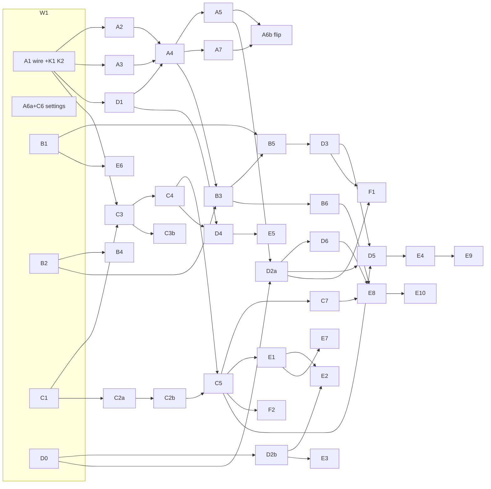

# Spatial audio M3: milestones, waves and gates (ADR 0162)

This plan breaks the M3 task table, [api-and-models.md §10](../design/0162-audio-spatial/api-and-models.md#10-task-breakdown) (A1–E10), into milestones, waves, contracts and gates. **The task table owns each task's ID, days, dependencies and acceptance:** where this plan and the table differ on those, the table wins. The record ([ADR 0162](../decisions/0162-spatial-audio-ambisonic-bed-occlusion-and-reverb-zones.md), Revision 4 at its end) and the design ([docs/design/0162-audio-spatial/](../design/0162-audio-spatial/README.md)) own *what* gets built. This plan owns **order, file ownership, contracts and gates**. Every task in the table appears below exactly once, with its ID unchanged. Where this plan splits a task, it keeps the ID and adds a suffix (A6a/A6b). Where it moves part of a task's work into a contract, it says so in the audit (tree, "Collision audit") and in the changes table below.

The task tree (leads, leaves, models) is [2026-11-audio-spatial-m3-tree.md](2026-11-audio-spatial-m3-tree.md). Progress, numbers and deviations go in a new `docs/design/0162-audio-spatial/build-log.md` (coordinator), as `0157-audio-core/build-log.md` held M1 and M2.

**Every day figure is the table's human-effort estimate** unless labelled "plan est.". Every figure this plan derives (chains, wave lengths, contract days, leaf days) is an estimate until the pilot wave reports.

## State at planning (2026-11-11)

Checked in the repository rather than taken from the handoff ([2026-11-audio-m3-design-handoff.md](2026-11-audio-m3-design-handoff.md)):

- **The M3 design is on master now.** `origin/master` is `523190a` ("M3 (spatial audio): design-to-build handoff"), the tip of `claude/sweet-ritchie-miy6jm`, so the handoff's first open item (merge the design to master) is done. This branch, `claude/festive-brahmagupta-bpxdwr`, was at the same commit when planning started. As in M2, the local `master` ref in this container is a stale, unrelated `ea19930`: use `origin/master`.
- **Record numbers:** master's records go to 0162 (this one, Accepted); 0161 is Proposed. The next free number is **0163**. `origin/claude/ecstatic-heisenberg-xg0fvc` (not merged) carries its own 0151–0163, including a different 0162 and 0163. It renumbers when it merges (the owner deferred this, "later").
- **Handoff facts confirmed:**
  - The high preset has `hrtf: 32` (`src/plugins/audio/editor/audioSettingsModel.ts:213`). The default is 16 (`DEFAULT_VOICES`, `src/engine/audio/settings.ts:166`). `samples/stress/project.json:31` stores `"hrtf": 32`.
  - `_worldRaycast` takes no layers and returns no collider (`src/engine/core/worldServices.ts:266`). Its only callers are particles and a render-feature test.
  - `myco_audio_init` takes five parameters (`audio-wasm/src/lib.rs:94`), and its only TS caller is `runtime/worklet/coreDriver.ts`. Regions are fixed by `InitParams`, and new ones go before `Arena` (`audio-core/src/layout.rs:4–12`).
  - The HRIR ids are reserved in `audio-wire/src/schema/envelope.rs:19`.
  - The committed sizes are mixer 178,598 B, decoder 749,095 B, AAC decoder 1,073,338 B. `MIXER_LIMIT` is 256 KB (`native/audio/build.mjs:23`).
- **Facts the handoff doesn't state, which this plan relies on:**
  - The core applies records in `audio-core/src/scheduler.rs` (the `match env.kind` at line 126), not in `core.rs` (230 lines).
  - `audioSystem.ts` is 97 lines. `coreBackend.ts` is 1,281, `replay.ts` 547, `commandWriter.ts` 626, `voices.rs` 1,463, `stream.rs` 1,250.
  - `hrtfPick` is used by `core/selection.ts`, `core/coreBackend.ts` and `audioGolden.test.ts`.
  - The sample occlusion changes is **`pirates`**: `engine.MeshCollider` in `rocky-maze`, `island-bay` and `open-ocean`, and positioned one-shots (`pirates/scripts/client.ts:227`). `sound-lab` and `stress` have no colliders (their `physics` is 2D gravity only).
  - `InitParams` (`audio-core/src/params.rs:6`) has no `Default` and is built as a struct literal in 37 places across `audio-core`, `audio-bench` and tests (`clips.rs:608` among them, B2's file).
  - The core memory is sized on main by `core/context.ts` (`presetFromSettings`, line 30; the rebuild decision at line 307) and capped by `worklet/coreDriver.ts`'s constant `FIXED_REGIONS_HEADROOM_BYTES` (16 MiB, line 56). High needs ≈ 21 MiB once the zone and wide regions exist, so the cap must become a function of the init parameters.
  - `coreDriver.ts` also copies stream chunks (535–581) and sizes clip frames as f32 or int16 only (463); formats 3–5 and 16-channel streams change it.
  - STREAM_OPEN is written in `decoder/streams.ts:282`, which clamps streams to 2 channels (`MAX_CHANNELS`, line 106).
- **Things the design names that don't exist yet:**
  - `native/audio/tools/` (A3 creates it for `bake-magls`).
  - `docs/guide/spatial-audio.md` (E8).
  - `core/listener.ts`, `core/voiceFx.ts`, `core/occlusion.ts`, `core/doppler.ts`, `core/zones.ts`, `core/beds.ts`, `core/pannerPick.ts`.
  - The `bench:audio-spatial` script (D6, added to `package.json` by the coordinator).
- **One inconsistency in the design, settled here:** FuMa conversion is in `runtime/decoder/ambisonic.ts` per task B1's file list and architecture §3 ("converted in the worker per chunk"), not in an `audio-decode/src/ambisonic.rs` as api-and-models §5.1 lists. The table wins, and §5.1 is updated (write-back commit).
- **Not run in planning:** `node_modules` is absent in this container, so no baseline `npm test`/typecheck was run. Wave 0's baseline does it (the working-notes rule: don't run what can't change a decision; the baseline can, so it runs once at kickoff).

## What "shippable" means here

Every wave merges to the M3 integration branch, and every milestone to master, with all of these true:

1. **Wave end** (the owner's cadence, `working-notes.md`): `npm run typecheck`, the full `npm test`, `npm run build`, `npm run test:e2e` (Chromium), `cargo test` in `native/audio/`, `npm run check:audio-metered`, and the short benches the wave's tasks touch. The committed wasm matches its source hash (`wasm/sourceHash.test.ts`). A baseline change says why in the build log.
2. **Milestone end, before master:** also `npm run test:e2e:slow`, WebKit and Firefox (Docker) when the milestone touches the browser layer, and the long benches and soaks. The lab-VM run is the owner's.
3. **M1/M2 goldens and parity digests stay bit-identical** at every wave end (shared reverb, automation low-pass, mono-once, every `golden/*.json` that exists today). The one allowed difference is a voice **with sends**, which differs by float rounding. It is stated in C4's acceptance and logged.
4. **No feature flags, no compatibility defaults** (owner). Between waves, the old path serves a feature until the task that makes the new one live. That task is the **flip**: it updates every sample its default changes, in the same branch (the owner's rule: update the samples instead). Flips in M3:

   | Flip | What changes for every project | Task | Gated on (safety net) |
   |---|---|---|---|
   | **Beds on, HRTF voices to 8** | the default and presets `voices.hrtf` 32/16 → 8; main sends BED_CONFIG (A5's `beds.ts`), so voices past the HRTF count go to the bed; the `Beds` region is sized | **A5 + A6b, merged together, last in W4** (A6b is split from A6; A5 is the sender, so it is under the same gate) | A3 (the baked 16 → 2 matrix decodes beds while MagLS isn't resident, R9), A4's crossfade and ducked-chain goldens, A7's bed bench recorded and the mixer under 230 KB |
   | **Occlusion on** | `AudioSource.occlusion` defaults true and every layer occludes (design §11 item 3) | D2a | D0 (own-collider and sensor exclusion), D2a's no-physics path (occlusion 1 and one note) and its overrun halving. D2a updates `pirates` (explicit occlusion layers, or `occlusion: false` where a source should stay dry) |
   | **Doppler on** | `dopplerLevel` 1 for spatial sources | D3 | D3's teleport guard and `maxSpeed` clamp. D3 sets `dopplerLevel: 0` where §1.6 asks for it: the orbiting pitch and bench sources (`lab.Orbit`) in `samples/sound-lab/scenes/main.scene.json`, and `stress` through its generator `samples/stress/tools/generate.mjs` and the regenerated scene (an edit to the scene alone is reverted by the next run) |
   | **Zone and wide memory** | every core-backend project pays the fixed `Zones` and `Wide` regions (M3 fixed memory ≈ 20.9 / 10.7 / 3.0 MB with beds, owner-accepted in Revision 4) | C5 (zones), B5 (wide), each setting its region function | C3's and B4's acceptance (the regions work), K2's headroom function (init can't overrun the Memory maximum) |

   Until its flip, each region's init parameter is zero, so M2 projects pay nothing for it (K2's `Fx` pool, ≈ 28–112 KB, is the one exception). Everything else is opt-in by data, so it is inert until a project uses it: zones by component, ambisonic clips by sidecar, event `filter`/`sends` by event keys, and occluders.
5. A milestone reaches master at the end of the wave that completes it. Tasks of later milestones merged by then go with it. Each passed its own acceptance and none is a flip that hasn't been gated, so they don't change behaviour, though they may already be reachable through data (a zone component works before its gizmo exists). Nothing editor-side is documented as working before its E task merges.

## Milestones

The table's milestone groups, unchanged. The **exit checks** are §9's, plus the owner's listening items.

| # | Milestone | Tasks (pure critical path in **bold**) | Exit check | Days | Done after |
|---|---|---|---|---|---|
| M3a | Bed | **A1**, **A2**, A3, **A4**, A5, A6 (A6a, A6b), A7 | the shippable checks; `bed-64/256/xfade` benches recorded; mixer under 230 KB; owner listening: a source crossing the 8-voice HRTF boundary both ways (no dip or jump), above, below (floor-below: a failure opens reserve R1), behind and sides, bed against HRTF, a loud close source with 200 quiet ones, idle silence | 31.5 | W4 |
| M3b | Ambisonic clips | B1, B2, **B3**, B4, **B5**, B6 | 4/9/16-channel clips and a 16-channel stream play; stall test; owner listening: an ambience turned on the spot at 1st and 3rd order | 25.5 | W5 |
| M3c | Zones | C1, C2a, C2b, C3, C3b, C4, C5, C6, C7 | `zones-2x2s` recorded (p50 ≈ 47 µs, p99 ≈ 107 µs, container, est.); both slot paths' loopback; owner listening: rooms A, B, C with 2 s and 4 s IRs, a source in A heard from B | 44.25 | W5 |
| M3d | Occlusion, Doppler, event effects | D0, D1, D2a, D2b, **D3**, D4, **D5**, D6 | `filters-256`, `bench:audio-spatial` (ray ages ≈ 3/5/22 frames at 64/256/1,024), `m3-worst-*` recorded; owner listening: wall, door open and closed, corner, a fast Doppler pass and a teleport | 29.25 | W7 |
| F | Babylon fallback | F1, F2 | §8 rows against the mocks; owner: the Babylon backend once | 3.5 | W7 |
| M3e | Editor, samples, listening pass | E1, E2, E3, **E4**, E5, E6, E7, E8, **E9**, E10 | Playwright specs (3 of 3 repeats at milestone end); samples load warning-free and non-silent; `check:links`; the listening-pass document; the owner's lab-VM run of `m3-typical` and `m3-worst-high` and the sign-off | 35.5 | W9 |
| | Named reserve | R1 SADIE II 4, R2 lab-VM tuning 5, R4 listening fixes 5 | drawn only by an owner decision | 14 | |

Total 169.5 days of tasks + 14 reserve = 183.5 (the table's, unchanged). The contracts cost **≈ 5 days on top (plan est.)**, part of which is work the A, B, C and D rows would otherwise have done (below). The table's rows keep their days until the pilot measures the shift, so the plan counts the 5 days as added.

(`D1 → A4` is a file-order edge, not a table dependency: both write `voices.rs`, and D1's send-tap hook K3 must land first.)

## The critical path

**The pure dependency chain** (longest path through the table's `Depends` column, summed from the rows) is **41 days**:
A1 5 → A2 5 → A4 7 → B3 6 → B5 3.5 → D3 3 → D5 3.5 → E4 4 → E9 4.
The zone chain is close behind at **39.75 days**: C1 6 → C3 9 → C4 3 → C5 8.5 → C7 4.75 → E8 6.5 → E10 2.

- **Against the design.** The design's "≈ 45 days of chain" links C7 → D5 and E9 → E10, which aren't dependencies in its own table. It reads as a sequenced figure, not the pure chain. Recomputed here from the rows.
- **Doppler sits on the critical path** only because D3 needs B5's `listener.ts` (listener velocity), which puts the whole bed and ambisonic spine in front of the Doppler task, the API surface and the debug panel. Nothing else ties Doppler to beds. If the pilot shows the bed spine slipping, the first relief is to let D3's lead start on `doppler.ts` against K4's `listener.ts` stub and merge after B5.
- **With the plan's seams, est.:** K1 and K2 add about 2.5 days to A1, but A2 and A3 start on K1 (the wire and module skeletons), not on K2. So the chain grows by ≈ 0–1.5 days depending on when K1 lands (≈ 42.5 at most, plan est.). The bed flip (A6b) waits for A7, but nothing on the chain depends on A6b.
- **Start early (W1), because of the pure chain:**
  - A1 and C1, the heads of both chains;
  - B2, because B3 needs it and it has nothing in front of it;
  - D0, because D2a needs it.

**The staffing queue.** S-level (senior) work is **74.5 days**: A2, A3, A4, B2, B3, B4, C1, C2a, C3, C3b, C4, C5, D1, D2a. That's the design's "≈ 70" plus C3b. A list schedule of the table (plan est.):

| Strongest-model leads at once | Finish (days) | What waits |
|---|---|---|
| unlimited | 41.0 | nothing: the pure chain |
| 3 | ≈ 42.5 | close to the pure chain |
| 2 (the design's two seniors) | ≈ 49–54 | B2 and B3 slip behind C3 and A4; C2a behind A4 |

- **Tasks on the path only because one lead does both:** with two senior lanes, B3 waits on B2 (a lane shared with C3), and C5 waits on C2a.
- **Recommendation:** run up to **three** strongest-model leads at once in W2–W4 (owner item O6, a cost decision).
- **Within a wave, start critical tasks first:** A2 and C3 in W2, A4 in W3, B3 and C5 in W4. The tasks with slack (B4, C2a, C3b, D1 within its window) go when a lane frees.

**Waves as barriers.** If every wave waited for its longest task, the waves would sum to ≈ 54.75 days (plan est.: 6.5 + 9 + 7 + 8.5 + 5.5 + 3.75 + 6.5 + 4 + 4, W1 being A1 with its contracts), not 41. So waves here are **ownership windows and review points, not hard barriers.** A task starts when its dependencies are merged and no running task owns its files. The wave number is the order and the owner of each file at each point. The named early starts:

- A2 and A3 start when K1 lands, before A1's K2 is done;
- A4 starts when A2, A3 and D1 are merged, without waiting for C3, because K2's bus hook keeps A4 out of `bus.rs`;
- B3 starts when A4 is merged.

**The coordinator** is the other real bottleneck:
- nine wave reviews;
- six waves that touch Rust, each with a wasm rebuild;
- four milestone merges;
- contract K0;
- owner reports.

## Who does what

- **Coordinator** (main session, strongest model):
  - wave 0 (baseline, branch, K0, the build log);
  - starting leads and leaves, merges and wasm rebuilds;
  - the single-writer files;
  - the wave reviews and global checks;
  - the milestone merges (with the owner's approval);
  - the build log and owner reports.
- **Leads and leaves:** see the tree. The strongest model leads the S-level tasks, A1 (which carries the core skeleton, K1 and K2) and K4. The mid model leads the rest. The cheapest model takes leaves where the leaf criteria hold, and runs E10 as a single leaf.
- **Isolation:** every lead and leaf works in its own git worktree. Leads branch from the integration branch at the wave's base, leaves from their lead's skeleton commit. From M2, still true: agent worktrees start at master unless told otherwise, so every brief names its base commit; node_modules go in as per-entry links; check `git status` before every commit (worktrees stay out of commits).
- **Dispatch is flat** (subagents can't start subagents in this tool): the lead commits its skeleton and returns leaf briefs, the coordinator starts the leaves, then continues the lead with their branch names.
- **Owner-only items:** listed in the handoff ([2026-11-audio-spatial-m3-handoff.md](2026-11-audio-spatial-m3-handoff.md), "Open").

### Single-writer files

| File | Writer |
|---|---|
| `src/plugins/audio/runtime/wasm/*.wasm`, `wasm/hash.json` | coordinator, after merging (`npm run build:audio`); task branches commit Rust source and may commit a local rebuild, which the coordinator's rebuild replaces |
| `native/audio/Cargo.lock`, any `Cargo.toml` dependency change | coordinator (a task asks in its report) |
| the metered baseline (`tools/audio-bench/metered/`) | coordinator, with a build-log line |
| `audio-wire/src/schema/*`, `generated.rs`, `runtime/wire.generated.ts` | A1 in W1; afterwards the coordinator (a later wire change, e.g. the 32,768-frame wide ring if B4's stall test fails, is regenerated by the coordinator) |
| `src/engine/audio/magls-o3.bin` | A3 |
| `native/audio/build.mjs` | A3 in W2 (the `bake-magls --check` step and the 230 KB mixer warning); afterwards the coordinator |
| `runtime/backend.ts` (the backend interface) | coordinator (K0); a task that needs a member asks |
| `runtime/testing.ts` (the fake backend) | K4 in W3; afterwards the coordinator |
| `src/myco.ts`, `runtime/index.ts` (exports, component registration) | coordinator; D2b, C5 and D5 list what they need in their reports |
| `package.json`, `vite*.ts`, `playwright.config.ts` | coordinator (`bench:audio-spatial` for D6) |
| `docs/architecture/implementation-status.md`, `docs/README.md`, `docs/decisions/*`, `docs/design/0162-audio-spatial/build-log.md` | coordinator (E8 supplies the status text; no task rewrites 0162; deviations go in the build log) |
| the `audio-bench` scene registry and `tools/audio-bench/*` | A7 in W4, C7 in W5, D6 in W6 |
| `samples/*/project.json`, sample scenes and generators | A6b in W4 (`stress` HRTF), D2a in W5 (`pirates`), D3 in W6 (`sound-lab/scenes/main.scene.json`, `stress/tools/generate.mjs` and its scene), E8 in W7 |
| `runtime/worklet/coreDriver.ts`, `runtime/core/context.ts` | A1 (K2) in W1; afterwards the coordinator. The region values come from `core/initParams.ts`'s feature functions, so no later task edits them |
| `src/plugins/audio/editor/index.ts` (viewport tools, sections) | E1 in W5, E2 in W6, E4 in W8 (additive lines) |

### Contracts

| Id | Contract | Lands | Lets run in parallel |
|---|---|---|---|
| K0 | **Backend and worker surface.** `backend.ts`: every M3 member, all optional: `PlayRequest`'s §1.2/§1.3 fields (occlusion, dopplerLevel, reverbSend, reverbSendCurve, ambisonic and yaw, event filter and sends), `AudioVoice.setVelocity?`, and backend-agnostic `AudioVoice.setOcclusion?(gain, lpHz)` and `setDopplerRate?(factor)` so the Babylon fallback takes main's results (gain only, `playbackRate`, §8), `AudioDebugInfo.beds/zones/occlusion/memory` and the C24 counter names. A `ZoneIrService` interface (prepare, release, on prepared/failed) that K4 constructs and C2b implements. `decoder/protocol.ts`: `prepareIr`, `generateIr`, `irPrepared`, `irFailed` (C9), stream `channels` 1–16 and `convention`. `decoder/handler.ts` routes the IR messages to a stub `decoder/irPrepare.ts` | W0, coordinator | B4 (W3) and C2b (W3) on the worker without sharing `protocol.ts`/`handler.ts`; K4 implements the fakes; F1 and E4 code against the debug types |
| K1 | **The whole M3 wire, generated first.** Every record and constant of api-and-models §4 and C1–C7 in `audio-wire` (`spatial.rs`, `batch.rs`, `status.rs`, `envelope.rs`, `schema.rs`), the generated Rust and `wire.generated.ts`, the schema hash. `commandWriter.ts` methods for SET_VOICE_FX, BED_CONFIG, ZONE_CONFIG, LISTENER and PLAY bit 7 (STREAM_OPEN is written in `decoder/streams.ts`; its `convention` and 1–16 channels are B4's). `statusReader.ts` parses the 144-B header and the `beds`/`zones`/`zoneEvents` sections into a typed struct. Module declarations and doc-comment skeleton files: `audio-dsp` `ambisonic.rs`, `bed_decoder.rs`, `bed_matrix.rs`, `fxfilter.rs`; `audio-core` `bed.rs`, `zones.rs`, `fxpool.rs`, `listener.rs`, `sends.rs`, `chain.rs`; `audio-decode` `ir.rs` | W1, A1's first merge | A2 and A3 start on it; no later task edits `audio-wire`, `wire.generated.ts`, `commandWriter.ts`, `statusReader.ts` or a crate's module lines (C2a adds its `myco_ir_*` export functions to `audio-decode/src/lib.rs`, where the decoder's exports live) |
| K2 | **The core skeleton.** First, before B2 and C1 branch (day 0–0.5, merged at once): `InitParams` gains the four fields and a `Default` (M2's numbers, M3 regions zero), and its 37 struct literals (`audio-core`, `audio-bench`, tests) use `..InitParams::default()`. Then ABI 2.0: `myco_audio_init` with all nine parameters (C8) and `myco_audio_zone_kernel_budget_bytes`. `layout.rs` regions `Beds`, `Zones`, `Wide`, `Fx` and the 8 KB planar scratch, sized from `InitParams` per C8 (zero when their parameter is zero). `scheduler.rs` routes each new record kind to a stub handler in its module (parsed, then dropped), with §9's parse-refusal tests. The STATUS writer serialises every new header field and section from a counters struct (`counters.rs`), zero until a task sets it. `bus.rs`'s pre-effects input hook calls `bed::decode_into`, `zones::add_returns` and `sends::add_aux` (no-ops). `chain.rs` holds the bus-chain gain to the root (volume × mute × ducking, ramped) with its < 0.05 dB test. On main: `CorePreset` (`core/context.ts`) gains the four parameters, read from `core/initParams.ts` (zero for now), and the rebuild decision compares them. `coreDriver.ts` passes them to init, replaces `FIXED_REGIONS_HEADROOM_BYTES` with a function of the parameters (the TS mirror of the layout sizes, checked against `myco_audio_zone_kernel_budget_bytes` and the wasm's own size in a test), sizes clip frames for formats 3–5, and copies stream chunks of 1–16 channels. `Fx` is sized from `max_mixed`; the other regions stay zero until their flips. M1/M2 goldens unchanged | W1: the `InitParams` commit at once, the rest as A1's second merge | B2 and C1 branch after the `InitParams` commit, so no W1 task touches the same literal; C3, D1, B4 (W2–W3) and A4, C4 (W3) never edit `layout.rs`, `params.rs`, `scheduler.rs`, `status.rs`, `counters.rs`, `audio-wasm` or (A4, C4) `bus.rs`; B4, C2b, A3 and C3 never edit `coreDriver.ts` |
| K3 | **The send-tap hook.** In `voices.rs`, after the voice's own filters and before the distance gain, a call to `sends::tap` (no-op). A voice with sends runs filter → tap → dry gain; one without keeps M2's order | W2, D1's skeleton (committed first in its task) | C4 (W3) fills `sends.rs` without `voices.rs`; A4 owns `voices.rs` in W3 |
| K4 | **The main-side skeleton** (a contract task, plan est. 2.5 days, strongest lead). It covers:  • `audioSystem.ts` in the M3 order (attenuation, doppler, zones, occlusion, audibility × smoothed occlusion, selection, `pannerPick`, fx staging, listener) for **both backends**: occlusion and Doppler run on main whatever the backend and hand results to the voice through K0's `setOcclusion?`/`setDopplerRate?` (the core backend routes them into `voiceFx`, Babylon into volume and `playbackRate`), so `occlusion.ts` and `doppler.ts` don't read the core's voice table. It calls stubs with final signatures in `core/beds.ts`, `core/pannerPick.ts` (delegates to `hrtfPick` until A5), `core/zones.ts`, `core/occlusion.ts`, `core/doppler.ts`, `core/listener.ts`;  • `coreBackend.ts` constructs them (and C2b's `zoneIr.ts` against K0's `ZoneIrService`), `mirror.ts` gains the bed, zone and listener state they mirror, `spatial.ts` the listener frame they share, and `replay.ts` calls their replay hooks in C10's order (RESET, BUS_CONFIG, BED_CONFIG, BUS_MIX, LISTENER, ZONE_CONFIG);  • `core/initParams.ts` with one region function per feature file (beds, zones, wide), all zero, feeding K2's `CorePreset` fields;  • `voiceTable.ts` gains `occGain` (default 1), and selection reads `audibility0 × occGain`;  • `core/voiceFx.ts` complete with tests: per-voice staging, `lpHz` as the lowest contribution (S3), thresholds 0.5 dB / 1 Hz / 0.001 rad, re-sent with SET_MIXED on promotion;  • the §1 surface declared: `AudioSource` §1.2 fields with `@field` descriptions flowing through `apply()`/`applyEvent()` into `PlayRequest`, §1.3 one-shot options, `AudioListener.velocity`, handle members as stubs;  • `testing.ts` implements every K0 member | W3 | A5, C5, D4 (W4), B5, D2a (W5), D3 (W6) and D5 (W7) each fill only their own files; nobody else edits `audioSystem.ts`, `voiceFx.ts`, `mirror.ts`, `spatial.ts`, `replay.ts`'s order, `coreBackend.ts`'s construction or `testing.ts` |

**Contract days and the work they move** (all plan est.). The contracts cost ≈ 5 days on top of the table: K1/K2 ≈ 2.5 on A1 (module skeletons, `InitParams`, regions, dispatch, counters, the bus hook, the chain gain, the main-side preset and headroom, `coreDriver.ts` formats) and K4 ≈ 2.5. Some of that is work the rows below would otherwise have done. Those rows keep their table days until the pilot measures the shift, so the 5 days are counted as added, not moved:
- into K1/K2 from A4, B3, B4, C3, C4, D1: the core plumbing above;
- into K4 from A5, B5, C5, D2a, D3, D4, D5: the frame order, construction, replay order, `mirror.ts`, `voiceFx.ts`, the `@field` declarations and the fakes;
- into the W1 settings lead (A6a): parsing the §2.1 keys no task row owns (`occlusion.*`, `doppler.maxSpeed`, `speedOfSound`, which D2a, D2b and D3 would otherwise each add to `settings.ts`), and the §2.2 material table parse in `src/engine/audio/occlusionMaterials.ts` (D2b adds compile and combine);
- into the flip tasks from E8: the sample lines a default change needs (A6b `stress` HRTF, D2a `pirates`, D3 `dopplerLevel: 0` on the orbiting and bench sources).

## Wave reviews

After every wave, before its files change owner, the coordinator:

1. Merges the task branches in dependency order (a flip last), rebuilds the wasm once if any Rust changed, and runs the wave-end checks of "shippable" item 1. A failure goes back to the task that caused it, and only the failing spec or file is rerun. Known flakes are rerun alone once first: navSample, selectionBench, server.test, piratesSample, hrtfLoopback, streamRebuild, gltf.test, e2e codefiles, audio-core.spec beside other specs. `tests/e2e/selection.spec.ts:77` fails on master already.
2. Diffs each task against its file list here. Anything outside the list is either justified in the task report or reverted.
3. Checks M1/M2 goldens and parity digests are unchanged (item 3), and the mixer size against 230 KB.
4. Logs deviations from 0162 or the design in the build log, flagging the owner where one needs a decision. Records the pilot measures (W1) and leaf first-pass success (every wave).
5. Updates the 0162 row in `implementation-status.md` and the handoff.
6. At a milestone's last wave: the milestone-end checks, the owner's listening items for that milestone, then (with approval) the merge to master.

## Wave 0: baseline and K0 (coordinator, plan est. 0.5 day)

- `npm ci`, then the baseline: typecheck, `npm test`, `npm run build`, `cargo test` in `native/audio/`, the metered gate. Record failures as known before any task runs.
- Create the M3 integration branch from `origin/master` (`523190a` or later).
- Commit K0 (types and stubs only; typecheck green), and start `build-log.md` with the state above.
- Open tickets if the owner wants them (an epic per milestone, a sub-issue per task, leaves as checklist lines). Not done in planning.

## Wave 1 (pilot): wire and core skeleton, settings, the independent heads

| Task | Level | Files (new unless marked) |
|---|---|---|
| A1 (+K1, K2) | strongest | `audio-wire/src/schema/spatial.rs`, `audio-wire/tests/spatial_*.rs`, golden vectors; edits: `audio-wire/src/schema/{batch,status,envelope}.rs`, `schema.rs`, `generated.rs`, `runtime/wire.generated.ts`, `core/commandWriter.ts`, `core/statusReader.ts` (+ tests); K2: `audio-core/src/params.rs` and every `InitParams` literal (first commit), `audio-core/src/{layout,scheduler,status,counters,bus}.rs`, `chain.rs`, stub modules, `lib.rs` of `audio-core`/`audio-dsp`/`audio-decode`, `audio-wasm/src/{lib,memory}.rs`, `runtime/worklet/coreDriver.ts`, `runtime/core/context.ts` |
| A6a + C6 (one lead) | mid | edits: `src/engine/audio/settings.ts` (every §2.1 key, bus `bed`/`bedPriority`, inert), `editor/audioSettingsModel.ts` (`zones.standby` and memory accounting; **not** the preset HRTF numbers), their tests; new `src/engine/audio/occlusionMaterials.ts` (table and parse, §2.2) + test |
| B1 | mid | `runtime/decoder/ambisonic.ts` (FuMa for decoded clips, and the per-chunk function B4 calls) + test; edits: `src/engine/scene/importSettings.ts` (+ test), `core/clipRegistry.ts` (validation); **not** `decoder/streams.ts` (B4's) |
| B2 | strongest | edits: `audio-dsp/src/resample.rs` (the N-channel path is a **new function**; the stereo `lagrange` signature, called from `voices.rs:458` and `stream.rs:1243`, stays), `audio-core/src/clips.rs` (arena to 16 channels), `audio-decode/src/decoder.rs` (2 → 16 channels), their tests; branches after K2's `InitParams` commit |
| C1 | strongest | `audio-dsp/src/convolver/kernel.rs`, `instance.rs`, `stagger.rs` (`plan_stagger`, a seam file); edits: `convolver.rs`, `convolver/ir.rs` |
| D0 | mid | edits: `src/engine/core/worldServices.ts` (`raycastInto`, query, `groupsFor`), `src/plugins/physics/runtime/services.ts`, `systems3d.ts`, `Physics.ts` (no allocation per call); tests incl. `plugins.test.ts` boundary |

**Hotspots checked:** `audio-core`: A1's K2 (`params`, `layout`, `scheduler`, `status`, `counters`, `bus`, `chain`) and B2 (`clips.rs`) are disjoint once the `InitParams` literals (one is in `clips.rs:608`) are changed in K2's first commit, before B2 branches. `audio-dsp`: A1's `lib.rs` lines, B2's `resample.rs` and C1's `convolver/` are disjoint (C1's submodules are declared in `convolver.rs`). `audio-decode`: A1's `lib.rs` and B2's `decoder.rs` are disjoint. In the settings, one lead owns both files.
**Exit:** the shippable checks; `wire.roundtrip`, `wire.schemaHash` and the stale-wasm check green; STATUS worst case 15,904 B; all M1/M2 goldens bit-identical after K2; `raycastInto` never hits the source's own capsule and allocates nothing (D0); shared reverb bit-identical after C1.

## Wave 2: DSP and core foundations

| Task | Level | Files |
|---|---|---|
| A2 | strongest | fills `audio-dsp/src/ambisonic.rs` (SN3D encode 1–3, Ivanic rotation), `bed_decoder.rs` + tests |
| A3 | strongest | `native/audio/tools/bake-magls/` (new crate), `src/engine/audio/magls-o3.bin`; fills `audio-dsp/src/bed_matrix.rs` (the baked 16 → 2 matrix, seam file split from `ambisonic.rs`); edits: `runtime/core/hrir.ts` (format 4 loader), `native/audio/build.mjs` |
| C2a | strongest | fills `audio-decode/src/ir.rs`; new `audio-dsp/src/convolver/presets.rs`; edits: `audio-decode/src/lib.rs` (exports `myco_ir_*`) |
| C3 | strongest | fills `audio-core/src/zones.rs`; edits: `clips.rs` (formats 3, 5), `bus.rs` (return buses, shared-return scale; sole W2 owner), `fx.rs` if the shared reverb's return lives there, `audio-wasm` (kernel budget body) |
| D1 (+K3) | strongest | fills `audio-core/src/fxpool.rs`, `audio-dsp/src/fxfilter.rs`; edits: `voices.rs` (sole W2 owner; K3 first), `automation.rs` |
| D2b | mid | `runtime/AudioOccluder.ts` + test; edits: `src/engine/audio/occlusionMaterials.ts` (compile, combine, cache) |
| E6 | mid | edits: `src/editor/ui/AssetInspector.tsx` (+ its test) |

**Seams used:** K1's module skeletons (no `lib.rs` edits except C2a's export lines), K2's regions, dispatch and counters, K3 (set up here).
**Hotspots checked:** `ambisonic.rs` (A2) vs the matrix (A3): split into `bed_matrix.rs`. `voices.rs`: D1 only. `bus.rs`: C3 only. `clips.rs`: C3 only (B2 merged in W1). `audio-decode/src/lib.rs`: C2a only.
**Exit:** analytic encode and rotation tests (1e-5); 256 voices decode within 142 µs p50 (container, est.); `bake-magls --check` reproduces the asset, 12 of 12 azimuths; the matrix within 2 dB of `EqualPowerPanner` away from ±90°; IR blob equals `prepare_ir`, decoder under 900 KB; zone blend, ring-out and rebuild goldens; M2 goldens unchanged after D1 (filters migrated bit-identically).

## Wave 3: the core bed and sends, the IR path, wide rings, the main skeleton

| Task | Level | Files |
|---|---|---|
| A4 | strongest | fills `audio-core/src/bed.rs`; edits: `panner.rs` (kind 2, equal-power law), `voices.rs` (sole W3 owner) |
| C4 | strongest | fills `audio-core/src/sends.rs`; edits: `zones.rs` (inputs); never `voices.rs` or `bus.rs` (K2, K3) |
| B4 | strongest | edits: `audio-core/src/stream.rs` (`Wide` class), `runtime/decoder/streams.ts` (1–16 channels, STREAM_OPEN `convention`, the per-chunk FuMa call into B1's `decoder/ambisonic.ts`), `decoder/handler.ts` (stream chunking; K0 already routes the IR messages elsewhere), `core/streams.ts`; the 300 ms stall test. `coreDriver.ts` already copies 1–16-channel chunks (K2) |
| C2b | mid | fills `runtime/decoder/irPrepare.ts`; new `runtime/core/zoneIr.ts` + tests |
| K4 | strongest | as the contracts table: `audioSystem.ts`, `core/{beds,pannerPick,zones,occlusion,doppler,listener,initParams,voiceFx}.ts`, edits to `coreBackend.ts`, `replay.ts`, `voiceTable.ts`, `selection.ts`, `AudioSource.ts`, `AudioListener.ts`, `Audio.ts`, `testing.ts` |

**Hotspots checked:**
- `zones.rs`: C4 only, so C3b moved to W4 (it has no dependants).
- `handler.ts`: B4 only, because K0 routed C2b's messages to `irPrepare.ts`.
- `coreBackend.ts`: K4 only. K4 constructs C2b's service against K0's `ZoneIrService` interface, not against C2b's file.
- `coreDriver.ts`: nobody (K2 handled formats 3–5 and wide chunks in W1).

**Exit:** bed, crossfade and ducked-chain goldens (< 0.05 dB); the shedding ladder's bed-idle step and `m3Shed`; a send follows a ducked bus, and a muted bus mutes its reverb; voices with sends differ from M2 only by float rounding (logged); a 16-channel stream plays 60 s with seeks and loops and no underrun. The stall test passes, or the ring goes to 32,768 frames (the coordinator regenerates the wire constant and K2's `Wide` size). An IR rate change re-prepares, and kernels never touch main. K4 changes no behaviour: the full suite is unchanged.

## Wave 4: the bed flip, ambisonic voices, main zones, event effects

| Task | Level | Files |
|---|---|---|
| A5 | mid | fills `core/beds.ts` (incl. its region function), `core/pannerPick.ts` (the 500 ms game-time dwell), deletes `hrtfPick.ts` (imports in `selection.ts`, `coreBackend.ts`, `audioGolden.test.ts` updated); edits: `core/debug.ts` (bed rows) |
| A6b (flip) | mid (A5's lead) | edits: `settings.ts` (`DEFAULT_VOICES.hrtf` 8), `audioSettingsModel.ts` (`VOICE_PRESETS` HRTF 4/8/8, bed and `maxClips` numbers), `samples/stress/project.json`, tests that assumed 16/32 HRTF voices |
| A7 | mid | `native/audio/crates/audio-bench` scenes `bed-64`, `bed-256`, `bed-xfade`, `mode=fit` for bed and ambisonic terms; new `golden/bed-*.json`; size check |
| B3 | strongest | fills `audio-core/src/listener.rs`; edits: `voices.rs` (sole W4 owner), `bed.rs` (private decoders, `maxClips` stealing) |
| C3b | strongest | edits: `audio-core/src/zones.rs` (sole W4 owner) |
| C5 | strongest | `runtime/AudioReverbZone.ts`, fills `core/zones.ts` (planner, kernel LRU, preload, 5 s timeout, listener weight, the zone region function: the zone memory flip), new `core/zoneWeights.ts` (weights and send curve, a seam file for its leaf) + tests |
| D4 | mid | edits: `src/engine/audio/eventFormat.ts`, `runtime/events/eventRuntime.ts`; calls `voiceFx` setters only |

**The flip:** A5 makes beds live (it sends BED_CONFIG and the root defaults to `own`), so **A5 and A6b are one flip**: A5's lead commits A6b separately, and the coordinator merges both **last**, after A7's bed bench is recorded and the mixer is under 230 KB. If the gate fails, both wait, M3a doesn't exit and D2a (which needs A5) waits with them; nothing else in W4 depends on them.
**Hotspots checked:** `voiceFx.ts`: no W4 writer (K4 finished it; C5 and D4 call setters). `replay.ts`: hooks only. `zones.rs`: C3b only. `settings.ts`, `audioSettingsModel.ts`: A6b only.
**Exit (M3a):** the shippable checks plus M3a's exit check (milestones table), owner listening, then the merge to master with approval.

## Wave 5: listener and ambisonic API, occlusion, zone benches, first editor work

| Task | Level | Files |
|---|---|---|
| B5 | mid | fills `core/listener.ts` (LISTENER, axis map, 0.001 rad, the wide region function: the wide memory flip); edits: `AudioSource.ts` (ambisonic behaviour on K4's declared fields), `Audio.ts` (`maxClips` stealing by priority), `core/clipRegistry.ts` (the ambisonic stream default) |
| B6 | mid | `samples/sound-lab/tools/makeAmbisonic.mjs`, generated test clips, `core/ambisonicLoopback.test.ts` |
| C7 | mid | `golden/zones-*.json`, `core/zonesLoopback.test.ts`; `audio-bench` scenes `zones-2x2s`, `zones-swap`, `m3-high`, fit sweeps |
| D2a | strongest | fills `core/occlusion.ts`, new `core/occlusionMath.ts` + tests; edits: `samples/pirates` (`project.json` occlusion layers, or `occlusion: false` on sources that should stay dry) |
| E1 | mid | `editor/AudioReverbZoneGizmo.ts`, `EditZoneButton.tsx`, `zoneMath.ts` + test; edits: `editor/index.ts` |
| E3 | mid | edits: `editor/AudioSettingsSection.tsx`, `audioSettingsModel.ts` (setters; sole W5 owner), `audioSettings.css`, tests |
| E5 | mid | edits: `editor/event/nodeFields.ts`, `NodeProperties.tsx`, `Audition.tsx` + tests |
| F2 | mid | edits: `runtime/babylonBackend.ts` (zones inert, one warning) + test |

**Hotspots checked:** samples: D2a (`pirates`) and B6 (`sound-lab/tools`) only. `audioSettingsModel.ts`: E3 only (A6b merged in W4). `babylonBackend.ts`: F2 only. Golden files: separate per task.
**Exit (M3b, M3c):** the shippable checks plus both milestones' exit checks and owner listening, then the merge to master with approval.

## Wave 6: Doppler, occlusion benches, occluder editor, live tuning

| Task | Level | Files |
|---|---|---|
| D3 | mid | fills `core/doppler.ts`; edits: `core/listener.ts` (velocity; sole W6 owner), `AudioListener.ts` (`setVelocity` body), `samples/sound-lab/scenes/main.scene.json`, `samples/stress/tools/generate.mjs` and its regenerated scene (`dopplerLevel: 0`) |
| D6 | mid | `core/occlusionBench.test.ts`, `golden/filters-*.json`; `audio-bench` scenes `filters-256`, `m3-worst-high/default/low` |
| E2 | mid | `editor/AudioOccluderGizmo.ts`, `OccluderInspector.tsx`, `ZoneInspector.tsx`, `AudioSourceSections.tsx`; edits: `editor/index.ts` |
| E7 | mid | fixes for any zone, material, occluder or source field that doesn't apply in Play; no new files expected |

**Exit:** the shippable checks; the orbiting pitch and bench sources play at fixed pitch (`dopplerLevel: 0`). The metered gate runs native scenes and isn't affected by Doppler, which is computed on main.

## Wave 7: API surface, Babylon, samples and guides

| Task | Level | Files |
|---|---|---|
| D5 | mid | fills K4's handle stubs; edits: `AudioSource.ts`, `Audio.ts`, `core/debug.ts` (zones, occlusion, `m3Shed`, ladder state); new `audioApiM3.test.ts`; export list to the coordinator |
| F1 | mid | edits: `runtime/babylonBackend.ts`, `babylonMapping.ts` + tests; implements K0's `setOcclusion?` (gain only) and `setDopplerRate?` (`playbackRate`, decoded clips only) on Babylon voices; `audioSystem.ts` already runs occlusion and Doppler for both backends (K4) |
| E8 | mid | `samples/sound-lab` spatial scene and scripts (the door moving `openness`, a Doppler pass-by), `samples/*` settings, `docs/guide/spatial-audio.md`, edits to `audio-mixer.md`, `sound-events.md`; the `implementation-status.md` text to the coordinator |

**Exit (M3d, F):** the shippable checks plus both milestones' exit checks and owner listening, then the merge to master with approval.

## Wave 8: debug panel, listening pass

| Task | Level | Files |
|---|---|---|
| E4 | mid | edits: `editor/AudioDebugPanel.tsx`, `audioDebugPanel.css`, `editor/index.ts`; new `editor/audioDebugRows.ts` + test, `editor/OcclusionOverlay.ts` |
| E10 | cheapest (single leaf) | `docs/design/0162-audio-spatial/listening-pass.md`, `samples/sound-lab/scripts/behaviors/ListeningBench.ts` |

## Wave 9: Playwright and close

| Task | Level | Files |
|---|---|---|
| E9 | mid | `tests/e2e/audio-spatial*.spec.ts` (gizmos draw and drag with undo, settings edit and persist, debug panel sections, Inspector warnings, live tuning) |

Then the coordinator closes the build: the 0162 row, the build log, the record's write-back (design README's "stale decisions" row) and the handoff. The owner does the lab-VM run of `m3-typical` and `m3-worst-high`, the M3e listening items (Babylon once) and the sign-off.
**Exit (M3e):** its exit check (milestones table), then the merge to master with approval.

## Independent review (2026-11-11)

A fresh agent that didn't write the plan reviewed it against the task table, the design, the record and the code. It confirmed that:
- every §10 task appears once with its ID, and every wave respects the table's dependencies;
- the arithmetic holds (pure chain 41, model shares, 34 leaves);
- the repository facts it didn't dispute are right.

Its findings, all applied above:
1. **Fixed regions had no owner and would overrun init on high.** `core/context.ts` builds the preset and `coreDriver.ts` caps the regions at a constant 16 MiB. Now K2 owns both (preset fields, a headroom function), each region turns on with its feature's flip (beds A5/A6b, zones C5, wide B5), and the memory change is listed as a flip.
2. **`InitParams` is built as a literal in 37 places,** including B2's `clips.rs`, so "K2 and B2 are disjoint" was wrong. Now K2's first commit adds a `Default` and changes every literal before B2 and C1 branch, and B2's N-channel resampler is a new function.
3. **`coreDriver.ts` is a W3 hotspot** (wide stream chunks for B4; frame sizes for formats 3–5 for C2b, A3, C3). Now K2 handles both in W1, and it's a single-writer file afterwards.
4. **The bed flip happens in A5** (it sends BED_CONFIG), not only in A6b. Now A5 and A6b merge together behind the gate.
5. **The occlusion flip named the wrong samples.** `sound-lab` and `stress` have no colliders; `pirates` does. Now D2a owns `pirates`.
6. **The Doppler flip's reason was wrong** (the metered gate runs native scenes, and Doppler is computed on main), and `stress`'s scene is generated. Now D3 edits `sound-lab/scenes/main.scene.json` and `stress/tools/generate.mjs` with its regenerated scene, per §1.6.
7. **F1 couldn't stay in its files,** because Babylon needs main's occlusion and Doppler. Now K0 adds `setOcclusion?`/`setDopplerRate?` and K4's frame order runs them for both backends.
8. **The per-chunk stream hookup and STREAM_OPEN's `convention` live in `decoder/streams.ts`** (B4's), not B1's or `commandWriter.ts`. Moved to B4.
9. **Unowned files:** `mirror.ts` and `spatial.ts` (now K4's), the `setVelocity` body (now D3's), the stream default in `clipRegistry.ts` (now B5's), and `zoneIr.ts`'s interface (now K0's `ZoneIrService`).
10. **Wording:** C2a's export lines in `audio-decode/src/lib.rs` are allowed; the contract days are counted as added (≈ 5), not moved; W1 is 6.5 days with A1's contracts.

## Risks

| Risk | Where it shows | Response |
|---|---|---|
| Init overruns the Memory maximum on high once zone and wide regions are sized (≈ 21 MiB against today's 16 MiB constant) | C5, B5 flips | K2's headroom function and its test against the wasm's own size; the flips' acceptance includes a high-preset init |
| A K2 or K3 hook isn't a true no-op and moves an M1/M2 golden | W1, W2 | every M1/M2 golden is in K2's and D1's acceptance; the coordinator diffs the parity digests at each wave end |
| The 300 ms stall test fails | B4, W3 | the ring becomes 32,768 frames: the coordinator regenerates `STREAM_RING_FRAMES_WIDE` and K2's `Wide` size, +1 MiB per ring (§3.1), and logs it |
| The mixer passes 230 KB, or nears 256 KB | A7, C3, D1 | `wasm-opt` isn't installed here; the reserve's R2 includes a `wasm-opt` pass; the owner may move the gate with a reason (the M2 precedent) |
| Floor-below fails at M3a's listening | M3a exit | reserve R1 (SADIE II, 4 days), owner decision |
| The Ivanic rotation leaf (A2) needs re-runs | W2 | move it back to A2's lead; it's the only W2 leaf with real numerics, flagged in the tree |
| Occlusion changes how samples sound (every collider occludes by default) | D2a, W5 | D2a sets explicit layers in `pirates` (the one sample with colliders and positioned sound); Settings says so (E3); the owner can change the default |
| Shared-container tails (p99.9, max) track VM jitter | every bench | container runs record p50/p99 only (working notes); p99.9 budgets are the owner's lab-VM run |
| Three strongest-model leads at once cost more than planned | W2–W4 | owner item O6; with two, expect ≈ 49–54 days of chain (plan est.) |
| Waves treated as hard barriers add ≈ 14 days | every wave | rolling starts within file ownership (critical path section) |
| The coordinator is the bottleneck (nine reviews, six wasm rebuilds) | every wave | batch Rust merges per wave and rebuild once; leaves report in ≤ 150 words |
| `ecstatic-heisenberg` still carries a different 0162 and 0163 | its merge | the owner deferred; it renumbers past master when it merges |
